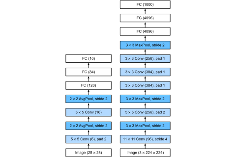
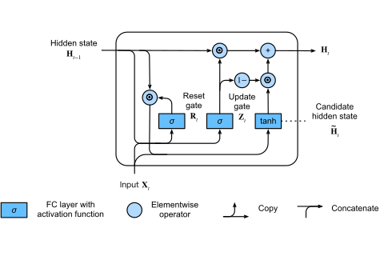
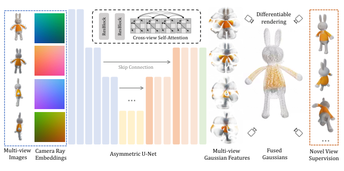
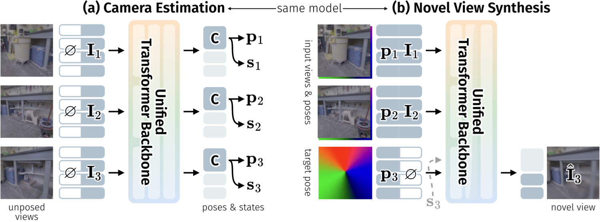

# 素材总目录

[Teaser](examples/teasers/README.md) · [Architecture](examples/architectures/README.md) · [Element](elements/README.md) · [仓库首页](README.md) · [JSON 来源索引](catalog.json)

按图的用途分类，会议、年份与 Oral 仅作为条目标签。完整范例与最小元素通过 [Markdown 对照表](elements/with-examples.md) 互相连接。

| 类别 | 数量 | 入口 |
|---|---:|---|
| Teaser 范例 | 13 | [浏览](examples/teasers/README.md) |
| Architecture 范例 | 35 | [浏览](examples/architectures/README.md) |
| Element 最小可复用元素 | 317 | [按内容与来源浏览](elements/README.md) |

完整机制参考由 Element 页链接，版式母版由 Architecture 页链接，均单独计数。

## Teaser 范例

### [Uneven Double Refraction：原型与成像能力展示](examples/teasers/birefractive-rgbd/README.md)

相机原型、输入、恢复彩色图和深度图横排，适合硬件或成像方法的 teaser。

来源类型：论文范例。许可：MIT（来源仓库）；照片与实验结果按原来源保留。。
[原文件](examples/teasers/birefractive-rgbd/source.svg) · [来源记录](examples/teasers/birefractive-rgbd/metadata.json)

### [CUT3R · 静态、动态与稀疏照片三类场景](examples/teasers/cut3r-capabilities/README.md)

三列分别说明输入场景和重建能力，借助同一版式把连续三维感知的应用范围讲清楚。

CVPR 2025 · Oral · 矢量 + 原有位图

来源类型：论文范例。许可：CC-BY-4.0。
[原文件](examples/teasers/cut3r-capabilities/source.svg) · [来源记录](examples/teasers/cut3r-capabilities/metadata.json)

### [DECOLLAGE：局部风格控制与三维细化](examples/teasers/decollage/README.md)

从粗体素结构出发，用不同示例为局部赋予风格，再展示细化结果。作者的首屏 teaser，包含原始矢量箭头与嵌入渲染图。

来源类型：论文范例。许可：MIT。
[原文件](examples/teasers/decollage/source.svg) · [来源记录](examples/teasers/decollage/metadata.json)

### [DPO · RLHF 与直接偏好优化的流程简化](examples/teasers/dpo-comparison/README.md)

左右两块使用同一输入与终点，只改变中间步骤；简化过程本身就是论文的主要观点。

NeurIPS 2023 · Oral · 整图位图，仅构图参考

来源类型：论文范例。许可：CC-BY-4.0。
[原文件](examples/teasers/dpo-comparison/source.png) · [来源记录](examples/teasers/dpo-comparison/metadata.json)

### [DreamGaussian · 生成能力与优化进程同图展示](examples/teasers/dreamgaussian-progress/README.md)

上方多视角结果说明输出能力，下方时间序列展示从模糊到成形的优化过程，让效率与质量成为同一视觉叙事。

ICLR 2024 · Oral · 矢量 + 原有位图

来源类型：论文范例。许可：作者保留权利 / 参考收录。
[原文件](examples/teasers/dreamgaussian-progress/source.svg) · [来源记录](examples/teasers/dreamgaussian-progress/metadata.json)

### [Genie · 不同提示生成可交互世界](examples/teasers/genie-interaction/README.md)

左侧三种输入沿统一箭头进入模型，右侧按动作展示连续变化；一张图同时回答输入是什么、输出是什么、为什么可交互。

ICML 2024 · Oral · 矢量 + 原有位图

来源类型：论文范例。许可：作者保留权利 / 参考收录。
[原文件](examples/teasers/genie-interaction/source.svg) · [来源记录](examples/teasers/genie-interaction/metadata.json)

### [K-LoRA：主体风格组合与训练范式比较](examples/teasers/k-lora/README.md)

左侧主体与风格组合示例，右侧比较需要训练与免训练的融合方式。

来源类型：论文范例。许可：作者 README 声明 CC BY-NC 4.0；内嵌示例素材保留原出处。。
[原文件](examples/teasers/k-lora/source.svg) · [来源记录](examples/teasers/k-lora/metadata.json)

### [LightGlue：速度与精度权衡](examples/teasers/lightglue-tradeoff/README.md)

准确率与吞吐量的权衡作为论文的贡献展示，比较固定深度、动态深度与既有方法。它属于结果型 teaser。

来源类型：论文范例。许可：Apache-2.0。
[原文件](examples/teasers/lightglue-tradeoff/source.svg) · [来源记录](examples/teasers/lightglue-tradeoff/metadata.json)

### [OrienterNet：用二维地图定位的任务与动机](examples/teasers/orienternet/README.md)

展示人类使用二维地图与既有三维点云定位的差别，再给出新方法的输入与输出。

来源类型：论文范例。许可：第三方图片与地图包含多种权利；图本身未见单独复用授权。。
[原文件](examples/teasers/orienternet/source.svg) · [来源记录](examples/teasers/orienternet/metadata.json)

### [RayDer：数据瓶颈与新训练范式](examples/teasers/rayder-concept/README.md)

数据金字塔、训练过程、结果与规模变化并列，先说明问题和核心差异。

来源类型：论文范例。许可：保存仓库原许可证；用途限于其原有条款。。
[原文件](examples/teasers/rayder-concept/source.svg) · [来源记录](examples/teasers/rayder-concept/metadata.json)

### [ShaDDR：粗形状与示例驱动的成果展示](examples/teasers/shaddr/README.md)

上排粗形状与风格示例，下排生成结果与局部放大，以成果直接展示任务和贡献。

来源类型：论文范例。许可：MIT（来源仓库）；渲染素材保留原论文出处。。
[原文件](examples/teasers/shaddr/source.svg) · [来源记录](examples/teasers/shaddr/metadata.json)

### [VAR · 从逐 token 到逐尺度生成的范式对照](examples/teasers/var-paradigm/README.md)

同一张图比较语言自回归、图像逐 token 生成和逐尺度生成，核心差异直接表现为生成顺序与尺度变化。

NeurIPS 2024 · Oral · 矢量 + 原有位图

来源类型：论文范例。许可：CC0-1.0。
[原文件](examples/teasers/var-paradigm/source.svg) · [来源记录](examples/teasers/var-paradigm/metadata.json)

### [VGGT · 多视图输入与统一三维感知能力](examples/teasers/vggt-capabilities/README.md)

用一个大型三维场景作为视觉中心，两侧安排输入与多种输出，让读者先理解方法能做什么。

CVPR 2025 · Oral · 矢量 + 原有位图

来源类型：论文范例。许可：作者保留权利 / 参考收录。
[原文件](examples/teasers/vggt-capabilities/source.svg) · [来源记录](examples/teasers/vggt-capabilities/metadata.json)

## Architecture 范例

辅助入口：[原生 AI / AIT 版式母版](templates/layouts/README.md)。

### [CLIP Figure 1：训练到零样本预测](examples/architectures/clip/README.md)

CLIP 的训练与零样本使用流程，按方法流程归入 architecture。

来源类型：论文范例。许可：arXiv non-exclusive distribution license。
[原文件](examples/architectures/clip/source.svg) · [来源记录](examples/architectures/clip/metadata.json)

### [CUT3R · 持久状态的更新、读取与未见视角推断](examples/architectures/cut3r-architecture/README.md)

左侧按时间展开状态更新，右侧用独立色块解释状态读取；重建结果紧邻对应计算步骤。

CVPR 2025 · Oral · 矢量 + 原有位图

来源类型：论文范例。许可：CC-BY-4.0。
[原文件](examples/architectures/cut3r-architecture/source.svg) · [来源记录](examples/architectures/cut3r-architecture/metadata.json)

### [D2L · AlexNet](examples/architectures/d2l-alexnet/README.md)

D2L 教材作者提供的原始矢量图，适合借鉴结构与模块表达；明确作为教材范例收录。

来源类型：教材或教程范例。许可：CC-BY-SA-4.0。
[原文件](examples/architectures/d2l-alexnet/source.svg) · [来源记录](examples/architectures/d2l-alexnet/metadata.json)

### [D2L · DenseNet 密集连接块](examples/architectures/d2l-densenet-block/README.md)

D2L 教材作者提供的原始矢量图，适合借鉴结构与模块表达；明确作为教材范例收录。

来源类型：教材或教程范例。许可：CC-BY-SA-4.0。
[原文件](examples/architectures/d2l-densenet-block/source.svg) · [来源记录](examples/architectures/d2l-densenet-block/metadata.json)

### [D2L · 编码器—解码器](examples/architectures/d2l-encoder-decoder/README.md)

D2L 教材作者提供的原始矢量图，适合借鉴结构与模块表达；明确作为教材范例收录。

来源类型：教材或教程范例。许可：CC-BY-SA-4.0。
[原文件](examples/architectures/d2l-encoder-decoder/source.svg) · [来源记录](examples/architectures/d2l-encoder-decoder/metadata.json)

### [D2L · 全卷积网络](examples/architectures/d2l-fcn/README.md)

D2L 教材作者提供的原始矢量图，适合借鉴结构与模块表达；明确作为教材范例收录。

来源类型：教材或教程范例。许可：CC-BY-SA-4.0。
[原文件](examples/architectures/d2l-fcn/source.svg) · [来源记录](examples/architectures/d2l-fcn/metadata.json)

### [D2L · 生成对抗网络](examples/architectures/d2l-gan/README.md)

D2L 教材作者提供的原始矢量图，适合借鉴结构与模块表达；明确作为教材范例收录。

来源类型：教材或教程范例。许可：CC-BY-SA-4.0。
[原文件](examples/architectures/d2l-gan/source.svg) · [来源记录](examples/architectures/d2l-gan/metadata.json)

### [D2L · GRU 内部门控](examples/architectures/d2l-gru-3/README.md)

D2L 教材作者提供的原始矢量图，适合借鉴结构与模块表达；明确作为教材范例收录。

来源类型：教材或教程范例。许可：CC-BY-SA-4.0。
[原文件](examples/architectures/d2l-gru-3/source.svg) · [来源记录](examples/architectures/d2l-gru-3/metadata.json)

### [D2L · Inception 并行分支](examples/architectures/d2l-inception/README.md)

D2L 教材作者提供的原始矢量图，适合借鉴结构与模块表达；明确作为教材范例收录。

来源类型：教材或教程范例。许可：CC-BY-SA-4.0。
[原文件](examples/architectures/d2l-inception/source.svg) · [来源记录](examples/architectures/d2l-inception/metadata.json)

### [D2L · LeNet](examples/architectures/d2l-lenet/README.md)

D2L 教材作者提供的原始矢量图，适合借鉴结构与模块表达；明确作为教材范例收录。

来源类型：教材或教程范例。许可：CC-BY-SA-4.0。
[原文件](examples/architectures/d2l-lenet/source.svg) · [来源记录](examples/architectures/d2l-lenet/metadata.json)

### [D2L · LSTM 内部门控](examples/architectures/d2l-lstm-3/README.md)

D2L 教材作者提供的原始矢量图，适合借鉴结构与模块表达；明确作为教材范例收录。

来源类型：教材或教程范例。许可：CC-BY-SA-4.0。
[原文件](examples/architectures/d2l-lstm-3/source.svg) · [来源记录](examples/architectures/d2l-lstm-3/metadata.json)

### [D2L · 多层感知机](examples/architectures/d2l-mlp/README.md)

D2L 教材作者提供的原始矢量图，适合借鉴结构与模块表达；明确作为教材范例收录。

来源类型：教材或教程范例。许可：CC-BY-SA-4.0。
[原文件](examples/architectures/d2l-mlp/source.svg) · [来源记录](examples/architectures/d2l-mlp/metadata.json)

### [D2L · ResNet 残差块](examples/architectures/d2l-resnet-block/README.md)

D2L 教材作者提供的原始矢量图，适合借鉴结构与模块表达；明确作为教材范例收录。

来源类型：教材或教程范例。许可：CC-BY-SA-4.0。
[原文件](examples/architectures/d2l-resnet-block/source.svg) · [来源记录](examples/architectures/d2l-resnet-block/metadata.json)

### [D2L · ResNeXt 分组残差块](examples/architectures/d2l-resnext-block/README.md)

D2L 教材作者提供的原始矢量图，适合借鉴结构与模块表达；明确作为教材范例收录。

来源类型：教材或教程范例。许可：CC-BY-SA-4.0。
[原文件](examples/architectures/d2l-resnext-block/source.svg) · [来源记录](examples/architectures/d2l-resnext-block/metadata.json)

### [D2L · 带注意力的 Seq2Seq](examples/architectures/d2l-seq2seq-attention/README.md)

D2L 教材作者提供的原始矢量图，适合借鉴结构与模块表达；明确作为教材范例收录。

来源类型：教材或教程范例。许可：CC-BY-SA-4.0。
[原文件](examples/architectures/d2l-seq2seq-attention/source.svg) · [来源记录](examples/architectures/d2l-seq2seq-attention/metadata.json)

### [D2L · Transformer 编码器与解码器](examples/architectures/d2l-transformer/README.md)

D2L 教材作者提供的原始矢量图，适合借鉴结构与模块表达；明确作为教材范例收录。

来源类型：教材或教程范例。许可：CC-BY-SA-4.0。
[原文件](examples/architectures/d2l-transformer/source.svg) · [来源记录](examples/architectures/d2l-transformer/metadata.json)

### [D2L · VGG](examples/architectures/d2l-vgg/README.md)

D2L 教材作者提供的原始矢量图，适合借鉴结构与模块表达；明确作为教材范例收录。

来源类型：教材或教程范例。许可：CC-BY-SA-4.0。
[原文件](examples/architectures/d2l-vgg/source.svg) · [来源记录](examples/architectures/d2l-vgg/metadata.json)

### [D2L · Vision Transformer](examples/architectures/d2l-vit/README.md)

D2L 教材作者提供的原始矢量图，适合借鉴结构与模块表达；明确作为教材范例收录。

来源类型：教材或教程范例。许可：CC-BY-SA-4.0。
[原文件](examples/architectures/d2l-vit/source.svg) · [来源记录](examples/architectures/d2l-vit/metadata.json)

### [DiT · 整体主干与三种条件注入模块](examples/architectures/dit-architecture/README.md)

左侧给完整主干，右侧展开 block 变体；推荐模块使用更高视觉对比，完整展示论文的结构选择。

ICCV 2023 · Oral · 矢量结构

来源类型：论文范例。许可：CC-BY-4.0。
[原文件](examples/architectures/dit-architecture/source.svg) · [来源记录](examples/architectures/dit-architecture/metadata.json)

### [DreamGaussian · 高斯生成、网格提取与纹理细化](examples/architectures/dreamgaussian-architecture/README.md)

三个带编号的区域分别解释表示初始化、表示转换和后续细化，同时把不同损失放在对应优化回路内。

ICLR 2024 · Oral · 矢量 + 原有位图

来源类型：论文范例。许可：作者保留权利 / 参考收录。
[原文件](examples/architectures/dreamgaussian-architecture/source.svg) · [来源记录](examples/architectures/dreamgaussian-architecture/metadata.json)

### [3D Gaussian Splatting · 优化与光栅化双向流程](examples/architectures/gaussian-splatting-architecture/README.md)

黑色实线和蓝色箭头分别表达正向操作与梯度回传，让自适应密度控制与可微渲染的关系无需依赖长图注。

SIGGRAPH 2023 · 会议论文，未核实 Oral · 矢量 + 原有位图

来源类型：论文范例。许可：CC-BY-4.0。
[原文件](examples/architectures/gaussian-splatting-architecture/source.svg) · [来源记录](examples/architectures/gaussian-splatting-architecture/metadata.json)

### [Genie · 视频 tokenizer、潜在动作与动力学模型](examples/architectures/genie-architecture/README.md)

只保留三个核心模块，视频 tokens 与潜在动作分别编码后汇入动力学模型；简单分支就讲清训练信息来源。

ICML 2024 · Oral · 整图位图，仅构图参考

来源类型：论文范例。许可：作者保留权利 / 参考收录。
[原文件](examples/architectures/genie-architecture/source.png) · [来源记录](examples/architectures/genie-architecture/metadata.json)

### [Instant NGP · 多分辨率哈希编码到 MLP](examples/architectures/instant-ngp-hash-architecture/README.md)

通过五个编号步骤，将空间采样、哈希查表、插值、拼接与网络连接起来；不同尺度的颜色可贯穿整张图。

SIGGRAPH 2022 · 会议论文，未核实 Oral · 矢量 + 原有位图

来源类型：论文范例。许可：作者保留权利 / 参考收录。
[原文件](examples/architectures/instant-ngp-hash-architecture/source.svg) · [来源记录](examples/architectures/instant-ngp-hash-architecture/metadata.json)

### [LAV：感知、预测与驾驶控制流程](examples/architectures/lav/README.md)

多摄像头输入、语义分割、传感器融合、三维主干、运动预测与控制的整体数据流。原文件虽叫 teaser.svg，按内容归入 architecture。

来源类型：论文范例。许可：Apache-2.0（来源仓库）。。
[原文件](examples/architectures/lav/source.svg) · [来源记录](examples/architectures/lav/metadata.json)

### [LGM · 非对称 U-Net 与跨视角注意力](examples/architectures/lgm-architecture/README.md)

把多视图输入、相机射线编码、U-Net、三维融合和监督闭环放在一张图里；顶部局部放大说明跨视角交互。

ECCV 2024 · Oral · 矢量 + 原有位图

来源类型：论文范例。许可：作者保留权利 / 参考收录。
[原文件](examples/architectures/lgm-architecture/source.svg) · [来源记录](examples/architectures/lgm-architecture/metadata.json)

### [LGM · 从文本或图像到三维高斯和网格的流程](examples/architectures/lgm-pipeline/README.md)

用少量大模块完成端到端说明，同时把各阶段耗时直接放在阶段下方，适合紧凑的方法总览。

ECCV 2024 · Oral · 矢量 + 原有位图

来源类型：论文范例。许可：作者保留权利 / 参考收录。
[原文件](examples/architectures/lgm-pipeline/source.svg) · [来源记录](examples/architectures/lgm-pipeline/metadata.json)

### [LightGlue：注意力、动态剪枝与匹配](examples/architectures/lightglue/README.md)

双分支局部特征经过 self/cross attention、置信度预测、剪枝和匹配分配。

来源类型：论文范例。许可：Apache-2.0（来源仓库）。。
[原文件](examples/architectures/lightglue/source.svg) · [来源记录](examples/architectures/lightglue/metadata.json)

### [多尺度网络总览与模块展开](examples/architectures/multiscale-network/README.md)

作者 Illustrator 科研绘图教程中的多尺度网络案例：Backbone、高低层特征、SPPA／LFSA／GMFF 模块、预测结果，以及模块细节。原文件含 7 个画板。

来源类型：教材或教程范例。许可：未发现明确 LICENSE。
[原文件](examples/architectures/multiscale-network/source.ai) · [来源记录](examples/architectures/multiscale-network/metadata.json)

### [RayDer：统一 Transformer 的两个使用阶段](examples/architectures/rayder/README.md)

左右并列相机估计与新视角合成，清楚标明共用模型与不同输入输出。

来源类型：论文范例。许可：保存仓库原许可证；用途限于其原有条款。。
[原文件](examples/architectures/rayder/source.svg) · [来源记录](examples/architectures/rayder/metadata.json)

### [RUST：编码器、场景表示与位姿分支](examples/architectures/rust/README.md)

无位姿输入图像经 Encoder、场景表示、Decoder 输出新视角，训练时有 Pose Estimator 分支。按内容归入 architecture。

来源类型：论文范例。许可：项目仓库未发现 LICENSE；仅作出处明确的参考，元素提取不新增授权。。
[原文件](examples/architectures/rust/source.svg) · [来源记录](examples/architectures/rust/metadata.json)

### [SAM / LoRA 总体流程与 Transformer 模块](examples/architectures/sam-lora/README.md)

作者 Illustrator 科研绘图教程中的 SAM / LoRA 案例，含总体方法流程与 Transformer／LoRA 模块结构，共 2 个画板；公开的 PNG、PDF 与 PPTX 配套素材一并保留。

来源类型：教材或教程范例。许可：未发现明确 LICENSE。
[原文件](examples/architectures/sam-lora/source.ai) · [来源记录](examples/architectures/sam-lora/metadata.json)

### [SD3 · 双模态主干与 MM-DiT block 展开](examples/architectures/sd3-mmdit-architecture/README.md)

左侧说明文本与图像条件如何进入主干，右侧以对称双路结构展开联合注意力，颜色和符号在两部分保持一致。

ICML 2024 · Oral · 矢量结构

来源类型：论文范例。许可：作者保留权利 / 参考收录。
[原文件](examples/architectures/sd3-mmdit-architecture/source.svg) · [来源记录](examples/architectures/sd3-mmdit-architecture/metadata.json)

### [VAR · 多尺度 VQVAE 与 VAR 两阶段训练](examples/architectures/var-architecture/README.md)

两块并列区域分别解释表示学习和自回归训练，尺度、token 序列和因果 mask 的对应关系可在图中追踪。

NeurIPS 2024 · Oral · 矢量 + 原有位图

来源类型：论文范例。许可：CC0-1.0。
[原文件](examples/architectures/var-architecture/source.svg) · [来源记录](examples/architectures/var-architecture/metadata.json)

### [VGGT · 交替注意力主干与多任务输出头](examples/architectures/vggt-architecture/README.md)

整图始终沿左到右阅读；颜色区分 token，虚线框标出重复主干，右侧分组展开输出任务。

CVPR 2025 · Oral · 矢量 + 原有位图

来源类型：论文范例。许可：作者保留权利 / 参考收录。
[原文件](examples/architectures/vggt-architecture/source.svg) · [来源记录](examples/architectures/vggt-architecture/metadata.json)

### [ViT 原论文 · 图像分块、token 序列与编码器展开](examples/architectures/vit-original-architecture/README.md)

输入图像、patch 序列、位置编码和分类 token 都有直观的对应关系；右侧独立展开重复的 Transformer 编码器。

ICLR 2021 · Oral · 矢量 + 原有位图

来源类型：论文范例。许可：作者保留权利 / 参考收录。
[原文件](examples/architectures/vit-original-architecture/source.svg) · [来源记录](examples/architectures/vit-original-architecture/metadata.json)

## Element

[元素分类目录](elements/README.md) · [范例与元素对照表](elements/with-examples.md) · [离线检索](elements/gallery.html)

辅助入口：[完整机制参考](references/mechanisms/README.md)。这些完整机制图不计入最小元素数量。
