# 素材总目录

[Teaser](teaser/README.md) · [Architecture](architecture/README.md) · [大图](multipanel/README.md) · [Element](element/README.md) · [仓库首页](README.md) · [JSON 来源索引](catalog.json)

按图的用途分类，会议、年份与 Oral 仅作为条目标签。完整范例与最小元素通过 [Markdown 对照表](element/with-examples.md) 互相连接。

| 类别 | 数量 | 入口 |
|---|---:|---|
| Teaser 范例 | 76 | [浏览](teaser/README.md) |
| Architecture 范例 | 69 | [浏览](architecture/README.md) |
| 多面板大图 | 22 | [浏览](multipanel/README.md) |
| Element 最小可复用元素 | 392 | [按内容与来源浏览](element/README.md) |

完整机制参考由 Element 页链接，版式母版由 Architecture 页链接，均单独计数。

## Teaser 范例

### [3DETR · 输入点云、注意力与检测结果的对应](teaser/3detr-attention-teaser/README.md)

每一行沿输入点云、解码器注意力、检测结果排列，直接展示模型如何把空间关注区域与目标实例联系起来。

ICCV 2021 · Oral · 矢量 + 原有位图

来源类型：论文范例。许可：作者保留权利 / 参考收录。
[原文件](teaser/3detr-attention-teaser/source.svg) · [来源记录](teaser/3detr-attention-teaser/metadata.json)

### [Uneven Double Refraction：原型与成像能力展示](teaser/birefractive-rgbd/README.md)

相机原型、输入、恢复彩色图和深度图横排，适合硬件或成像方法的 teaser。

来源类型：论文范例。许可：MIT（来源仓库）；照片与实验结果按原来源保留。。
[原文件](teaser/birefractive-rgbd/source.svg) · [来源记录](teaser/birefractive-rgbd/metadata.json)

### [Cortex · 生物系统巩固与模型记忆巩固类比](teaser/cortex-memory-consolidation/README.md)

左侧用海马体、睡眠与新皮层说明生物系统巩固；右侧并列展示带上下文的模型与巩固后的模型，以高亮 FFN／MoE 变化解释将上下文收益写入参数的目标。

arXiv 2026 · 预印本 · 矢量 + 原有位图

来源类型：论文范例。许可：作者保留权利 / 私有参考。
[原文件](teaser/cortex-memory-consolidation/original.pdf) · [来源记录](teaser/cortex-memory-consolidation/metadata.json)

### [CUT3R · 静态、动态与稀疏照片三类场景](teaser/cut3r-capabilities/README.md)

三列分别说明输入场景和重建能力，借助同一版式把连续三维感知的应用范围讲清楚。

CVPR 2025 · Oral · 矢量 + 原有位图

来源类型：论文范例。许可：CC-BY-4.0。
[原文件](teaser/cut3r-capabilities/source.svg) · [来源记录](teaser/cut3r-capabilities/metadata.json)

### [DECOLLAGE：局部风格控制与三维细化](teaser/decollage/README.md)

从粗体素结构出发，用不同示例为局部赋予风格，再展示细化结果。作者的首屏 teaser，包含原始矢量箭头与嵌入渲染图。

来源类型：论文范例。许可：MIT。
[原文件](teaser/decollage/source.svg) · [来源记录](teaser/decollage/metadata.json)

### [DPO · RLHF 与直接偏好优化的流程简化](teaser/dpo-comparison/README.md)

左右两块使用同一输入与终点，只改变中间步骤；简化过程本身就是论文的主要观点。

NeurIPS 2023 · Oral · 整图位图，仅构图参考

来源类型：论文范例。许可：CC-BY-4.0。
[原文件](teaser/dpo-comparison/source.png) · [来源记录](teaser/dpo-comparison/metadata.json)

### [DreamGaussian · 生成能力与优化进程同图展示](teaser/dreamgaussian-progress/README.md)

上方多视角结果说明输出能力，下方时间序列展示从模糊到成形的优化过程，让效率与质量成为同一视觉叙事。

ICLR 2024 · Oral · 矢量 + 原有位图

来源类型：论文范例。许可：作者保留权利 / 参考收录。
[原文件](teaser/dreamgaussian-progress/source.svg) · [来源记录](teaser/dreamgaussian-progress/metadata.json)

### [Genie · 不同提示生成可交互世界](teaser/genie-interaction/README.md)

左侧三种输入沿统一箭头进入模型，右侧按动作展示连续变化；一张图同时回答输入是什么、输出是什么、为什么可交互。

ICML 2024 · Oral · 矢量 + 原有位图

来源类型：论文范例。许可：作者保留权利 / 参考收录。
[原文件](teaser/genie-interaction/source.svg) · [来源记录](teaser/genie-interaction/metadata.json)

### [HippoRAG · 普通 RAG、人类记忆与海马索引对照](teaser/hipporag-human-memory-comparison/README.md)

三行共享同一索引与问答任务，比较普通 RAG、人类记忆和 HippoRAG；脑区高亮、知识关联和答案对错一起解释方法动机。

NeurIPS 2024 · 会议论文，未核实 Oral · 矢量 + 原有位图

[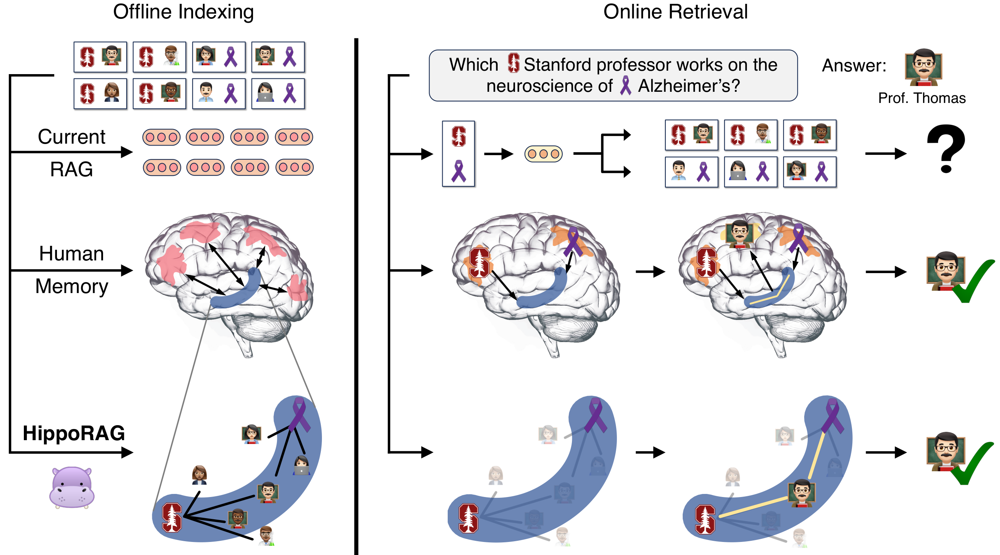](teaser/hipporag-human-memory-comparison/original.pdf)

来源类型：论文范例。许可：作者保留权利 / 私有参考。
[原文件](teaser/hipporag-human-memory-comparison/original.pdf) · [来源记录](teaser/hipporag-human-memory-comparison/metadata.json)

### [K-LoRA：主体风格组合与训练范式比较](teaser/k-lora/README.md)

左侧主体与风格组合示例，右侧比较需要训练与免训练的融合方式。

来源类型：论文范例。许可：作者 README 声明 CC BY-NC 4.0；内嵌示例素材保留原出处。。
[原文件](teaser/k-lora/source.svg) · [来源记录](teaser/k-lora/metadata.json)

### [LightGlue：速度与精度权衡](teaser/lightglue-tradeoff/README.md)

准确率与吞吐量的权衡作为论文的贡献展示，比较固定深度、动态深度与既有方法。它属于结果型 teaser。

来源类型：论文范例。许可：Apache-2.0。
[原文件](teaser/lightglue-tradeoff/source.svg) · [来源记录](teaser/lightglue-tradeoff/metadata.json)

### [LightMem · 原始记忆流水线与主题过滤、睡眠更新对照](teaser/lightmem-memory-construction-comparison/README.md)

上下对照展示冗余输入、反复构建与在线更新，以及先过滤、按主题组织、离线统一更新的改变；具体记忆项和动作贯穿对照。

ICLR 2026 · 会议论文，未核实 Oral · 整图位图，仅构图参考

[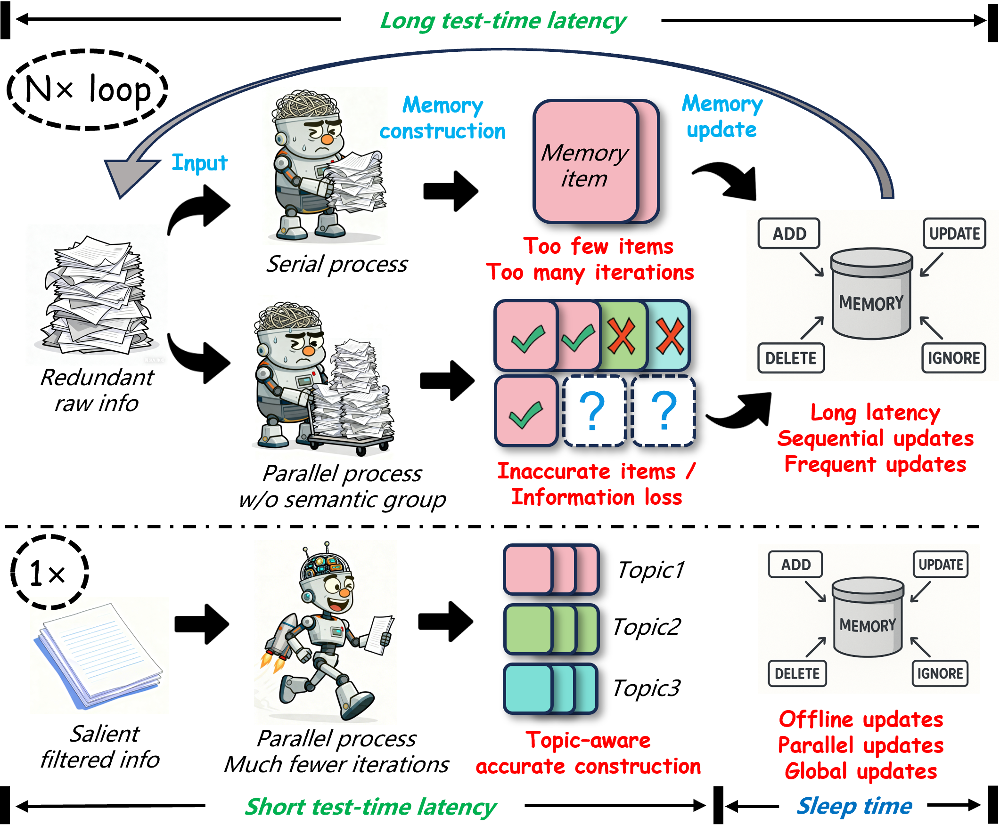](teaser/lightmem-memory-construction-comparison/original.png)

来源类型：论文范例。许可：作者保留权利 / 私有参考。
[原文件](teaser/lightmem-memory-construction-comparison/original.png) · [来源记录](teaser/lightmem-memory-construction-comparison/metadata.json)

### [MemoryVLA · 人类记忆类比、方法与性能首图](teaser/memoryvla-cognition-memory-action/README.md)

以时间混淆问题为动机，对照人类的工作记忆与情景记忆、MemoryVLA 的感知—认知记忆机制，底部再放四组性能对照与机器人任务示例。

ICLR 2026 · 会议论文，未核实 Oral · 矢量 + 原有位图

来源类型：论文范例。许可：作者保留权利 / 私有参考。
[原文件](teaser/memoryvla-cognition-memory-action/original.pdf) · [来源记录](teaser/memoryvla-cognition-memory-action/metadata.json)

### [MemOS · LLM 记忆、人类类比与可管理记忆三阶段](teaser/memos-memory-evolution-three-stages/README.md)

弧形带状构图依次放入记忆类型坐标、人类脑区类比和记忆管理操作，用统一视线解释从记忆定义到系统管理的转变。

arXiv 2025 · 预印本 · 矢量 + 原有位图

来源类型：论文范例。许可：CC BY 4.0（所收录论文版本）。
[原文件](teaser/memos-memory-evolution-three-stages/original.pdf) · [来源记录](teaser/memos-memory-evolution-three-stages/metadata.json)

### [MemOS · 文本、激活与参数记忆的双向转化](teaser/memos-three-memory-consolidation-paths/README.md)

文本、激活和参数记忆采用同一医疗例子，三栏之间以不同路径说明编码、解码、缓存、微调和参数解码，上下长箭头概括巩固与激活方向。

arXiv 2025 · 预印本 · 矢量 + 原有位图

[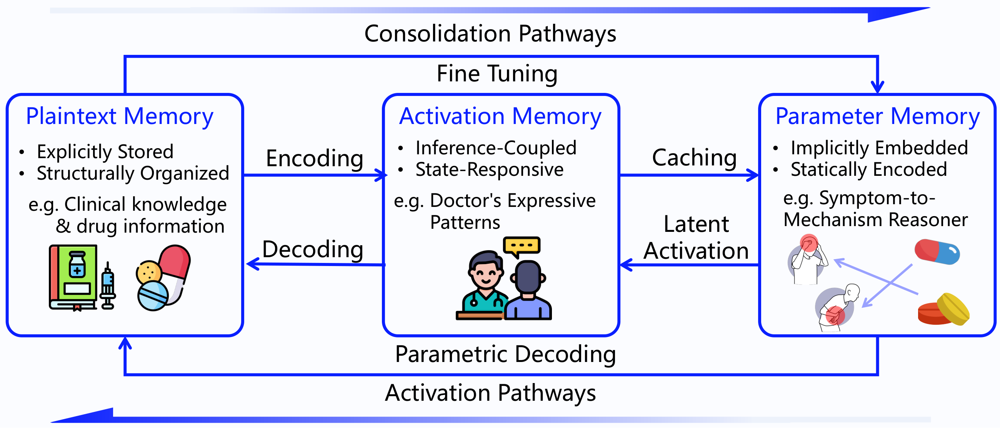](teaser/memos-three-memory-consolidation-paths/original.pdf)

来源类型：论文范例。许可：CC BY 4.0（所收录论文版本）。
[原文件](teaser/memos-three-memory-consolidation-paths/original.pdf) · [来源记录](teaser/memos-three-memory-consolidation-paths/metadata.json)

### [MVSplat · 重建质量、速度与参数量的并列对照](teaser/mvsplat-comparison/README.md)

用同一输入将两种方法的三维外观和深度排在两侧，中央小图直接补充速度与参数量，使定性效果和成本在同一个版式中对齐。

ECCV 2024 · Oral · 矢量 + 原有位图

[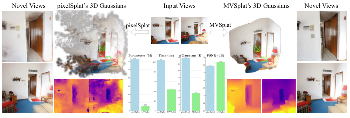](teaser/mvsplat-comparison/source.svg)

来源类型：论文范例。许可：CC-BY-4.0。
[原文件](teaser/mvsplat-comparison/source.svg) · [来源记录](teaser/mvsplat-comparison/metadata.json)

### [OrienterNet：用二维地图定位的任务与动机](teaser/orienternet/README.md)

展示人类使用二维地图与既有三维点云定位的差别，再给出新方法的输入与输出。

来源类型：论文范例。许可：第三方图片与地图包含多种权利；图本身未见单独复用授权。。
[原文件](teaser/orienternet/source.svg) · [来源记录](teaser/orienternet/metadata.json)

### [PBDL · 领域位置与方法空间的概念总览](teaser/pbdl-field-method-space/README.md)

左侧用机器学习、数值方法与物理的交集定位领域，右侧展开正反问题以及数据驱动、物理损失和混合方法，形成从领域位置到方法空间的概念总览。

[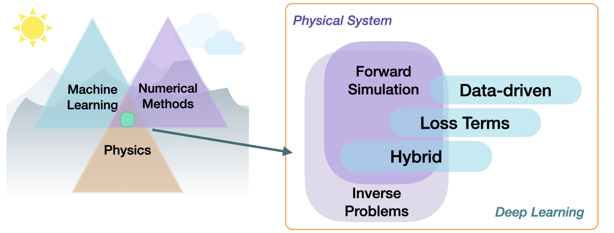](teaser/pbdl-field-method-space/source.jpg)

来源类型：教材或教程范例。许可：Apache-2.0。
[原文件](teaser/pbdl-field-method-space/source.jpg) · [来源记录](teaser/pbdl-field-method-space/metadata.json)

### [RayDer：数据瓶颈与新训练范式](teaser/rayder-concept/README.md)

数据金字塔、训练过程、结果与规模变化并列，先说明问题和核心差异。

来源类型：论文范例。许可：保存仓库原许可证；用途限于其原有条款。。
[原文件](teaser/rayder-concept/source.svg) · [来源记录](teaser/rayder-concept/metadata.json)

### [SAM 2 · 任务、模型与数据引擎三联概念图](teaser/sam2-task-model-data/README.md)

三个并列区域分别回答方法解决什么任务、依靠什么模型、数据如何形成闭环，任务、模型与数据之间还有明确的对应连线。

ICLR 2025 · Oral · 矢量 + 原有位图

[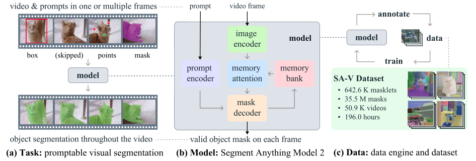](teaser/sam2-task-model-data/source.svg)

来源类型：论文范例。许可：作者保留权利 / 参考收录。
[原文件](teaser/sam2-task-model-data/source.svg) · [来源记录](teaser/sam2-task-model-data/metadata.json)

### [ShaDDR：粗形状与示例驱动的成果展示](teaser/shaddr/README.md)

上排粗形状与风格示例，下排生成结果与局部放大，以成果直接展示任务和贡献。

来源类型：论文范例。许可：MIT（来源仓库）；渲染素材保留原论文出处。。
[原文件](teaser/shaddr/source.svg) · [来源记录](teaser/shaddr/metadata.json)

### [3D 生成概念地图 · 表示、学习目标与生成范式](teaser/survey-3d-representation-generators/README.md)

以表示与生成模型的双向关系为中心，左侧用同一兔子示例比较多种 3D 表示，右侧比较 VAE、GAN、扩散和自回归，上下分别列训练目标与采样方式，信息组织完整。

arXiv 2026 · 预印本 · 综述 · 矢量 + 原有位图

来源类型：论文范例。许可：作者保留权利 / 私有参考。
[原文件](teaser/survey-3d-representation-generators/original.pdf) · [来源记录](teaser/survey-3d-representation-generators/metadata.json)

### [世界模型数据集图谱 · 蛇形时间路与模态卡片](teaser/survey-3d4d-dataset-roadmap/README.md)

沿蛇形路线组织数据集年代，每张卡片复用名称、年份、模态图标和样例图四层信息；时间顺序、视觉差异和模态范围可以一起阅读。

arXiv 2025 · 预印本 · 综述 · 矢量 + 原有位图

来源类型：论文范例。许可：CC-BY-SA-4.0。
[原文件](teaser/survey-3d4d-dataset-roadmap/original.pdf) · [来源记录](teaser/survey-3d4d-dataset-roadmap/metadata.json)

### [3D／4D 世界模型方法地图 · 三棵功能树](teaser/survey-3d4d-method-tree/README.md)

把 VideoGen、OccGen、LiDARGen 画成三组有主干和侧枝的研究地图，在分支处标出数据引擎、动作解释、场景表征和预测等功能，兼顾密集代表工作与整体方向。

arXiv 2025 · 预印本 · 综述 · 矢量 + 原有位图

来源类型：论文范例。许可：CC-BY-SA-4.0。
[原文件](teaser/survey-3d4d-method-tree/original.pdf) · [来源记录](teaser/survey-3d4d-method-tree/metadata.json)

### [3D／4D 世界模型 · 场景与研究维度全景](teaser/survey-3d4d-world-overview/README.md)

左边用可识别的三维街景建立主题，右边用重复的窄栏展开定义、方法、数据与评估、应用和未来方向；VideoGen、OccGen、LiDARGen 的图标贯穿多个维度，视觉与内容都有明确对应。

arXiv 2025 · 预印本 · 综述 · 矢量 + 原有位图

来源类型：论文范例。许可：CC-BY-SA-4.0。
[原文件](teaser/survey-3d4d-world-overview/original.pdf) · [来源记录](teaser/survey-3d4d-world-overview/metadata.json)

### [3DGS 应用全景 · 中心主题与场景分支](teaser/survey-3dgs-application-landscape/README.md)

以中心主题连接机器人、动态场景、生成编辑、化身、内窥镜、场景重建和物理等分支，并把少量视觉实例放进分支旁，兼顾分类和直观性。

ACM Computing Surveys 2026 · 期刊论文 · 综述 · 矢量 + 原有位图

[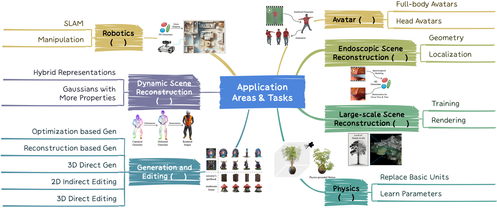](teaser/survey-3dgs-application-landscape/original.pdf)

来源类型：论文范例。许可：CC-BY-4.0。
[原文件](teaser/survey-3dgs-application-landscape/original.pdf) · [来源记录](teaser/survey-3dgs-application-landscape/metadata.json)

### [3DGS 编辑应用 · 5 组子图与上下前后对照](teaser/survey-3dgs-editing-operations/README.md)

5 组操作横向排开，上排原视图、下排编辑结果；视频编辑保留连续帧，风格迁移加入参考图，统一对照逻辑又允许各组呈现必要细节。

arXiv 2025 · 预印本 · 综述 · 矢量 + 原有位图

来源类型：论文范例。许可：作者保留权利 / 私有参考。
[原文件](teaser/survey-3dgs-editing-operations/original.pdf) · [来源记录](teaser/survey-3dgs-editing-operations/metadata.json)

### [3DGS 综述路线图 · 双侧分类地图](teaser/survey-3dgs-review-map/README.md)

从中心领域向两侧展开原理、方法方向、应用、比较与研究方向，颜色对应一层主题，形成清晰的综述阅读地图。

ACM Computing Surveys 2026 · 期刊论文 · 综述 · 矢量结构

来源类型：论文范例。许可：CC-BY-4.0。
[原文件](teaser/survey-3dgs-review-map/original.pdf) · [来源记录](teaser/survey-3dgs-review-map/metadata.json)

### [自主 Agent 发展 · 趋势曲线与代表场景](teaser/survey-agent-growth-landscape/README.md)

在累计论文增长曲线上排布有类别配色的代表系统缩略图，将领域热度、时间顺序和应用类型合在一个画面里。

Frontiers of Computer Science 2024 · 期刊论文 · 综述 · 矢量 + 原有位图

来源类型：论文范例。许可：CC-BY-4.0。
[原文件](teaser/survey-agent-growth-landscape/original.pdf) · [来源记录](teaser/survey-agent-growth-landscape/metadata.json)

### [Agent 社会场景 · 综述概念 teaser](teaser/survey-agent-society-teaser/README.md)

以一座共同活动的虚拟城市场景承载任务规划、协作和工具使用，再用三个局部场景与对话气泡解释含义；这是本批最接近叙事型 teaser 的一张。

arXiv 2023 · 预印本 · 综述 · 矢量 + 原有位图

来源类型：论文范例。许可：作者保留权利 / 私有参考。
[原文件](teaser/survey-agent-society-teaser/original.pdf) · [来源记录](teaser/survey-agent-society-teaser/metadata.json)

### [AI 记忆综述 · 视频对象、动作、问答与生成四面板](teaser/survey-ai-memory-video-task-panels/README.md)

2×2 面板并列对象级跟踪、动作定位、综合视频问答和视频生成。每组使用连续帧、局部高亮或问答示例解释任务所需的时序信息。

arXiv 2026 · 预印本 · 综述 · 矢量 + 原有位图

[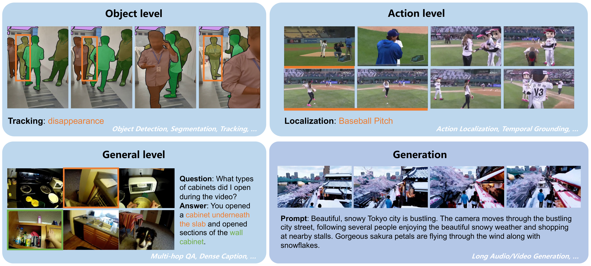](teaser/survey-ai-memory-video-task-panels/original.pdf)

来源类型：论文范例。许可：作者保留权利 / 私有参考。
[原文件](teaser/survey-ai-memory-video-task-panels/original.pdf) · [来源记录](teaser/survey-ai-memory-video-task-panels/metadata.json)

### [AI for PDEs · 物理与数据条件下的三类方法对照](teaser/survey-ai-pde-physics-data-paradigms/README.md)

同一套物理信息／数据条件标记贯穿多个子区，各区给出相应方法的科学示意和求解路径。子图围绕一个共同问题形成对照，能同时说明方法差异、适用条件及相互融合的关系。

arXiv 2024 · 预印本 · 综述 · 矢量 + 原有位图

[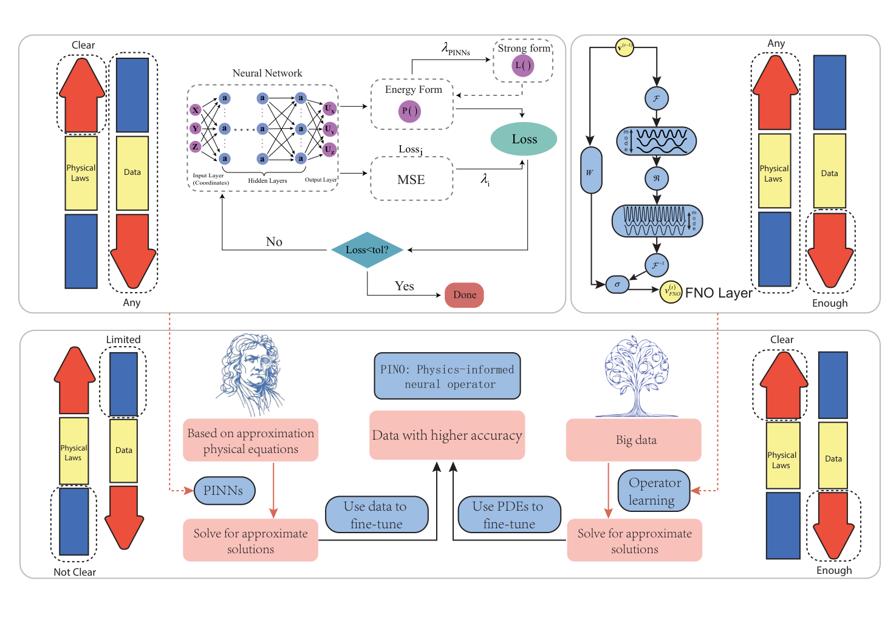](teaser/survey-ai-pde-physics-data-paradigms/original.pdf)

来源类型：论文范例。许可：作者保留权利 / 私有参考。
[原文件](teaser/survey-ai-pde-physics-data-paradigms/original.pdf) · [来源记录](teaser/survey-ai-pde-physics-data-paradigms/metadata.json)

### [AI for PDEs · 领域定位、方法与应用全景](teaser/survey-ai-pde-scope-map/README.md)

从 AI4Science 中的领域位置出发，将三类 AI4PDE 方法连接到计算力学，再按三个应用领域及正反问题展开。分类、范围和研究对象形成一条完整主线，是内容充实的综述概念总览。

arXiv 2024 · 预印本 · 综述 · 矢量结构

来源类型：论文范例。许可：作者保留权利 / 私有参考。
[原文件](teaser/survey-ai-pde-scope-map/original.pdf) · [来源记录](teaser/survey-ai-pde-scope-map/metadata.json)

### [AI4Research · 科学发现的五区流程总览](teaser/survey-ai4research-discovery-cycle/README.md)

将想法、评估、理论和实验的局部方法放在同一张总览里，并用闭环说明端到端发现。各区有任务细分和简短图示，适合借鉴为方法家族与研究流程结合的 teaser。

arXiv 2025 · 预印本 · 综述 · 矢量 + 原有位图

[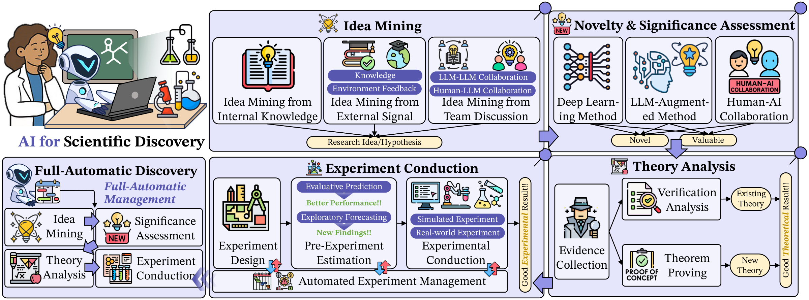](teaser/survey-ai4research-discovery-cycle/original.pdf)

来源类型：论文范例。许可：CC-BY-SA-4.0。
[原文件](teaser/survey-ai4research-discovery-cycle/original.pdf) · [来源记录](teaser/survey-ai4research-discovery-cycle/metadata.json)

### [AI4Research · 五类科研活动的多区总览](teaser/survey-ai4research-five-activities/README.md)

五类科研活动各有独立底色、示意对象和细分任务，中心场景把它们连成一张完整概念图。局部可单独阅读，整体也有明确的视觉中心。

arXiv 2025 · 预印本 · 综述 · 矢量 + 原有位图

[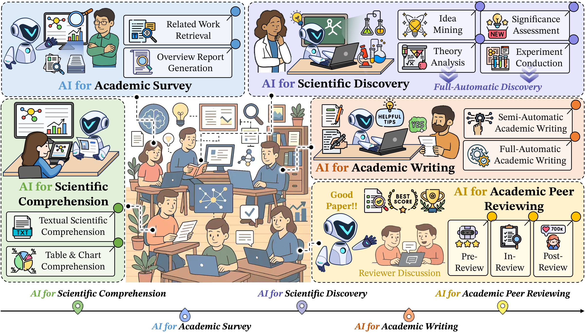](teaser/survey-ai4research-five-activities/original.pdf)

来源类型：论文范例。许可：CC-BY-SA-4.0。
[原文件](teaser/survey-ai4research-five-activities/original.pdf) · [来源记录](teaser/survey-ai4research-five-activities/metadata.json)

### [AI4Research · 三大领域、七类应用面板](teaser/survey-ai4research-seven-domains/README.md)

同一视觉语汇覆盖七类学科应用，以三行组织较大的领域分组。各面板不只是学科名称，还列出模拟、发现、控制、开发或实验等具体用途。

arXiv 2025 · 预印本 · 综述 · 矢量 + 原有位图

[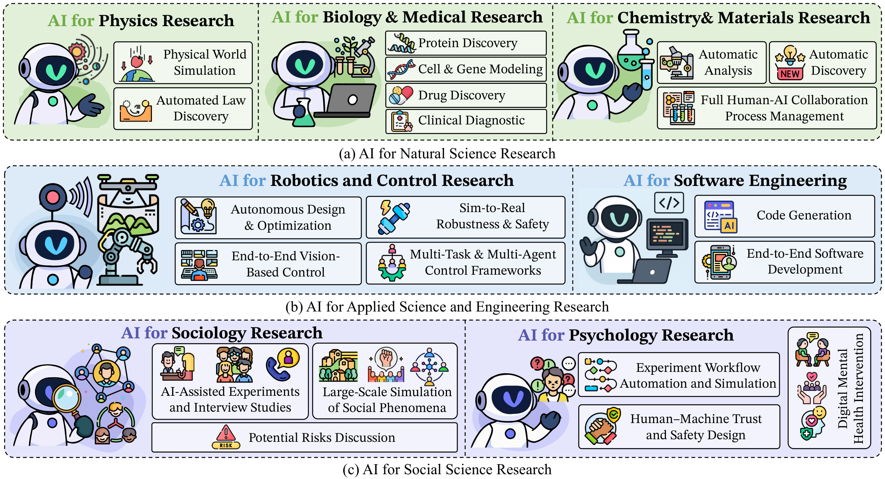](teaser/survey-ai4research-seven-domains/original.pdf)

来源类型：论文范例。许可：CC-BY-SA-4.0。
[原文件](teaser/survey-ai4research-seven-domains/original.pdf) · [来源记录](teaser/survey-ai4research-seven-domains/metadata.json)

### [AI4Science 领域圆环 · 从量子到连续系统](teaser/survey-ai4science-domain-wheel/README.md)

用三层圆环把量子、原子与连续系统统一起来：外圈是研究对象的视觉实例，中圈是学科和任务，中心是对称性、泛化与不确定性等共同议题。领域覆盖与核心观点同时可见。

arXiv 2023 · 预印本 · 综述 · 矢量 + 原有位图

来源类型：论文范例。许可：作者保留权利 / 私有参考。
[原文件](teaser/survey-ai4science-domain-wheel/original.pdf) · [来源记录](teaser/survey-ai4science-domain-wheel/metadata.json)

### [AI4Science 时空尺度图 · 研究对象与共同挑战](teaser/survey-ai4science-scale-map/README.md)

把研究方向放进时间与长度尺度坐标，再用斜向箭头表达跨尺度共性；同一画面包含应用对象、典型任务、对称性和共通研究挑战，信息量足而层级清楚。

arXiv 2023 · 预印本 · 综述 · 矢量 + 原有位图

来源类型：论文范例。许可：作者保留权利 / 私有参考。
[原文件](teaser/survey-ai4science-scale-map/original.pdf) · [来源记录](teaser/survey-ai4science-scale-map/metadata.json)

### [生物医学 PIML · 六面板方法范式总览](teaser/survey-biomedical-six-methods/README.md)

同一张图用六个面板解释不同表示模型、物理损失、连续时间建模与算子学习。蓝色表示模型、绿色表示数据或损失，适合借鉴为内容充实的方法范式总览。

arXiv 2025 · 预印本 · 综述 · 矢量 + 原有位图

[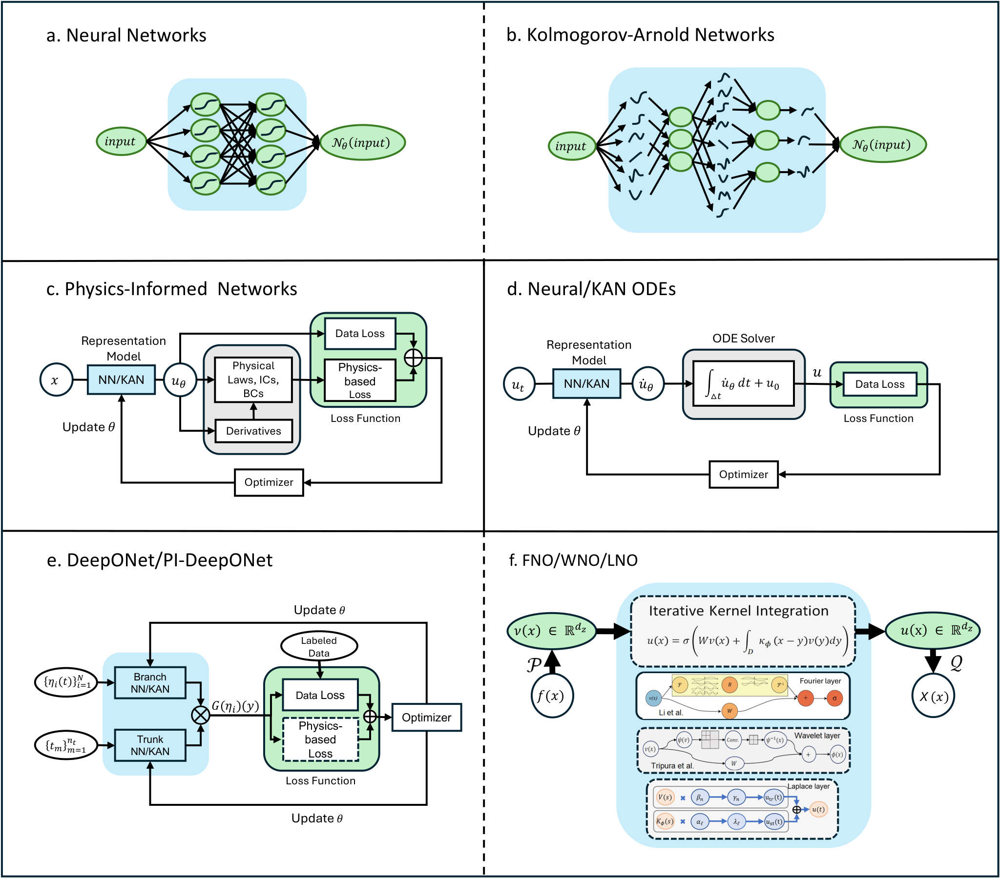](teaser/survey-biomedical-six-methods/original.pdf)

来源类型：论文范例。许可：CC-BY-NC-ND-4.0。
[原文件](teaser/survey-biomedical-six-methods/original.pdf) · [来源记录](teaser/survey-biomedical-six-methods/metadata.json)

### [可微仿真综述 · 十二个场景的双排时间线](teaser/survey-diffsim-twelve-scenes/README.md)

软体、刚体、轨迹优化、形态优化和操作等研究场景共同组成一张总览。时间线、节点、标签与十二张独立图像保留为分离对象，适合借鉴为内容丰富的发展脉络 teaser。

arXiv 2024 · 预印本 · 综述 · 矢量 + 原有位图

来源类型：论文范例。许可：作者保留权利 / 私有参考。
[原文件](teaser/survey-diffsim-twelve-scenes/original.pdf) · [来源记录](teaser/survey-diffsim-twelve-scenes/metadata.json)

### [动力学学习 · 物理与数据依赖的四范式对照](teaser/survey-dynamics-physics-learning-spectrum/README.md)

四个面板沿用相同的输入、输出和网络视觉语汇，通过物理模块进入网络的方式突出范式区别；下方的连续方向带概括物理先验与学习依赖的变化。

PNAS 2024 · 期刊论文 · 整图位图，仅构图参考

[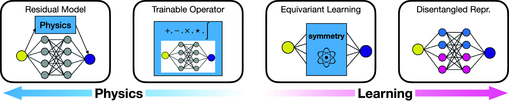](teaser/survey-dynamics-physics-learning-spectrum/source.jpg)

来源类型：论文范例。许可：CC-BY-4.0。
[原文件](teaser/survey-dynamics-physics-learning-spectrum/source.jpg) · [来源记录](teaser/survey-dynamics-physics-learning-spectrum/metadata.json)

### [流体机器学习综述 · 五阶段与降阶模型总览](teaser/survey-fluid-ml-five-stages/README.md)

用流体降阶建模这一具体例子解释通用机器学习流程。图中同时保留流场快照、网络结构、潜在空间动力学和目标函数，适合将一般概念落到一个科学任务上。

arXiv 2021 · 预印本 · 综述 · 矢量 + 原有位图

来源类型：论文范例。许可：CC-BY-4.0。
[原文件](teaser/survey-fluid-ml-five-stages/original.pdf) · [来源记录](teaser/survey-fluid-ml-five-stages/metadata.json)

### [基础模型概念总览 · 多源数据与多任务适配](teaser/survey-foundation-model-adaptation/README.md)

左侧多模态数据汇入一个共享基础，右侧扇出多个下游任务；每个任务用短名称和具象图标表达，能快速讲清共同底座与任务适配的概念。

arXiv 2021 · 预印本 · 综述 · 矢量 + 原有位图

来源类型：论文范例。许可：CC-BY-4.0。
[原文件](teaser/survey-foundation-model-adaptation/original.pdf) · [来源记录](teaser/survey-foundation-model-adaptation/metadata.json)

### [基础模型生态 · 数据、模型与人的完整链条](teaser/survey-foundation-model-ecosystem/README.md)

用五个连续色带串起数据产生、整理、训练、适配与部署，并在两端放人、在中间放多路数据与模型，提示讨论模型影响时应同时看到上下游生态。

arXiv 2021 · 预印本 · 综述 · 矢量 + 原有位图

[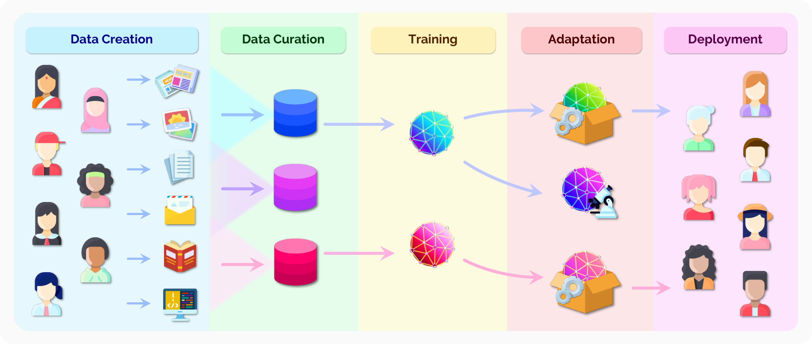](teaser/survey-foundation-model-ecosystem/original.pdf)

来源类型：论文范例。许可：CC-BY-4.0。
[原文件](teaser/survey-foundation-model-ecosystem/original.pdf) · [来源记录](teaser/survey-foundation-model-ecosystem/metadata.json)

### [GenAI 综述 · 演进、生成模型与代表方法拼图](teaser/survey-genai-history-model-mosaic/README.md)

将历史演进轴、三类生成结构、多任务与元学习，以及 GPT、DALL-E、CLIP 局部机制组合在一起；信息丰富且层次清楚。

arXiv 2024 · 预印本 · 综述 · 矢量 + 原有位图

[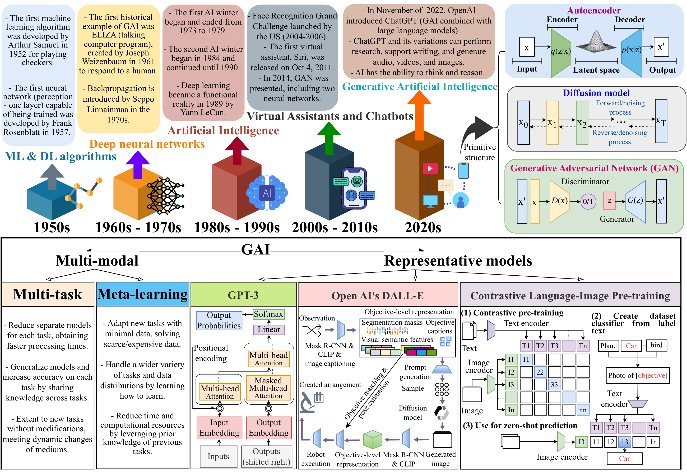](teaser/survey-genai-history-model-mosaic/original.pdf)

来源类型：论文范例。许可：作者保留权利 / 私有参考。
[原文件](teaser/survey-genai-history-model-mosaic/original.pdf) · [来源记录](teaser/survey-genai-history-model-mosaic/metadata.json)

### [GenAI × IoT · 分层技术栈与多场景应用](teaser/survey-genai-iot-layers-scenes/README.md)

上半部把技术栈和生成流程并排，下半部围绕通信节点展开感知、追踪、控制和远程应用，将层级、机制和场景放在同一画面。

arXiv 2024 · 预印本 · 综述 · 矢量 + 原有位图

[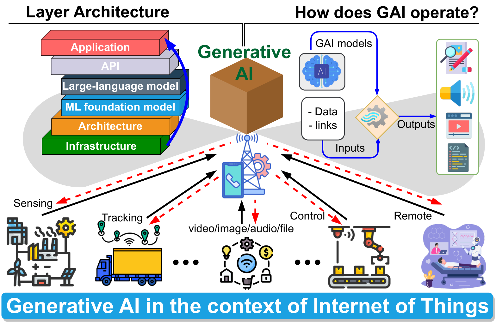](teaser/survey-genai-iot-layers-scenes/original.pdf)

来源类型：论文范例。许可：作者保留权利 / 私有参考。
[原文件](teaser/survey-genai-iot-layers-scenes/original.pdf) · [来源记录](teaser/survey-genai-iot-layers-scenes/metadata.json)

### [GenAI 网络管理 · 控制面、数据面与切片场景](teaser/survey-genai-network-management-scenes/README.md)

以控制面和数据面形成上下两层，用网络切片、设备和生成模型局部展开解释网络控制、资源配置与信道估计。

arXiv 2024 · 预印本 · 综述 · 矢量 + 原有位图

[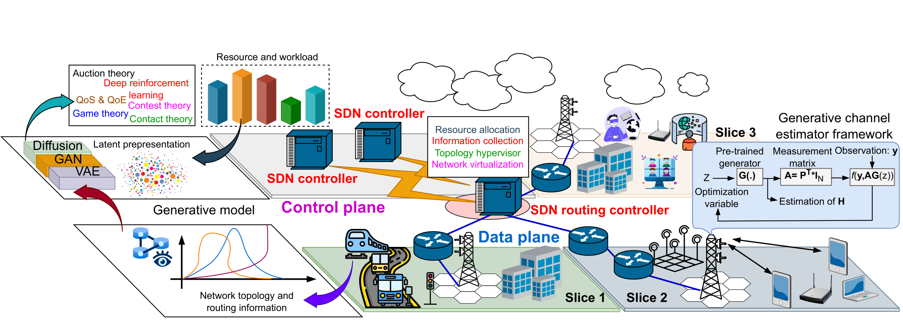](teaser/survey-genai-network-management-scenes/original.pdf)

来源类型：论文范例。许可：作者保留权利 / 私有参考。
[原文件](teaser/survey-genai-network-management-scenes/original.pdf) · [来源记录](teaser/survey-genai-network-management-scenes/metadata.json)

### [无线生成式 AI · 城市场景串联四类应用](teaser/survey-genai-wireless-four-scenarios/README.md)

四个方法场景围绕中心城市示意组织：信道估计、定位数据增强、雷达去噪、人体感知域适应。每区既有应用对象，也有局部模型或信号流程。

arXiv 2025 · 预印本 · 综述 · 矢量 + 原有位图

[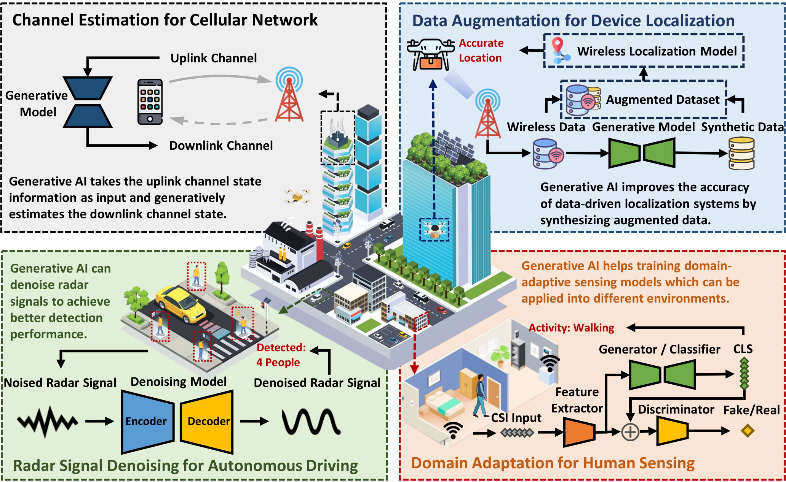](teaser/survey-genai-wireless-four-scenarios/original.pdf)

来源类型：论文范例。许可：作者保留权利 / 私有参考。
[原文件](teaser/survey-genai-wireless-four-scenarios/original.pdf) · [来源记录](teaser/survey-genai-wireless-four-scenarios/metadata.json)

### [GenAI 无线安全 · 四场景与局部机制并列](teaser/survey-genai-wireless-security-four-panels/README.md)

四栏分别解释敏感数据隐藏、入侵检测、干扰攻击和生成式隐写。每栏都有场景或数据图标、局部网络与关键箭头，最接近参考图 1 的信息密度。

arXiv 2024 · 预印本 · 综述 · 矢量 + 原有位图

[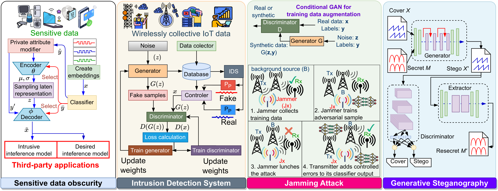](teaser/survey-genai-wireless-security-four-panels/original.pdf)

来源类型：论文范例。许可：作者保留权利 / 私有参考。
[原文件](teaser/survey-genai-wireless-security-four-panels/original.pdf) · [来源记录](teaser/survey-genai-wireless-security-four-panels/metadata.json)

### [图基础模型范式对照 · 专用学习与共享预训练](teaser/survey-graph-foundation-paradigm/README.md)

左右对照专用端到端学习与预训练加适配，复用同样的图节点和模型符号，底部再用示意曲线与能力列表补充两种范式的概念差异；几乎全靠结构和线条传递信息。

arXiv 2023 · 预印本 · 综述 · 矢量结构

来源类型：论文范例。许可：作者保留权利 / 私有参考。
[原文件](teaser/survey-graph-foundation-paradigm/original.pdf) · [来源记录](teaser/survey-graph-foundation-paradigm/metadata.json)

### [Informed ML · 数据路径与先验知识路径的概念对照](teaser/survey-informed-ml-information-flow/README.md)

把传统数据路径和独立先验知识路径画在同一信息流中，通过实线、虚线和内部阶段展开解释融合发生在哪里。简洁的结构承载清楚的方法差异。

arXiv 2019 · 预印本 · 综述 · 矢量结构

来源类型：论文范例。许可：CC-BY-4.0。
[原文件](teaser/survey-informed-ml-information-flow/original.pdf) · [来源记录](teaser/survey-informed-ml-information-flow/metadata.json)

### [Informed ML · 知识来源—表示—融入位置全景](teaser/survey-informed-ml-knowledge-map/README.md)

三列分别回答知识来自哪里、如何表示、在哪里进入学习流程。Sankey 连接将分类目录变成关系全景，能够同时展示多个类别以及它们之间的联系。

arXiv 2019 · 预印本 · 综述 · 矢量 + 原有位图

[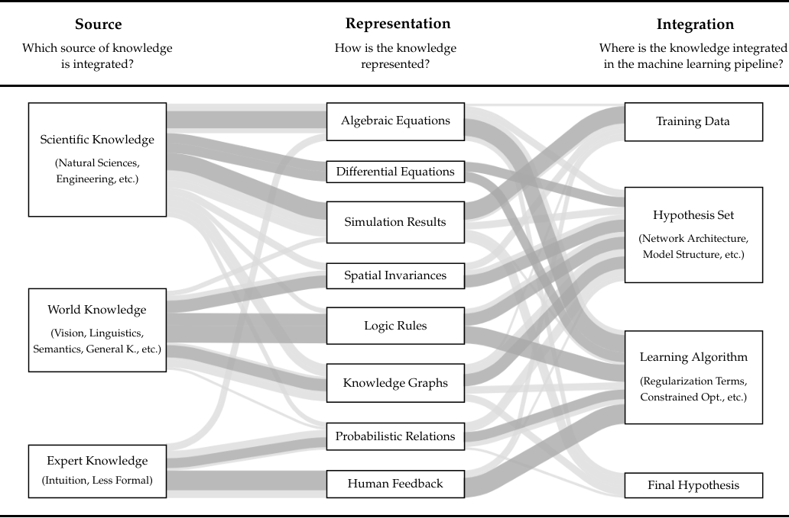](teaser/survey-informed-ml-knowledge-map/original.pdf)

来源类型：论文范例。许可：CC-BY-4.0。
[原文件](teaser/survey-informed-ml-knowledge-map/original.pdf) · [来源记录](teaser/survey-informed-ml-knowledge-map/metadata.json)

### [指令式图像编辑 · 21 种任务的多子图总览](teaser/survey-instruction-editing-task-gallery/README.md)

21 个任务子图按五类操作组织，每个小面板保留输入、编辑结果和短标签；颜色只分大类，横排、竖排与底部长条配合，内容密集且层次清楚。

arXiv 2026 · 预印本 · 综述 · 矢量 + 原有位图

来源类型：论文范例。许可：作者保留权利 / 私有参考。
[原文件](teaser/survey-instruction-editing-task-gallery/original.pdf) · [来源记录](teaser/survey-instruction-editing-task-gallery/metadata.json)

### [LLaMA 家族关系 · 模型与数据继承图](teaser/survey-llama-family-map/README.md)

把模型继承、数据继承与继续预训练画成不同颜色和线型的关系，从单一根节点展开出任务与领域分支，重点是关系而非枚举。

Frontiers of Computer Science 2026 · 期刊论文 · 综述 · 矢量 + 原有位图

来源类型：论文范例。许可：作者保留权利 / 私有参考。
[原文件](teaser/survey-llama-family-map/original.pdf) · [来源记录](teaser/survey-llama-family-map/metadata.json)

### [LLM 发布脉络 · 主轴与时间分支](teaser/survey-llm-release-timeline/README.md)

沿弯曲主轴安排不同时间段，分支容纳密集的模型名称，黄色底色再编码检查点是否公开；适合综述开篇交代领域发展范围。

Frontiers of Computer Science 2026 · 期刊论文 · 综述 · 矢量 + 原有位图

[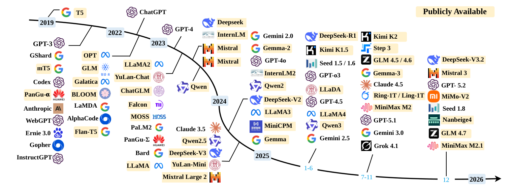](teaser/survey-llm-release-timeline/original.pdf)

来源类型：论文范例。许可：作者保留权利 / 私有参考。
[原文件](teaser/survey-llm-release-timeline/original.pdf) · [来源记录](teaser/survey-llm-release-timeline/metadata.json)

### [语言模型四代能力演进 · 阶梯式概念图](teaser/survey-lm-capability-evolution/README.md)

用同一条阶梯和时间轴，把统计语言模型、神经语言模型、预训练语言模型与大语言模型的任务能力变化串起来；一眼先读到观点，再读阶段细节。

Frontiers of Computer Science 2026 · 期刊论文 · 综述 · 矢量结构

来源类型：论文范例。许可：作者保留权利 / 私有参考。
[原文件](teaser/survey-lm-capability-evolution/original.pdf) · [来源记录](teaser/survey-lm-capability-evolution/metadata.json)

### [记忆综述 · 表示、六类操作与研究主题总览](teaser/survey-memory-representations-operations-map/README.md)

左侧操作与 Transformer 参数结构，中间上下文记忆及两个会话例子，右侧把四个研究主题映射到记忆类型与操作，兼有概念、例子和对应关系。

arXiv 2025 · 预印本 · 综述 · 矢量 + 原有位图

来源类型：论文范例。许可：CC0 1.0（所收录论文版本）。
[原文件](teaser/survey-memory-representations-operations-map/original.pdf) · [来源记录](teaser/survey-memory-representations-operations-map/metadata.json)

### [多模态大模型发展 · 分段曲线时间线](teaser/survey-mllm-timeline/README.md)

弯曲时间轴配合阶段分支和小型图标，在一张横向图内承载多模态模型从 2022 年到 2024 年初的发展；比普通表格更容易看出阶段。

National Science Review 2024 · 期刊论文 · 综述 · 矢量 + 原有位图

[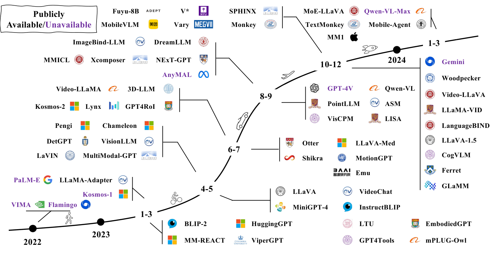](teaser/survey-mllm-timeline/original.pdf)

来源类型：论文范例。许可：CC-BY-4.0。
[原文件](teaser/survey-mllm-timeline/original.pdf) · [来源记录](teaser/survey-mllm-timeline/metadata.json)

### [多模态 Agent · 8 类应用与外围场景子图](teaser/survey-multimodal-agent-applications/README.md)

8 类应用围绕中心展开，外围场景图分别对应 UI 助手、驾驶、游戏、机器人、音视频和视觉推理等主题；既有领域分类，也有能直接识别的任务实例。

arXiv 2024 · 预印本 · 综述 · 矢量 + 原有位图

来源类型：论文范例。许可：CC-BY-4.0。
[原文件](teaser/survey-multimodal-agent-applications/original.pdf) · [来源记录](teaser/survey-multimodal-agent-applications/metadata.json)

### [Neural Fields · 5 类技术与 6 类应用的多子图 teaser](teaser/survey-neural-fields-multipanel/README.md)

把 5 类通用技术放在上层、6 类应用放在下层，再用一个数据库截图连接到综述资源；每个主题有短标签、不同形态的原论文图例和清楚分区，是完整的综述首图。

EUROGRAPHICS 2022 · STAR 报告 · 综述 · 矢量 + 原有位图

来源类型：论文范例。许可：作者保留权利 / 私有参考。
[原文件](teaser/survey-neural-fields-multipanel/original.pdf) · [来源记录](teaser/survey-neural-fields-multipanel/metadata.json)

### [Neural Rendering 2020 · 两排 11 组场景 teaser](teaser/survey-neural-rendering-2020-gallery/README.md)

两排 11 组场景覆盖人像、对象、场景、重光照、表情与人体驱动，使用不同宽度的小组安排输入输出对和多视角样例，整张图仍保持平齐的上下边界。

EUROGRAPHICS 2020 · STAR 报告 · 综述 · 整图位图，仅构图参考

来源类型：论文范例。许可：作者保留权利 / 私有参考。
[原文件](teaser/survey-neural-rendering-2020-gallery/source.jpg) · [来源记录](teaser/survey-neural-rendering-2020-gallery/metadata.json)

### [Advances in Neural Rendering · 两排约 10 组主题 teaser](teaser/survey-neural-rendering-2022-gallery/README.md)

把自由视角、生成、重光照、场景编辑和动态人物等能力排成两层图群；组内用多个视图或状态形成小叙事，既展示多样性，也让同一能力的变化可见。

EUROGRAPHICS 2022 · STAR 报告 · 综述 · 整图位图，仅构图参考

来源类型：论文范例。许可：作者保留权利 / 私有参考。
[原文件](teaser/survey-neural-rendering-2022-gallery/source.jpg) · [来源记录](teaser/survey-neural-rendering-2022-gallery/metadata.json)

### [PDE 求解综述 · 物理—数据连续谱与两类方法全景](teaser/survey-pde-physics-data-continuum/README.md)

共同难题、统一视角和分支方法排成三层。PINNs 与神经算子沿同一物理—数据主线对照，下层用 12 个小型科学／方法图示解释具体研究方向，信息丰富且阅读顺序清楚。

IJCAI 2026 · 会议论文，未核实 Oral · 综述 · 矢量 + 原有位图

[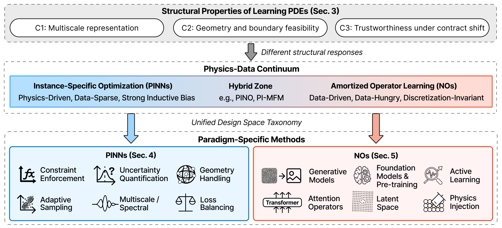](teaser/survey-pde-physics-data-continuum/original.pdf)

来源类型：论文范例。许可：CC-BY-4.0。
[原文件](teaser/survey-pde-physics-data-continuum/original.pdf) · [来源记录](teaser/survey-pde-physics-data-continuum/metadata.json)

### [物理知识融入学习 · 五种方式的统一图元对照](teaser/survey-physics-knowledge-five-paradigms/README.md)

五栏使用同一套数据、模型和目标函数图元，通过信息流和明暗编码突出物理知识进入学习过程的位置。读者只需理解一栏的图示规则，就能比较其余四栏。

TMLR 2025 · 期刊论文 · 综述 · 矢量结构

来源类型：论文范例。许可：作者保留权利 / 私有参考。
[原文件](teaser/survey-physics-knowledge-five-paradigms/original.pdf) · [来源记录](teaser/survey-physics-knowledge-five-paradigms/metadata.json)

### [PIML · 数据、模型与优化的完整融合流程](teaser/survey-piml-data-model-optimization/README.md)

三个并列区域分别展开数据、模型与优化；底部共享物理先验向三处提供约束，框内保留采样点、物理模块和损失方程。适合借鉴为内容充实的综述概念总览。

Machine Learning for Computational Science and Engineering 2025 · 期刊论文 · 综述 · 整图位图，仅构图参考

[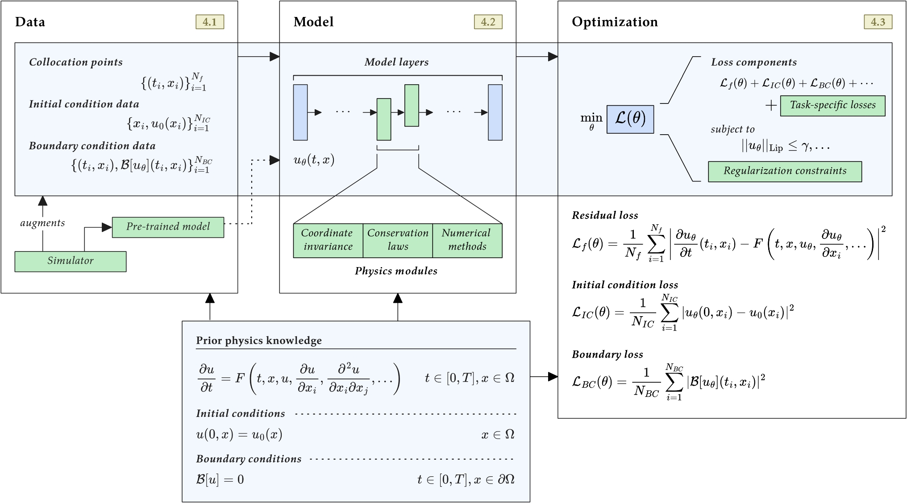](teaser/survey-piml-data-model-optimization/source.png)

来源类型：论文范例。许可：CC-BY-4.0。
[原文件](teaser/survey-piml-data-model-optimization/source.png) · [来源记录](teaser/survey-piml-data-model-optimization/metadata.json)

### [PINN 综述 · 导数、物理方程与残差三栏展开](teaser/survey-piml-equations-residuals/README.md)

以导数、物理规律和残差为三条主线，将自动微分、有限差分、不同算子、无量纲化、方程改写与弱形式整合到一个有公式和科学示意的总览里。

arXiv 2024 · 预印本 · 综述 · 整图位图，仅构图参考

来源类型：论文范例。许可：CC-BY-NC-SA-4.0。
[原文件](teaser/survey-piml-equations-residuals/source.png) · [来源记录](teaser/survey-piml-equations-residuals/metadata.json)

### [PINN 综述 · 问题、损失与优化的多子图全景](teaser/survey-piml-optimization-landscape/README.md)

上方主线串联问题、损失函数和优化器，下面用场分布、区域划分、采样点、梯度几何与 Pareto 前沿展开细节。是一张内容密度高、科学子图丰富的综述总览。

arXiv 2024 · 预印本 · 综述 · 整图位图，仅构图参考

[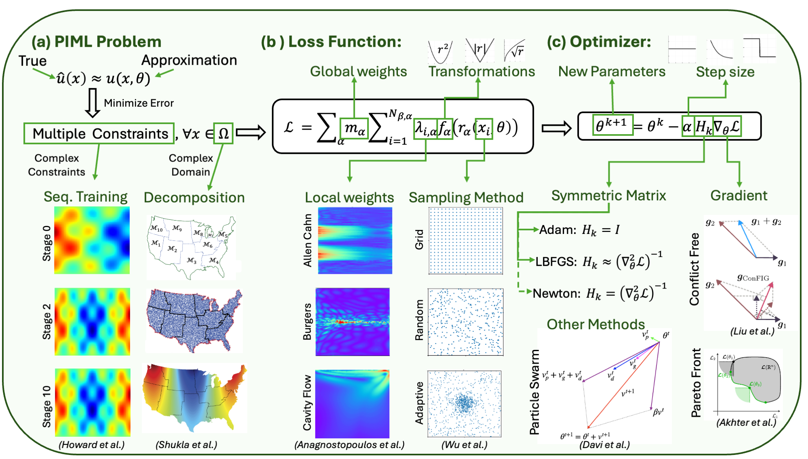](teaser/survey-piml-optimization-landscape/source.png)

来源类型：论文范例。许可：CC-BY-NC-SA-4.0。
[原文件](teaser/survey-piml-optimization-landscape/source.png) · [来源记录](teaser/survey-piml-optimization-landscape/metadata.json)

### [PIML · 物理先验、融入层级与任务的三维全景](teaser/survey-piml-three-axis-landscape/README.md)

以物理先验、学习中的融入层级和任务为三个维度，再用两张二维图将代表方法放回同一分类空间。图形结构直接解释领域是如何被组织的。

arXiv 2022 · 预印本 · 综述 · 矢量 + 原有位图

[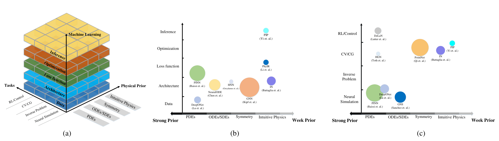](teaser/survey-piml-three-axis-landscape/original.pdf)

来源类型：论文范例。许可：作者保留权利 / 私有参考。
[原文件](teaser/survey-piml-three-axis-landscape/original.pdf) · [来源记录](teaser/survey-piml-three-axis-landscape/metadata.json)

### [机器人学习 · 物理先验融入架构的六类方法](teaser/survey-robot-physics-six-families/README.md)

六个面板使用相同的色块、标题、中心图示和底部说明组织不同方法家族。每个面板包含公式、网络连接或机器人结构，既能独立阅读，也能共同构成有科学内容的方法全景。

arXiv 2026 · 预印本 · 综述 · 矢量 + 原有位图

来源类型：论文范例。许可：CC-BY-4.0。
[原文件](teaser/survey-robot-physics-six-families/original.pdf) · [来源记录](teaser/survey-robot-physics-six-families/metadata.json)

### [机器人学习 · 物理先验融入的三路对照](teaser/survey-robot-physics-three-routes/README.md)

三栏沿用相同的物理先验主题，分别用机器人观测、网络内部结构和物理损失方程解释三种融入位置。颜色分区和真实方法示意共同承担信息表达，与多方法对照 teaser 的结构接近。

arXiv 2026 · 预印本 · 综述 · 矢量 + 原有位图

来源类型：论文范例。许可：CC-BY-4.0。
[原文件](teaser/survey-robot-physics-three-routes/original.pdf) · [来源记录](teaser/survey-robot-physics-three-routes/metadata.json)

### [科学大模型综述 · 数据获取、构建与审查全景](teaser/survey-scillm-data-construction/README.md)

将数据来源、数据构建的三条路径和质量审查放在统一框架中。多行步骤、来源图标和右侧反馈形成有主次的复杂总览，适合借鉴为“上层来源＋中层处理＋侧边约束”的 teaser。

arXiv 2025 · 预印本 · 综述 · 矢量 + 原有位图

[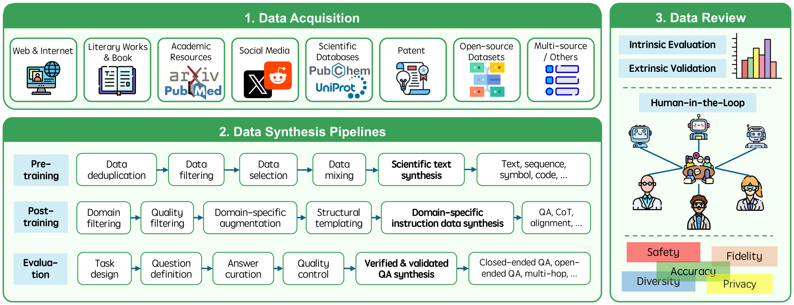](teaser/survey-scillm-data-construction/original.pdf)

来源类型：论文范例。许可：CC-BY-4.0。
[原文件](teaser/survey-scillm-data-construction/original.pdf) · [来源记录](teaser/survey-scillm-data-construction/metadata.json)

### [科学大模型综述 · 五层知识阶梯与发现循环](teaser/survey-scillm-knowledge-levels/README.md)

用阶梯明确科学知识的层级，每层配简短含义和代表性图标，底部再展示跨层循环。适合表达“原始数据如何逐层走向科学发现”，与多面板平铺提供不同的组织方式。

arXiv 2025 · 预印本 · 综述 · 矢量 + 原有位图

[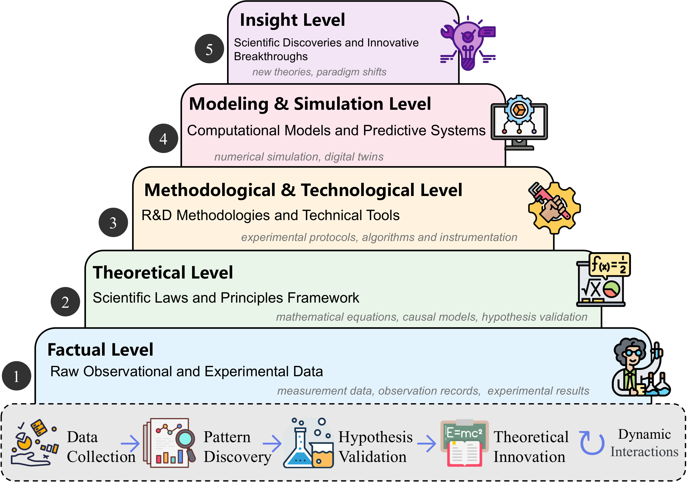](teaser/survey-scillm-knowledge-levels/original.pdf)

来源类型：论文范例。许可：CC-BY-4.0。
[原文件](teaser/survey-scillm-knowledge-levels/original.pdf) · [来源记录](teaser/survey-scillm-knowledge-levels/metadata.json)

### [科学大模型综述 · 六学科环形问答总览](teaser/survey-scillm-six-domain-examples/README.md)

中心概念连接六个学科扇区，外侧用模型名称、问题文本和科学图片补充实际含义。相比单纯的领域圆环，多了一层能够快速读懂的具体任务。

arXiv 2025 · 预印本 · 综述 · 矢量 + 原有位图

[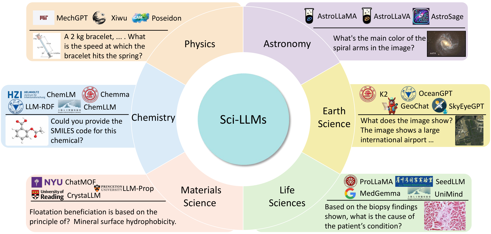](teaser/survey-scillm-six-domain-examples/original.pdf)

来源类型：论文范例。许可：CC-BY-4.0。
[原文件](teaser/survey-scillm-six-domain-examples/original.pdf) · [来源记录](teaser/survey-scillm-six-domain-examples/metadata.json)

### [世界模型能力递进 · 可信预测、可控干预与决策收益](teaser/survey-world-model-capability-ladder/README.md)

用同一个机器人操作任务贯穿观察、未来预测、不同动作干预和决策执行，最后接入改进闭环；相同场景反复出现，使抽象能力差异变成可以直接对照的图像证据要求。

arXiv 2026 · 预印本 · 综述 · 矢量 + 原有位图

[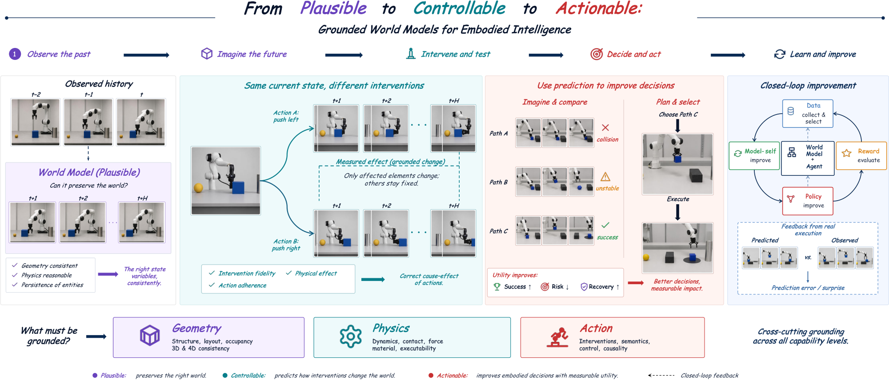](teaser/survey-world-model-capability-ladder/original.pdf)

来源类型：论文范例。许可：CC-BY-4.0。
[原文件](teaser/survey-world-model-capability-ladder/original.pdf) · [来源记录](teaser/survey-world-model-capability-ladder/metadata.json)

### [VAR · 从逐 token 到逐尺度生成的范式对照](teaser/var-paradigm/README.md)

同一张图比较语言自回归、图像逐 token 生成和逐尺度生成，核心差异直接表现为生成顺序与尺度变化。

NeurIPS 2024 · Oral · 矢量 + 原有位图

来源类型：论文范例。许可：CC0-1.0。
[原文件](teaser/var-paradigm/source.svg) · [来源记录](teaser/var-paradigm/metadata.json)

### [VGGT · 多视图输入与统一三维感知能力](teaser/vggt-capabilities/README.md)

用一个大型三维场景作为视觉中心，两侧安排输入与多种输出，让读者先理解方法能做什么。

CVPR 2025 · Oral · 矢量 + 原有位图

来源类型：论文范例。许可：作者保留权利 / 参考收录。
[原文件](teaser/vggt-capabilities/source.svg) · [来源记录](teaser/vggt-capabilities/metadata.json)

## Architecture 范例

辅助入口：[原生 AI / AIT 版式母版](templates/layouts/README.md)。

### [3DETR · 点云编码器、查询嵌入与集合预测](architecture/3detr-architecture/README.md)

左侧将点集到检测集合的主干压缩成一条水平线，右侧放大查询点、位置编码和查询嵌入的来源。

ICCV 2021 · Oral · 矢量 + 原有位图

来源类型：论文范例。许可：作者保留权利 / 参考收录。
[原文件](architecture/3detr-architecture/source.svg) · [来源记录](architecture/3detr-architecture/metadata.json)

### [A-MEM · 笔记构建、关联、演化与检索四分区](architecture/amem-notes-links-evolution-framework/README.md)

四个相邻分区把对话写成笔记、为记忆建立关联、更新原有记忆和查询检索串联起来；笔记、分组和模型符号跨区复用。

NeurIPS 2025 · 会议论文，未核实 Oral · 矢量 + 原有位图

[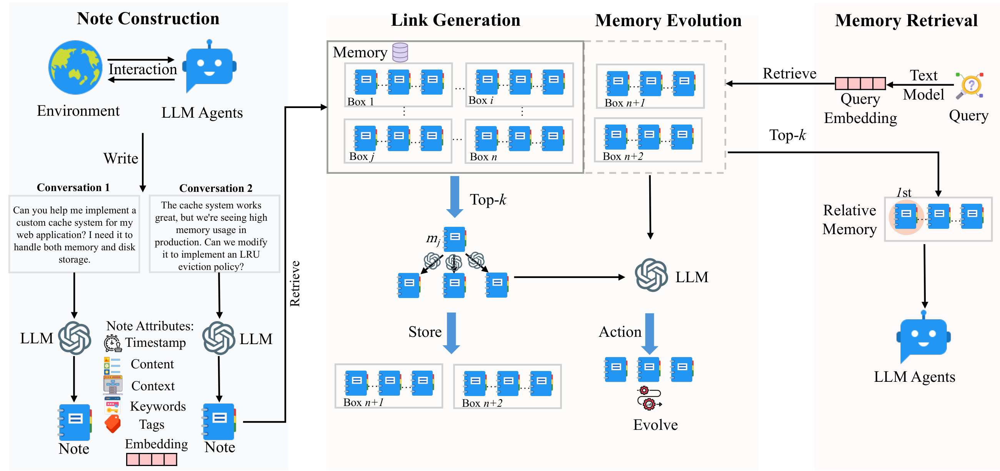](architecture/amem-notes-links-evolution-framework/original.pdf)

来源类型：论文范例。许可：作者保留权利 / 私有参考。
[原文件](architecture/amem-notes-links-evolution-framework/original.pdf) · [来源记录](architecture/amem-notes-links-evolution-framework/metadata.json)

### [BLIP-2 · 冻结图像与语言模型的两阶段桥接](architecture/blip2-bridge-framework/README.md)

左右两块分别说明表示学习和生成学习，只让中间的 Q-Former 成为主要可训练连接，冻结标记紧邻对应基础模型。

ICML 2023 · Poster · 矢量 + 原有位图

来源类型：论文范例。许可：CC-BY-4.0。
[原文件](architecture/blip2-bridge-framework/source.svg) · [来源记录](architecture/blip2-bridge-framework/metadata.json)

### [BLIP-2 · Q-Former 与三种注意力掩码](architecture/blip2-qformer-architecture/README.md)

左侧画共享查询模块和训练目标，右侧用同一种矩阵视觉语法比较三种注意力约束，结构与约束之间的关系很清楚。

ICML 2023 · Poster · 矢量 + 原有位图

来源类型：论文范例。许可：CC-BY-4.0。
[原文件](architecture/blip2-qformer-architecture/source.svg) · [来源记录](architecture/blip2-qformer-architecture/metadata.json)

### [Chain-of-Table · 自行车名次表的迭代推理](architecture/chain-of-table-cyclist-table-reasoning/README.md)

同一张自行车名次表贯穿三种解法。方法部分把选操作、填参数、变换表格画成循环，右侧列出四轮操作及最终汇总表。

ICLR 2024 · 会议论文，未核实 Oral · 矢量 + 原有位图

来源类型：论文范例。许可：arXiv 非独占分发许可（私有参考）。
[原文件](architecture/chain-of-table-cyclist-table-reasoning/original.pdf) · [来源记录](architecture/chain-of-table-cyclist-table-reasoning/metadata.json)

### [CLIP Figure 1：训练到零样本预测](architecture/clip/README.md)

CLIP 的训练与零样本使用流程，按方法流程归入 architecture。

来源类型：论文范例。许可：arXiv non-exclusive distribution license。
[原文件](architecture/clip/source.svg) · [来源记录](architecture/clip/metadata.json)

### [CRAG · 评估分流、知识纠正与三路生成](architecture/crag-evaluate-correct-generate/README.md)

检索质量分成正确、模糊和错误三路，分别触发知识精炼、网页搜索或两者结合；底部对照三类证据组合如何进入生成器。

arXiv 2024 · 预印本 · 矢量 + 原有位图

来源类型：论文范例。许可：作者保留权利 / 私有参考。
[原文件](architecture/crag-evaluate-correct-generate/original.pdf) · [来源记录](architecture/crag-evaluate-correct-generate/metadata.json)

### [CUT3R · 持久状态的更新、读取与未见视角推断](architecture/cut3r-architecture/README.md)

左侧按时间展开状态更新，右侧用独立色块解释状态读取；重建结果紧邻对应计算步骤。

CVPR 2025 · Oral · 矢量 + 原有位图

来源类型：论文范例。许可：CC-BY-4.0。
[原文件](architecture/cut3r-architecture/source.svg) · [来源记录](architecture/cut3r-architecture/metadata.json)

### [D2L · AlexNet](architecture/d2l-alexnet/README.md)

D2L 教材作者提供的原始矢量图，适合借鉴结构与模块表达；明确作为教材范例收录。

来源类型：教材或教程范例。许可：CC-BY-SA-4.0。
[原文件](architecture/d2l-alexnet/source.svg) · [来源记录](architecture/d2l-alexnet/metadata.json)

### [D2L · DenseNet 密集连接块](architecture/d2l-densenet-block/README.md)

D2L 教材作者提供的原始矢量图，适合借鉴结构与模块表达；明确作为教材范例收录。

来源类型：教材或教程范例。许可：CC-BY-SA-4.0。
[原文件](architecture/d2l-densenet-block/source.svg) · [来源记录](architecture/d2l-densenet-block/metadata.json)

### [D2L · 编码器—解码器](architecture/d2l-encoder-decoder/README.md)

D2L 教材作者提供的原始矢量图，适合借鉴结构与模块表达；明确作为教材范例收录。

来源类型：教材或教程范例。许可：CC-BY-SA-4.0。
[原文件](architecture/d2l-encoder-decoder/source.svg) · [来源记录](architecture/d2l-encoder-decoder/metadata.json)

### [D2L · 全卷积网络](architecture/d2l-fcn/README.md)

D2L 教材作者提供的原始矢量图，适合借鉴结构与模块表达；明确作为教材范例收录。

来源类型：教材或教程范例。许可：CC-BY-SA-4.0。
[原文件](architecture/d2l-fcn/source.svg) · [来源记录](architecture/d2l-fcn/metadata.json)

### [D2L · 生成对抗网络](architecture/d2l-gan/README.md)

D2L 教材作者提供的原始矢量图，适合借鉴结构与模块表达；明确作为教材范例收录。

来源类型：教材或教程范例。许可：CC-BY-SA-4.0。
[原文件](architecture/d2l-gan/source.svg) · [来源记录](architecture/d2l-gan/metadata.json)

### [D2L · GRU 内部门控](architecture/d2l-gru-3/README.md)

D2L 教材作者提供的原始矢量图，适合借鉴结构与模块表达；明确作为教材范例收录。

来源类型：教材或教程范例。许可：CC-BY-SA-4.0。
[原文件](architecture/d2l-gru-3/source.svg) · [来源记录](architecture/d2l-gru-3/metadata.json)

### [D2L · Inception 并行分支](architecture/d2l-inception/README.md)

D2L 教材作者提供的原始矢量图，适合借鉴结构与模块表达；明确作为教材范例收录。

来源类型：教材或教程范例。许可：CC-BY-SA-4.0。
[原文件](architecture/d2l-inception/source.svg) · [来源记录](architecture/d2l-inception/metadata.json)

### [D2L · LeNet](architecture/d2l-lenet/README.md)

D2L 教材作者提供的原始矢量图，适合借鉴结构与模块表达；明确作为教材范例收录。

[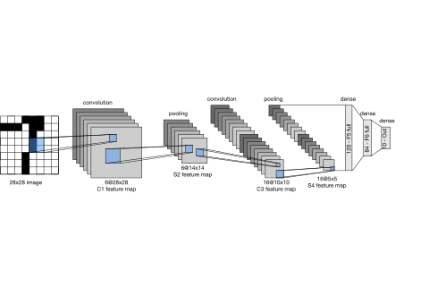](architecture/d2l-lenet/source.svg)

来源类型：教材或教程范例。许可：CC-BY-SA-4.0。
[原文件](architecture/d2l-lenet/source.svg) · [来源记录](architecture/d2l-lenet/metadata.json)

### [D2L · LSTM 内部门控](architecture/d2l-lstm-3/README.md)

D2L 教材作者提供的原始矢量图，适合借鉴结构与模块表达；明确作为教材范例收录。

来源类型：教材或教程范例。许可：CC-BY-SA-4.0。
[原文件](architecture/d2l-lstm-3/source.svg) · [来源记录](architecture/d2l-lstm-3/metadata.json)

### [D2L · 多层感知机](architecture/d2l-mlp/README.md)

D2L 教材作者提供的原始矢量图，适合借鉴结构与模块表达；明确作为教材范例收录。

来源类型：教材或教程范例。许可：CC-BY-SA-4.0。
[原文件](architecture/d2l-mlp/source.svg) · [来源记录](architecture/d2l-mlp/metadata.json)

### [D2L · ResNet 残差块](architecture/d2l-resnet-block/README.md)

D2L 教材作者提供的原始矢量图，适合借鉴结构与模块表达；明确作为教材范例收录。

来源类型：教材或教程范例。许可：CC-BY-SA-4.0。
[原文件](architecture/d2l-resnet-block/source.svg) · [来源记录](architecture/d2l-resnet-block/metadata.json)

### [D2L · ResNeXt 分组残差块](architecture/d2l-resnext-block/README.md)

D2L 教材作者提供的原始矢量图，适合借鉴结构与模块表达；明确作为教材范例收录。

来源类型：教材或教程范例。许可：CC-BY-SA-4.0。
[原文件](architecture/d2l-resnext-block/source.svg) · [来源记录](architecture/d2l-resnext-block/metadata.json)

### [D2L · 带注意力的 Seq2Seq](architecture/d2l-seq2seq-attention/README.md)

D2L 教材作者提供的原始矢量图，适合借鉴结构与模块表达；明确作为教材范例收录。

来源类型：教材或教程范例。许可：CC-BY-SA-4.0。
[原文件](architecture/d2l-seq2seq-attention/source.svg) · [来源记录](architecture/d2l-seq2seq-attention/metadata.json)

### [D2L · Transformer 编码器与解码器](architecture/d2l-transformer/README.md)

D2L 教材作者提供的原始矢量图，适合借鉴结构与模块表达；明确作为教材范例收录。

[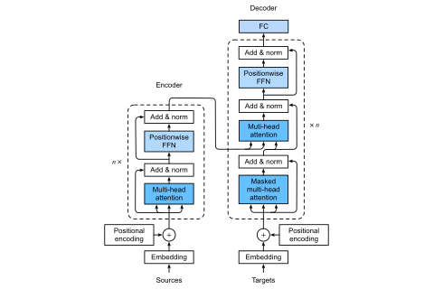](architecture/d2l-transformer/source.svg)

来源类型：教材或教程范例。许可：CC-BY-SA-4.0。
[原文件](architecture/d2l-transformer/source.svg) · [来源记录](architecture/d2l-transformer/metadata.json)

### [D2L · VGG](architecture/d2l-vgg/README.md)

D2L 教材作者提供的原始矢量图，适合借鉴结构与模块表达；明确作为教材范例收录。

来源类型：教材或教程范例。许可：CC-BY-SA-4.0。
[原文件](architecture/d2l-vgg/source.svg) · [来源记录](architecture/d2l-vgg/metadata.json)

### [D2L · Vision Transformer](architecture/d2l-vit/README.md)

D2L 教材作者提供的原始矢量图，适合借鉴结构与模块表达；明确作为教材范例收录。

来源类型：教材或教程范例。许可：CC-BY-SA-4.0。
[原文件](architecture/d2l-vit/source.svg) · [来源记录](architecture/d2l-vit/metadata.json)

### [DiT · 整体主干与三种条件注入模块](architecture/dit-architecture/README.md)

左侧给完整主干，右侧展开 block 变体；推荐模块使用更高视觉对比，完整展示论文的结构选择。

ICCV 2023 · Oral · 矢量结构

来源类型：论文范例。许可：CC-BY-4.0。
[原文件](architecture/dit-architecture/source.svg) · [来源记录](architecture/dit-architecture/metadata.json)

### [DreamGaussian · 高斯生成、网格提取与纹理细化](architecture/dreamgaussian-architecture/README.md)

三个带编号的区域分别解释表示初始化、表示转换和后续细化，同时把不同损失放在对应优化回路内。

ICLR 2024 · Oral · 矢量 + 原有位图

来源类型：论文范例。许可：作者保留权利 / 参考收录。
[原文件](architecture/dreamgaussian-architecture/source.svg) · [来源记录](architecture/dreamgaussian-architecture/metadata.json)

### [EAGLE · 图像子区搜索与模态归因](architecture/eagle-visual-language-attribution/README.md)

用一张海滩照片串起超像素分区、贪心搜索和逐步揭示图像子区。输出同时展示词元对视觉或语言的依赖，以及图像上的归因热图。

CVPR 2026 · 会议论文，未核实 Oral · 矢量 + 原有位图

来源类型：论文范例。许可：CC BY 4.0（所收录论文版本）。
[原文件](architecture/eagle-visual-language-attribution/original.pdf) · [来源记录](architecture/eagle-visual-language-attribution/metadata.json)

### [FlashTrace · 片段归因与多跳递归追踪](architecture/flashtrace-span-recursive-attribution/README.md)

三栏并置归因计算、逐跳回溯的购物示例和逐行解说。每一跳复用同一段文本，用颜色区分目标与高分词元，末尾汇总输入词元的归因分数。

ICML 2026 · Oral · 矢量 + 原有位图

来源类型：论文范例。许可：CC BY-NC-ND 4.0（所收录论文版本）。
[原文件](architecture/flashtrace-span-recursive-attribution/original.pdf) · [来源记录](architecture/flashtrace-span-recursive-attribution/metadata.json)

### [G-Retriever · 图问答的索引、子图与生成](architecture/g-retriever-graph-question-walkthrough/README.md)

围绕 Justin Bieber 的兄弟是谁，展示实体及边的索引、候选检索、连通子图的选择，以及子图和问题如何接入模型。

NeurIPS 2024 · 会议论文，未核实 Oral · 矢量 + 原有位图

来源类型：论文范例。许可：arXiv 非独占分发许可（私有参考）。
[原文件](architecture/g-retriever-graph-question-walkthrough/original.pdf) · [来源记录](architecture/g-retriever-graph-question-walkthrough/metadata.json)

### [3D Gaussian Splatting · 优化与光栅化双向流程](architecture/gaussian-splatting-architecture/README.md)

黑色实线和蓝色箭头分别表达正向操作与梯度回传，让自适应密度控制与可微渲染的关系无需依赖长图注。

SIGGRAPH 2023 · 会议论文，未核实 Oral · 矢量 + 原有位图

来源类型：论文范例。许可：CC-BY-4.0。
[原文件](architecture/gaussian-splatting-architecture/source.svg) · [来源记录](architecture/gaussian-splatting-architecture/metadata.json)

### [Genie · 视频 tokenizer、潜在动作与动力学模型](architecture/genie-architecture/README.md)

只保留三个核心模块，视频 tokens 与潜在动作分别编码后汇入动力学模型；简单分支就讲清训练信息来源。

ICML 2024 · Oral · 整图位图，仅构图参考

来源类型：论文范例。许可：作者保留权利 / 参考收录。
[原文件](architecture/genie-architecture/source.png) · [来源记录](architecture/genie-architecture/metadata.json)

### [GrAInS · 归因、PCA 与推理时引导](architecture/grains-attribution-steering-pipeline/README.md)

以交通灯计数为例，依次展开对比积分梯度、正负掩码、PCA 构造引导向量及其在 Transformer 层的注入位置。

ACL 2026 · 会议论文，未核实 Oral · 矢量 + 原有位图

[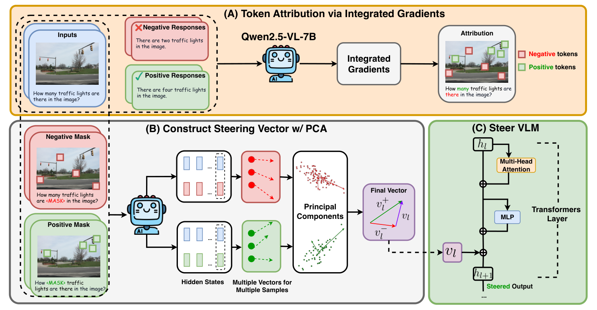](architecture/grains-attribution-steering-pipeline/original.pdf)

来源类型：论文范例。许可：arXiv 非独占分发许可（私有参考）。
[原文件](architecture/grains-attribution-steering-pipeline/original.pdf) · [来源记录](architecture/grains-attribution-steering-pipeline/metadata.json)

### [Graph of Thoughts · 64 个数字的分支排序](architecture/graph-of-thoughts-sorting-walkthrough/README.md)

用同一组 64 个数字说明如何拆成四个子数组、比较候选排序、保留高分结果并逐层合并。上方有全局操作图，下方附中间结果、分数与参数批注。

AAAI 2024 · 会议论文，未核实 Oral · 矢量 + 原有位图

[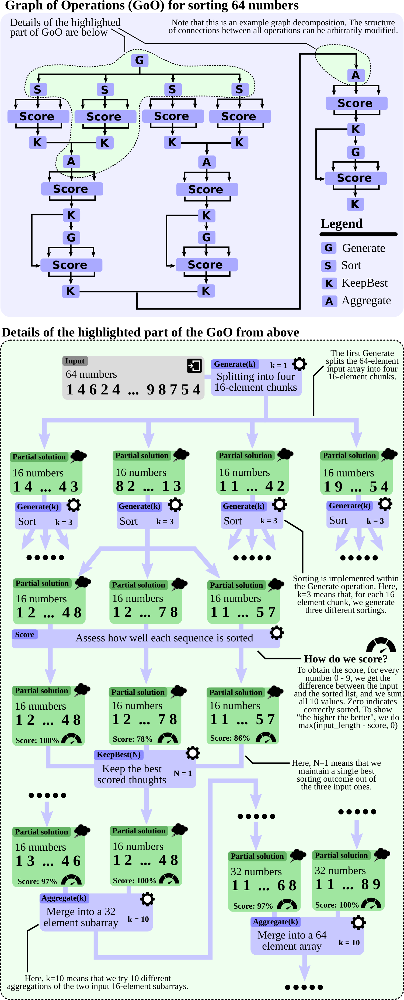](architecture/graph-of-thoughts-sorting-walkthrough/original.pdf)

来源类型：论文范例。许可：arXiv 非独占分发许可（私有参考）。
[原文件](architecture/graph-of-thoughts-sorting-walkthrough/original.pdf) · [来源记录](architecture/graph-of-thoughts-sorting-walkthrough/metadata.json)

### [HippoRAG · 三脑区类比与索引检索框架](architecture/hipporag-brain-region-framework/README.md)

上方三个脑区与下方 LLM、检索编码器、知识图谱及 PageRank 一一对应，再按离线索引和在线检索两行展开。

NeurIPS 2024 · 会议论文，未核实 Oral · 矢量 + 原有位图

[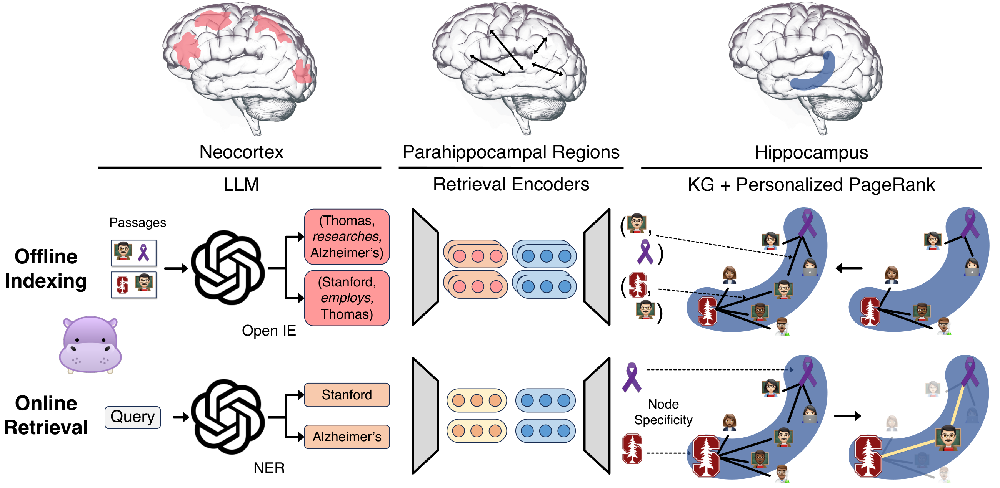](architecture/hipporag-brain-region-framework/original.pdf)

来源类型：论文范例。许可：作者保留权利 / 私有参考。
[原文件](architecture/hipporag-brain-region-framework/original.pdf) · [来源记录](architecture/hipporag-brain-region-framework/metadata.json)

### [HippoRAG 2 · 图谱索引、筛选与检索双阶段](architecture/hipporag2-indexing-retrieval-framework/README.md)

两行分别展示离线知识图谱构建与在线问答。节点、边与颜色图例明确，局部图谱逐步变化，解释三元组筛选、种子权重与 PageRank。

ICML 2025 · 会议论文，未核实 Oral · 矢量结构

来源类型：论文范例。许可：作者保留权利 / 私有参考。
[原文件](architecture/hipporag2-indexing-retrieval-framework/original.pdf) · [来源记录](architecture/hipporag2-indexing-retrieval-framework/metadata.json)

### [Instant NGP · 多分辨率哈希编码到 MLP](architecture/instant-ngp-hash-architecture/README.md)

通过五个编号步骤，将空间采样、哈希查表、插值、拼接与网络连接起来；不同尺度的颜色可贯穿整张图。

SIGGRAPH 2022 · 会议论文，未核实 Oral · 矢量 + 原有位图

来源类型：论文范例。许可：作者保留权利 / 参考收录。
[原文件](architecture/instant-ngp-hash-architecture/source.svg) · [来源记录](architecture/instant-ngp-hash-architecture/metadata.json)

### [IRCoT · 歌曲作者问答的多轮检索与推理](architecture/ircot-songwriting-multihop-retrieval/README.md)

以追查 Murray Head 代表歌曲的作者为主线。每轮生成的推理句成为下一轮检索查询，文档不断累加，右侧展示模块输入和提示词组成。

ACL 2023 · 会议论文，未核实 Oral · 矢量 + 原有位图

[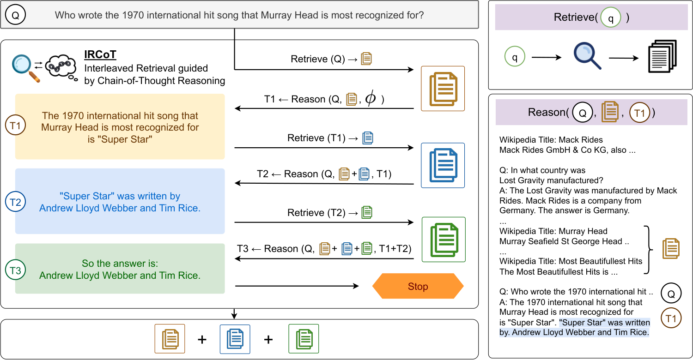](architecture/ircot-songwriting-multihop-retrieval/original.pdf)

来源类型：论文范例。许可：CC BY 4.0（所收录论文版本）。
[原文件](architecture/ircot-songwriting-multihop-retrieval/original.pdf) · [来源记录](architecture/ircot-songwriting-multihop-retrieval/metadata.json)

### [LAV：感知、预测与驾驶控制流程](architecture/lav/README.md)

多摄像头输入、语义分割、传感器融合、三维主干、运动预测与控制的整体数据流。原文件虽叫 teaser.svg，按内容归入 architecture。

来源类型：论文范例。许可：Apache-2.0（来源仓库）。。
[原文件](architecture/lav/source.svg) · [来源记录](architecture/lav/metadata.json)

### [LGM · 非对称 U-Net 与跨视角注意力](architecture/lgm-architecture/README.md)

把多视图输入、相机射线编码、U-Net、三维融合和监督闭环放在一张图里；顶部局部放大说明跨视角交互。

ECCV 2024 · Oral · 矢量 + 原有位图

来源类型：论文范例。许可：作者保留权利 / 参考收录。
[原文件](architecture/lgm-architecture/source.svg) · [来源记录](architecture/lgm-architecture/metadata.json)

### [LGM · 从文本或图像到三维高斯和网格的流程](architecture/lgm-pipeline/README.md)

用少量大模块完成端到端说明，同时把各阶段耗时直接放在阶段下方，适合紧凑的方法总览。

ECCV 2024 · Oral · 矢量 + 原有位图

来源类型：论文范例。许可：作者保留权利 / 参考收录。
[原文件](architecture/lgm-pipeline/source.svg) · [来源记录](architecture/lgm-pipeline/metadata.json)

### [LightGlue：注意力、动态剪枝与匹配](architecture/lightglue/README.md)

双分支局部特征经过 self/cross attention、置信度预测、剪枝和匹配分配。

来源类型：论文范例。许可：Apache-2.0（来源仓库）。。
[原文件](architecture/lightglue/source.svg) · [来源记录](architecture/lightglue/metadata.json)

### [LightMem · 感觉过滤、主题记忆与睡眠更新三面板](architecture/lightmem-sensory-topic-sleep-framework/README.md)

三面板以实际对话和记忆项解释 token 过滤、主题切分、结构化摘要与离线合并；包含注意力矩阵、局部峰值及更新队列。

ICLR 2026 · 会议论文，未核实 Oral · 整图位图，仅构图参考

来源类型：论文范例。许可：作者保留权利 / 私有参考。
[原文件](architecture/lightmem-sensory-topic-sleep-framework/original.png) · [来源记录](architecture/lightmem-sensory-topic-sleep-framework/metadata.json)

### [LLaVA · 视觉投影与语言 token 的统一输入](architecture/llava-original-architecture/README.md)

用颜色和形状区分视觉 token、指令 token 与生成 token，投影层把图像特征接入语言模型的关系简洁清楚。

NeurIPS 2023 · Oral · 矢量结构

[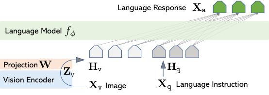](architecture/llava-original-architecture/source.svg)

来源类型：论文范例。许可：CC-BY-4.0。
[原文件](architecture/llava-original-architecture/source.svg) · [来源记录](architecture/llava-original-architecture/metadata.json)

### [双稳态折纸机器人 · 结构、磁驱动与运动模式](architecture/magnetic-bistable-origami-robot-design-actuation/README.md)

A–J 十个面板将折痕与铰链几何、原型和力学曲线、四线圈驱动装置与控制流程排在同一版。下方用一条示例路线和编号把八种形变与运动模式对应起来。

Nature Communications 2026 · 期刊论文 · 整图位图，仅构图参考

[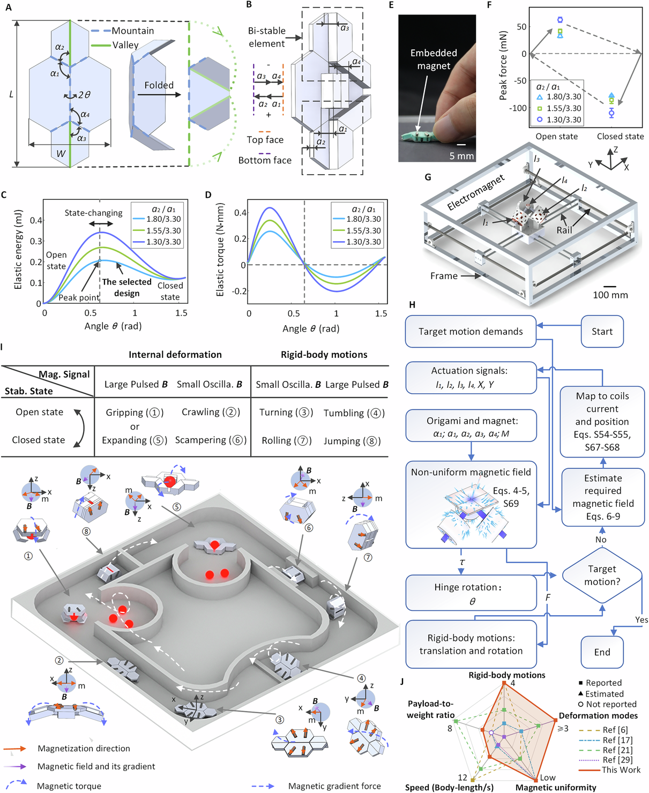](architecture/magnetic-bistable-origami-robot-design-actuation/original.png)

来源类型：论文范例。许可：CC BY 4.0（出版社图版）。
[原文件](architecture/magnetic-bistable-origami-robot-design-actuation/original.png) · [来源记录](architecture/magnetic-bistable-origami-robot-design-actuation/metadata.json)

### [MemoryOS · 三层记忆、动态更新与回答生成](architecture/memoryos-three-tier-memory-framework/README.md)

短期、中期和长期个人记忆并排展开，包含队列、页面、热度、用户画像与检索回路；上下主线把存储、更新和生成串起来。

EMNLP 2025 · Oral · 矢量 + 原有位图

[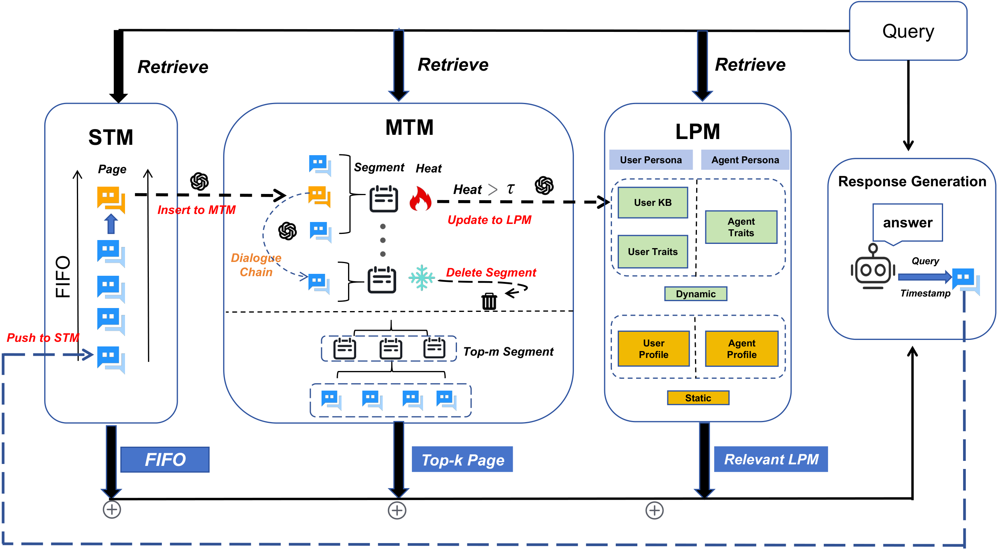](architecture/memoryos-three-tier-memory-framework/original.pdf)

来源类型：论文范例。许可：作者保留权利 / 私有参考。
[原文件](architecture/memoryos-three-tier-memory-framework/original.pdf) · [来源记录](architecture/memoryos-three-tier-memory-framework/metadata.json)

### [MemoryVLA · 感知认知记忆库与扩散动作网络](architecture/memoryvla-perceptual-cognitive-architecture/README.md)

左侧视觉与语言编码，中间感知认知记忆库、检索、门控融合和巩固回路，右侧展开动作专家的双路注意力与去噪结构。

ICLR 2026 · 会议论文，未核实 Oral · 矢量 + 原有位图

来源类型：论文范例。许可：作者保留权利 / 私有参考。
[原文件](architecture/memoryvla-perceptual-cognitive-architecture/original.pdf) · [来源记录](architecture/memoryvla-perceptual-cognitive-architecture/metadata.json)

### [MExGen · 问答扰动与逐级文本归因](architecture/mexgen-perturbation-attribution-workflow/README.md)

围绕一条出生地问答展开文本切分和三条并行扰动。每个回答旁保留具体的标量分数，最后回到着色的原文本并用虚线表示进一步细分。

ACL 2025 · Oral · 矢量 + 原有位图

[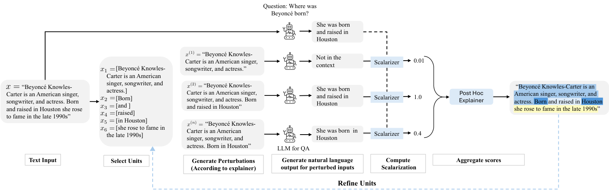](architecture/mexgen-perturbation-attribution-workflow/original.pdf)

来源类型：论文范例。许可：CC BY 4.0（所收录论文版本）。
[原文件](architecture/mexgen-perturbation-attribution-workflow/original.pdf) · [来源记录](architecture/mexgen-perturbation-attribution-workflow/metadata.json)

### [多尺度网络总览与模块展开](architecture/multiscale-network/README.md)

作者 Illustrator 科研绘图教程中的多尺度网络案例：Backbone、高低层特征、SPPA／LFSA／GMFF 模块、预测结果，以及模块细节。原文件含 7 个画板。

来源类型：教材或教程范例。许可：未发现明确 LICENSE。
[原文件](architecture/multiscale-network/source.ai) · [来源记录](architecture/multiscale-network/metadata.json)

### [MVSplat · 多视图匹配、代价体与三维高斯预测](architecture/mvsplat-architecture/README.md)

输入视图、匹配特征、代价体、深度及三维表示沿一条阅读方向展开，两个视图始终保持上下对应关系。

ECCV 2024 · Oral · 矢量 + 原有位图

来源类型：论文范例。许可：CC-BY-4.0。
[原文件](architecture/mvsplat-architecture/source.svg) · [来源记录](architecture/mvsplat-architecture/metadata.json)

### [pixelSplat · 概率深度采样与像素对齐高斯](architecture/pixelsplat-probabilistic-architecture/README.md)

用相机、射线、离散概率柱状图和连续高斯对应表达同一预测过程，抽象参数与几何对象能在图中逐一对上。

CVPR 2024 · 会议论文，未核实 Oral · 矢量 + 原有位图

来源类型：论文范例。许可：作者保留权利 / 参考收录。
[原文件](architecture/pixelsplat-probabilistic-architecture/source.svg) · [来源记录](architecture/pixelsplat-probabilistic-architecture/metadata.json)

### [RayDer：统一 Transformer 的两个使用阶段](architecture/rayder/README.md)

左右并列相机估计与新视角合成，清楚标明共用模型与不同输入输出。

来源类型：论文范例。许可：保存仓库原许可证；用途限于其原有条款。。
[原文件](architecture/rayder/source.svg) · [来源记录](architecture/rayder/metadata.json)

### [RUST：编码器、场景表示与位姿分支](architecture/rust/README.md)

无位姿输入图像经 Encoder、场景表示、Decoder 输出新视角，训练时有 Pose Estimator 分支。按内容归入 architecture。

来源类型：论文范例。许可：项目仓库未发现 LICENSE；仅作出处明确的参考，元素提取不新增授权。。
[原文件](architecture/rust/source.svg) · [来源记录](architecture/rust/metadata.json)

### [SAM / LoRA 总体流程与 Transformer 模块](architecture/sam-lora/README.md)

作者 Illustrator 科研绘图教程中的 SAM / LoRA 案例，含总体方法流程与 Transformer／LoRA 模块结构，共 2 个画板；公开的 PNG、PDF 与 PPTX 配套素材一并保留。

来源类型：教材或教程范例。许可：未发现明确 LICENSE。
[原文件](architecture/sam-lora/source.ai) · [来源记录](architecture/sam-lora/metadata.json)

### [SAM 2 · 流式编码、记忆注意力与记忆库](architecture/sam2-memory-architecture/README.md)

沿时间方向叠放帧和特征，主线保留当前帧的编码与解码，顶部多条回线单独表达历史记忆参与计算。

ICLR 2025 · Oral · 矢量 + 原有位图

来源类型：论文范例。许可：作者保留权利 / 参考收录。
[原文件](architecture/sam2-memory-architecture/source.svg) · [来源记录](architecture/sam2-memory-architecture/metadata.json)

### [SD3 · 双模态主干与 MM-DiT block 展开](architecture/sd3-mmdit-architecture/README.md)

左侧说明文本与图像条件如何进入主干，右侧以对称双路结构展开联合注意力，颜色和符号在两部分保持一致。

ICML 2024 · Oral · 矢量结构

来源类型：论文范例。许可：作者保留权利 / 参考收录。
[原文件](architecture/sd3-mmdit-architecture/source.svg) · [来源记录](architecture/sd3-mmdit-architecture/metadata.json)

### [Self-RAG · 检索、并行生成与自评选择](architecture/selfrag-retrieve-generate-critique/README.md)

左侧是固定检索 RAG，右侧完整展开按需检索、并行生成和自评选择，下方再用不需要检索的请求形成补充对照。

ICLR 2024 · Oral · 矢量 + 原有位图

来源类型：论文范例。许可：CC BY 4.0（所收录论文版本）。
[原文件](architecture/selfrag-retrieve-generate-critique/original.pdf) · [来源记录](architecture/selfrag-retrieve-generate-critique/metadata.json)

### [Speculative RAG · 并行起草与通用模型验证](architecture/speculative-rag-draft-verify/README.md)

小型专用 RAG 模型对不同文档子集并行生成答案草稿和依据，再由大型通用模型验证并选择。图内明确展示查询、文档、答案、依据与两类模型之间的数据流。

ICLR 2025 · 会议论文，未核实 Oral · 矢量 + 原有位图

来源类型：论文范例。许可：作者保留权利 / 私有参考。
[原文件](architecture/speculative-rag-draft-verify/original.pdf) · [来源记录](architecture/speculative-rag-draft-verify/metadata.json)

### [Agent 概念框架 · 感知、大脑与行动](architecture/survey-agent-perception-brain-action/README.md)

用环境交互闭环串起感知、大脑与行动，同时在右侧展开存储和决策能力；适合作为综述统一框架图的构图参考。

arXiv 2023 · 预印本 · 综述 · 矢量 + 原有位图

[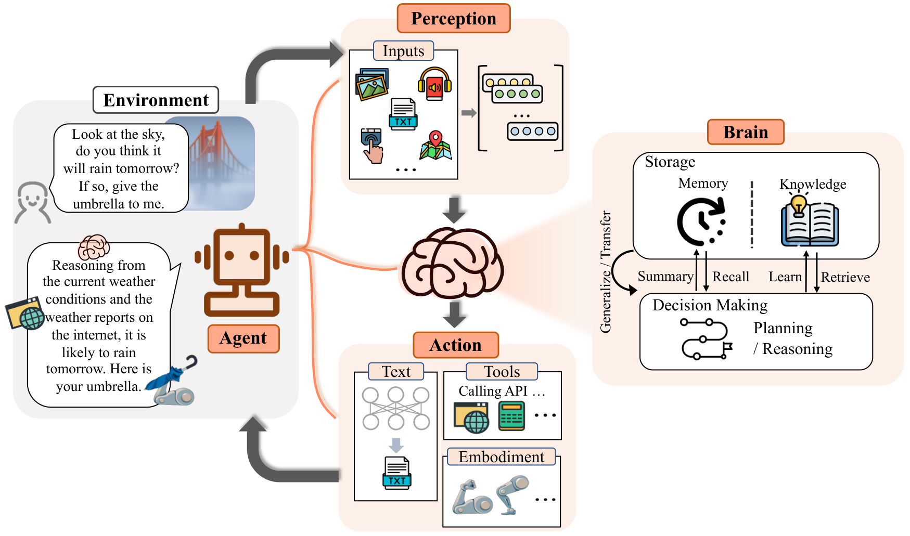](architecture/survey-agent-perception-brain-action/original.pdf)

来源类型：论文范例。许可：作者保留权利 / 私有参考。
[原文件](architecture/survey-agent-perception-brain-action/original.pdf) · [来源记录](architecture/survey-agent-perception-brain-action/metadata.json)

### [AI 记忆综述 · 感觉、短期、长期记忆与行动闭环](architecture/survey-ai-memory-agent-feedback-framework/README.md)

层叠的感觉、短期和长期记忆与右侧策略推理相连，外圈串联环境、观测、行动与人类反馈；图内保留具体记忆内容和多模态输入。

arXiv 2026 · 预印本 · 综述 · 矢量 + 原有位图

[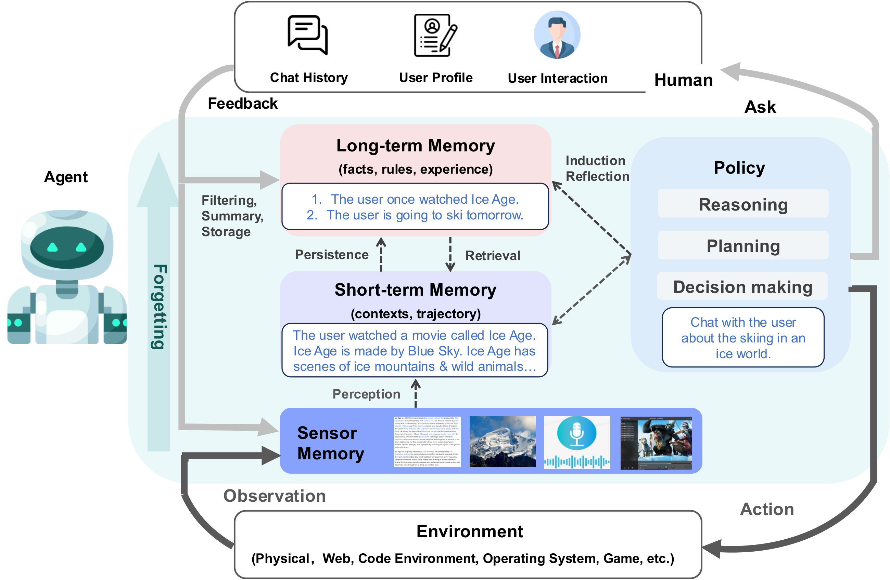](architecture/survey-ai-memory-agent-feedback-framework/original.pdf)

来源类型：论文范例。许可：作者保留权利 / 私有参考。
[原文件](architecture/survey-ai-memory-agent-feedback-framework/original.pdf) · [来源记录](architecture/survey-ai-memory-agent-feedback-framework/metadata.json)

### [自主 Agent 统一框架 · 四列模块分解](architecture/survey-autonomous-agent-modules/README.md)

将 Profile、Memory、Planning、Action 并列成四列，列内再分子能力，顶部说明共享的 LLM 基础，适合综述比较多个系统的共同组成。

Frontiers of Computer Science 2024 · 期刊论文 · 综述 · 矢量 + 原有位图

来源类型：论文范例。许可：CC-BY-4.0。
[原文件](architecture/survey-autonomous-agent-modules/original.pdf) · [来源记录](architecture/survey-autonomous-agent-modules/metadata.json)

### [GenAI 语义通信 · 语义记忆与物理信道双路框架](architecture/survey-genai-semantic-memory-framework/README.md)

发送端先提取共同知识和变化数据，上路通过两端语义记忆共享知识，下路通过 DJSCC 编解码与无线信道重建数据，最后输出预测。

arXiv 2024 · 预印本 · 综述 · 矢量 + 原有位图

[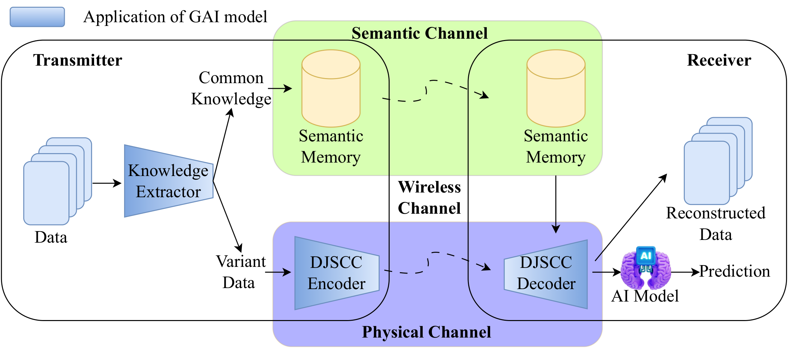](architecture/survey-genai-semantic-memory-framework/original.pdf)

来源类型：论文范例。许可：作者保留权利 / 私有参考。
[原文件](architecture/survey-genai-semantic-memory-framework/original.pdf) · [来源记录](architecture/survey-genai-semantic-memory-framework/metadata.json)

### [MLLM 统一架构 · 模态接口与连接器对照](architecture/survey-mllm-connector-framework/README.md)

上半部统一多模态输入、编码器、连接器、LLM 与生成器，下半部并列展开 MLP、Q-Former 和注意力连接方式，兼顾全局和接口差异。

National Science Review 2024 · 期刊论文 · 综述 · 矢量结构

[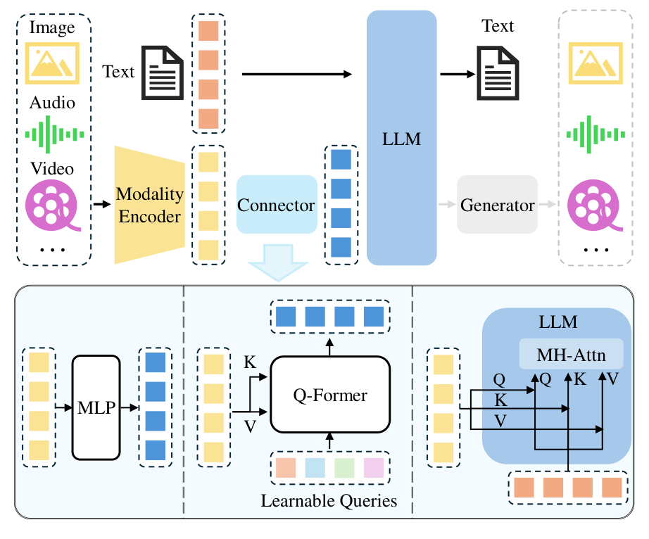](architecture/survey-mllm-connector-framework/original.pdf)

来源类型：论文范例。许可：CC-BY-4.0。
[原文件](architecture/survey-mllm-connector-framework/original.pdf) · [来源记录](architecture/survey-mllm-connector-framework/metadata.json)

### [Tokengeist · 五轮退款对话的递归溯源](architecture/tokengeist-refund-provenance-trace/README.md)

一段五轮退款对话贯穿全图。逐层展示词元分数如何汇总到对话轮次、如何选取父节点，以及如何将有向无环图裁剪成最终溯源链。

arXiv 2026 · 预印本 · 矢量 + 原有位图

[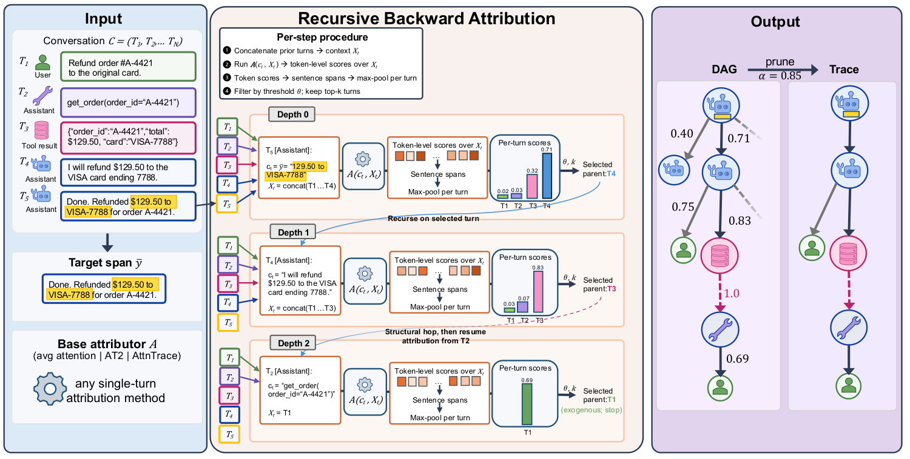](architecture/tokengeist-refund-provenance-trace/original.pdf)

来源类型：论文范例。许可：CC BY 4.0（所收录论文版本）。
[原文件](architecture/tokengeist-refund-provenance-trace/original.pdf) · [来源记录](architecture/tokengeist-refund-provenance-trace/metadata.json)

### [Tree of Thoughts · 24 点的分支生成与评估](architecture/tree-of-thoughts-game24-search/README.md)

用 4、9、10、13 玩 24 点。左侧保留每次运算后剩余的数，右侧拿树上的输入和候选状态展开生成与评估模块。

NeurIPS 2023 · 会议论文，未核实 Oral · 矢量结构

来源类型：论文范例。许可：CC BY 4.0（所收录论文版本）。
[原文件](architecture/tree-of-thoughts-game24-search/original.pdf) · [来源记录](architecture/tree-of-thoughts-game24-search/metadata.json)

### [VAR · 多尺度 VQVAE 与 VAR 两阶段训练](architecture/var-architecture/README.md)

两块并列区域分别解释表示学习和自回归训练，尺度、token 序列和因果 mask 的对应关系可在图中追踪。

NeurIPS 2024 · Oral · 矢量 + 原有位图

来源类型：论文范例。许可：CC0-1.0。
[原文件](architecture/var-architecture/source.svg) · [来源记录](architecture/var-architecture/metadata.json)

### [VGGT · 交替注意力主干与多任务输出头](architecture/vggt-architecture/README.md)

整图始终沿左到右阅读；颜色区分 token，虚线框标出重复主干，右侧分组展开输出任务。

CVPR 2025 · Oral · 矢量 + 原有位图

来源类型：论文范例。许可：作者保留权利 / 参考收录。
[原文件](architecture/vggt-architecture/source.svg) · [来源记录](architecture/vggt-architecture/metadata.json)

### [ViT 原论文 · 图像分块、token 序列与编码器展开](architecture/vit-original-architecture/README.md)

输入图像、patch 序列、位置编码和分类 token 都有直观的对应关系；右侧独立展开重复的 Transformer 编码器。

ICLR 2021 · Oral · 矢量 + 原有位图

[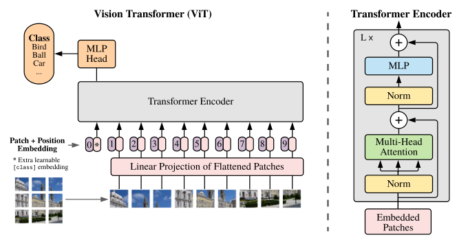](architecture/vit-original-architecture/source.svg)

来源类型：论文范例。许可：作者保留权利 / 参考收录。
[原文件](architecture/vit-original-architecture/source.svg) · [来源记录](architecture/vit-original-architecture/metadata.json)

### [VoxPoser · 开抽屉并绕开花瓶的轨迹规划](architecture/voxposer-drawer-value-map-planning/README.md)

用“打开上层抽屉并避开花瓶”串起双相机观测、视觉语言模型、代码、可供性图与约束图，最后叠加机器人末端轨迹。

CoRL 2023 · 会议论文，未核实 Oral · 矢量 + 原有位图

来源类型：论文范例。许可：arXiv 非独占分发许可（私有参考）。
[原文件](architecture/voxposer-drawer-value-map-planning/original.pdf) · [来源记录](architecture/voxposer-drawer-value-map-planning/metadata.json)

### [VTrace · 从回答到视觉证据的多跳归因](architecture/vtrace-multihop-visual-attribution/README.md)

用小狗跳过倒木的视觉问答展示直接归因、两跳和更长路径。左侧展开图像块与成对归因矩阵，底部对照校准前后的词元和图像块排序。

arXiv 2026 · 预印本 · 矢量 + 原有位图

来源类型：论文范例。许可：CC BY 4.0（所收录论文版本）。
[原文件](architecture/vtrace-multihop-visual-attribution/original.pdf) · [来源记录](architecture/vtrace-multihop-visual-attribution/metadata.json)

## 多面板大图

[按图版编排浏览全部大图与原件](multipanel/README.md)

## Element

[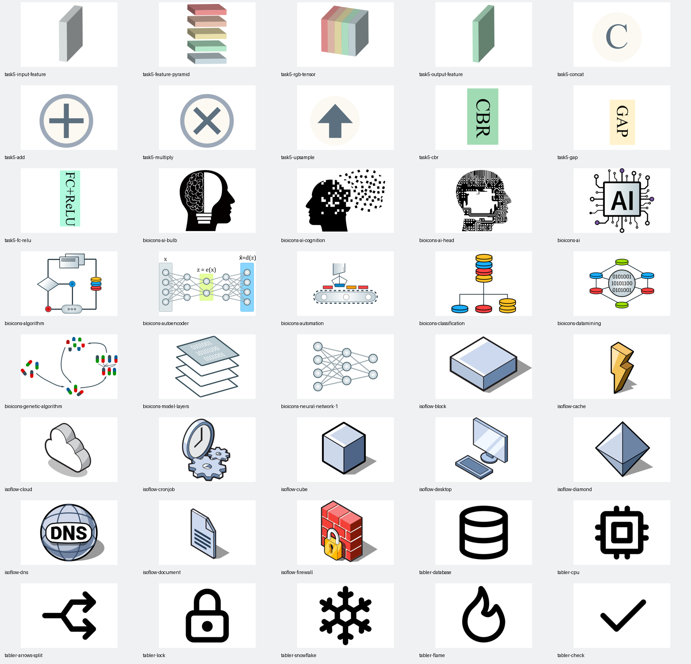](element/README.md)

[元素分类目录](element/README.md) · [范例与元素对照表](element/with-examples.md) · [离线检索](element/gallery.html)

辅助入口：[完整机制参考](references/mechanisms/README.md)。这些完整机制图不计入最小元素数量。
