# 素材总目录

[仓库首页](README.md) · [元素分类目录](elements/README.md) · [JSON 来源索引](catalog.json)

| 类别 | 数量 | 入口 |
|---|---:|---|
| Teaser 范例 | 7 | [浏览](examples/teasers/README.md) |
| Architecture 范例 | 23 | [浏览](examples/architectures/README.md) |
| 机制参考图 | 17 | [浏览](references/mechanisms/README.md) |
| 原生版式模板 | 11 | [浏览](templates/layouts/README.md) |
| 最小可复用元素 | 317 | [按内容与来源浏览](elements/README.md) |

## 元素入口

完整机制图、版式母版与完整架构图分别计数；它们不计入最小图元数量。

## Teaser 范例

### [Uneven Double Refraction：原型与成像能力展示](examples/teasers/birefractive-rgbd/README.md)

相机原型、输入、恢复彩色图和深度图横排，适合硬件或成像方法的 teaser。

来源类型：论文范例。许可：MIT（来源仓库）；照片与实验结果按原来源保留。。
[原文件](examples/teasers/birefractive-rgbd/source.svg) · [来源记录](examples/teasers/birefractive-rgbd/metadata.json)

### [DECOLLAGE：局部风格控制与三维细化](examples/teasers/decollage/README.md)

从粗体素结构出发，用不同示例为局部赋予风格，再展示细化结果。作者的首屏 teaser，包含原始矢量箭头与嵌入渲染图。

来源类型：论文范例。许可：MIT。
[原文件](examples/teasers/decollage/source.svg) · [来源记录](examples/teasers/decollage/metadata.json)

### [K-LoRA：主体风格组合与训练范式比较](examples/teasers/k-lora/README.md)

左侧主体与风格组合示例，右侧比较需要训练与免训练的融合方式。

来源类型：论文范例。许可：作者 README 声明 CC BY-NC 4.0；内嵌示例素材保留原出处。。
[原文件](examples/teasers/k-lora/source.svg) · [来源记录](examples/teasers/k-lora/metadata.json)

### [LightGlue：速度与精度权衡](examples/teasers/lightglue-tradeoff/README.md)

准确率与吞吐量的权衡作为论文的贡献展示，比较固定深度、动态深度与既有方法。它属于结果型 teaser。

来源类型：论文范例。许可：Apache-2.0。
[原文件](examples/teasers/lightglue-tradeoff/source.svg) · [来源记录](examples/teasers/lightglue-tradeoff/metadata.json)

### [OrienterNet：用二维地图定位的任务与动机](examples/teasers/orienternet/README.md)

展示人类使用二维地图与既有三维点云定位的差别，再给出新方法的输入与输出。

来源类型：论文范例。许可：第三方图片与地图包含多种权利；图本身未见单独复用授权。。
[原文件](examples/teasers/orienternet/source.svg) · [来源记录](examples/teasers/orienternet/metadata.json)

### [RayDer：数据瓶颈与新训练范式](examples/teasers/rayder-concept/README.md)

数据金字塔、训练过程、结果与规模变化并列，先说明问题和核心差异。

来源类型：论文范例。许可：保存仓库原许可证；用途限于其原有条款。。
[原文件](examples/teasers/rayder-concept/source.svg) · [来源记录](examples/teasers/rayder-concept/metadata.json)

### [ShaDDR：粗形状与示例驱动的成果展示](examples/teasers/shaddr/README.md)

上排粗形状与风格示例，下排生成结果与局部放大，以成果直接展示任务和贡献。

来源类型：论文范例。许可：MIT（来源仓库）；渲染素材保留原论文出处。。
[原文件](examples/teasers/shaddr/source.svg) · [来源记录](examples/teasers/shaddr/metadata.json)

## Architecture 范例

### [CLIP Figure 1：训练到零样本预测](examples/architectures/clip/README.md)

CLIP 的训练与零样本使用流程，按方法流程归入 architecture。

来源类型：论文范例。许可：arXiv non-exclusive distribution license。
[原文件](examples/architectures/clip/source.svg) · [来源记录](examples/architectures/clip/metadata.json)

### [D2L · AlexNet](examples/architectures/d2l-alexnet/README.md)

D2L 教材作者提供的原始矢量图，适合借鉴结构与模块表达；明确作为教材范例收录。

来源类型：教材或教程范例。许可：CC-BY-SA-4.0。
[原文件](examples/architectures/d2l-alexnet/source.svg) · [来源记录](examples/architectures/d2l-alexnet/metadata.json)

### [D2L · DenseNet 密集连接块](examples/architectures/d2l-densenet-block/README.md)

D2L 教材作者提供的原始矢量图，适合借鉴结构与模块表达；明确作为教材范例收录。

来源类型：教材或教程范例。许可：CC-BY-SA-4.0。
[原文件](examples/architectures/d2l-densenet-block/source.svg) · [来源记录](examples/architectures/d2l-densenet-block/metadata.json)

### [D2L · 编码器—解码器](examples/architectures/d2l-encoder-decoder/README.md)

D2L 教材作者提供的原始矢量图，适合借鉴结构与模块表达；明确作为教材范例收录。

来源类型：教材或教程范例。许可：CC-BY-SA-4.0。
[原文件](examples/architectures/d2l-encoder-decoder/source.svg) · [来源记录](examples/architectures/d2l-encoder-decoder/metadata.json)

### [D2L · 全卷积网络](examples/architectures/d2l-fcn/README.md)

D2L 教材作者提供的原始矢量图，适合借鉴结构与模块表达；明确作为教材范例收录。

来源类型：教材或教程范例。许可：CC-BY-SA-4.0。
[原文件](examples/architectures/d2l-fcn/source.svg) · [来源记录](examples/architectures/d2l-fcn/metadata.json)

### [D2L · 生成对抗网络](examples/architectures/d2l-gan/README.md)

D2L 教材作者提供的原始矢量图，适合借鉴结构与模块表达；明确作为教材范例收录。

来源类型：教材或教程范例。许可：CC-BY-SA-4.0。
[原文件](examples/architectures/d2l-gan/source.svg) · [来源记录](examples/architectures/d2l-gan/metadata.json)

### [D2L · GRU 内部门控](examples/architectures/d2l-gru-3/README.md)

D2L 教材作者提供的原始矢量图，适合借鉴结构与模块表达；明确作为教材范例收录。

来源类型：教材或教程范例。许可：CC-BY-SA-4.0。
[原文件](examples/architectures/d2l-gru-3/source.svg) · [来源记录](examples/architectures/d2l-gru-3/metadata.json)

### [D2L · Inception 并行分支](examples/architectures/d2l-inception/README.md)

D2L 教材作者提供的原始矢量图，适合借鉴结构与模块表达；明确作为教材范例收录。

来源类型：教材或教程范例。许可：CC-BY-SA-4.0。
[原文件](examples/architectures/d2l-inception/source.svg) · [来源记录](examples/architectures/d2l-inception/metadata.json)

### [D2L · LeNet](examples/architectures/d2l-lenet/README.md)

D2L 教材作者提供的原始矢量图，适合借鉴结构与模块表达；明确作为教材范例收录。

来源类型：教材或教程范例。许可：CC-BY-SA-4.0。
[原文件](examples/architectures/d2l-lenet/source.svg) · [来源记录](examples/architectures/d2l-lenet/metadata.json)

### [D2L · LSTM 内部门控](examples/architectures/d2l-lstm-3/README.md)

D2L 教材作者提供的原始矢量图，适合借鉴结构与模块表达；明确作为教材范例收录。

来源类型：教材或教程范例。许可：CC-BY-SA-4.0。
[原文件](examples/architectures/d2l-lstm-3/source.svg) · [来源记录](examples/architectures/d2l-lstm-3/metadata.json)

### [D2L · 多层感知机](examples/architectures/d2l-mlp/README.md)

D2L 教材作者提供的原始矢量图，适合借鉴结构与模块表达；明确作为教材范例收录。

来源类型：教材或教程范例。许可：CC-BY-SA-4.0。
[原文件](examples/architectures/d2l-mlp/source.svg) · [来源记录](examples/architectures/d2l-mlp/metadata.json)

### [D2L · ResNet 残差块](examples/architectures/d2l-resnet-block/README.md)

D2L 教材作者提供的原始矢量图，适合借鉴结构与模块表达；明确作为教材范例收录。

来源类型：教材或教程范例。许可：CC-BY-SA-4.0。
[原文件](examples/architectures/d2l-resnet-block/source.svg) · [来源记录](examples/architectures/d2l-resnet-block/metadata.json)

### [D2L · ResNeXt 分组残差块](examples/architectures/d2l-resnext-block/README.md)

D2L 教材作者提供的原始矢量图，适合借鉴结构与模块表达；明确作为教材范例收录。

来源类型：教材或教程范例。许可：CC-BY-SA-4.0。
[原文件](examples/architectures/d2l-resnext-block/source.svg) · [来源记录](examples/architectures/d2l-resnext-block/metadata.json)

### [D2L · 带注意力的 Seq2Seq](examples/architectures/d2l-seq2seq-attention/README.md)

D2L 教材作者提供的原始矢量图，适合借鉴结构与模块表达；明确作为教材范例收录。

来源类型：教材或教程范例。许可：CC-BY-SA-4.0。
[原文件](examples/architectures/d2l-seq2seq-attention/source.svg) · [来源记录](examples/architectures/d2l-seq2seq-attention/metadata.json)

### [D2L · Transformer 编码器与解码器](examples/architectures/d2l-transformer/README.md)

D2L 教材作者提供的原始矢量图，适合借鉴结构与模块表达；明确作为教材范例收录。

来源类型：教材或教程范例。许可：CC-BY-SA-4.0。
[原文件](examples/architectures/d2l-transformer/source.svg) · [来源记录](examples/architectures/d2l-transformer/metadata.json)

### [D2L · VGG](examples/architectures/d2l-vgg/README.md)

D2L 教材作者提供的原始矢量图，适合借鉴结构与模块表达；明确作为教材范例收录。

来源类型：教材或教程范例。许可：CC-BY-SA-4.0。
[原文件](examples/architectures/d2l-vgg/source.svg) · [来源记录](examples/architectures/d2l-vgg/metadata.json)

### [D2L · Vision Transformer](examples/architectures/d2l-vit/README.md)

D2L 教材作者提供的原始矢量图，适合借鉴结构与模块表达；明确作为教材范例收录。

来源类型：教材或教程范例。许可：CC-BY-SA-4.0。
[原文件](examples/architectures/d2l-vit/source.svg) · [来源记录](examples/architectures/d2l-vit/metadata.json)

### [LAV：感知、预测与驾驶控制流程](examples/architectures/lav/README.md)

多摄像头输入、语义分割、传感器融合、三维主干、运动预测与控制的整体数据流。原文件虽叫 teaser.svg，按内容归入 architecture。

来源类型：论文范例。许可：Apache-2.0（来源仓库）。。
[原文件](examples/architectures/lav/source.svg) · [来源记录](examples/architectures/lav/metadata.json)

### [LightGlue：注意力、动态剪枝与匹配](examples/architectures/lightglue/README.md)

双分支局部特征经过 self/cross attention、置信度预测、剪枝和匹配分配。

来源类型：论文范例。许可：Apache-2.0（来源仓库）。。
[原文件](examples/architectures/lightglue/source.svg) · [来源记录](examples/architectures/lightglue/metadata.json)

### [多尺度网络总览与模块展开](examples/architectures/multiscale-network/README.md)

作者 Illustrator 科研绘图教程中的多尺度网络案例：Backbone、高低层特征、SPPA／LFSA／GMFF 模块、预测结果，以及模块细节。原文件含 7 个画板。

来源类型：教材或教程范例。许可：未发现明确 LICENSE。
[原文件](examples/architectures/multiscale-network/source.ai) · [来源记录](examples/architectures/multiscale-network/metadata.json)

### [RayDer：统一 Transformer 的两个使用阶段](examples/architectures/rayder/README.md)

左右并列相机估计与新视角合成，清楚标明共用模型与不同输入输出。

来源类型：论文范例。许可：保存仓库原许可证；用途限于其原有条款。。
[原文件](examples/architectures/rayder/source.svg) · [来源记录](examples/architectures/rayder/metadata.json)

### [RUST：编码器、场景表示与位姿分支](examples/architectures/rust/README.md)

无位姿输入图像经 Encoder、场景表示、Decoder 输出新视角，训练时有 Pose Estimator 分支。按内容归入 architecture。

来源类型：论文范例。许可：项目仓库未发现 LICENSE；仅作出处明确的参考，元素提取不新增授权。。
[原文件](examples/architectures/rust/source.svg) · [来源记录](examples/architectures/rust/metadata.json)

### [SAM / LoRA 总体流程与 Transformer 模块](examples/architectures/sam-lora/README.md)

作者 Illustrator 科研绘图教程中的 SAM / LoRA 案例，含总体方法流程与 Transformer／LoRA 模块结构，共 2 个画板；公开的 PNG、PDF 与 PPTX 配套素材一并保留。

来源类型：教材或教程范例。许可：未发现明确 LICENSE。
[原文件](examples/architectures/sam-lora/source.ai) · [来源记录](examples/architectures/sam-lora/metadata.json)

## 机制参考图

### [D2L · 注意力输出](references/mechanisms/d2l-attention-output/README.md)

完整机制示意，保留原标注供参考或拆取图形；这不是单个最小图元，不计入元素数量。

[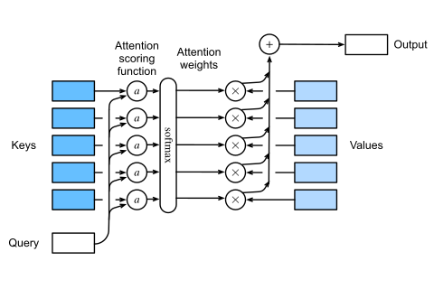](references/mechanisms/d2l-attention-output/source.svg)

来源类型：教材或教程范例。许可：CC-BY-SA-4.0。
[原文件](references/mechanisms/d2l-attention-output/source.svg) · [来源记录](references/mechanisms/d2l-attention-output/metadata.json)

### [D2L · 1×1 卷积](references/mechanisms/d2l-conv-1x1/README.md)

完整机制示意，保留原标注供参考或拆取图形；这不是单个最小图元，不计入元素数量。

来源类型：教材或教程范例。许可：CC-BY-SA-4.0。
[原文件](references/mechanisms/d2l-conv-1x1/source.svg) · [来源记录](references/mechanisms/d2l-conv-1x1/metadata.json)

### [D2L · 多输入通道卷积](references/mechanisms/d2l-conv-multi-in/README.md)

完整机制示意，保留原标注供参考或拆取图形；这不是单个最小图元，不计入元素数量。

来源类型：教材或教程范例。许可：CC-BY-SA-4.0。
[原文件](references/mechanisms/d2l-conv-multi-in/source.svg) · [来源记录](references/mechanisms/d2l-conv-multi-in/metadata.json)

### [D2L · 卷积填充](references/mechanisms/d2l-conv-pad/README.md)

完整机制示意，保留原标注供参考或拆取图形；这不是单个最小图元，不计入元素数量。

[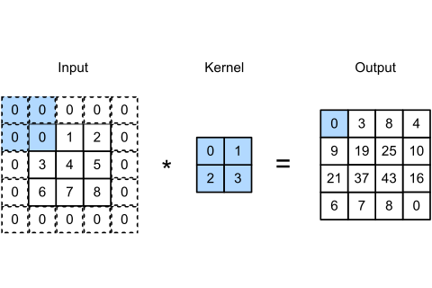](references/mechanisms/d2l-conv-pad/source.svg)

来源类型：教材或教程范例。许可：CC-BY-SA-4.0。
[原文件](references/mechanisms/d2l-conv-pad/source.svg) · [来源记录](references/mechanisms/d2l-conv-pad/metadata.json)

### [D2L · 卷积步幅](references/mechanisms/d2l-conv-stride/README.md)

完整机制示意，保留原标注供参考或拆取图形；这不是单个最小图元，不计入元素数量。

[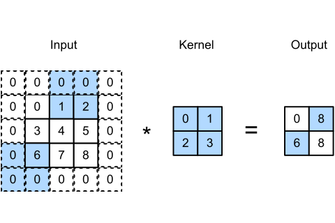](references/mechanisms/d2l-conv-stride/source.svg)

来源类型：教材或教程范例。许可：CC-BY-SA-4.0。
[原文件](references/mechanisms/d2l-conv-stride/source.svg) · [来源记录](references/mechanisms/d2l-conv-stride/metadata.json)

### [D2L · 一维卷积](references/mechanisms/d2l-conv1d/README.md)

完整机制示意，保留原标注供参考或拆取图形；这不是单个最小图元，不计入元素数量。

[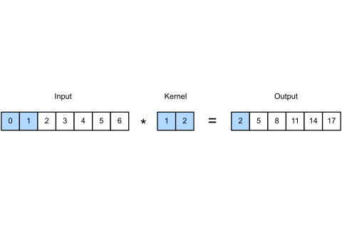](references/mechanisms/d2l-conv1d/source.svg)

来源类型：教材或教程范例。许可：CC-BY-SA-4.0。
[原文件](references/mechanisms/d2l-conv1d/source.svg) · [来源记录](references/mechanisms/d2l-conv1d/metadata.json)

### [D2L · 一维卷积与通道](references/mechanisms/d2l-conv1d-channel/README.md)

完整机制示意，保留原标注供参考或拆取图形；这不是单个最小图元，不计入元素数量。

[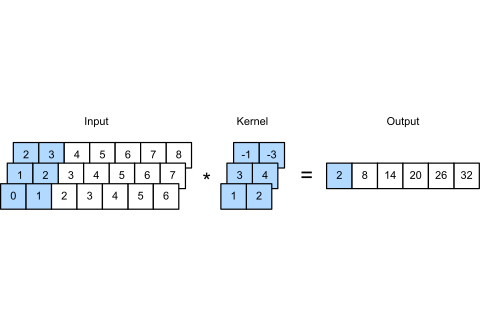](references/mechanisms/d2l-conv1d-channel/source.svg)

来源类型：教材或教程范例。许可：CC-BY-SA-4.0。
[原文件](references/mechanisms/d2l-conv1d-channel/source.svg) · [来源记录](references/mechanisms/d2l-conv1d-channel/metadata.json)

### [D2L · 二维互相关](references/mechanisms/d2l-correlation/README.md)

完整机制示意，保留原标注供参考或拆取图形；这不是单个最小图元，不计入元素数量。

[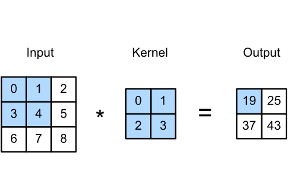](references/mechanisms/d2l-correlation/source.svg)

来源类型：教材或教程范例。许可：CC-BY-SA-4.0。
[原文件](references/mechanisms/d2l-correlation/source.svg) · [来源记录](references/mechanisms/d2l-correlation/metadata.json)

### [D2L · 多头注意力](references/mechanisms/d2l-multi-head-attention/README.md)

完整机制示意，保留原标注供参考或拆取图形；这不是单个最小图元，不计入元素数量。

[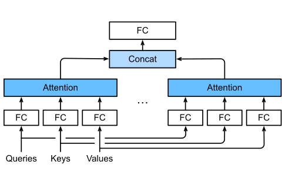](references/mechanisms/d2l-multi-head-attention/source.svg)

来源类型：教材或教程范例。许可：CC-BY-SA-4.0。
[原文件](references/mechanisms/d2l-multi-head-attention/source.svg) · [来源记录](references/mechanisms/d2l-multi-head-attention/metadata.json)

### [D2L · 神经元示意](references/mechanisms/d2l-neuron/README.md)

完整机制示意，保留原标注供参考或拆取图形；这不是单个最小图元，不计入元素数量。

[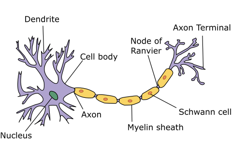](references/mechanisms/d2l-neuron/source.svg)

来源类型：教材或教程范例。许可：CC-BY-SA-4.0。
[原文件](references/mechanisms/d2l-neuron/source.svg) · [来源记录](references/mechanisms/d2l-neuron/metadata.json)

### [D2L · 池化](references/mechanisms/d2l-pooling/README.md)

完整机制示意，保留原标注供参考或拆取图形；这不是单个最小图元，不计入元素数量。

来源类型：教材或教程范例。许可：CC-BY-SA-4.0。
[原文件](references/mechanisms/d2l-pooling/source.svg) · [来源记录](references/mechanisms/d2l-pooling/metadata.json)

### [D2L · 查询、键与值](references/mechanisms/d2l-qkv/README.md)

完整机制示意，保留原标注供参考或拆取图形；这不是单个最小图元，不计入元素数量。

来源类型：教材或教程范例。许可：CC-BY-SA-4.0。
[原文件](references/mechanisms/d2l-qkv/source.svg) · [来源记录](references/mechanisms/d2l-qkv/metadata.json)

### [D2L · 普通块与残差块对比](references/mechanisms/d2l-residual-block/README.md)

完整机制示意，保留原标注供参考或拆取图形；这不是单个最小图元，不计入元素数量。

来源类型：教材或教程范例。许可：CC-BY-SA-4.0。
[原文件](references/mechanisms/d2l-residual-block/source.svg) · [来源记录](references/mechanisms/d2l-residual-block/metadata.json)

### [D2L · 自注意力对照](references/mechanisms/d2l-self-attention/README.md)

完整机制示意，保留原标注供参考或拆取图形；这不是单个最小图元，不计入元素数量。

[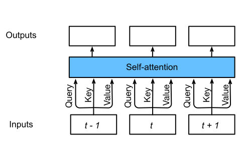](references/mechanisms/d2l-self-attention/source.svg)

来源类型：教材或教程范例。许可：CC-BY-SA-4.0。
[原文件](references/mechanisms/d2l-self-attention/source.svg) · [来源记录](references/mechanisms/d2l-self-attention/metadata.json)

### [D2L · 单神经元](references/mechanisms/d2l-singleneuron/README.md)

完整机制示意，保留原标注供参考或拆取图形；这不是单个最小图元，不计入元素数量。

[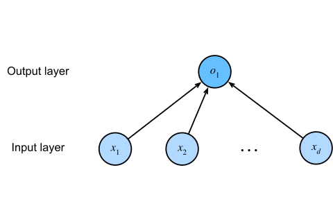](references/mechanisms/d2l-singleneuron/source.svg)

来源类型：教材或教程范例。许可：CC-BY-SA-4.0。
[原文件](references/mechanisms/d2l-singleneuron/source.svg) · [来源记录](references/mechanisms/d2l-singleneuron/metadata.json)

### [D2L · 转置卷积](references/mechanisms/d2l-trans-conv/README.md)

完整机制示意，保留原标注供参考或拆取图形；这不是单个最小图元，不计入元素数量。

[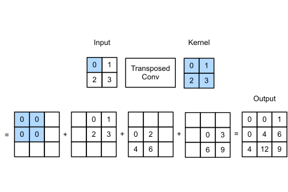](references/mechanisms/d2l-trans-conv/source.svg)

来源类型：教材或教程范例。许可：CC-BY-SA-4.0。
[原文件](references/mechanisms/d2l-trans-conv/source.svg) · [来源记录](references/mechanisms/d2l-trans-conv/metadata.json)

### [D2L · 带步幅的转置卷积](references/mechanisms/d2l-trans-conv-stride2/README.md)

完整机制示意，保留原标注供参考或拆取图形；这不是单个最小图元，不计入元素数量。

来源类型：教材或教程范例。许可：CC-BY-SA-4.0。
[原文件](references/mechanisms/d2l-trans-conv-stride2/source.svg) · [来源记录](references/mechanisms/d2l-trans-conv-stride2/metadata.json)

## 原生版式模板

### [Nature 官方 · nature-figure-illustrator-template](templates/layouts/nature-official-nature-figure-illustrator-template/README.md)

作者已有的画幅与版式母版，保留原生文件；不包含可直接替换内容的模型架构，不计入元素或 teaser 数量。

[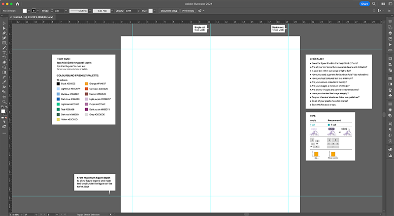](templates/layouts/nature-official-nature-figure-illustrator-template/nature-figure-illustrator-template.ait)

来源类型：原生模板。许可：website-terms。
[原文件](templates/layouts/nature-official-nature-figure-illustrator-template/nature-figure-illustrator-template.ait) · [来源记录](templates/layouts/nature-official-nature-figure-illustrator-template/metadata.json)

### [Scientific Figure Templates · ICML](templates/layouts/scientific-figure-icml/README.md)

作者已有的画幅与版式母版，保留原生文件；不包含可直接替换内容的模型架构，不计入元素或 teaser 数量。

来源类型：原生模板。许可：no-explicit-license。
[原文件](templates/layouts/scientific-figure-icml/ICML.ai) · [来源记录](templates/layouts/scientific-figure-icml/metadata.json)

### [Scientific Figure Templates · IEEE-ISBI](templates/layouts/scientific-figure-ieee-isbi/README.md)

作者已有的画幅与版式母版，保留原生文件；不包含可直接替换内容的模型架构，不计入元素或 teaser 数量。

来源类型：原生模板。许可：no-explicit-license。
[原文件](templates/layouts/scientific-figure-ieee-isbi/IEEE-ISBI.ai) · [来源记录](templates/layouts/scientific-figure-ieee-isbi/metadata.json)

### [Scientific Figure Templates · Nature](templates/layouts/scientific-figure-nature/README.md)

作者已有的画幅与版式母版，保留原生文件；不包含可直接替换内容的模型架构，不计入元素或 teaser 数量。

[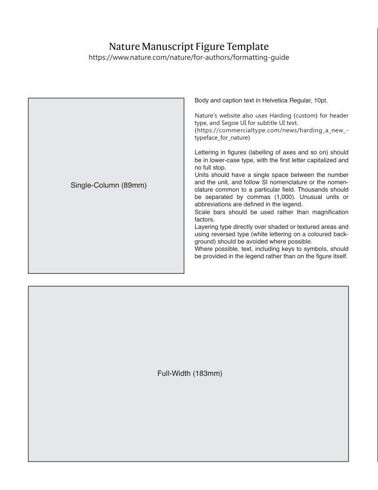](templates/layouts/scientific-figure-nature/Nature.ai)

来源类型：原生模板。许可：no-explicit-license。
[原文件](templates/layouts/scientific-figure-nature/Nature.ai) · [来源记录](templates/layouts/scientific-figure-nature/metadata.json)

### [SciFigureTemplates · ACSFigureTemplate](templates/layouts/scifigure-acsfiguretemplate/README.md)

作者已有的画幅与版式母版，保留原生文件；不包含可直接替换内容的模型架构，不计入元素或 teaser 数量。

来源类型：原生模板。许可：MIT。
[原文件](templates/layouts/scifigure-acsfiguretemplate/ACSFigureTemplate.ait) · [来源记录](templates/layouts/scifigure-acsfiguretemplate/metadata.json)

### [SciFigureTemplates · AIPFigureTemplate](templates/layouts/scifigure-aipfiguretemplate/README.md)

作者已有的画幅与版式母版，保留原生文件；不包含可直接替换内容的模型架构，不计入元素或 teaser 数量。

来源类型：原生模板。许可：MIT。
[原文件](templates/layouts/scifigure-aipfiguretemplate/AIPFigureTemplate.ait) · [来源记录](templates/layouts/scifigure-aipfiguretemplate/metadata.json)

### [SciFigureTemplates · APSFigureTemplate](templates/layouts/scifigure-apsfiguretemplate/README.md)

作者已有的画幅与版式母版，保留原生文件；不包含可直接替换内容的模型架构，不计入元素或 teaser 数量。

来源类型：原生模板。许可：MIT。
[原文件](templates/layouts/scifigure-apsfiguretemplate/APSFigureTemplate.ait) · [来源记录](templates/layouts/scifigure-apsfiguretemplate/metadata.json)

### [SciFigureTemplates · IOPFigureTemplate](templates/layouts/scifigure-iopfiguretemplate/README.md)

作者已有的画幅与版式母版，保留原生文件；不包含可直接替换内容的模型架构，不计入元素或 teaser 数量。

[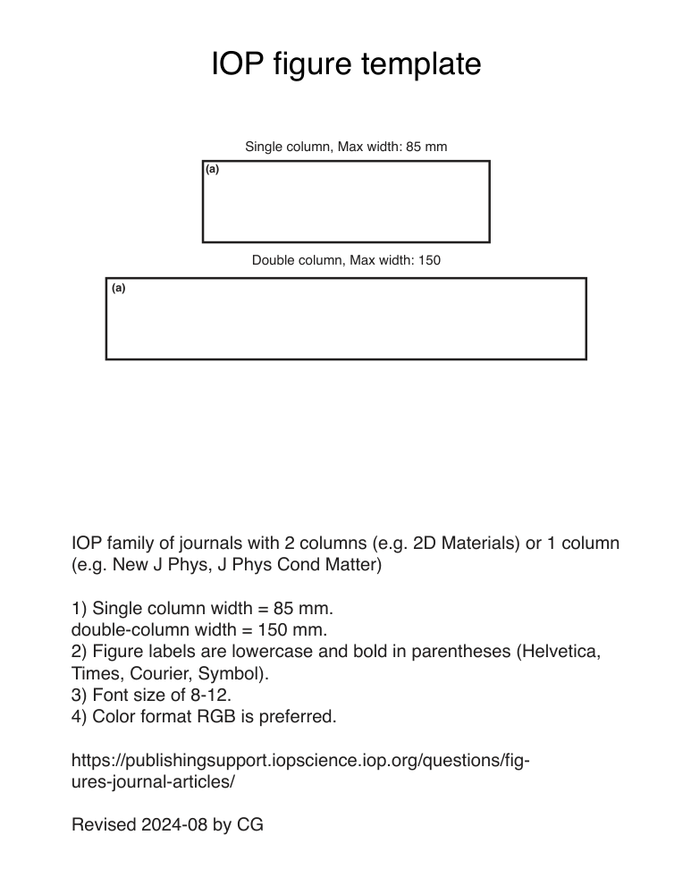](templates/layouts/scifigure-iopfiguretemplate/IOPFigureTemplate.ait)

来源类型：原生模板。许可：MIT。
[原文件](templates/layouts/scifigure-iopfiguretemplate/IOPFigureTemplate.ait) · [来源记录](templates/layouts/scifigure-iopfiguretemplate/metadata.json)

### [SciFigureTemplates · NatureFigureTemplate](templates/layouts/scifigure-naturefiguretemplate/README.md)

作者已有的画幅与版式母版，保留原生文件；不包含可直接替换内容的模型架构，不计入元素或 teaser 数量。

来源类型：原生模板。许可：MIT。
[原文件](templates/layouts/scifigure-naturefiguretemplate/NatureFigureTemplate.ait) · [来源记录](templates/layouts/scifigure-naturefiguretemplate/metadata.json)

### [SciFigureTemplates · SciAdvancesFigureTemplate_2026-08](templates/layouts/scifigure-sciadvancesfiguretemplate-2026-08/README.md)

作者已有的画幅与版式母版，保留原生文件；不包含可直接替换内容的模型架构，不计入元素或 teaser 数量。

[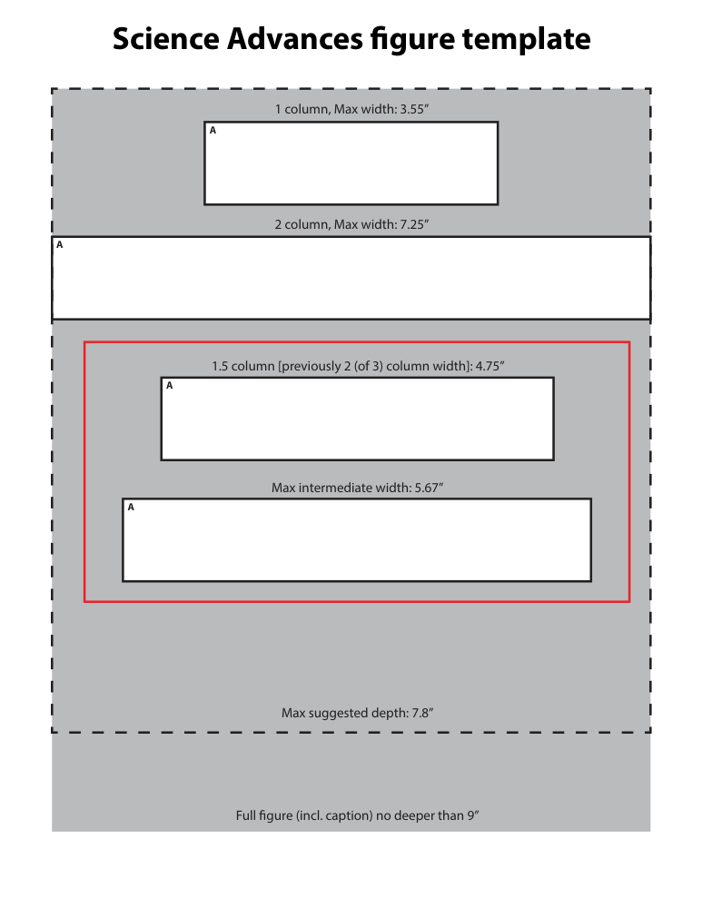](templates/layouts/scifigure-sciadvancesfiguretemplate-2026-08/SciAdvancesFigureTemplate_2026-08.ait)

来源类型：原生模板。许可：MIT。
[原文件](templates/layouts/scifigure-sciadvancesfiguretemplate-2026-08/SciAdvancesFigureTemplate_2026-08.ait) · [来源记录](templates/layouts/scifigure-sciadvancesfiguretemplate-2026-08/metadata.json)

### [SciFigureTemplates · ScienceFigureTemplate_2026-08](templates/layouts/scifigure-sciencefiguretemplate-2026-08/README.md)

作者已有的画幅与版式母版，保留原生文件；不包含可直接替换内容的模型架构，不计入元素或 teaser 数量。

来源类型：原生模板。许可：MIT。
[原文件](templates/layouts/scifigure-sciencefiguretemplate-2026-08/ScienceFigureTemplate_2026-08.ait) · [来源记录](templates/layouts/scifigure-sciencefiguretemplate-2026-08/metadata.json)
