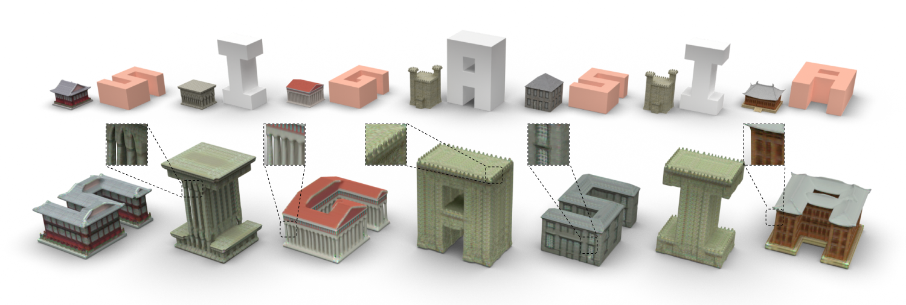

# 素材目录

本页由 `python scripts/build_catalog.py` 根据各条目的元数据生成。编辑素材条目后重新运行命令即可更新。

[仓库首页](README.md) · [新增与维护](CONTRIBUTING.md) · [机器可读索引](catalog.json)

| 类别 | 数量 | 主要用途 |
|---|---:|---|
| [Teaser](#teaser-范例) | 5 | 核心想法、动机与方法差异 |
| [Architecture](#architecture-范例) | 7 | 模型结构、整体框架与模块连接 |
| [最小可复用元素](#最小可复用元素) | 16 | 复制单个 SVG，组合成自己的图 |

## Teaser 范例

### [Uneven Double Refraction：原型与成像能力展示](examples/teasers/birefractive-rgbd/README.md)

相机原型、输入、恢复彩色图和深度图横排，适合硬件或成像方法的 teaser。

**类型：** 论文范例　**格式：** SVG

**许可：** MIT（来源仓库）；照片与实验结果按原来源保留。（`repository-license`）。第三方图形保留原出处，图元提取或文件格式不改变原权利状态。

**标签：** `teaser` · `hardware` · `imaging` · `capability-showcase`

[可编辑源文件](examples/teasers/birefractive-rgbd/source.svg) · [来源与修改记录](examples/teasers/birefractive-rgbd/metadata.json) · [使用说明](examples/teasers/birefractive-rgbd/README.md)

### [K-LoRA：主体风格组合与训练范式比较](examples/teasers/k-lora/README.md)

左侧主体与风格组合示例，右侧比较需要训练与免训练的融合方式。

**类型：** 论文范例　**格式：** SVG

**许可：** 作者 README 声明 CC BY-NC 4.0；内嵌示例素材保留原出处。（`noncommercial`）。第三方图形保留原出处，图元提取或文件格式不改变原权利状态。

**标签：** `teaser` · `method-comparison` · `subject-style` · `training-free`

[可编辑源文件](examples/teasers/k-lora/source.svg) · [来源与修改记录](examples/teasers/k-lora/metadata.json) · [使用说明](examples/teasers/k-lora/README.md)

### [OrienterNet：用二维地图定位的任务与动机](examples/teasers/orienternet/README.md)

展示人类使用二维地图与既有三维点云定位的差别，再给出新方法的输入与输出。

**类型：** 论文范例　**格式：** SVG

**许可：** 第三方图片与地图包含多种权利；图本身未见单独复用授权。（`mixed-source-license`）。第三方图形保留原出处，图元提取或文件格式不改变原权利状态。

**标签：** `teaser` · `motivation` · `task-comparison` · `localization`

[可编辑源文件](examples/teasers/orienternet/source.svg) · [来源与修改记录](examples/teasers/orienternet/metadata.json) · [使用说明](examples/teasers/orienternet/README.md)

### [RayDer：数据瓶颈与新训练范式](examples/teasers/rayder-concept/README.md)

数据金字塔、训练过程、结果与规模变化并列，先说明问题和核心差异。

**类型：** 论文范例　**格式：** SVG

**许可：** 保存仓库原许可证；用途限于其原有条款。（`research-noncommercial`）。第三方图形保留原出处，图元提取或文件格式不改变原权利状态。

**标签：** `teaser` · `motivation` · `data-bottleneck` · `novel-view-synthesis`

[可编辑源文件](examples/teasers/rayder-concept/source.svg) · [来源与修改记录](examples/teasers/rayder-concept/metadata.json) · [使用说明](examples/teasers/rayder-concept/README.md)

### [ShaDDR：粗形状与示例驱动的成果展示](examples/teasers/shaddr/README.md)

上排粗形状与风格示例，下排生成结果与局部放大，以成果直接展示任务和贡献。

**类型：** 论文范例　**格式：** SVG

**许可：** MIT（来源仓库）；渲染素材保留原论文出处。（`repository-license`）。第三方图形保留原出处，图元提取或文件格式不改变原权利状态。

**标签：** `teaser` · `results-showcase` · `3d-generation` · `zoom-in`

[可编辑源文件](examples/teasers/shaddr/source.svg) · [来源与修改记录](examples/teasers/shaddr/metadata.json) · [使用说明](examples/teasers/shaddr/README.md)

## Architecture 范例

### [CLIP Figure 1：训练到零样本预测](examples/architectures/clip/README.md)

CLIP 的训练与零样本使用流程，按方法流程归入 architecture。

**类型：** 论文范例　**格式：** PDF / SVG

**许可：** arXiv non-exclusive distribution license（`reference-only`）。arXiv 的非独占分发许可不是通用自由复用许可证。本条目作为私人研究与版式参考保存，不能据此推定可以自由再分发或直接复用论文图片。

**标签：** `method-overview` · `contrastive-learning` · `zero-shot` · `three-stages` · `CLIP` · `architecture`

[可编辑源文件](examples/architectures/clip/source.svg) · [来源与修改记录](examples/architectures/clip/metadata.json) · [使用说明](examples/architectures/clip/README.md)

### [LAV：感知、预测与驾驶控制流程](examples/architectures/lav/README.md)

多摄像头输入、语义分割、传感器融合、三维主干、运动预测与控制的整体数据流。原文件虽叫 teaser.svg，按内容归入 architecture。

**类型：** 论文范例　**格式：** SVG

**许可：** Apache-2.0（来源仓库）。（`repository-license`）。第三方图形保留原出处，图元提取或文件格式不改变原权利状态。

**标签：** `architecture` · `autonomous-driving` · `pipeline` · `multibranch`

[可编辑源文件](examples/architectures/lav/source.svg) · [来源与修改记录](examples/architectures/lav/metadata.json) · [使用说明](examples/architectures/lav/README.md)

### [LightGlue：注意力、动态剪枝与匹配](examples/architectures/lightglue/README.md)

双分支局部特征经过 self/cross attention、置信度预测、剪枝和匹配分配。

**类型：** 论文范例　**格式：** SVG

**许可：** Apache-2.0（来源仓库）。（`repository-license`）。第三方图形保留原出处，图元提取或文件格式不改变原权利状态。

**标签：** `architecture` · `attention` · `pruning` · `feature-matching`

[可编辑源文件](examples/architectures/lightglue/source.svg) · [来源与修改记录](examples/architectures/lightglue/metadata.json) · [使用说明](examples/architectures/lightglue/README.md)

### [多尺度网络总览与模块展开](examples/architectures/multiscale-network/README.md)

作者 Illustrator 科研绘图教程中的多尺度网络案例：Backbone、高低层特征、SPPA／LFSA／GMFF 模块、预测结果，以及模块细节。原文件含 7 个画板。

**类型：** 教程范例　**格式：** AI

**许可：** 未发现明确 LICENSE（`no-explicit-license`）。作者提供公开免费教程；公开下载不等于自由再分发许可。保留出处；不能标为 MIT、CC0 或已获商用授权。

**标签：** `architecture` · `network` · `multiscale` · `feature-fusion` · `skip-connection` · `illustrator`

[可编辑源文件](examples/architectures/multiscale-network/source.ai) · [来源与修改记录](examples/architectures/multiscale-network/metadata.json) · [使用说明](examples/architectures/multiscale-network/README.md)

### [RayDer：统一 Transformer 的两个使用阶段](examples/architectures/rayder/README.md)

左右并列相机估计与新视角合成，清楚标明共用模型与不同输入输出。

**类型：** 论文范例　**格式：** SVG

**许可：** 保存仓库原许可证；用途限于其原有条款。（`research-noncommercial`）。第三方图形保留原出处，图元提取或文件格式不改变原权利状态。

**标签：** `architecture` · `transformer` · `shared-model` · `two-stages`

[可编辑源文件](examples/architectures/rayder/source.svg) · [来源与修改记录](examples/architectures/rayder/metadata.json) · [使用说明](examples/architectures/rayder/README.md)

### [RUST：编码器、场景表示与位姿分支](examples/architectures/rust/README.md)

无位姿输入图像经 Encoder、场景表示、Decoder 输出新视角，训练时有 Pose Estimator 分支。按内容归入 architecture。

**类型：** 论文范例　**格式：** SVG

**许可：** 项目仓库未发现 LICENSE；仅作出处明确的参考，元素提取不新增授权。（`no-explicit-license`）。第三方图形保留原出处，图元提取或文件格式不改变原权利状态。

**标签：** `architecture` · `encoder-decoder` · `feature-stack` · `training-branch`

[可编辑源文件](examples/architectures/rust/source.svg) · [来源与修改记录](examples/architectures/rust/metadata.json) · [使用说明](examples/architectures/rust/README.md)

### [SAM / LoRA 总体流程与 Transformer 模块](examples/architectures/sam-lora/README.md)

作者 Illustrator 科研绘图教程中的 SAM / LoRA 案例，含总体方法流程与 Transformer／LoRA 模块结构，共 2 个画板；公开的 PNG、PDF 与 PPTX 配套素材一并保留。

**类型：** 教程范例　**格式：** AI / PDF / PPTX

**许可：** 未发现明确 LICENSE（`no-explicit-license`）。作者提供公开免费教程；公开下载不等于自由再分发许可。保留出处；不能标为 MIT、CC0 或已获商用授权。

**标签：** `architecture` · `framework` · `SAM` · `LoRA` · `transformer` · `illustrator` · `parameter-efficient-finetuning`

[可编辑源文件](examples/architectures/sam-lora/source.ai) · [来源与修改记录](examples/architectures/sam-lora/metadata.json) · [使用说明](examples/architectures/sam-lora/README.md)

## 最小可复用元素

共 16 个有出处的元素，均为外部下载或原图中已有矢量节点的提取。来源、提取位置与权利状态逐条保存在索引中。

[打开总览 SVG](elements/all-elements.svg) · [元素使用说明](elements/README.md) · [提取位置](elements/extraction-specs.json)

| 元素 | 分类 | 标签 | 来源 / 权利状态 |
|---|---|---|---|
| [浅层神经网络](elements/svg/towaki-neuralnetwork.svg) | 模块 | external, CC0, icon | CC0-1.0 |
| [深层神经网络](elements/svg/towaki-deepneuralnetwork.svg) | 模块 | external, CC0, icon | CC0-1.0 |
| [神经场论文图标](elements/svg/towaki-neuralfieldpaper.svg) | 数据表示 | external, CC0, icon | CC0-1.0 |
| [兔形图标](elements/svg/towaki-bunny.svg) | 数据表示 | external, CC0, icon | CC0-1.0 |
| [存储图标](elements/svg/towaki-floppydisk.svg) | 数据表示 | external, CC0, icon | CC0-1.0 |
| [编码器块](elements/svg/rust-encoder.svg) | 模块 | rust, extracted, vector | 原项目未发现独立图形授权；仅作出处明确的参考 |
| [解码器块](elements/svg/rust-decoder.svg) | 模块 | rust, extracted, vector | 原项目未发现独立图形授权；仅作出处明确的参考 |
| [特征表示堆叠](elements/svg/rust-feature-stack.svg) | 数据表示 | rust, extracted, vector | 原项目未发现独立图形授权；仅作出处明确的参考 |
| [单层特征块](elements/svg/rust-feature-tile.svg) | 数据表示 | rust, extracted, vector | 原项目未发现独立图形授权；仅作出处明确的参考 |
| [位姿估计模块](elements/svg/rust-pose-estimator.svg) | 模块 | rust, extracted, vector | 原项目未发现独立图形授权；仅作出处明确的参考 |
| [右向流程箭头](elements/svg/rust-arrow-right.svg) | 连接 | rust, extracted, vector | 原项目未发现独立图形授权；仅作出处明确的参考 |
| [下向流程箭头](elements/svg/rust-arrow-down.svg) | 连接 | rust, extracted, vector | 原项目未发现独立图形授权；仅作出处明确的参考 |
| [Self attention 块](elements/svg/lightglue-self-attention.svg) | 模块 | lightglue, extracted, vector | Apache-2.0（LightGlue 来源仓库） |
| [匹配相似度矩阵](elements/svg/lightglue-assignment-matrix.svg) | 数据表示 | lightglue, extracted, vector | Apache-2.0（LightGlue 来源仓库） |
| [残差加法节点](elements/svg/lightglue-residual-add.svg) | 运算 | lightglue, extracted, vector | Apache-2.0（LightGlue 来源仓库） |
| [蓝色流程箭头](elements/svg/lightglue-flow-arrow.svg) | 连接 | lightglue, extracted, vector | Apache-2.0（LightGlue 来源仓库） |

## 如何理解许可与可编辑性

每条记录的许可单独适用，整个仓库没有为第三方素材重新授权。MIT 条目保留了原许可文件；reference-only 和 no-explicit-license 条目记录了可查证的状态。

SVG 中的路径、形状和文字对象可进一步修改；嵌入的照片仍是位图。PDF 转换得到的文字可能被拆分。AI 原文件和配套素材保留了各自的来源说明。
