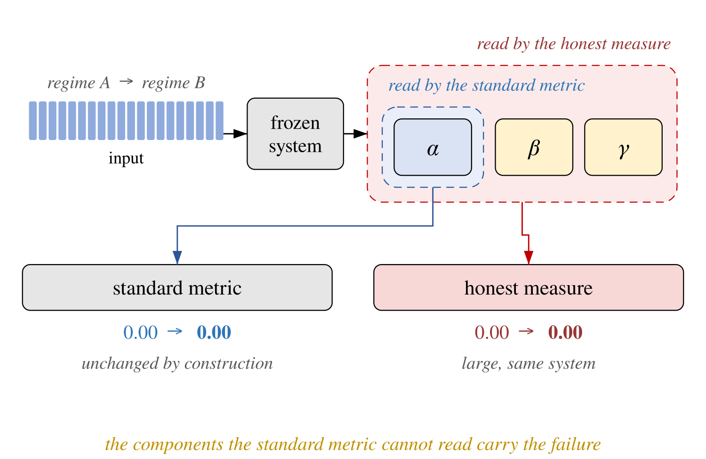
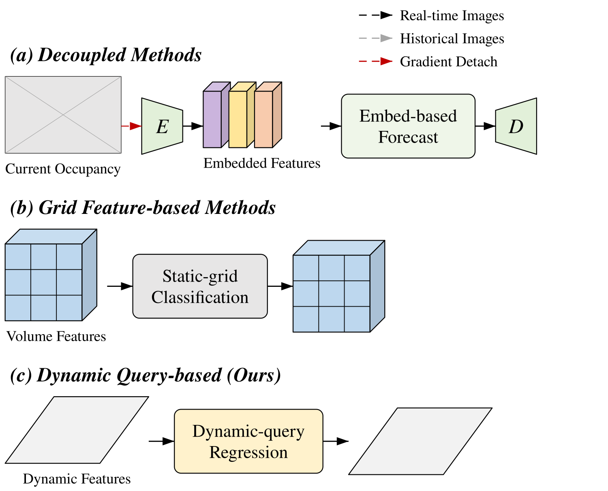
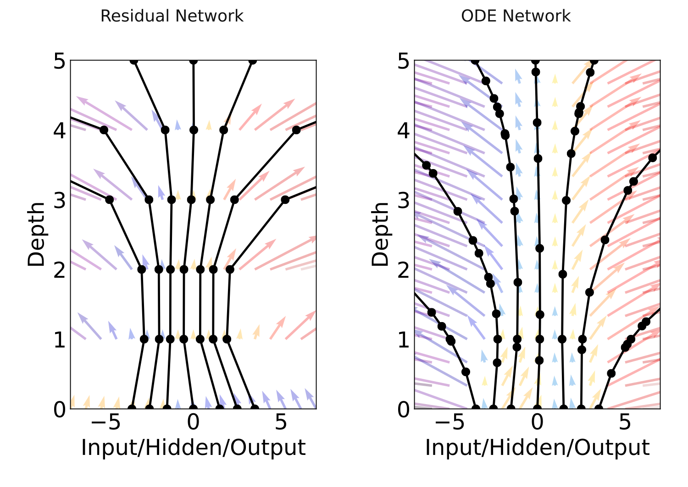
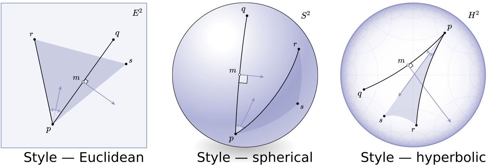
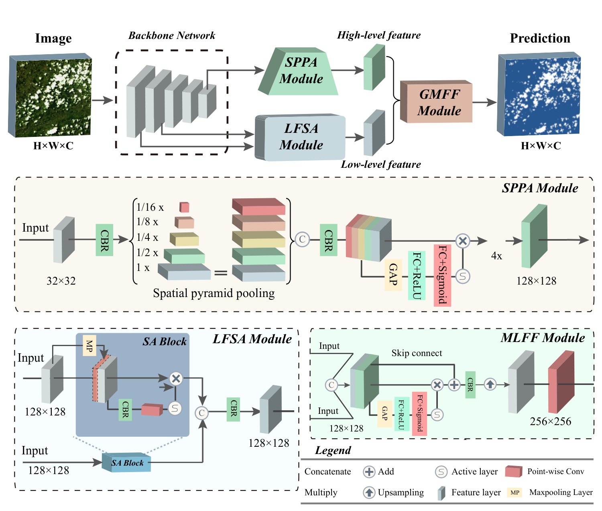
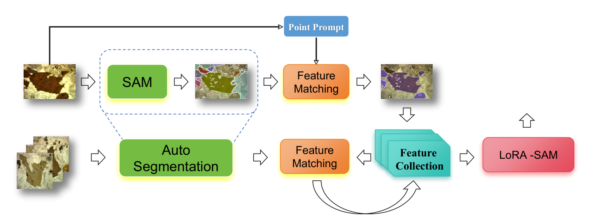
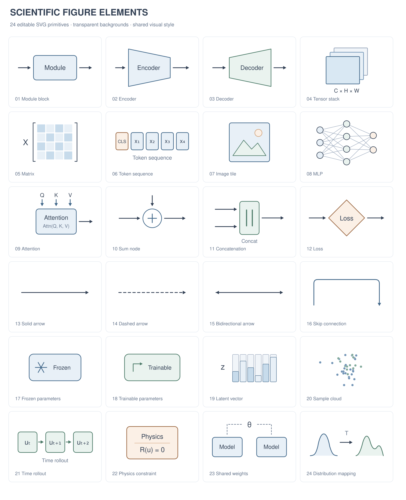

# 素材目录

本页由 `python scripts/build_catalog.py` 根据各条目的元数据生成。编辑素材条目后重新运行命令即可更新。

[仓库首页](README.md) · [新增与维护](CONTRIBUTING.md) · [机器可读索引](catalog.json)

| 类别 | 数量 | 主要用途 |
|---|---:|---|
| [Teaser](#teaser-范例) | 5 | 核心想法、动机与方法差异 |
| [Architecture](#architecture-范例) | 2 | 模型结构、整体框架与模块连接 |
| [最小可复用元素](#最小可复用元素) | 24 | 复制单个 SVG，组合成自己的图 |

## Teaser 范例

### [CLIP Figure 1：训练到零样本预测](examples/teasers/clip/README.md)

真实论文 Figure 1：左侧为图文对比预训练，右侧依次为用类别文本构建分类器、零样本预测。适合借鉴“一个训练阶段 + 两个使用阶段”的信息层级。

**类型：** 论文范例　**格式：** PDF / SVG

**许可：** arXiv non-exclusive distribution license（`reference-only`）。arXiv 的非独占分发许可不是通用自由复用许可证。本条目作为私人研究与版式参考保存，不能据此推定可以自由再分发或直接复用论文图片。

**标签：** `teaser` · `method-overview` · `contrastive-learning` · `zero-shot` · `three-stages` · `CLIP`

[可编辑源文件](examples/teasers/clip/source.svg) · [来源与修改记录](examples/teasers/clip/metadata.json) · [使用说明](examples/teasers/clip/README.md)

### [评估盲点与研究动机 / Evaluation blind spot](examples/teasers/evaluation-blindspot/README.md)

用系统的不同区域与指标覆盖范围的差别，解释“当前评估遗漏了什么”。适合论文动机、评价方法或诊断方法的首图。

**类型：** 通用模板　**格式：** SVG / YAML

**许可：** MIT License（`permissive`）。许可证针对来源项目；复制或再分发其内容时保留原版权和许可声明。

**标签：** `teaser` · `motivation` · `evaluation` · `blind-spot` · `editable-text`

[可编辑源文件](examples/teasers/evaluation-blindspot/source.svg) · [来源与修改记录](examples/teasers/evaluation-blindspot/metadata.json) · [使用说明](examples/teasers/evaluation-blindspot/README.md)

### [方法范式对比 / Method comparison](examples/teasers/method-comparison/README.md)

三行并列展示 Decoupled、Grid feature-based 与 Dynamic query-based 三种范式。适合把两类既有方法与本文方法的核心差异放在同一张首图中。

**类型：** 通用模板　**格式：** SVG / YAML

**许可：** MIT License（`permissive`）。许可证针对来源项目；复制或再分发其内容时保留原版权和许可声明。

**标签：** `teaser` · `method-comparison` · `three-rows` · `motivation` · `editable-text`

[可编辑源文件](examples/teasers/method-comparison/source.svg) · [来源与修改记录](examples/teasers/method-comparison/metadata.json) · [使用说明](examples/teasers/method-comparison/README.md)

### [Neural ODE Figure 1：离散层与连续动力学](examples/teasers/neural-ode/README.md)

真实论文 Figure 1 的两个面板：离散残差变换与连续 ODE 向量场对比。适合借鉴用轨迹、采样位置与连续场解释方法差异的方式。

**类型：** 论文范例　**格式：** PDF / SVG

**许可：** arXiv non-exclusive distribution license（`reference-only`）。arXiv 的非独占分发许可不是通用自由复用许可证。本条目作为私人研究与版式参考保存，不能据此推定可以自由再分发或直接复用论文图片。

**标签：** `teaser` · `conceptual-comparison` · `dynamics` · `neural-ode` · `residual-network` · `vector-field`

[可编辑源文件](examples/teasers/neural-ode/source.svg) · [来源与修改记录](examples/teasers/neural-ode/metadata.json) · [使用说明](examples/teasers/neural-ode/README.md)

### [Penrose Figure 1：三种几何的概念对照](examples/teasers/penrose/README.md)

Penrose 论文 Figure 1 右侧的三联可视化，展示欧氏、球面和双曲几何。原 Figure 1 左侧还包含语句／代码，所以本条目不是整张 Figure 1。

**类型：** 论文范例　**格式：** SVG

**许可：** MIT License (source repository)（`repository-permissive`）。来源仓库声明 MIT，已保留其许可证原文；保留项目与论文出处。

**标签：** `teaser` · `geometry` · `mathematical-illustration` · `three-panels` · `conceptual-comparison`

[可编辑源文件](examples/teasers/penrose/source.svg) · [来源与修改记录](examples/teasers/penrose/metadata.json) · [使用说明](examples/teasers/penrose/README.md)

## Architecture 范例

### [多尺度网络总览与模块展开](examples/architectures/multiscale-network/README.md)

作者 Illustrator 科研绘图教程中的多尺度网络案例：Backbone、高低层特征、SPPA／LFSA／GMFF 模块、预测结果，以及模块细节。原文件含 7 个画板。

**类型：** 教程范例　**格式：** AI

**许可：** 未发现明确 LICENSE（`no-explicit-license`）。作者提供公开免费教程；公开下载不等于自由再分发许可。保留出处；不能标为 MIT、CC0 或已获商用授权。

**标签：** `architecture` · `network` · `multiscale` · `feature-fusion` · `skip-connection` · `illustrator`

[可编辑源文件](examples/architectures/multiscale-network/source.ai) · [来源与修改记录](examples/architectures/multiscale-network/metadata.json) · [使用说明](examples/architectures/multiscale-network/README.md)

### [SAM / LoRA 总体流程与 Transformer 模块](examples/architectures/sam-lora/README.md)

作者 Illustrator 科研绘图教程中的 SAM / LoRA 案例，含总体方法流程与 Transformer／LoRA 模块结构，共 2 个画板；公开的 PNG、PDF 与 PPTX 配套素材一并保留。

**类型：** 教程范例　**格式：** AI / PDF / PPTX

**许可：** 未发现明确 LICENSE（`no-explicit-license`）。作者提供公开免费教程；公开下载不等于自由再分发许可。保留出处；不能标为 MIT、CC0 或已获商用授权。

**标签：** `architecture` · `framework` · `SAM` · `LoRA` · `transformer` · `illustrator` · `parameter-efficient-finetuning`

[可编辑源文件](examples/architectures/sam-lora/source.ai) · [来源与修改记录](examples/architectures/sam-lora/metadata.json) · [使用说明](examples/architectures/sam-lora/README.md)

## 最小可复用元素

共 24 个元素，其中 24 个为此仓库原创。来源与权利状态逐条保存在索引中；当前原创元素用于你的绘图复用，未设置对外再分发许可证。

[打开总览 SVG](elements/all-elements.svg) · [元素使用说明](elements/README.md) · [样式参数](elements/style-tokens.json)

| 元素 | 分类 | 标签 | 来源 / 权利状态 |
|---|---|---|---|
| [通用模块](elements/svg/module-block.svg) | 模块 | module, process, architecture | 本库原创 |
| [编码器](elements/svg/encoder.svg) | 模块 | encoder, compression, representation | 本库原创 |
| [解码器](elements/svg/decoder.svg) | 模块 | decoder, generation, reconstruction | 本库原创 |
| [特征张量](elements/svg/tensor-stack.svg) | 数据表示 | tensor, feature-map, channels | 本库原创 |
| [矩阵](elements/svg/matrix.svg) | 数据表示 | matrix, features, linear-algebra | 本库原创 |
| [Token 序列](elements/svg/token-sequence.svg) | 数据表示 | tokens, transformer, sequence | 本库原创 |
| [图像占位块](elements/svg/image-tile.svg) | 数据表示 | image, input, placeholder | 本库原创 |
| [全连接网络](elements/svg/mlp.svg) | 模块 | mlp, neural-network, fully-connected | 本库原创 |
| [注意力模块](elements/svg/attention.svg) | 模块 | attention, transformer, qkv | 本库原创 |
| [加法节点](elements/svg/sum-node.svg) | 运算 | sum, add, residual | 本库原创 |
| [拼接节点](elements/svg/concat-node.svg) | 运算 | concat, fusion, merge | 本库原创 |
| [损失函数](elements/svg/loss.svg) | 运算 | loss, objective, training | 本库原创 |
| [实线箭头](elements/svg/arrow-solid.svg) | 连接 | arrow, flow, connection | 本库原创 |
| [虚线箭头](elements/svg/arrow-dashed.svg) | 连接 | arrow, optional, auxiliary | 本库原创 |
| [双向箭头](elements/svg/arrow-bidirectional.svg) | 连接 | arrow, bidirectional, interaction | 本库原创 |
| [跳跃连接](elements/svg/skip-connection.svg) | 连接 | skip, residual, bypass | 本库原创 |
| [冻结参数](elements/svg/frozen-badge.svg) | 训练标识 | frozen, parameters, finetuning | 本库原创 |
| [可训练参数](elements/svg/trainable-badge.svg) | 训练标识 | trainable, parameters, finetuning | 本库原创 |
| [隐变量向量](elements/svg/latent-vector.svg) | 数据表示 | latent, embedding, vector | 本库原创 |
| [样本点云](elements/svg/sample-cloud.svg) | 数据表示 | distribution, samples, generative | 本库原创 |
| [时间推进](elements/svg/time-rollout.svg) | 科学与动力学 | time-series, dynamics, ai4pde, rollout | 本库原创 |
| [物理约束](elements/svg/physics-constraint.svg) | 科学与动力学 | physics, pde, residual, prior | 本库原创 |
| [参数共享](elements/svg/shared-weights.svg) | 训练标识 | shared-weights, siamese, parameters | 本库原创 |
| [分布映射](elements/svg/distribution-map.svg) | 科学与动力学 | distribution, mapping, transport, teaser | 本库原创 |

## 如何理解许可与可编辑性

每条记录的许可单独适用，整个仓库没有为第三方素材重新授权。MIT 条目保留了原许可文件；reference-only 和 no-explicit-license 条目记录了可查证的状态。

SVG 中的路径、形状和文字对象可进一步修改；嵌入的照片仍是位图。PDF 转换得到的文字可能被拆分。AI 原文件和配套素材保留了各自的来源说明。
