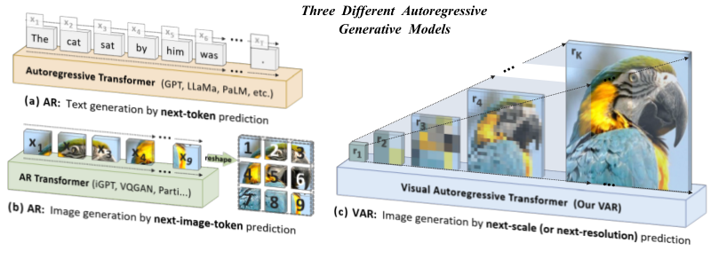
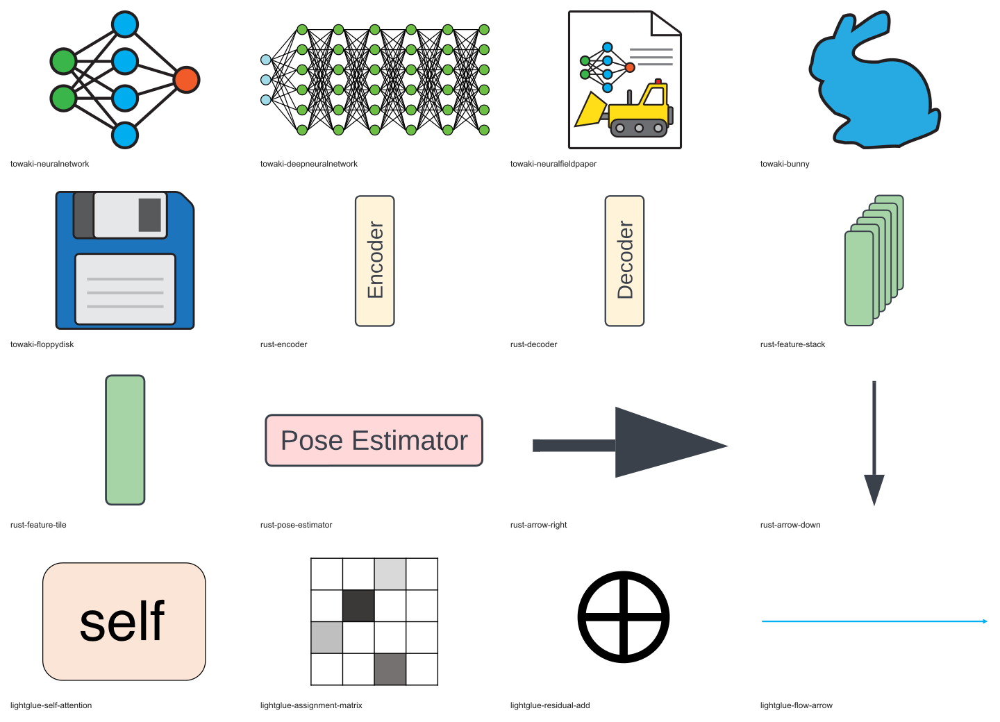

# Paper Figure Library

个人 CS / AI 论文配图素材库。收集作者和成熟素材库已有的源文件，方便用 Illustrator 选图、拆图和组合。

**317 个独立元素 · 13 个 teaser · 35 个 architecture · 17 张机制参考图 · 11 份原生版式模板**。

## 先看顶会论文原图

[**顶会配图精选图文目录 →**](collections/top-conference-figures.md)

本轮新增 **18 张经过逐页筛选的作者原图**，包含 6 张 teaser、12 张 architecture / framework。覆盖 CVPR、ICCV、ECCV、NeurIPS、ICML、ICLR 的 **10 篇已核实 Oral 论文**，另补 2 张 SIGGRAPH 架构图。

重点包括 VAR 与 DPO 的范式对照、Genie 的交互概念、DiT / SD3 / ViT 的整体与模块展开，以及 VGGT、CUT3R、LGM、DreamGaussian 的方法主图。每张都解释选图理由，附会议身份依据。

16 张提供原 PDF 矢量提取的 SVG，含照片的图仍保留原位图；DPO 对照图和 Genie 训练总览明确列为 **位图构图参考**。没有套壳 SVG，也没有标成作者原生 AI 工程。

## 先找元素

| 内容 | 入口 |
|---|---|
| 网络、张量、特征图与模块 | [网络与模块](elements/by-category/modules.md) · [数据表示](elements/by-category/data.md) |
| 箭头、分支、汇合、弯曲连接 | [箭头与连接](elements/by-category/connections.md) |
| 运算、冻结与训练标记 | [运算与变换](elements/by-category/operations.md) · [训练与标记](elements/by-category/training.md) |
| GPU、服务器、相机、云、设备 | [设备与对象](elements/by-category/devices.md) |
| 原图来源、许可、署名和源文件 | [元素图文目录](elements/README.md) · [逐项记录](elements/catalog.json) |
| 离线搜索与筛选 | 下载仓库后打开 [gallery.html](elements/gallery.html)，按中文、英文、分类和来源检索 |

这批元素包括 **160 个 Tabler 通用线性图标、100 个 Bioicons 科学与计算图元、30 个 Isoflow 等轴测对象、11 个从原 task5.ai 提取的网络部件，以及此前的 16 个作者来源元素**。通用图标和网络专用部件在分类与来源页分别列出。

原 AI 提取的部件包括：多通道张量、特征层、多尺度特征堆叠、CBR、GAP、FC+ReLU、拼接、加法、乘法和上采样。只复制原有路径与字形，记录原图、画板和节点位置。

## 范例与模板

| 分类 | 数量 | 内容 |
|---|---:|---|
| [Teaser](examples/teasers/README.md) | 13 | 新增 VAR、DPO、Genie、VGGT、CUT3R、DreamGaussian；另有 OrienterNet、RayDer、ShaDDR、K-LoRA、DECOLLAGE、LightGlue 等作者原图；覆盖动机、方法差异、能力与速度精度权衡 |
| [Architecture](examples/architectures/README.md) | 35 | 17 个论文方法图、16 个 D2L 教材结构图、2 个原生 AI 教程；包括 Transformer、ViT、ResNet、DenseNet、LSTM、GRU、GAN 等 |
| [机制参考](references/mechanisms/README.md) | 17 | 卷积、池化、Q/K/V、多头注意力与转置卷积等完整机制图；不计入最小元素数量 |
| [原生版式模板](templates/layouts/README.md) | 11 | Nature 官方、SciFigureTemplates、ICML / IEEE-ISBI 等 AI / AIT 母版；不计入 teaser 或元素数量 |
| [全部素材与来源](CATALOG.md) | — | 图文目录与 [JSON 索引](catalog.json) |

## 来源与编辑范围

原始下载的 SVG、AI、AIT 保留下载字节，GitHub 来源按固定版本和 blob 哈希核对。论文 PDF 摘图的 SVG 为转换件，另记原 PDF 哈希、页码、裁剪坐标和真实编辑范围。拆取的图元保留完整原图与精确节点位置。没有运行来源仓库中的图形生成脚本，也没有用本仓库自行生成的图形填充素材数量。

照片和三维渲染图仍是内嵌位图，部分字形已转轮廓。原 AIT 有些未保存实际 PDF 兼容图形，预览采用同一作者配套 PDF 或官方网页；说明中明确记录了预览来源。已检查图形预览与文件完整性，桌面 Illustrator 尚未逐项实测。

许可逐项保留。CC BY 等条目有作者与来源信息；未明确授权的论文图和教程部件作为参考保存。不要给整库第三方素材统一套用新的许可证。

## 维护

新增规则见 [CONTRIBUTING.md](CONTRIBUTING.md)。运行以下两步更新索引并检查完整性：

    python scripts/build_catalog.py
    python scripts/validate_library.py

[顶会论文收录记录](sources/top-conference-2026-10-27.json) · [元素批量下载记录](sources/expansion-2026-10-25.json) · [原始收录纠正记录](docs/curation-correction.md)
