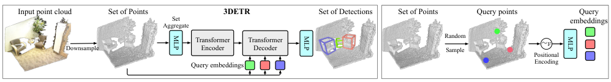

# 3DETR · 点云编码器、查询嵌入与集合预测

<!-- CATEGORY NAV -->
[Teaser](../../teaser/README.md) · [Architecture](../README.md) · [Element](../../element/README.md) · [总目录](../../CATALOG.md)
<!-- END CATEGORY NAV -->

[所属分类](../README.md) · [总目录](../../CATALOG.md)

**ICCV 2021 · Oral · 原论文 Figure 2**

## 为什么收这张图

左侧将点集到检测集合的主干压缩成一条水平线，右侧放大查询点、位置编码和查询嵌入的来源。

点云 Transformer 的整体网络与查询构造。

## 可以借鉴

- 整体主干与关键输入构造相邻呈现
- 用集合对象表达无序输入输出
- 查询嵌入通过统一颜色贯穿两部分

## 文件与编辑范围

[主文件](source.svg) · [单图 PDF](figure.pdf) · [来源与校验记录](metadata.json)

原 PDF 的几何路径与线条保留，SVG 文字转为轮廓；照片、三维渲染与原有位图部件仍为嵌入图片。

SVG 是原论文图形的提取转换件，未取得作者原生 AI 工程。不同 PDF 阅读器或 Illustrator 对字体、透明度的导入可能有差异。

## 原始出处

- 论文：[An End-to-End Transformer Model for 3D Object Detection](https://arxiv.org/abs/2109.08141)
- 作者：Misra, Ishan, Girdhar, Rohit, Joulin, Armand
- [作者项目或代码](https://facebookresearch.github.io/3detr/)
- [会议与展示身份依据](https://facebookresearch.github.io/3detr/)
- PDF 第 3 页，Figure 2；截取坐标见 metadata.json。

## 权利与修改记录

arXiv 标注的是授予 arXiv 的非独占分发许可，不是第三方图形重用许可。本条用于个人私有参考，改编或公开再用需核对原权利。

原文许可声明：https://arxiv.org/licenses/nonexclusive-distrib/1.0/

只提取、裁剪与转换原图；没有重新绘制。

<!-- BEGIN FIGURE LINKS -->
## 关联范例与元素

同论文的其他图：[3DETR · 输入点云、注意力与检测结果的对应](../../teaser/3detr-attention-teaser/README.md)

**可搭配的现有元素：** [ViT 编码器块](../../element/svg/vit-encoder-block.svg) · [DiT 多头自注意力模块](../../element/svg/dit-self-attention.svg) · [条件嵌入模块](../../element/svg/dit-embed.svg) · [ViT 前馈 MLP 模块](../../element/svg/vit-mlp.svg) · [三维坐标物体](../../element/svg/tabler-cube-3d-sphere.svg)

这些元素按表达功能关联，并非从本论文原图拆出；来源和许可仍以各元素记录为准。

[范例与元素对照表](../../element/with-examples.md) · [元素分类目录](../../element/README.md)
<!-- END FIGURE LINKS -->
