# Architecture 范例

[Teaser](../teaser/README.md) · [Architecture](README.md) · [Element](../element/README.md) · [总目录](../CATALOG.md)

按图的表达用途浏览。会议、期刊、年份及综述类型保留在条目标签中。

| 表达用途 | 数量 | 入口 |
|---|---:|---|
| 整体方法与训练流程 | 26 | [浏览](#framework) |
| 网络主干与模块展开 | 14 | [浏览](#network) |
| 基础结构与教材范例 | 16 | [浏览](#tutorial) |

## 整体方法与训练流程

### [GenAI 语义通信 · 语义记忆与物理信道双路框架](survey-genai-semantic-memory-framework/README.md)

发送端先提取共同知识和变化数据，上路通过两端语义记忆共享知识，下路通过 DJSCC 编解码与无线信道重建数据，最后输出预测。

arXiv 2024 · 预印本 · 综述

**子图组织：** 发送端、上下双路信道、接收端三大区域；生成模型的作用用浅蓝模块统一标示。 原论文 Figure 7。

[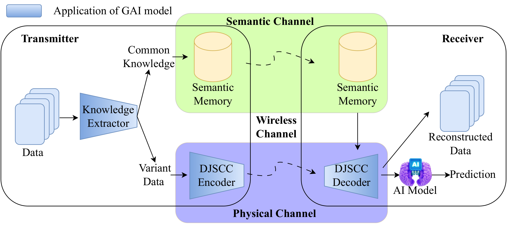](survey-genai-semantic-memory-framework/README.md)

[说明与源文件](survey-genai-semantic-memory-framework/README.md) · [同论文：GenAI × IoT · 分层技术栈与多场景应用](../teaser/survey-genai-iot-layers-scenes/README.md) · [同论文：GenAI 综述 · 演进、生成模型与代表方法拼图](../teaser/survey-genai-history-model-mosaic/README.md) · [同论文：GenAI 网络管理 · 控制面、数据面与切片场景](../teaser/survey-genai-network-management-scenes/README.md) · [同论文：GenAI 无线安全 · 四场景与局部机制并列](../teaser/survey-genai-wireless-security-four-panels/README.md) · [关联元素](survey-genai-semantic-memory-framework/README.md#关联范例与元素)

### [HippoRAG · 三脑区类比与索引检索框架](hipporag-brain-region-framework/README.md)

上方三个脑区与下方 LLM、检索编码器、知识图谱及 PageRank 一一对应，再按离线索引和在线检索两行展开。

NeurIPS 2024 · 会议论文；未核实 Oral

**子图组织：** 三列脑区及计算模块对应，下面两行展开离线与在线操作。 原论文 Figure 2。

[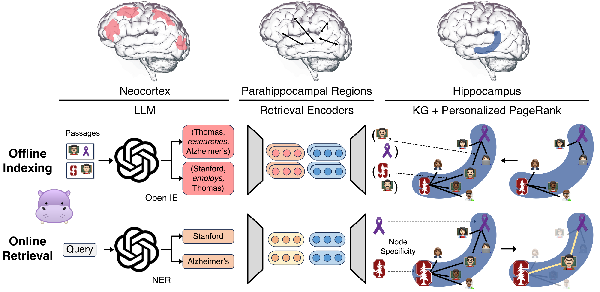](hipporag-brain-region-framework/README.md)

[说明与源文件](hipporag-brain-region-framework/README.md) · [同论文：HippoRAG · 普通 RAG、人类记忆与海马索引对照](../teaser/hipporag-human-memory-comparison/README.md) · [关联元素](hipporag-brain-region-framework/README.md#关联范例与元素)

### [HippoRAG 2 · 图谱索引、筛选与检索双阶段](hipporag2-indexing-retrieval-framework/README.md)

两行分别展示离线知识图谱构建与在线问答。节点、边与颜色图例明确，局部图谱逐步变化，解释三元组筛选、种子权重与 PageRank。

ICML 2025 · 会议论文；未核实 Oral

**子图组织：** 上行三个索引步骤，下行五个检索问答步骤；右上统一图例。 原论文 Figure 2。

[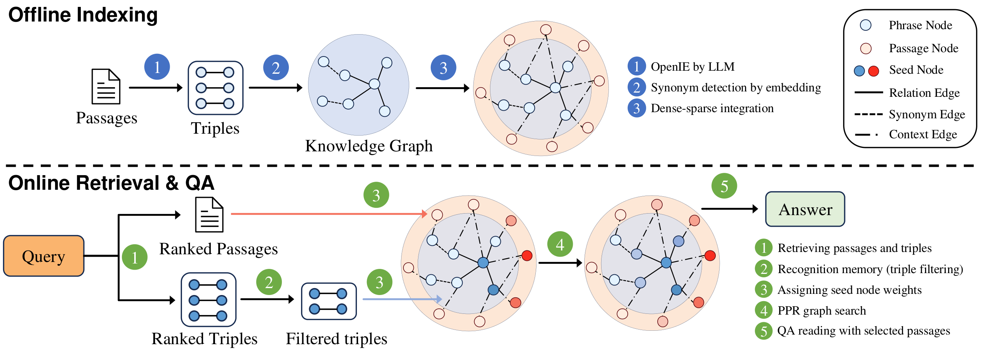](hipporag2-indexing-retrieval-framework/README.md)

[说明与源文件](hipporag2-indexing-retrieval-framework/README.md) · [关联元素](hipporag2-indexing-retrieval-framework/README.md#关联范例与元素)

### [A-MEM · 笔记构建、关联、演化与检索四分区](amem-notes-links-evolution-framework/README.md)

四个相邻分区把对话写成笔记、为记忆建立关联、更新原有记忆和查询检索串联起来；笔记、分组和模型符号跨区复用。

NeurIPS 2025 · 会议论文；未核实 Oral

**子图组织：** 四栏：Note Construction、Link Generation、Memory Evolution、Memory Retrieval。 原论文 Figure 2。

[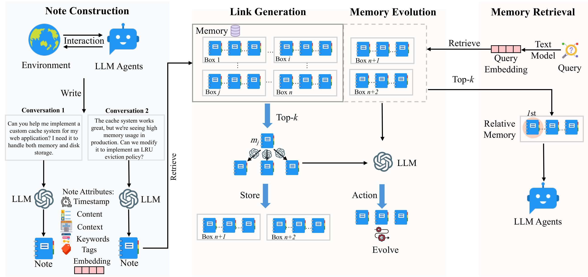](amem-notes-links-evolution-framework/README.md)

[说明与源文件](amem-notes-links-evolution-framework/README.md) · [关联元素](amem-notes-links-evolution-framework/README.md#关联范例与元素)

### [Self-RAG · 检索、并行生成与自评选择](selfrag-retrieve-generate-critique/README.md)

左侧是固定检索 RAG，右侧完整展开按需检索、并行生成和自评选择，下方再用不需要检索的请求形成补充对照。

ICLR 2024 · Oral

**子图组织：** 左右方法对照；右侧包含三阶段和三条文档分支；底部额外对照非检索任务。 原论文 Figure 1。

[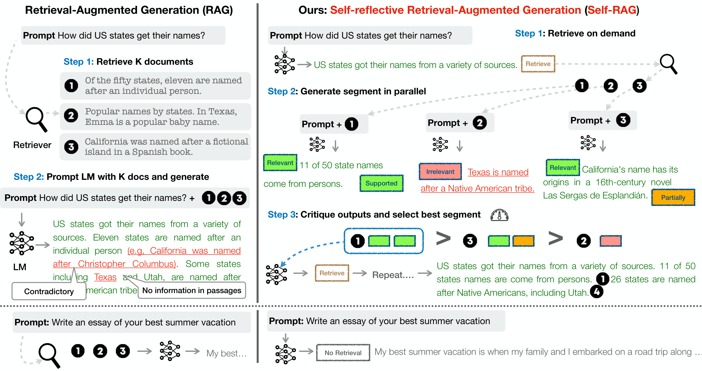](selfrag-retrieve-generate-critique/README.md)

[说明与源文件](selfrag-retrieve-generate-critique/README.md) · [关联元素](selfrag-retrieve-generate-critique/README.md#关联范例与元素)

### [CRAG · 评估分流、知识纠正与三路生成](crag-evaluate-correct-generate/README.md)

检索质量分成正确、模糊和错误三路，分别触发知识精炼、网页搜索或两者结合；底部对照三类证据组合如何进入生成器。

arXiv 2024 · 预印本

**子图组织：** 纵向三阶段：检索、知识纠正、生成；中间两种纠正机制，底部三路输入组合。 原论文 Figure 2。

[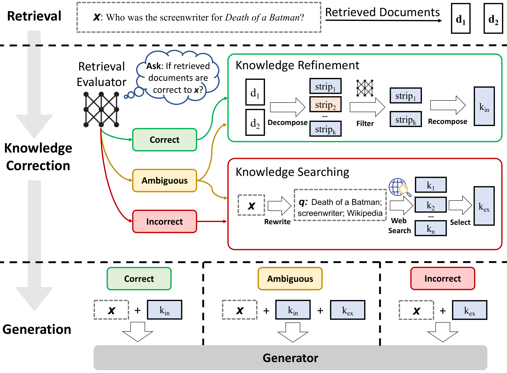](crag-evaluate-correct-generate/README.md)

[说明与源文件](crag-evaluate-correct-generate/README.md) · [关联元素](crag-evaluate-correct-generate/README.md#关联范例与元素)

### [MemoryOS · 三层记忆、动态更新与回答生成](memoryos-three-tier-memory-framework/README.md)

短期、中期和长期个人记忆并排展开，包含队列、页面、热度、用户画像与检索回路；上下主线把存储、更新和生成串起来。

EMNLP 2025 · Oral

**子图组织：** STM、MTM、LPM 三个记忆区及右侧回答区；上下检索和写回回路贯穿。 原论文 Figure 1。

[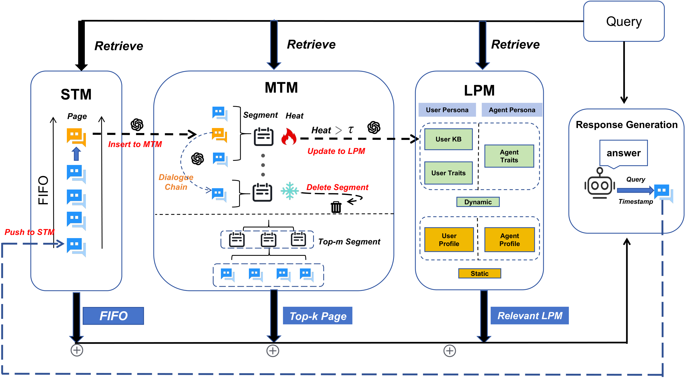](memoryos-three-tier-memory-framework/README.md)

[说明与源文件](memoryos-three-tier-memory-framework/README.md) · [关联元素](memoryos-three-tier-memory-framework/README.md#关联范例与元素)

### [LightMem · 感觉过滤、主题记忆与睡眠更新三面板](lightmem-sensory-topic-sleep-framework/README.md)

三面板以实际对话和记忆项解释 token 过滤、主题切分、结构化摘要与离线合并；包含注意力矩阵、局部峰值及更新队列。

ICLR 2026 · 会议论文；未核实 Oral

**子图组织：** (a) 上方长条感觉记忆过滤与切分；(b) 左下主题记忆构建；(c) 右下睡眠时间合并与更新。 原论文 Figure 2。

**整图位图，仅构图参考。**

[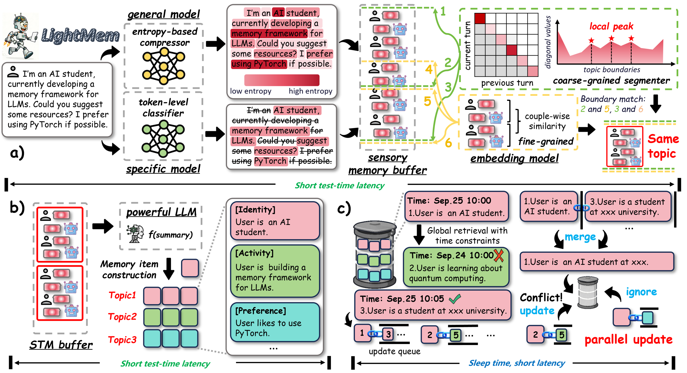](lightmem-sensory-topic-sleep-framework/README.md)

[说明与源文件](lightmem-sensory-topic-sleep-framework/README.md) · [同论文：LightMem · 原始记忆流水线与主题过滤、睡眠更新对照](../teaser/lightmem-memory-construction-comparison/README.md) · [关联元素](lightmem-sensory-topic-sleep-framework/README.md#关联范例与元素)

### [AI 记忆综述 · 感觉、短期、长期记忆与行动闭环](survey-ai-memory-agent-feedback-framework/README.md)

层叠的感觉、短期和长期记忆与右侧策略推理相连，外圈串联环境、观测、行动与人类反馈；图内保留具体记忆内容和多模态输入。

arXiv 2026 · 预印本 · 综述

**子图组织：** 三层记忆、右侧三类策略、顶部人类交互、底部环境构成闭环。 原论文 Figure 9。

[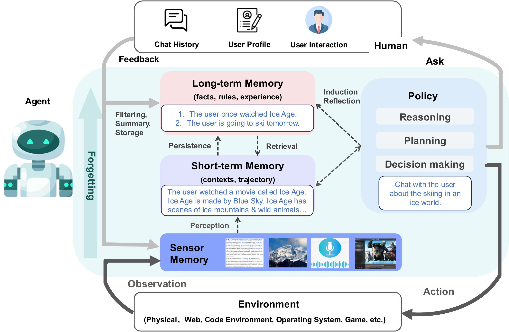](survey-ai-memory-agent-feedback-framework/README.md)

[说明与源文件](survey-ai-memory-agent-feedback-framework/README.md) · [同论文：AI 记忆综述 · 视频对象、动作、问答与生成四面板](../teaser/survey-ai-memory-video-task-panels/README.md) · [关联元素](survey-ai-memory-agent-feedback-framework/README.md#关联范例与元素)

### [Speculative RAG · 并行起草与通用模型验证](speculative-rag-draft-verify/README.md)

小型专用 RAG 模型对不同文档子集并行生成答案草稿和依据，再由大型通用模型验证并选择。图内明确展示查询、文档、答案、依据与两类模型之间的数据流。

ICLR 2025 · 会议论文；未核实 Oral

**子图组织：** 官方博客图分为查询通用模型、专用模型起草、通用模型验证三个阶段。论文完整 Figure 1 另保留 (a)–(c) 三类既有方法及 (d) 本方法。 原论文 Figure 1。

[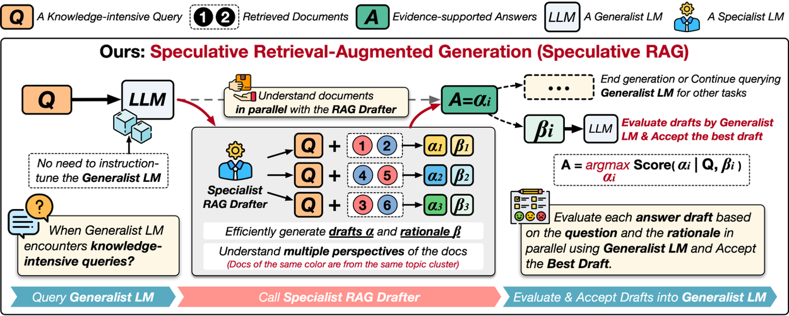](speculative-rag-draft-verify/README.md)

[说明与源文件](speculative-rag-draft-verify/README.md) · [关联元素](speculative-rag-draft-verify/README.md#关联范例与元素)

### [CUT3R · 持久状态的更新、读取与未见视角推断](cut3r-architecture/README.md)

左侧按时间展开状态更新，右侧用独立色块解释状态读取；重建结果紧邻对应计算步骤。

CVPR 2025 · Oral

[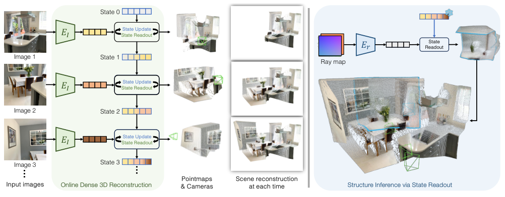](cut3r-architecture/README.md)

[说明与源文件](cut3r-architecture/README.md) · [同论文：CUT3R · 静态、动态与稀疏照片三类场景](../teaser/cut3r-capabilities/README.md) · [关联元素](cut3r-architecture/README.md#关联范例与元素)

### [DreamGaussian · 高斯生成、网格提取与纹理细化](dreamgaussian-architecture/README.md)

三个带编号的区域分别解释表示初始化、表示转换和后续细化，同时把不同损失放在对应优化回路内。

ICLR 2024 · Oral

[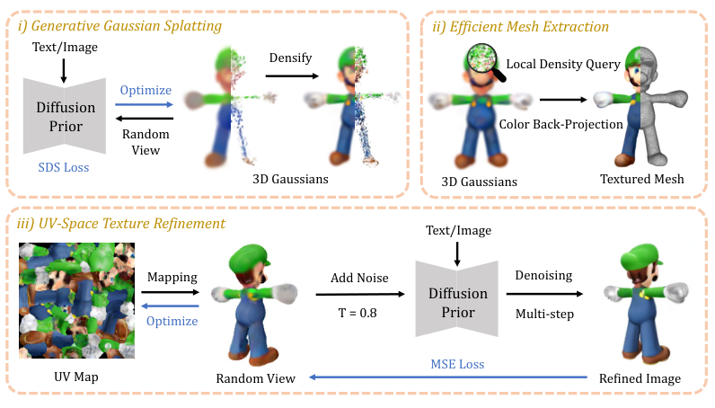](dreamgaussian-architecture/README.md)

[说明与源文件](dreamgaussian-architecture/README.md) · [同论文：DreamGaussian · 生成能力与优化进程同图展示](../teaser/dreamgaussian-progress/README.md) · [关联元素](dreamgaussian-architecture/README.md#关联范例与元素)

### [Genie · 视频 tokenizer、潜在动作与动力学模型](genie-architecture/README.md)

只保留三个核心模块，视频 tokens 与潜在动作分别编码后汇入动力学模型；简单分支就讲清训练信息来源。

ICML 2024 · Oral

**整图位图，仅构图参考。**

[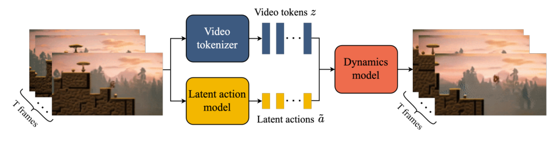](genie-architecture/README.md)

[说明与源文件](genie-architecture/README.md) · [同论文：Genie · 不同提示生成可交互世界](../teaser/genie-interaction/README.md) · [关联元素](genie-architecture/README.md#关联范例与元素)

### [VAR · 多尺度 VQVAE 与 VAR 两阶段训练](var-architecture/README.md)

两块并列区域分别解释表示学习和自回归训练，尺度、token 序列和因果 mask 的对应关系可在图中追踪。

NeurIPS 2024 · Oral

[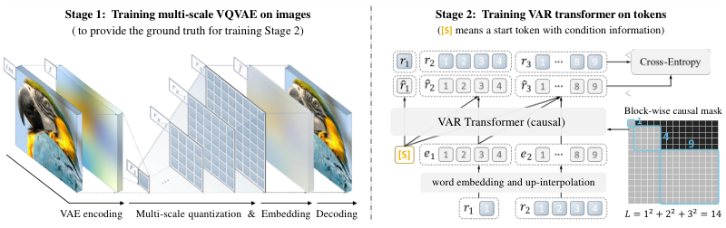](var-architecture/README.md)

[说明与源文件](var-architecture/README.md) · [同论文：VAR · 从逐 token 到逐尺度生成的范式对照](../teaser/var-paradigm/README.md) · [关联元素](var-architecture/README.md#关联范例与元素)

### [LGM · 从文本或图像到三维高斯和网格的流程](lgm-pipeline/README.md)

用少量大模块完成端到端说明，同时把各阶段耗时直接放在阶段下方，适合紧凑的方法总览。

ECCV 2024 · Oral

[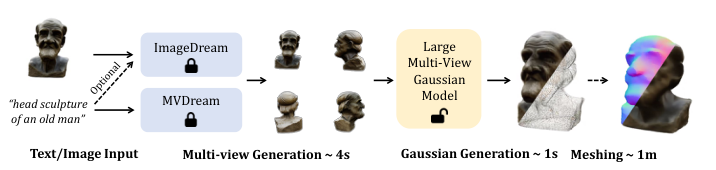](lgm-pipeline/README.md)

[说明与源文件](lgm-pipeline/README.md) · [同论文：LGM · 非对称 U-Net 与跨视角注意力](lgm-architecture/README.md) · [关联元素](lgm-pipeline/README.md#关联范例与元素)

### [3D Gaussian Splatting · 优化与光栅化双向流程](gaussian-splatting-architecture/README.md)

黑色实线和蓝色箭头分别表达正向操作与梯度回传，让自适应密度控制与可微渲染的关系无需依赖长图注。

SIGGRAPH 2023 · 会议论文；未核实 Oral

[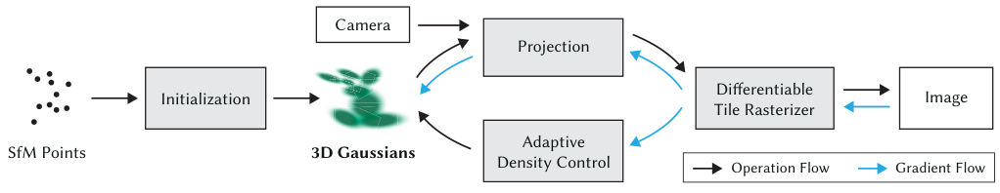](gaussian-splatting-architecture/README.md)

[说明与源文件](gaussian-splatting-architecture/README.md) · [关联元素](gaussian-splatting-architecture/README.md#关联范例与元素)

### [CLIP Figure 1：训练到零样本预测](clip/README.md)

CLIP 的训练与零样本使用流程，按方法流程归入 architecture。

[说明与源文件](clip/README.md) · [关联元素](clip/README.md#关联范例与元素)

### [RayDer：统一 Transformer 的两个使用阶段](rayder/README.md)

左右并列相机估计与新视角合成，清楚标明共用模型与不同输入输出。

[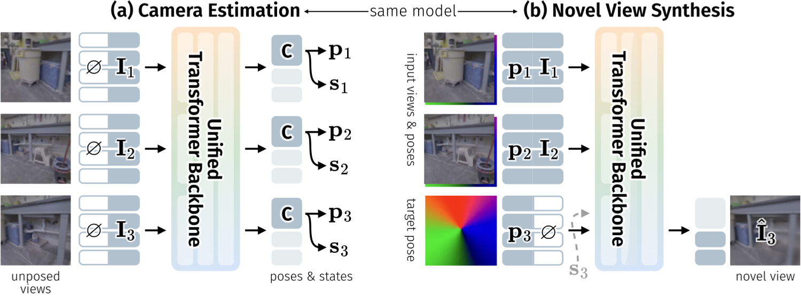](rayder/README.md)

[说明与源文件](rayder/README.md) · [同论文：RayDer：数据瓶颈与新训练范式](../teaser/rayder-concept/README.md) · [关联元素](rayder/README.md#关联范例与元素)

### [RUST：编码器、场景表示与位姿分支](rust/README.md)

无位姿输入图像经 Encoder、场景表示、Decoder 输出新视角，训练时有 Pose Estimator 分支。按内容归入 architecture。

[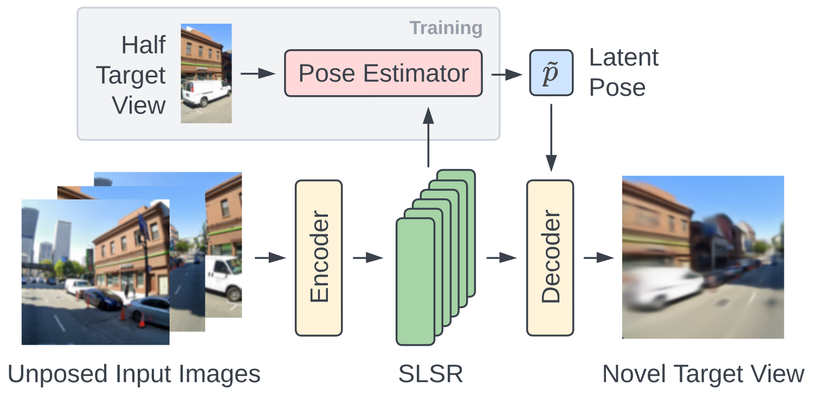](rust/README.md)

[说明与源文件](rust/README.md) · [关联元素](rust/README.md#关联范例与元素)

### [LAV：感知、预测与驾驶控制流程](lav/README.md)

多摄像头输入、语义分割、传感器融合、三维主干、运动预测与控制的整体数据流。原文件虽叫 teaser.svg，按内容归入 architecture。

[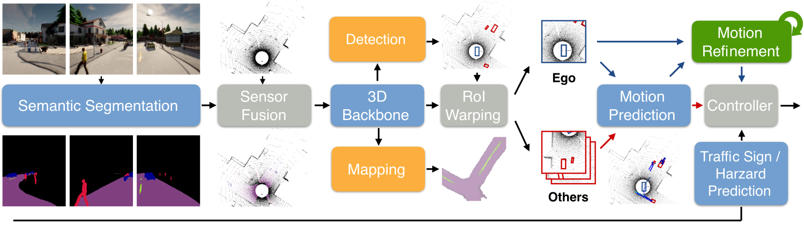](lav/README.md)

[说明与源文件](lav/README.md) · [关联元素](lav/README.md#关联范例与元素)

### [SAM / LoRA 总体流程与 Transformer 模块](sam-lora/README.md)

作者 Illustrator 科研绘图教程中的 SAM / LoRA 案例，含总体方法流程与 Transformer／LoRA 模块结构，共 2 个画板；公开的 PNG、PDF 与 PPTX 配套素材一并保留。

[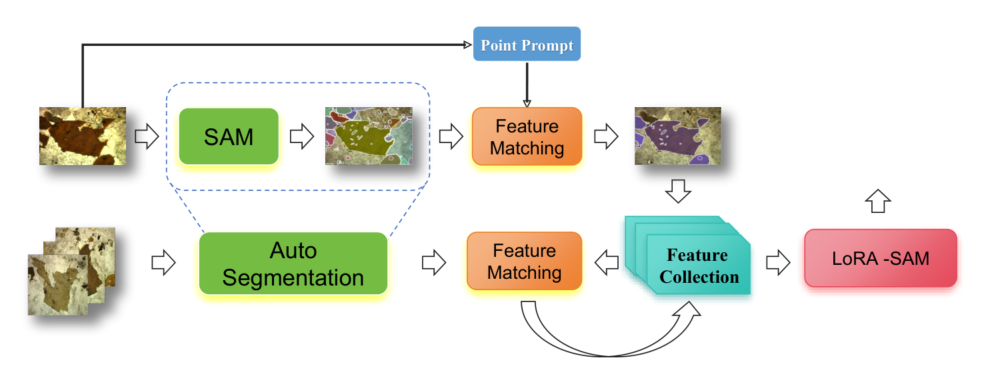](sam-lora/README.md)

[说明与源文件](sam-lora/README.md) · [关联元素](sam-lora/README.md#关联范例与元素)

### [pixelSplat · 概率深度采样与像素对齐高斯](pixelsplat-probabilistic-architecture/README.md)

用相机、射线、离散概率柱状图和连续高斯对应表达同一预测过程，抽象参数与几何对象能在图中逐一对上。

CVPR 2024 · 会议论文；未核实 Oral

[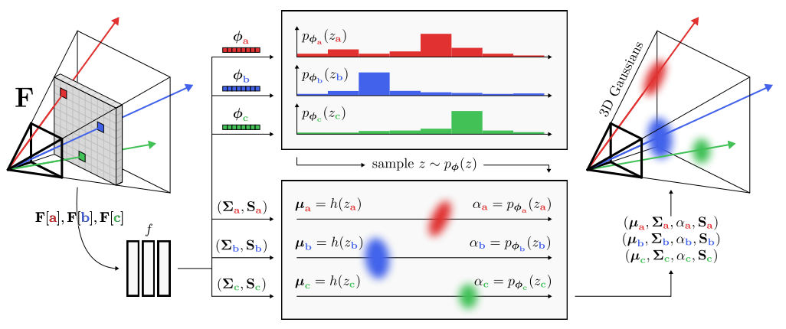](pixelsplat-probabilistic-architecture/README.md)

[说明与源文件](pixelsplat-probabilistic-architecture/README.md) · [关联元素](pixelsplat-probabilistic-architecture/README.md#关联范例与元素)

### [BLIP-2 · 冻结图像与语言模型的两阶段桥接](blip2-bridge-framework/README.md)

左右两块分别说明表示学习和生成学习，只让中间的 Q-Former 成为主要可训练连接，冻结标记紧邻对应基础模型。

ICML 2023 · Poster

[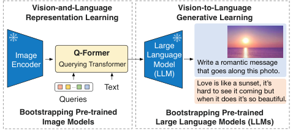](blip2-bridge-framework/README.md)

[说明与源文件](blip2-bridge-framework/README.md) · [同论文：BLIP-2 · Q-Former 与三种注意力掩码](blip2-qformer-architecture/README.md) · [关联元素](blip2-bridge-framework/README.md#关联范例与元素)

### [Agent 概念框架 · 感知、大脑与行动](survey-agent-perception-brain-action/README.md)

用环境交互闭环串起感知、大脑与行动，同时在右侧展开存储和决策能力；适合作为综述统一框架图的构图参考。

arXiv 2023 · 预印本 · 综述

[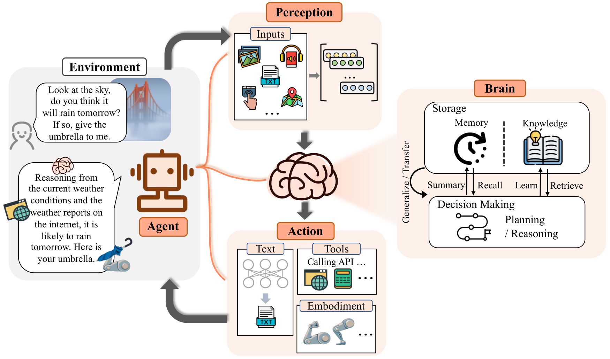](survey-agent-perception-brain-action/README.md)

[说明与源文件](survey-agent-perception-brain-action/README.md) · [同论文：Agent 社会场景 · 综述概念 teaser](../teaser/survey-agent-society-teaser/README.md) · [关联元素](survey-agent-perception-brain-action/README.md#关联范例与元素)

### [自主 Agent 统一框架 · 四列模块分解](survey-autonomous-agent-modules/README.md)

将 Profile、Memory、Planning、Action 并列成四列，列内再分子能力，顶部说明共享的 LLM 基础，适合综述比较多个系统的共同组成。

Frontiers of Computer Science 2024 · 期刊论文 · 综述

[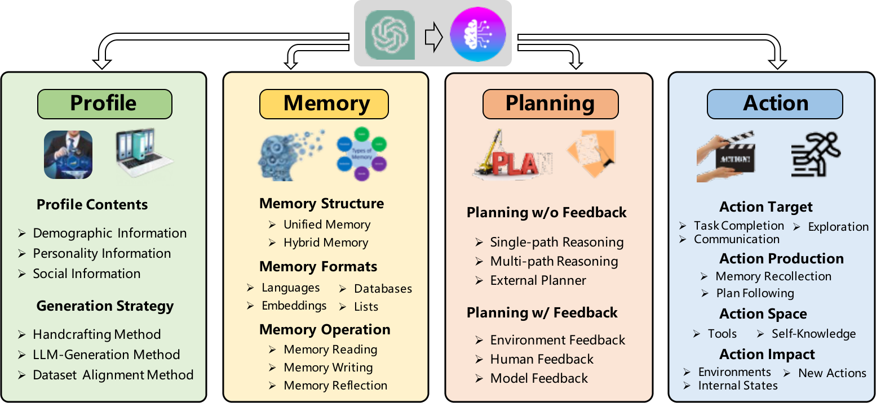](survey-autonomous-agent-modules/README.md)

[说明与源文件](survey-autonomous-agent-modules/README.md) · [同论文：自主 Agent 发展 · 趋势曲线与代表场景](../teaser/survey-agent-growth-landscape/README.md) · [关联元素](survey-autonomous-agent-modules/README.md#关联范例与元素)

### [MLLM 统一架构 · 模态接口与连接器对照](survey-mllm-connector-framework/README.md)

上半部统一多模态输入、编码器、连接器、LLM 与生成器，下半部并列展开 MLP、Q-Former 和注意力连接方式，兼顾全局和接口差异。

National Science Review 2024 · 期刊论文 · 综述

[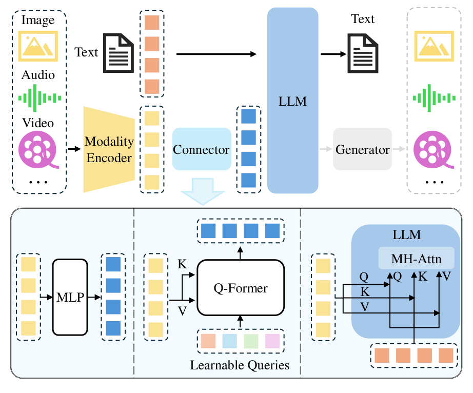](survey-mllm-connector-framework/README.md)

[说明与源文件](survey-mllm-connector-framework/README.md) · [同论文：多模态大模型发展 · 分段曲线时间线](../teaser/survey-mllm-timeline/README.md) · [关联元素](survey-mllm-connector-framework/README.md#关联范例与元素)

## 网络主干与模块展开

### [MemoryVLA · 感知认知记忆库与扩散动作网络](memoryvla-perceptual-cognitive-architecture/README.md)

左侧视觉与语言编码，中间感知认知记忆库、检索、门控融合和巩固回路，右侧展开动作专家的双路注意力与去噪结构。

ICLR 2026 · 会议论文；未核实 Oral

**子图组织：** 输入编码、记忆管理、动作专家三个区域；最后一个区域展示内部网络层。 原论文 Figure 2。

[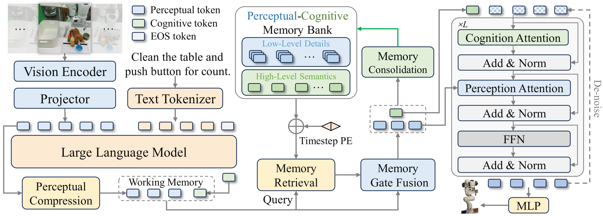](memoryvla-perceptual-cognitive-architecture/README.md)

[说明与源文件](memoryvla-perceptual-cognitive-architecture/README.md) · [同论文：MemoryVLA · 人类记忆类比、方法与性能首图](../teaser/memoryvla-cognition-memory-action/README.md) · [关联元素](memoryvla-perceptual-cognitive-architecture/README.md#关联范例与元素)

### [DiT · 整体主干与三种条件注入模块](dit-architecture/README.md)

左侧给完整主干，右侧展开 block 变体；推荐模块使用更高视觉对比，完整展示论文的结构选择。

ICCV 2023 · Oral

[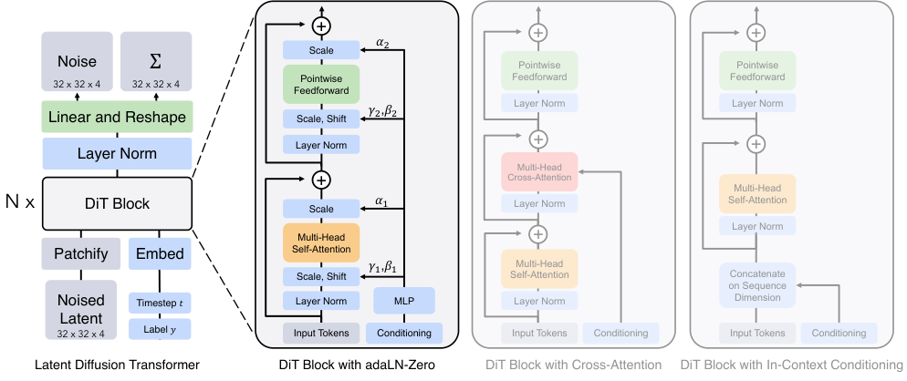](dit-architecture/README.md)

[说明与源文件](dit-architecture/README.md) · [关联元素](dit-architecture/README.md#关联范例与元素)

### [SD3 · 双模态主干与 MM-DiT block 展开](sd3-mmdit-architecture/README.md)

左侧说明文本与图像条件如何进入主干，右侧以对称双路结构展开联合注意力，颜色和符号在两部分保持一致。

ICML 2024 · Oral

[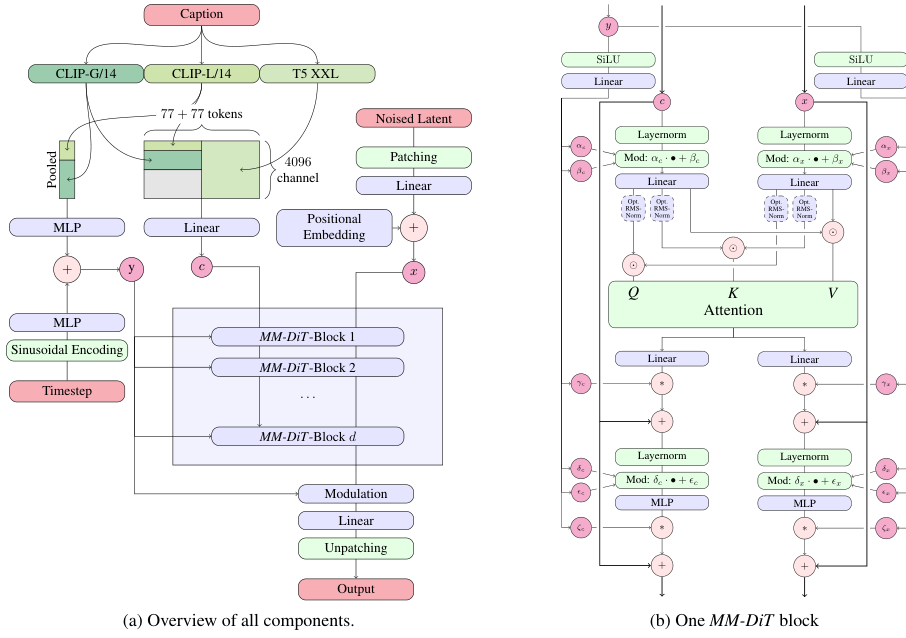](sd3-mmdit-architecture/README.md)

[说明与源文件](sd3-mmdit-architecture/README.md) · [关联元素](sd3-mmdit-architecture/README.md#关联范例与元素)

### [VGGT · 交替注意力主干与多任务输出头](vggt-architecture/README.md)

整图始终沿左到右阅读；颜色区分 token，虚线框标出重复主干，右侧分组展开输出任务。

CVPR 2025 · Oral

[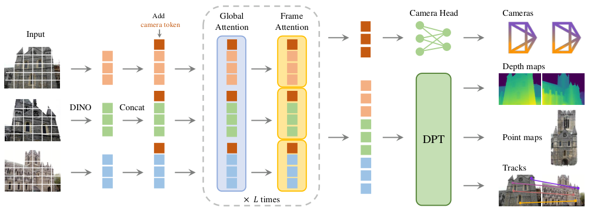](vggt-architecture/README.md)

[说明与源文件](vggt-architecture/README.md) · [同论文：VGGT · 多视图输入与统一三维感知能力](../teaser/vggt-capabilities/README.md) · [关联元素](vggt-architecture/README.md#关联范例与元素)

### [ViT 原论文 · 图像分块、token 序列与编码器展开](vit-original-architecture/README.md)

输入图像、patch 序列、位置编码和分类 token 都有直观的对应关系；右侧独立展开重复的 Transformer 编码器。

ICLR 2021 · Oral

[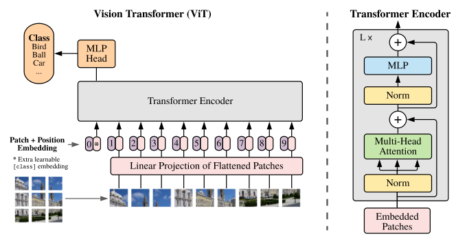](vit-original-architecture/README.md)

[说明与源文件](vit-original-architecture/README.md) · [关联元素](vit-original-architecture/README.md#关联范例与元素)

### [LGM · 非对称 U-Net 与跨视角注意力](lgm-architecture/README.md)

把多视图输入、相机射线编码、U-Net、三维融合和监督闭环放在一张图里；顶部局部放大说明跨视角交互。

ECCV 2024 · Oral

[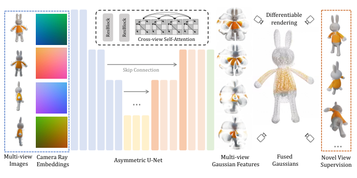](lgm-architecture/README.md)

[说明与源文件](lgm-architecture/README.md) · [同论文：LGM · 从文本或图像到三维高斯和网格的流程](lgm-pipeline/README.md) · [关联元素](lgm-architecture/README.md#关联范例与元素)

### [Instant NGP · 多分辨率哈希编码到 MLP](instant-ngp-hash-architecture/README.md)

通过五个编号步骤，将空间采样、哈希查表、插值、拼接与网络连接起来；不同尺度的颜色可贯穿整张图。

SIGGRAPH 2022 · 会议论文；未核实 Oral

[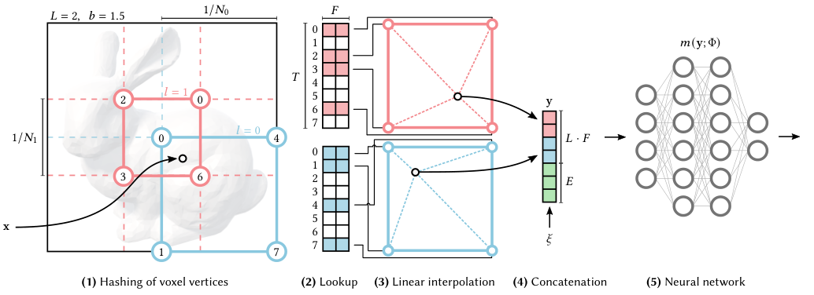](instant-ngp-hash-architecture/README.md)

[说明与源文件](instant-ngp-hash-architecture/README.md) · [关联元素](instant-ngp-hash-architecture/README.md#关联范例与元素)

### [LightGlue：注意力、动态剪枝与匹配](lightglue/README.md)

双分支局部特征经过 self/cross attention、置信度预测、剪枝和匹配分配。

[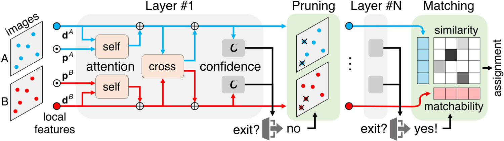](lightglue/README.md)

[说明与源文件](lightglue/README.md) · [同论文：LightGlue：速度与精度权衡](../teaser/lightglue-tradeoff/README.md) · [关联元素](lightglue/README.md#关联范例与元素)

### [多尺度网络总览与模块展开](multiscale-network/README.md)

作者 Illustrator 科研绘图教程中的多尺度网络案例：Backbone、高低层特征、SPPA／LFSA／GMFF 模块、预测结果，以及模块细节。原文件含 7 个画板。

[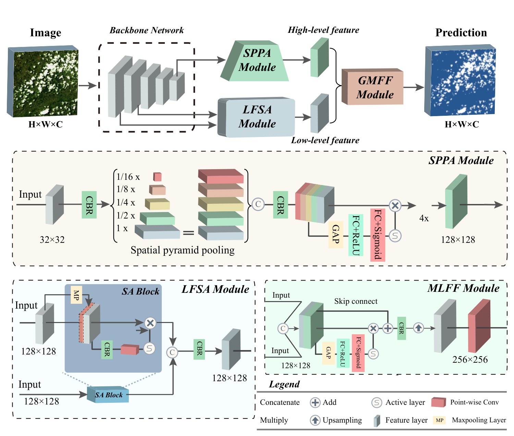](multiscale-network/README.md)

[说明与源文件](multiscale-network/README.md) · [关联元素](multiscale-network/README.md#关联范例与元素)

### [MVSplat · 多视图匹配、代价体与三维高斯预测](mvsplat-architecture/README.md)

输入视图、匹配特征、代价体、深度及三维表示沿一条阅读方向展开，两个视图始终保持上下对应关系。

ECCV 2024 · Oral

[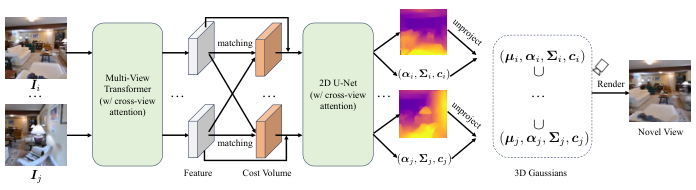](mvsplat-architecture/README.md)

[说明与源文件](mvsplat-architecture/README.md) · [同论文：MVSplat · 重建质量、速度与参数量的并列对照](../teaser/mvsplat-comparison/README.md) · [关联元素](mvsplat-architecture/README.md#关联范例与元素)

### [SAM 2 · 流式编码、记忆注意力与记忆库](sam2-memory-architecture/README.md)

沿时间方向叠放帧和特征，主线保留当前帧的编码与解码，顶部多条回线单独表达历史记忆参与计算。

ICLR 2025 · Oral

[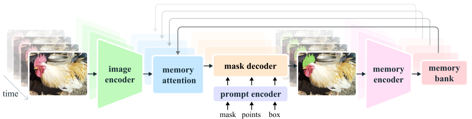](sam2-memory-architecture/README.md)

[说明与源文件](sam2-memory-architecture/README.md) · [同论文：SAM 2 · 任务、模型与数据引擎三联概念图](../teaser/sam2-task-model-data/README.md) · [关联元素](sam2-memory-architecture/README.md#关联范例与元素)

### [LLaVA · 视觉投影与语言 token 的统一输入](llava-original-architecture/README.md)

用颜色和形状区分视觉 token、指令 token 与生成 token，投影层把图像特征接入语言模型的关系简洁清楚。

NeurIPS 2023 · Oral

[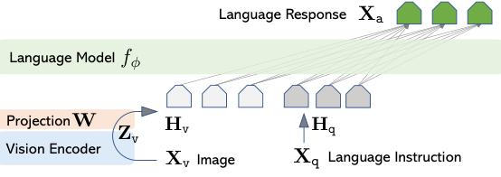](llava-original-architecture/README.md)

[说明与源文件](llava-original-architecture/README.md) · [关联元素](llava-original-architecture/README.md#关联范例与元素)

### [BLIP-2 · Q-Former 与三种注意力掩码](blip2-qformer-architecture/README.md)

左侧画共享查询模块和训练目标，右侧用同一种矩阵视觉语法比较三种注意力约束，结构与约束之间的关系很清楚。

ICML 2023 · Poster

[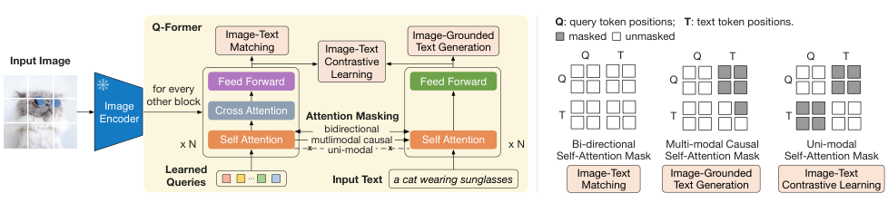](blip2-qformer-architecture/README.md)

[说明与源文件](blip2-qformer-architecture/README.md) · [同论文：BLIP-2 · 冻结图像与语言模型的两阶段桥接](blip2-bridge-framework/README.md) · [关联元素](blip2-qformer-architecture/README.md#关联范例与元素)

### [3DETR · 点云编码器、查询嵌入与集合预测](3detr-architecture/README.md)

左侧将点集到检测集合的主干压缩成一条水平线，右侧放大查询点、位置编码和查询嵌入的来源。

ICCV 2021 · Oral

[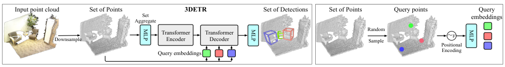](3detr-architecture/README.md)

[说明与源文件](3detr-architecture/README.md) · [同论文：3DETR · 输入点云、注意力与检测结果的对应](../teaser/3detr-attention-teaser/README.md) · [关联元素](3detr-architecture/README.md#关联范例与元素)

## 基础结构与教材范例

### [D2L · Transformer 编码器与解码器](d2l-transformer/README.md)

D2L 教材作者提供的原始矢量图，适合借鉴结构与模块表达；明确作为教材范例收录。

[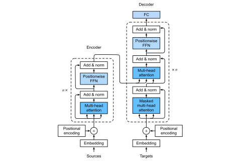](d2l-transformer/README.md)

[说明与源文件](d2l-transformer/README.md) · [关联元素](d2l-transformer/README.md#关联范例与元素)

### [D2L · Vision Transformer](d2l-vit/README.md)

D2L 教材作者提供的原始矢量图，适合借鉴结构与模块表达；明确作为教材范例收录。

[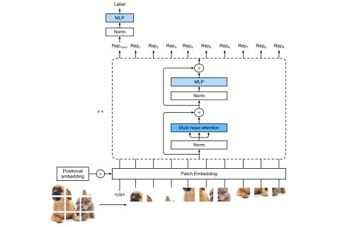](d2l-vit/README.md)

[说明与源文件](d2l-vit/README.md) · [关联元素](d2l-vit/README.md#关联范例与元素)

### [D2L · 编码器—解码器](d2l-encoder-decoder/README.md)

D2L 教材作者提供的原始矢量图，适合借鉴结构与模块表达；明确作为教材范例收录。

[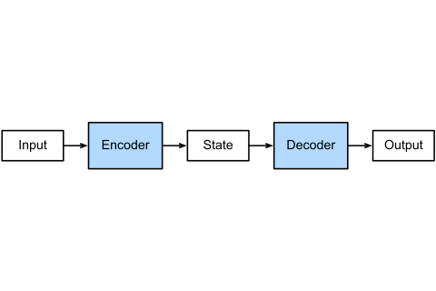](d2l-encoder-decoder/README.md)

[说明与源文件](d2l-encoder-decoder/README.md) · [关联元素](d2l-encoder-decoder/README.md#关联范例与元素)

### [D2L · 带注意力的 Seq2Seq](d2l-seq2seq-attention/README.md)

D2L 教材作者提供的原始矢量图，适合借鉴结构与模块表达；明确作为教材范例收录。

[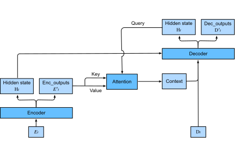](d2l-seq2seq-attention/README.md)

[说明与源文件](d2l-seq2seq-attention/README.md) · [关联元素](d2l-seq2seq-attention/README.md#关联范例与元素)

### [D2L · ResNet 残差块](d2l-resnet-block/README.md)

D2L 教材作者提供的原始矢量图，适合借鉴结构与模块表达；明确作为教材范例收录。

[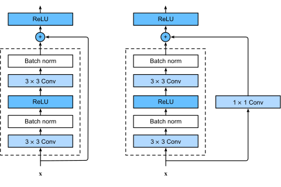](d2l-resnet-block/README.md)

[说明与源文件](d2l-resnet-block/README.md) · [关联元素](d2l-resnet-block/README.md#关联范例与元素)

### [D2L · ResNeXt 分组残差块](d2l-resnext-block/README.md)

D2L 教材作者提供的原始矢量图，适合借鉴结构与模块表达；明确作为教材范例收录。

[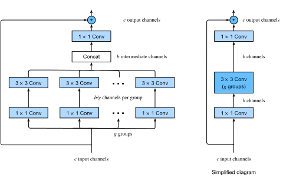](d2l-resnext-block/README.md)

[说明与源文件](d2l-resnext-block/README.md) · [关联元素](d2l-resnext-block/README.md#关联范例与元素)

### [D2L · DenseNet 密集连接块](d2l-densenet-block/README.md)

D2L 教材作者提供的原始矢量图，适合借鉴结构与模块表达；明确作为教材范例收录。

[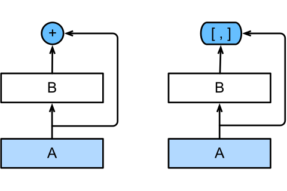](d2l-densenet-block/README.md)

[说明与源文件](d2l-densenet-block/README.md) · [关联元素](d2l-densenet-block/README.md#关联范例与元素)

### [D2L · Inception 并行分支](d2l-inception/README.md)

D2L 教材作者提供的原始矢量图，适合借鉴结构与模块表达；明确作为教材范例收录。

[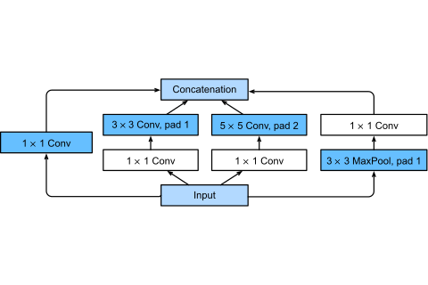](d2l-inception/README.md)

[说明与源文件](d2l-inception/README.md) · [关联元素](d2l-inception/README.md#关联范例与元素)

### [D2L · LeNet](d2l-lenet/README.md)

D2L 教材作者提供的原始矢量图，适合借鉴结构与模块表达；明确作为教材范例收录。

[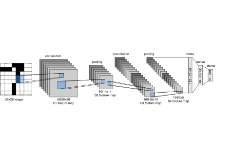](d2l-lenet/README.md)

[说明与源文件](d2l-lenet/README.md) · [关联元素](d2l-lenet/README.md#关联范例与元素)

### [D2L · AlexNet](d2l-alexnet/README.md)

D2L 教材作者提供的原始矢量图，适合借鉴结构与模块表达；明确作为教材范例收录。

[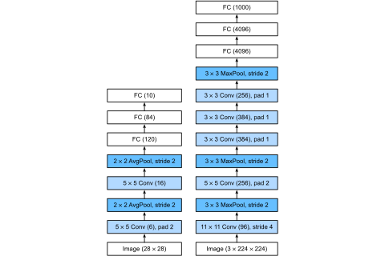](d2l-alexnet/README.md)

[说明与源文件](d2l-alexnet/README.md) · [关联元素](d2l-alexnet/README.md#关联范例与元素)

### [D2L · VGG](d2l-vgg/README.md)

D2L 教材作者提供的原始矢量图，适合借鉴结构与模块表达；明确作为教材范例收录。

[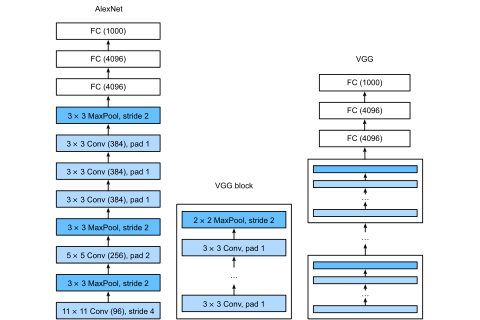](d2l-vgg/README.md)

[说明与源文件](d2l-vgg/README.md) · [关联元素](d2l-vgg/README.md#关联范例与元素)

### [D2L · 全卷积网络](d2l-fcn/README.md)

D2L 教材作者提供的原始矢量图，适合借鉴结构与模块表达；明确作为教材范例收录。

[说明与源文件](d2l-fcn/README.md) · [关联元素](d2l-fcn/README.md#关联范例与元素)

### [D2L · 多层感知机](d2l-mlp/README.md)

D2L 教材作者提供的原始矢量图，适合借鉴结构与模块表达；明确作为教材范例收录。

[说明与源文件](d2l-mlp/README.md) · [关联元素](d2l-mlp/README.md#关联范例与元素)

### [D2L · LSTM 内部门控](d2l-lstm-3/README.md)

D2L 教材作者提供的原始矢量图，适合借鉴结构与模块表达；明确作为教材范例收录。

[说明与源文件](d2l-lstm-3/README.md) · [关联元素](d2l-lstm-3/README.md#关联范例与元素)

### [D2L · GRU 内部门控](d2l-gru-3/README.md)

D2L 教材作者提供的原始矢量图，适合借鉴结构与模块表达；明确作为教材范例收录。

[说明与源文件](d2l-gru-3/README.md) · [关联元素](d2l-gru-3/README.md#关联范例与元素)

### [D2L · 生成对抗网络](d2l-gan/README.md)

D2L 教材作者提供的原始矢量图，适合借鉴结构与模块表达；明确作为教材范例收录。

[说明与源文件](d2l-gan/README.md) · [关联元素](d2l-gan/README.md#关联范例与元素)

## 版式辅助

[原生 AI / AIT 版式母版](../templates/layouts/README.md)，作为辅助素材单独计数。
