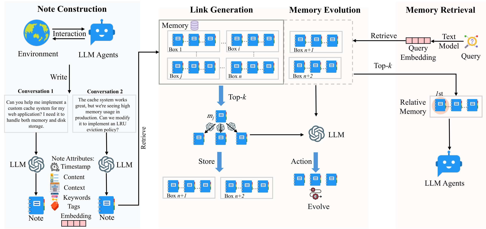

# A-MEM · 笔记构建、关联、演化与检索四分区

<!-- CATEGORY NAV -->
[Teaser](../../teaser/README.md) · [Architecture](../README.md) · [Element](../../element/README.md) · [总目录](../../CATALOG.md)
<!-- END CATEGORY NAV -->

**Architecture · 原论文 Figure 2 · 2502.12110v11**

## 内容与构图

四个相邻分区把对话写成笔记、为记忆建立关联、更新原有记忆和查询检索串联起来；笔记、分组和模型符号跨区复用。

四栏：Note Construction、Link Generation、Memory Evolution、Memory Retrieval。

解释模型内部结构、处理步骤或数据流，按主要表达用途归入 Architecture。

## 与这次四张参考图的关系

沿 [参考图 2 · Speculative RAG](../../architecture/speculative-rag-draft-verify/README.md) · [参考图 3 · MemoryVLA](../../teaser/memoryvla-cognition-memory-action/README.md) 的表达方式继续检索。

可借鉴的组织关系：

- 用稳定的笔记符号贯穿存储与检索。
- 主流程与局部数据组织示意相邻，避免只剩抽象框。

## 文件与编辑范围

[作者独立 PDF](original.pdf) · [SVG 转换件](source.svg) · [原始插图定义](figure-inclusion.tex) · [来源与校验记录](metadata.json)

作者独立 PDF 含 98 个绘图对象、92 个文本片段和 47 个嵌入位图对象；保留原有矢量、文字或轮廓。SVG 是 PDF 转换件，文字转轮廓，嵌入图片保持。位图对象数不代表子图数。

PDF 的框线、箭头和原有文字对象或轮廓可按实际对象修改；照片和部分图标仍为位图。桌面 Illustrator 尚未逐项实测。

## 原始出处

- 论文：[A-MEM: Agentic Memory for LLM Agents](https://arxiv.org/abs/2502.12110v11)
- 作者：Xu, Wujiang；Liang, Zujie；Mei, Kai；Gao, Hang；Tan, Juntao；Zhang, Yongfeng
- [作者项目或仓库](https://github.com/WujiangXu/AgenticMemory)
- 所收录版本：`2502.12110v11`，原文 PDF 第 3 页，Figure 2。
- [固定版本 TeX 源码归档](https://arxiv.org/src/2502.12110v11)；原件路径 `figure/framework.pdf`。
- [会议身份依据](https://papers.neurips.cc/paper_files/paper/2025/file/19909c36f51abc4856b4560aff3d36d6-Paper-Conference.pdf)：NeurIPS 2025；本条源文件版本仍以上述 arXiv 为准。

## 权利与转换记录

所收录 arXiv 版本采用非独占分发许可，该许可不等同第三方重用授权。本条用于私有参考，保留署名与来源；图中第三方插图和照片按原始权利核对。

[原版本许可](https://arxiv.org/licenses/nonexclusive-distrib/1.0/) · [权利记录](RIGHTS.source.txt)

原始文件按原字节保存，转换件另存。

<!-- BEGIN FIGURE LINKS -->
## 关联范例与元素

**从本图拆出的部件：** [查询嵌入向量条](../../element/svg/amem-embedding-vector.svg)

**可搭配的现有元素：** [文本文件](../../element/svg/tabler-file-text.svg) · [网络](../../element/svg/tabler-network.svg) · [数据库](../../element/svg/tabler-database.svg) · [回环箭头](../../element/svg/tabler-arrow-loop-right.svg)

这些元素按表达功能关联，并非从本论文原图拆出；来源和许可仍以各元素记录为准。

[范例与元素对照表](../../element/with-examples.md) · [元素分类目录](../../element/README.md)
<!-- END FIGURE LINKS -->
