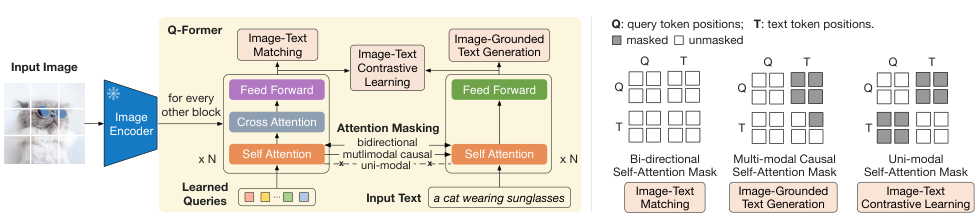

# BLIP-2 · Q-Former 与三种注意力掩码

<!-- CATEGORY NAV -->
[Teaser](../../teaser/README.md) · [Architecture](../README.md) · [Element](../../element/README.md) · [总目录](../../CATALOG.md)
<!-- END CATEGORY NAV -->

[所属分类](../README.md) · [总目录](../../CATALOG.md)

**ICML 2023 · Poster · 原论文 Figure 2**

## 为什么收这张图

左侧画共享查询模块和训练目标，右侧用同一种矩阵视觉语法比较三种注意力约束，结构与约束之间的关系很清楚。

局部模块架构与训练约束展开。

## 可以借鉴

- 共享模块与多个目标分区组织
- 用小矩阵展开注意力约束
- 相同矩阵排版保持对照一致

## 文件与编辑范围

[主文件](source.svg) · [单图 PDF](figure.pdf) · [来源与校验记录](metadata.json)

原 PDF 的几何路径与线条保留，SVG 文字转为轮廓；照片、三维渲染与原有位图部件仍为嵌入图片。

SVG 是原论文图形的提取转换件，未取得作者原生 AI 工程。不同 PDF 阅读器或 Illustrator 对字体、透明度的导入可能有差异。

## 原始出处

- 论文：[BLIP-2: Bootstrapping Language-Image Pre-training with Frozen Image Encoders and Large Language Models](https://arxiv.org/abs/2301.12597)
- 作者：Li, Junnan, Li, Dongxu, Savarese, Silvio, Hoi, Steven
- [作者项目或代码](https://github.com/salesforce/LAVIS/tree/main/projects/blip2)
- [会议与展示身份依据](https://icml.cc/virtual/2023/poster/25182)
- PDF 第 3 页，Figure 2；截取坐标见 metadata.json。

## 权利与修改记录

arXiv 原文声明 CC BY 4.0；保留作者署名、论文链接和裁剪转换说明。第三方照片与模型若有独立声明，仍按原声明。

原文许可声明：https://creativecommons.org/licenses/by/4.0/

只提取、裁剪与转换原图；没有重新绘制。

<!-- BEGIN FIGURE LINKS -->
## 关联范例与元素

同论文的其他图：[BLIP-2 · 冻结图像与语言模型的两阶段桥接](../blip2-bridge-framework/README.md)

**可搭配的现有元素：** [DiT 多头自注意力模块](../../element/svg/dit-self-attention.svg) · [匹配相似度矩阵](../../element/svg/lightglue-assignment-matrix.svg) · [逐位置前馈网络模块](../../element/svg/dit-feed-forward.svg) · [ViT 编码器块](../../element/svg/vit-encoder-block.svg)

这些元素按表达功能关联，并非从本论文原图拆出；来源和许可仍以各元素记录为准。

[范例与元素对照表](../../element/with-examples.md) · [元素分类目录](../../element/README.md)
<!-- END FIGURE LINKS -->
