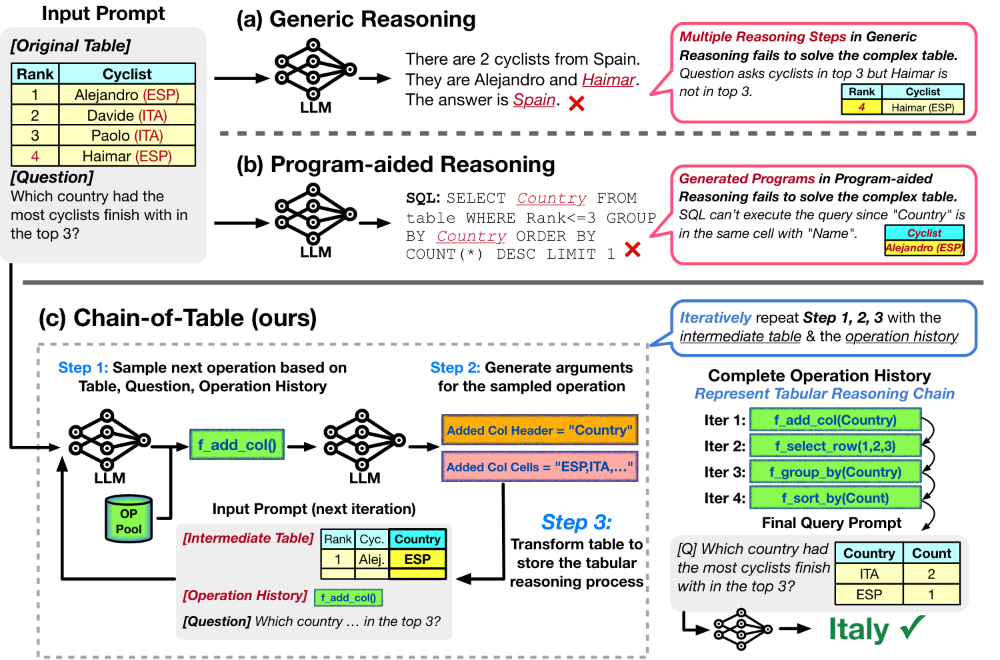

# Chain-of-Table · 自行车名次表的迭代推理

<!-- CATEGORY NAV -->
[Teaser](../../teaser/README.md) · [Architecture](../README.md) · [Element](../../element/README.md) · [总目录](../../CATALOG.md)
<!-- END CATEGORY NAV -->

**Architecture · 原论文 Figure 1 · ICLR 2024**

## 内容与构图

同一张自行车名次表贯穿三种解法。方法部分把选操作、填参数、变换表格画成循环，右侧列出四轮操作及最终汇总表。

共用左侧原表与问题。上方两行分别显示直接推理和程序辅助推理，下方展开三步循环与完整操作历史。

- 基线和新方法共用原表，红色批注直接连到被错读的单元格。
- 把单轮的输入、输出与多轮的操作历史分开画，同时复用表格与函数框的配色。

同类构图可对照 [Tokengeist Fig. 13](../tokengeist-refund-provenance-trace/README.md)。

## 文件与编辑范围

[作者独立 PDF](original.pdf) · [SVG 转换件](source.svg) · [LaTeX 插图定义](figure-inclusion.tex) · [来源与校验记录](metadata.json)

作者 PDF 含 279 个矢量绘图对象、123 个文本片段和 11 个嵌入位图对象。SVG 将文字转为轮廓，并保留原有位图。桌面 Illustrator 尚未实测。

## 原始出处

*Chain-of-Table: Evolving Tables in the Reasoning Chain for Table Understanding*。Zilong Wang、Hao Zhang、Chun-Liang Li、Julian Martin Eisenschlos、Vincent Perot、Zifeng Wang、Lesly Miculicich、Yasuhisa Fujii、Jingbo Shang、Chen-Yu Lee、Tomas Pfister。原图为 `2401.04398v2` 源包的 `figures/CoTable-Figure1-Jan8.pdf`。插图定义位于 `contents/1-introduction.tex`。[固定版论文](https://arxiv.org/abs/2401.04398v2) · [论文 PDF 第 2 页](https://arxiv.org/pdf/2401.04398v2#page=2) · [LaTeX 源码包](https://arxiv.org/src/2401.04398v2) · [会议信息](https://proceedings.iclr.cc/paper_files/paper/2024/hash/f53fd88a4340063ecd258c0ae9948b40-Abstract-Conference.html) · [作者项目或发布页](https://github.com/google-research/chain-of-table)

## 权利与转换记录

所收录 arXiv 版本声明向 arXiv 授予非独占分发许可。此条保留作者署名与原件，用于私有参考，第三方重用授权以作者声明为准。作者 PDF 按原字节保存，PNG 和 SVG 由该 PDF 转换。[所收录版本许可](https://arxiv.org/licenses/nonexclusive-distrib/1.0/) · [权利记录](RIGHTS.source.txt)

<!-- BEGIN FIGURE LINKS -->
## 关联范例与元素

**可搭配的现有元素：** [表格](../../element/svg/tabler-table.svg) · [降序](../../element/svg/tabler-sort-descending.svg) · [回环箭头](../../element/svg/tabler-arrow-loop-right.svg)

这些元素按表达功能关联，并非从本论文原图拆出；来源和许可仍以各元素记录为准。

[范例与元素对照表](../../element/with-examples.md) · [元素分类目录](../../element/README.md)
<!-- END FIGURE LINKS -->
