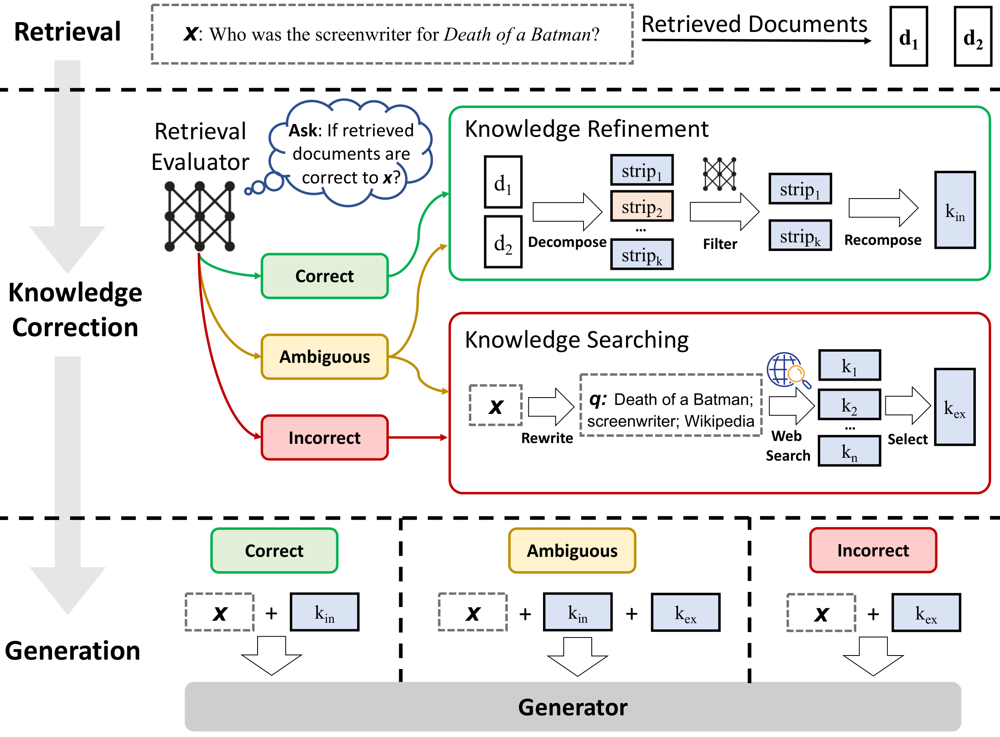

# CRAG · 评估分流、知识纠正与三路生成

<!-- CATEGORY NAV -->
[Teaser](../../teaser/README.md) · [Architecture](../README.md) · [Element](../../element/README.md) · [总目录](../../CATALOG.md)
<!-- END CATEGORY NAV -->

**Architecture · 原论文 Figure 2 · 2401.15884v3**

## 内容与构图

检索质量分成正确、模糊和错误三路，分别触发知识精炼、网页搜索或两者结合；底部对照三类证据组合如何进入生成器。

纵向三阶段：检索、知识纠正、生成；中间两种纠正机制，底部三路输入组合。

解释模型内部结构、处理步骤或数据流，按主要表达用途归入 Architecture。

## 与这次四张参考图的关系

沿 [参考图 2 · Speculative RAG](../../architecture/speculative-rag-draft-verify/README.md) 的表达方式继续检索。

可借鉴的组织关系：

- 颜色在决策标签、分流箭头与最终组合中保持一致。
- 内部展开直接贴在分支旁，减少跨图寻找。

## 文件与编辑范围

[作者独立 PDF](original.pdf) · [SVG 转换件](source.svg) · [原始插图定义](figure-inclusion.tex) · [来源与校验记录](metadata.json)

作者独立 PDF 含 84 个绘图对象、84 个文本片段和 3 个嵌入位图对象；保留原有矢量、文字或轮廓。SVG 是 PDF 转换件，文字转轮廓，嵌入图片保持。位图对象数不代表子图数。

PDF 的框线、箭头和原有文字对象或轮廓可按实际对象修改；照片和部分图标仍为位图。桌面 Illustrator 尚未逐项实测。

## 原始出处

- 论文：[Corrective Retrieval Augmented Generation](https://arxiv.org/abs/2401.15884v3)
- 作者：Yan, Shi-Qi；Gu, Jia-Chen；Zhu, Yun；Ling, Zhen-Hua
- [作者项目或仓库](https://github.com/HuskyInSalt/CRAG)
- 所收录版本：`2401.15884v3`，原文 PDF 第 4 页，Figure 2。
- [固定版本 TeX 源码归档](https://arxiv.org/src/2401.15884v3)；原件路径 `fig/method.pdf`。

## 权利与转换记录

所收录 arXiv 版本采用非独占分发许可，该许可不等同第三方重用授权。本条用于私有参考，保留署名与来源；图中第三方插图和照片按原始权利核对。

[原版本许可](https://arxiv.org/licenses/nonexclusive-distrib/1.0/) · [权利记录](RIGHTS.source.txt)

原始文件按原字节保存，转换件另存。

<!-- BEGIN FIGURE LINKS -->
## 关联范例与元素

**可搭配的现有元素：** [过滤](../../element/svg/tabler-filter.svg) · [分流箭头](../../element/svg/tabler-arrows-split.svg) · [文本文件](../../element/svg/tabler-file-text.svg) · [勾选](../../element/svg/tabler-check.svg)

这些元素按表达功能关联，并非从本论文原图拆出；来源和许可仍以各元素记录为准。

[范例与元素对照表](../../element/with-examples.md) · [元素分类目录](../../element/README.md)
<!-- END FIGURE LINKS -->
