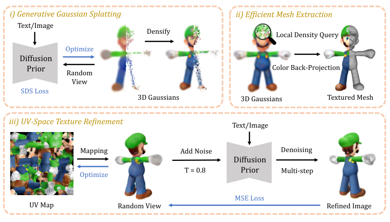

# DreamGaussian · 高斯生成、网格提取与纹理细化

<!-- CATEGORY NAV -->
[Teaser](../../teaser/README.md) · [Architecture](../README.md) · [Element](../../element/README.md) · [总目录](../../CATALOG.md)
<!-- END CATEGORY NAV -->

**ICLR 2024 · Oral · 原论文 Figure 2**

## 为什么收这张图

三个带编号的区域分别解释表示初始化、表示转换和后续细化，同时把不同损失放在对应优化回路内。

多阶段生成与优化框架图。

## 可以借鉴

- 阶段区域用边框与编号区分
- 显式画出三维表示转换
- 把损失与其实际作用阶段放在一起

## 文件与编辑范围

[主文件](source.svg) · [单图 PDF](figure.pdf) · [来源与校验记录](metadata.json)

原 PDF 的几何路径与线条保留，SVG 文字转为轮廓；照片、三维渲染与原有位图部件仍为嵌入图片。

SVG 是原论文图形的提取转换件，未取得作者原生 AI 工程。不同 PDF 阅读器或 Illustrator 对字体、透明度的导入可能有差异。

## 原始出处

- 论文：[DreamGaussian: Generative Gaussian Splatting for Efficient 3D Content Creation](https://arxiv.org/abs/2309.16653)
- 作者：Tang, Jiaxiang, Ren, Jiawei, Zhou, Hang, Liu, Ziwei, Zeng, Gang
- [作者项目或代码](https://dreamgaussian.github.io/)
- [会议与展示身份依据](https://dreamgaussian.github.io/)
- PDF 第 4 页，Figure 2；截取坐标见 metadata.json。

## 权利与修改记录

arXiv 标注的是授予 arXiv 的非独占分发许可，不是第三方图形重用许可。本条用于个人私有参考，改编或公开再用需核对原权利。

原文许可声明：https://arxiv.org/licenses/nonexclusive-distrib/1.0/

只提取、裁剪与转换原图；没有重新绘制。

<!-- BEGIN FIGURE LINKS -->
## 关联范例与元素

同论文的其他图：[DreamGaussian · 生成能力与优化进程同图展示](../../teaser/dreamgaussian-progress/README.md)

**可搭配的现有元素：** [图像](../../element/svg/tabler-photo.svg) · [三维坐标物体](../../element/svg/tabler-cube-3d-sphere.svg) · [水平双向箭头](../../element/svg/tabler-arrows-right-left.svg) · [时钟](../../element/svg/tabler-clock.svg) · [回环箭头](../../element/svg/tabler-arrow-loop-right.svg)

这些元素按表达功能关联，并非从本论文原图拆出；来源和许可仍以各元素记录为准。

[范例与元素对照表](../../element/with-examples.md) · [元素分类目录](../../element/README.md)
<!-- END FIGURE LINKS -->
