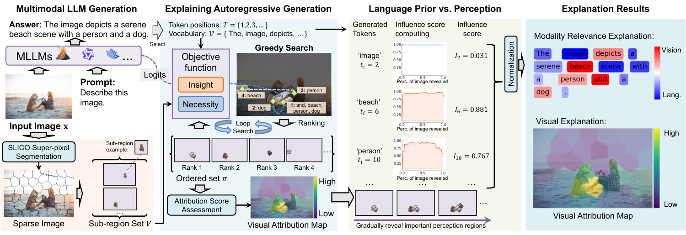

# EAGLE · 图像子区搜索与模态归因

<!-- CATEGORY NAV -->
[Teaser](../../teaser/README.md) · [Architecture](../README.md) · [Element](../../element/README.md) · [总目录](../../CATALOG.md)
<!-- END CATEGORY NAV -->

**Architecture · 原论文 Figure 2 · CVPR 2026**

## 内容与构图

用一张海滩照片串起超像素分区、贪心搜索和逐步揭示图像子区。输出同时展示词元对视觉或语言的依赖，以及图像上的归因热图。

四栏依次展示输入与图像分区、生成归因、视觉与语言影响、最终解释。

- 将候选图像子区按排名并排展示，再用同一批子区解释逐步揭示过程。
- 把中间影响曲线贴在对应词元旁，末栏将词元着色与空间热图上下配对。

同类构图可对照 [FlashTrace Figure 2](../flashtrace-span-recursive-attribution/README.md)。

## 文件与编辑范围

[作者独立 PDF](original.pdf) · [SVG 转换件](source.svg) · [LaTeX 插图定义](figure-inclusion.tex) · [来源与校验记录](metadata.json)

作者 PDF 含 92 个矢量绘图对象、109 个文本片段和 37 个嵌入位图对象。SVG 将文字转为轮廓，并保留原有位图；部分路径的变换矩阵已等价展开以保留虚线等细节。桌面 Illustrator 尚未实测。

## 原始出处

*Where MLLMs Attend and What They Rely On: Explaining Autoregressive Token Generation*。Ruoyu Chen、Xiaoqing Guo、Kangwei Liu、Siyuan Liang、Shiming Liu、Qunli Zhang、Laiyuan Wang、Hua Zhang、Xiaochun Cao。原图为 `2509.22496v5` 源包的 `images/framework.pdf`。插图定义位于 `sec/2_related_work.tex`。[固定版论文](https://arxiv.org/abs/2509.22496v5) · [论文 PDF 第 3 页](https://arxiv.org/pdf/2509.22496v5#page=3) · [LaTeX 源码包](https://arxiv.org/src/2509.22496v5) · [作者项目或发布页](https://github.com/RuoyuChen10/EAGLE)

## 权利与转换记录

所收录 arXiv 版本标注 CC BY 4.0。保留作者署名和出处，图中第三方图像的权利以原出处为准。作者 PDF 按原字节保存，PNG 和 SVG 由该 PDF 转换。[所收录版本许可](https://creativecommons.org/licenses/by/4.0/) · [权利记录](RIGHTS.source.txt)

<!-- BEGIN FIGURE LINKS -->
## 关联范例与元素

**可搭配的现有元素：** [图像块线性投影模块](../../element/svg/vit-patch-projection.svg) · [折线图符号](../../element/svg/tabler-chart-line.svg) · [回环箭头](../../element/svg/tabler-arrow-loop-right.svg)

这些元素按表达功能关联，并非从本论文原图拆出；来源和许可仍以各元素记录为准。

[范例与元素对照表](../../element/with-examples.md) · [元素分类目录](../../element/README.md)
<!-- END FIGURE LINKS -->
