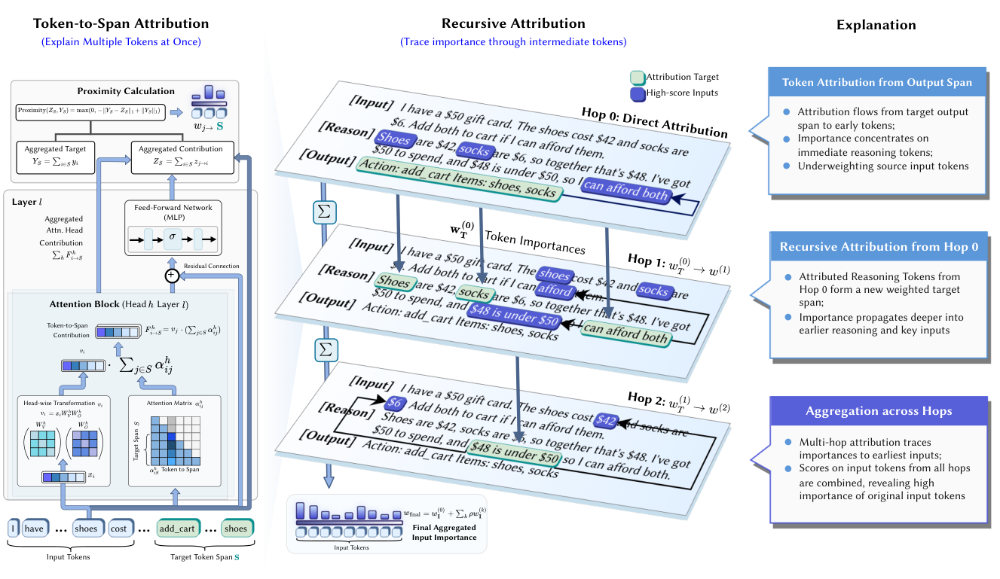

# FlashTrace · 片段归因与多跳递归追踪

<!-- CATEGORY NAV -->
[Teaser](../../teaser/README.md) · [Architecture](../README.md) · [Element](../../element/README.md) · [总目录](../../CATALOG.md)
<!-- END CATEGORY NAV -->

**Architecture · 原论文 Figure 2 · ICML 2026 Oral**

## 内容与构图

左栏展开目标片段的归因计算，展示如何汇总注意力头和残差连接的贡献。中栏用同一个购物示例呈现三轮归因，从输出片段经中间推理词元回溯到更早的输入。右栏逐行解释各轮在做什么，以及最后如何汇总分数。

- 每一跳重复相同的输入、推理和输出，读者可以直接比较高亮位置如何变化。
- 两种高亮分别标记本轮归因目标与高分输入，右栏解说与中栏各跳对齐。

## 同类方法图

这些范例都用具体示例串联计算细节与处理步骤。[Tokengeist Fig. 13](../tokengeist-refund-provenance-trace/README.md) · [VTrace Fig. 4](../vtrace-multihop-visual-attribution/README.md) · [GrAInS Fig. 2](../grains-attribution-steering-pipeline/README.md) · [EAGLE Fig. 2](../eagle-visual-language-attribution/README.md) · [MExGen Fig. 2](../mexgen-perturbation-attribution-workflow/README.md)

## 文件与编辑范围

[作者独立 PDF](original.pdf) · [SVG 转换件](source.svg) · [LaTeX 插图定义](figure-inclusion.tex) · [来源与校验记录](metadata.json)

作者 PDF 同时含有矢量、文字和位图对象。SVG 由该 PDF 转换，文字转轮廓，原有位图保留。归档里的图件为 `Figures/overview.drawio.pdf`，源包没有独立的 `.drawio` 文件。桌面 Illustrator 尚未实测。

## 原始出处

Wenbo Pan、Zhichao Liu、Xianlong Wang、Haining Yu、Xiaohua Jia。所收录图件对应 arXiv v4 的 Figure 2，位于论文 PDF 第 3 页。作者在 arXiv 备注中标注 ICML 2026 Oral。[论文](https://arxiv.org/abs/2602.01914v4) · [ICML 论文集](https://proceedings.mlr.press/v306/pan26g.html) · [论文 PDF](https://arxiv.org/pdf/2602.01914v4#page=3) · [LaTeX 源码包](https://arxiv.org/src/2602.01914v4) · [作者仓库](https://github.com/wbopan/flashtrace)

## 权利与转换记录

所收录论文版本声明 CC BY-NC-ND 4.0。PDF 按原字节保存，PNG 和 SVG 保留整幅图的内容，分别供预览和矢量编辑参考。许可限制分发改编后的作品。[论文许可](https://creativecommons.org/licenses/by-nc-nd/4.0/) · [权利记录](RIGHTS.source.txt)

<!-- BEGIN FIGURE LINKS -->
## 关联范例与元素

**可搭配的现有元素：** [DiT 多头自注意力模块](../../element/svg/dit-self-attention.svg) · [DiT 残差加法节点](../../element/svg/dit-residual-add.svg) · [查询嵌入向量条](../../element/svg/amem-embedding-vector.svg) · [下箭头](../../element/svg/tabler-arrow-down.svg)

这些元素按表达功能关联，并非从本论文原图拆出；来源和许可仍以各元素记录为准。

[范例与元素对照表](../../element/with-examples.md) · [元素分类目录](../../element/README.md)
<!-- END FIGURE LINKS -->
