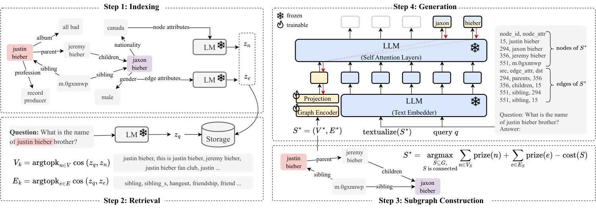

# G-Retriever · 图问答的索引、子图与生成

<!-- CATEGORY NAV -->
[Teaser](../../teaser/README.md) · [Architecture](../README.md) · [Element](../../element/README.md) · [总目录](../../CATALOG.md)
<!-- END CATEGORY NAV -->

**Architecture · 原论文 Figure 3 · NeurIPS 2024**

## 内容与构图

围绕 Justin Bieber 的兄弟是谁，展示实体及边的索引、候选检索、连通子图的选择，以及子图和问题如何接入模型。

四个编号面板分别展示索引、检索、构建连通子图和生成。关键实体颜色跨面板保持一致。

- 以同色实体连接原图、检索后的子图和生成结果，边的关系也保留在中间状态里。
- 生成模块同时展开图编码、投影和文本化提示，用图例标记冻结及可训练部分。

同类构图可对照 [VTrace Fig. 4](../vtrace-multihop-visual-attribution/README.md)。

## 文件与编辑范围

[作者独立 PDF](original.pdf) · [SVG 转换件](source.svg) · [LaTeX 插图定义](figure-inclusion.tex) · [来源与校验记录](metadata.json)

作者 PDF 含 359 个矢量绘图对象、70 个文本片段和 11 个嵌入位图对象。SVG 将文字转为轮廓，并保留原有位图。桌面 Illustrator 尚未实测。

## 原始出处

*G-Retriever: Retrieval-Augmented Generation for Textual Graph Understanding and Question Answering*。Xiaoxin He、Yijun Tian、Yifei Sun、Nitesh V. Chawla、Thomas Laurent、Yann LeCun、Xavier Bresson、Bryan Hooi。原图为 `2402.07630v3` 源包的 `figs/overview_v3.pdf`。插图定义位于 `neurips_2024.tex`。[固定版论文](https://arxiv.org/abs/2402.07630v3) · [论文 PDF 第 6 页](https://arxiv.org/pdf/2402.07630v3#page=6) · [LaTeX 源码包](https://arxiv.org/src/2402.07630v3) · [会议信息](https://proceedings.neurips.cc/paper_files/paper/2024/hash/efaf1c9726648c8ba363a5c927440529-Abstract-Conference.html) · [作者项目或发布页](https://github.com/XiaoxinHe/G-Retriever)

## 权利与转换记录

所收录 arXiv 版本声明向 arXiv 授予非独占分发许可。此条保留作者署名与原件，用于私有参考，第三方重用授权以作者声明为准。作者 PDF 按原字节保存，PNG 和 SVG 由该 PDF 转换。[所收录版本许可](https://arxiv.org/licenses/nonexclusive-distrib/1.0/) · [权利记录](RIGHTS.source.txt)

<!-- BEGIN FIGURE LINKS -->
## 关联范例与元素

**可搭配的现有元素：** [单层知识图谱节点组](../../element/svg/hipporag2-knowledge-graph.svg) · [三元组关系表](../../element/svg/hipporag2-triples.svg) · [数据库检索](../../element/svg/tabler-database-search.svg) · [DiT 多头自注意力模块](../../element/svg/dit-self-attention.svg)

这些元素按表达功能关联，并非从本论文原图拆出；来源和许可仍以各元素记录为准。

[范例与元素对照表](../../element/with-examples.md) · [元素分类目录](../../element/README.md)
<!-- END FIGURE LINKS -->
