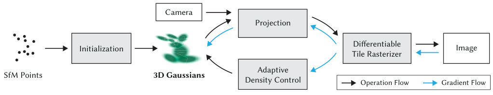

# 3D Gaussian Splatting · 优化与光栅化双向流程

<!-- CATEGORY NAV -->
[Teaser](../../teaser/README.md) · [Architecture](../README.md) · [Element](../../element/README.md) · [总目录](../../CATALOG.md)
<!-- END CATEGORY NAV -->

**SIGGRAPH 2023 · 会议论文；未核实 Oral · 原论文 Figure 2**

## 为什么收这张图

黑色实线和蓝色箭头分别表达正向操作与梯度回传，让自适应密度控制与可微渲染的关系无需依赖长图注。

优化与渲染框架；SIGGRAPH 精选，未标作已核实 Oral。

## 可以借鉴

- 正向操作与梯度流使用两套明确的箭头
- 小型图例就地解释颜色语义
- 优化闭环与输出保持同一水平主线

## 文件与编辑范围

[主文件](source.svg) · [单图 PDF](figure.pdf) · [来源与校验记录](metadata.json)

原 PDF 的几何路径与线条保留，SVG 文字转为轮廓；照片、三维渲染与原有位图部件仍为嵌入图片。

SVG 是原论文图形的提取转换件，未取得作者原生 AI 工程。不同 PDF 阅读器或 Illustrator 对字体、透明度的导入可能有差异。

## 原始出处

- 论文：[3D Gaussian Splatting for Real-Time Radiance Field Rendering](https://arxiv.org/abs/2308.04079)
- 作者：Kerbl, Bernhard, Kopanas, Georgios, Leimkühler, Thomas, Drettakis, George
- [作者项目或代码](https://repo-sam.inria.fr/fungraph/3d-gaussian-splatting/)
- [会议与展示身份依据](https://repo-sam.inria.fr/fungraph/3d-gaussian-splatting/)
- PDF 第 5 页，Figure 2；截取坐标见 metadata.json。

## 权利与修改记录

arXiv 原文声明 CC BY 4.0；保留作者署名、论文链接和裁剪转换说明。第三方照片与模型若有独立声明，仍按原声明。

原文许可声明：https://creativecommons.org/licenses/by/4.0/

只提取、裁剪与转换原图；没有重新绘制。

<!-- BEGIN FIGURE LINKS -->
## 关联范例与元素

**可搭配的现有元素：** [相机](../../element/svg/tabler-camera.svg) · [回环箭头](../../element/svg/tabler-arrow-loop-right.svg) · [水平双向箭头](../../element/svg/tabler-arrows-right-left.svg) · [图像](../../element/svg/tabler-photo.svg)

这些元素按表达功能关联，并非从本论文原图拆出；来源和许可仍以各元素记录为准。

[范例与元素对照表](../../element/with-examples.md) · [元素分类目录](../../element/README.md)
<!-- END FIGURE LINKS -->
