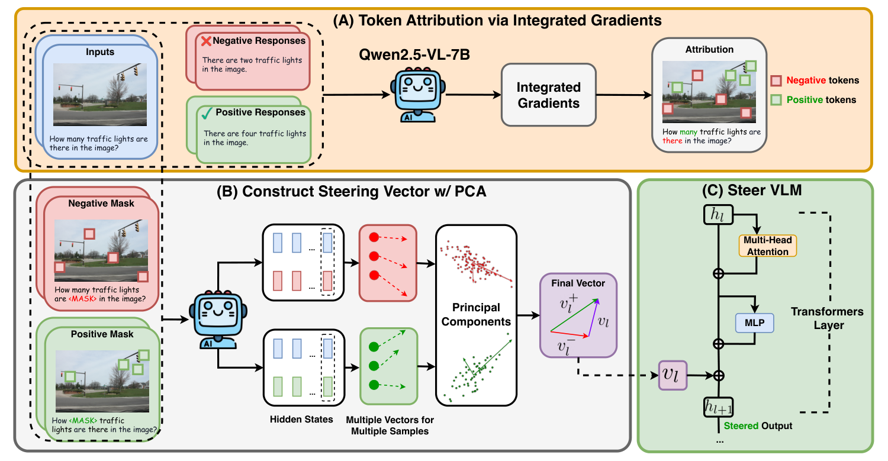

# GrAInS · 归因、PCA 与推理时引导

<!-- CATEGORY NAV -->
[Teaser](../../teaser/README.md) · [Architecture](../README.md) · [Element](../../element/README.md) · [总目录](../../CATALOG.md)
<!-- END CATEGORY NAV -->

**Architecture · 原论文 Figure 2 · ACL 2026**

## 内容与构图

以交通灯计数为例，依次展开对比积分梯度、正负掩码、PCA 构造引导向量及其在 Transformer 层的注入位置。

A 计算词元归因，B 由掩码样本构造引导向量，C 把向量加到 Transformer 层。

- 用一张照片和红绿两色贯穿正负回答、归因高亮、掩码与 PCA 分支。
- 用三个编号面板明确阶段边界，并在最后一格单独画出向量进入残差流的位置。

同类构图可对照 [FlashTrace Figure 2](../flashtrace-span-recursive-attribution/README.md)。

## 文件与编辑范围

[作者独立 PDF](original.pdf) · [SVG 转换件](source.svg) · [LaTeX 插图定义](figure-inclusion.tex) · [来源与校验记录](metadata.json)

作者 PDF 含 156 个矢量绘图对象、62 个文本片段和 16 个嵌入位图对象。SVG 将文字转为轮廓，并保留原有位图。桌面 Illustrator 尚未实测。

## 原始出处

*GrAInS: Gradient-based Attribution for Inference-Time Steering of LLMs and VLMs*。Duy Nguyen、Archiki Prasad、Elias Stengel-Eskin、Mohit Bansal。原图为 `2507.18043v2` 源包的 `figures/vlms_steering_2.pdf`。插图定义位于 `main.tex`。[固定版论文](https://arxiv.org/abs/2507.18043v2) · [论文 PDF 第 4 页](https://arxiv.org/pdf/2507.18043v2#page=4) · [LaTeX 源码包](https://arxiv.org/src/2507.18043v2) · [会议信息](https://aclanthology.org/2026.acl-long.2159/) · [作者项目或发布页](https://github.com/duykhuongnguyen/GrAInS)

## 权利与转换记录

所收录 arXiv 版本声明向 arXiv 授予非独占分发许可。此条保留作者署名与原件，用于私有参考，第三方重用授权以作者声明为准。作者 PDF 按原字节保存，PNG 和 SVG 由该 PDF 转换。[所收录版本许可](https://arxiv.org/licenses/nonexclusive-distrib/1.0/) · [权利记录](RIGHTS.source.txt)

<!-- BEGIN FIGURE LINKS -->
## 关联范例与元素

**可搭配的现有元素：** [DiT 多头自注意力模块](../../element/svg/dit-self-attention.svg) · [DiT 残差加法节点](../../element/svg/dit-residual-add.svg) · [查询嵌入向量条](../../element/svg/amem-embedding-vector.svg) · [散点图符号](../../element/svg/tabler-chart-scatter.svg)

这些元素按表达功能关联，并非从本论文原图拆出；来源和许可仍以各元素记录为准。

[范例与元素对照表](../../element/with-examples.md) · [元素分类目录](../../element/README.md)
<!-- END FIGURE LINKS -->
