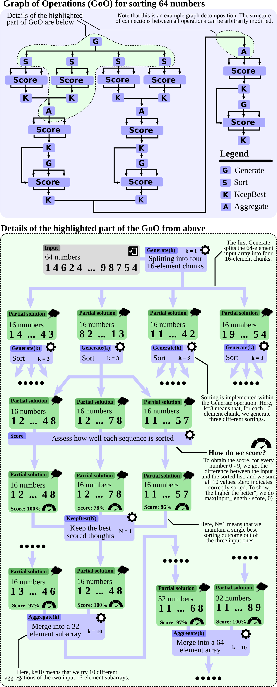

# Graph of Thoughts · 64 个数字的分支排序

<!-- CATEGORY NAV -->
[Teaser](../../teaser/README.md) · [Architecture](../README.md) · [Element](../../element/README.md) · [总目录](../../CATALOG.md)
<!-- END CATEGORY NAV -->

**Architecture · 原论文 Figure 4 · AAAI 2024**

## 内容与构图

用同一组 64 个数字说明如何拆成四个子数组、比较候选排序、保留高分结果并逐层合并。上方有全局操作图，下方附中间结果、分数与参数批注。

上半部是排序操作图与图例，下半部放大其中的分块、生成候选、评分、保留和合并操作。

- 用一组高亮轮廓圈出全局操作图里要展开的节点，再在下面用同色块映射到实际数字。
- 把每轮候选的局部结果和分数并排放，评分规则与保留数量贴着相应操作标注。

同类构图可对照 [Tokengeist Fig. 13](../tokengeist-refund-provenance-trace/README.md)。

## 文件与编辑范围

[作者独立 PDF](original.pdf) · [SVG 转换件](source.svg) · [LaTeX 插图定义](figure-inclusion.tex) · [来源与校验记录](metadata.json)

作者 PDF 含 285 个矢量绘图对象、163 个文本片段和 32 个嵌入位图对象。SVG 将文字转为轮廓，并保留原有位图。桌面 Illustrator 尚未实测。

## 原始出处

*Graph of Thoughts: Solving Elaborate Problems with Large Language Models*。Maciej Besta、Nils Blach、Ales Kubicek、Robert Gerstenberger、Michal Podstawski、Lukas Gianinazzi、Joanna Gajda、Tomasz Lehmann、Hubert Niewiadomski、Piotr Nyczyk、Torsten Hoefler。原图为 `2308.09687v4` 源包的 `sort_5.pdf`。插图定义位于 `cases.tex`。[固定版论文](https://arxiv.org/abs/2308.09687v4) · [论文 PDF 第 6 页](https://arxiv.org/pdf/2308.09687v4#page=6) · [LaTeX 源码包](https://arxiv.org/src/2308.09687v4) · [会议信息](https://ojs.aaai.org/index.php/AAAI/article/view/29720) · [作者项目或发布页](https://github.com/spcl/graph-of-thoughts)

arXiv v4 将该排序图编号为 Figure 4，AAAI 论文集对应的排序图编号为 Figure 3。

## 权利与转换记录

所收录 arXiv 版本声明向 arXiv 授予非独占分发许可。此条保留作者署名与原件，用于私有参考，第三方重用授权以作者声明为准。作者 PDF 按原字节保存，PNG 和 SVG 由该 PDF 转换。[所收录版本许可](https://arxiv.org/licenses/nonexclusive-distrib/1.0/) · [权利记录](RIGHTS.source.txt)

<!-- BEGIN FIGURE LINKS -->
## 关联范例与元素

**可搭配的现有元素：** [函数图形](../../element/svg/tabler-graph.svg) · [升序](../../element/svg/tabler-sort-ascending.svg) · [分流箭头](../../element/svg/tabler-arrows-split.svg) · [汇合箭头](../../element/svg/tabler-arrows-join.svg)

这些元素按表达功能关联，并非从本论文原图拆出；来源和许可仍以各元素记录为准。

[范例与元素对照表](../../element/with-examples.md) · [元素分类目录](../../element/README.md)
<!-- END FIGURE LINKS -->
