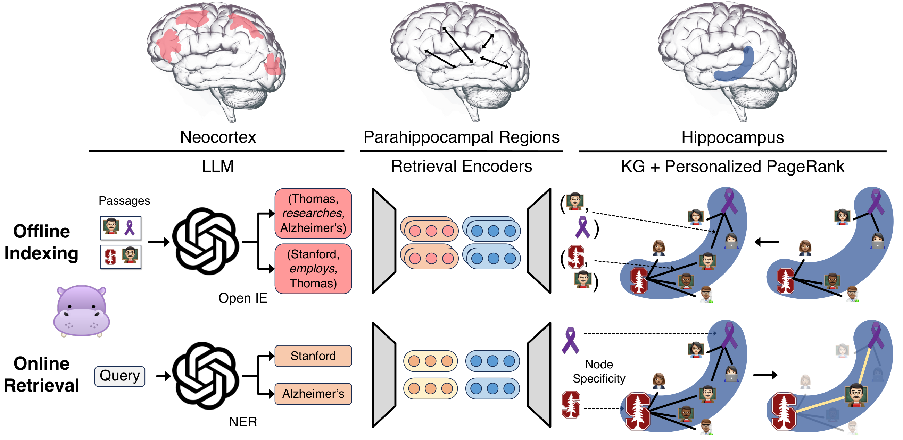

# HippoRAG · 三脑区类比与索引检索框架

<!-- CATEGORY NAV -->
[Teaser](../../teaser/README.md) · [Architecture](../README.md) · [Element](../../element/README.md) · [总目录](../../CATALOG.md)
<!-- END CATEGORY NAV -->

**Architecture · 原论文 Figure 2 · 2405.14831v3**

## 内容与构图

上方三个脑区与下方 LLM、检索编码器、知识图谱及 PageRank 一一对应，再按离线索引和在线检索两行展开。

三列脑区及计算模块对应，下面两行展开离线与在线操作。

解释模型内部结构、处理步骤或数据流，按主要表达用途归入 Architecture。

## 与这次四张参考图的关系

沿 [参考图 4 · Cortex](../../teaser/cortex-memory-consolidation/README.md) · [参考图 3 · MemoryVLA](../../teaser/memoryvla-cognition-memory-action/README.md) · [参考图 2 · Speculative RAG](../../architecture/speculative-rag-draft-verify/README.md) 的表达方式继续检索。

可借鉴的组织关系：

- 用竖向对齐保持生物对象与计算模块的对应。
- 上下两行复用视觉对象，突出训练外索引与查询差别。

## 文件与编辑范围

[作者独立 PDF](original.pdf) · [SVG 转换件](source.svg) · [原始插图定义](figure-inclusion.tex) · [来源与校验记录](metadata.json)

作者独立 PDF 含 171 个绘图对象、52 个文本片段和 47 个嵌入位图对象；保留原有矢量、文字或轮廓。SVG 是 PDF 转换件，文字转轮廓，嵌入图片保持。位图对象数不代表子图数。

PDF 的框线、箭头和原有文字对象或轮廓可按实际对象修改；照片和部分图标仍为位图。桌面 Illustrator 尚未逐项实测。

## 原始出处

- 论文：[HippoRAG: Neurobiologically Inspired Long-Term Memory for Large Language Models](https://arxiv.org/abs/2405.14831v3)
- 作者：Gutiérrez, Bernal Jiménez；Shu, Yiheng；Gu, Yu；Yasunaga, Michihiro；Su, Yu
- [作者项目或仓库](https://github.com/OSU-NLP-Group/HippoRAG)
- 所收录版本：`2405.14831v3`，原文 PDF 第 4 页，Figure 2。
- [固定版本 TeX 源码归档](https://arxiv.org/src/2405.14831v3)；原件路径 `figures/HippoRAG_method_version_4.pdf`。
- [会议身份依据](https://proceedings.neurips.cc/paper_files/paper/2024/hash/6ddc001d07ca4f319af96a3024f6dbd1-Abstract-Conference.html)：NeurIPS 2024；本条源文件版本仍以上述 arXiv 为准。

## 权利与转换记录

所收录 arXiv 版本采用非独占分发许可，该许可不等同第三方重用授权。本条用于私有参考，保留署名与来源；图中第三方插图和照片按原始权利核对。

[原版本许可](https://arxiv.org/licenses/nonexclusive-distrib/1.0/) · [权利记录](RIGHTS.source.txt)

原始文件按原字节保存，转换件另存。

<!-- BEGIN FIGURE LINKS -->
## 关联范例与元素

同论文的其他图：[HippoRAG · 普通 RAG、人类记忆与海马索引对照](../../teaser/hipporag-human-memory-comparison/README.md)

**可搭配的现有元素：** [大脑](../../element/svg/tabler-brain.svg) · [网络](../../element/svg/tabler-network.svg) · [数据库](../../element/svg/tabler-database.svg) · [右箭头](../../element/svg/tabler-arrow-right.svg)

这些元素按表达功能关联，并非从本论文原图拆出；来源和许可仍以各元素记录为准。

[范例与元素对照表](../../element/with-examples.md) · [元素分类目录](../../element/README.md)
<!-- END FIGURE LINKS -->
