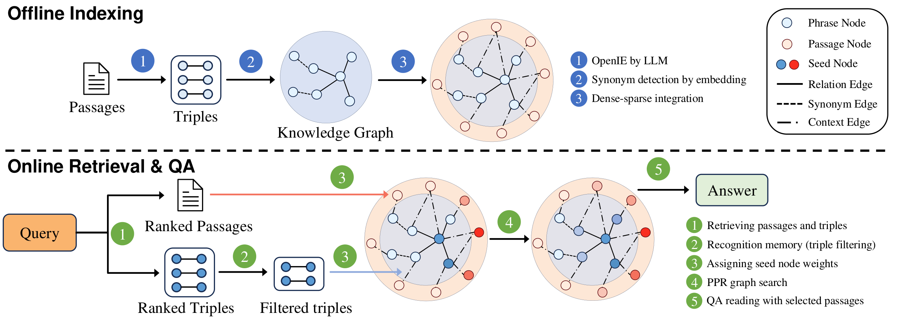

# HippoRAG 2 · 图谱索引、筛选与检索双阶段

<!-- CATEGORY NAV -->
[Teaser](../../teaser/README.md) · [Architecture](../README.md) · [Element](../../element/README.md) · [总目录](../../CATALOG.md)
<!-- END CATEGORY NAV -->

**Architecture · 原论文 Figure 2 · 2502.14802v2**

## 内容与构图

两行分别展示离线知识图谱构建与在线问答。节点、边与颜色图例明确，局部图谱逐步变化，解释三元组筛选、种子权重与 PageRank。

上行三个索引步骤，下行五个检索问答步骤；右上统一图例。

解释模型内部结构、处理步骤或数据流，按主要表达用途归入 Architecture。

## 与这次四张参考图的关系

沿 [参考图 2 · Speculative RAG](../../architecture/speculative-rag-draft-verify/README.md) · [参考图 4 · Cortex](../../teaser/cortex-memory-consolidation/README.md) 的表达方式继续检索。

可借鉴的组织关系：

- 重复使用图谱对象，通过着色变化显示中间状态。
- 阶段编号、图例和上下分路共同减轻长流程阅读负担。

## 文件与编辑范围

[作者独立 PDF](original.pdf) · [SVG 转换件](source.svg) · [原始插图定义](figure-inclusion.tex) · [来源与校验记录](metadata.json)

作者独立 PDF 含 191 个绘图对象、41 个文本片段和 0 个嵌入位图对象；保留原有矢量、文字或轮廓。SVG 是 PDF 转换件，文字转轮廓，嵌入图片保持。位图对象数不代表子图数。

PDF 的框线、箭头和原有文字对象或轮廓可按实际对象修改；照片和部分图标仍为位图。桌面 Illustrator 尚未逐项实测。

## 原始出处

- 论文：[From RAG to Memory: Non-Parametric Continual Learning for Large Language Models](https://arxiv.org/abs/2502.14802v2)
- 作者：Gutiérrez, Bernal Jiménez；Shu, Yiheng；Qi, Weijian；Zhou, Sizhe；Su, Yu
- [作者项目或仓库](https://github.com/OSU-NLP-Group/HippoRAG)
- 所收录版本：`2502.14802v2`，原文 PDF 第 4 页，Figure 2。
- [固定版本 TeX 源码归档](https://arxiv.org/src/2502.14802v2)；原件路径 `figure/methodology.pdf`。
- [会议身份依据](https://proceedings.mlr.press/v267/gutierrez25a.html)：ICML 2025；本条源文件版本仍以上述 arXiv 为准。

## 权利与转换记录

所收录 arXiv 版本采用非独占分发许可，该许可不等同第三方重用授权。本条用于私有参考，保留署名与来源；图中第三方插图和照片按原始权利核对。

[原版本许可](https://arxiv.org/licenses/nonexclusive-distrib/1.0/) · [权利记录](RIGHTS.source.txt)

原始文件按原字节保存，转换件另存。

<!-- BEGIN FIGURE LINKS -->
## 关联范例与元素

**从本图拆出的部件：** [图谱检索文档图标](../../element/svg/hipporag2-passage.svg) · [三元组关系表](../../element/svg/hipporag2-triples.svg) · [单层知识图谱节点组](../../element/svg/hipporag2-knowledge-graph.svg) · [短语与文档双层图谱](../../element/svg/hipporag2-heterogeneous-graph.svg)

**可搭配的现有元素：** [网络](../../element/svg/tabler-network.svg) · [文本文件](../../element/svg/tabler-file-text.svg) · [过滤](../../element/svg/tabler-filter.svg) · [右箭头](../../element/svg/tabler-arrow-right.svg)

这些元素按表达功能关联，并非从本论文原图拆出；来源和许可仍以各元素记录为准。

[范例与元素对照表](../../element/with-examples.md) · [元素分类目录](../../element/README.md)
<!-- END FIGURE LINKS -->
