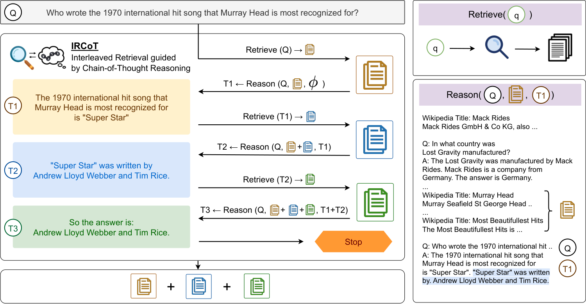

# IRCoT · 歌曲作者问答的多轮检索与推理

<!-- CATEGORY NAV -->
[Teaser](../../teaser/README.md) · [Architecture](../README.md) · [Element](../../element/README.md) · [总目录](../../CATALOG.md)
<!-- END CATEGORY NAV -->

**Architecture · 原论文 Figure 2 · ACL 2023**

## 内容与构图

以追查 Murray Head 代表歌曲的作者为主线。每轮生成的推理句成为下一轮检索查询，文档不断累加，右侧展示模块输入和提示词组成。

左侧为歌曲作者问答的交替流程，右侧拆出检索和推理两个模块，底部汇总检索文档。

- 用往返箭头区分检索和推理，文档颜色在检索结果、下一轮输入和最终汇总里保持一致。
- 主线走完整个例子，右栏单独展开检索接口和推理提示，提示里还能看到一个短的上下文示范。

同类构图可对照 [Tokengeist Fig. 13](../tokengeist-refund-provenance-trace/README.md)。

## 文件与编辑范围

[作者独立 PDF](original.pdf) · [SVG 转换件](source.svg) · [LaTeX 插图定义](figure-inclusion.tex) · [来源与校验记录](metadata.json)

作者 PDF 含 62 个矢量绘图对象、50 个文本片段和 21 个嵌入位图对象。SVG 将文字转为轮廓，并保留原有位图。桌面 Illustrator 尚未实测。

## 原始出处

*Interleaving Retrieval with Chain-of-Thought Reasoning for Knowledge-Intensive Multi-Step Questions*。Harsh Trivedi、Niranjan Balasubramanian、Tushar Khot、Ashish Sabharwal。原图为 `2212.10509v2` 源包的 `images/main-figure.pdf`。插图定义位于 `method.tex`。[固定版论文](https://arxiv.org/abs/2212.10509v2) · [论文 PDF 第 4 页](https://arxiv.org/pdf/2212.10509v2#page=4) · [LaTeX 源码包](https://arxiv.org/src/2212.10509v2) · [会议信息](https://aclanthology.org/2023.acl-long.557/) · [作者项目或发布页](https://github.com/StonyBrookNLP/ircot)

## 权利与转换记录

所收录 arXiv 版本标注 CC BY 4.0。保留作者署名和出处，图中第三方图像的权利以原出处为准。作者 PDF 按原字节保存，PNG 和 SVG 由该 PDF 转换。[所收录版本许可](https://creativecommons.org/licenses/by/4.0/) · [权利记录](RIGHTS.source.txt)

<!-- BEGIN FIGURE LINKS -->
## 关联范例与元素

**可搭配的现有元素：** [图谱检索文档图标](../../element/svg/hipporag2-passage.svg) · [数据库检索](../../element/svg/tabler-database-search.svg) · [水平双向箭头](../../element/svg/tabler-arrows-right-left.svg)

这些元素按表达功能关联，并非从本论文原图拆出；来源和许可仍以各元素记录为准。

[范例与元素对照表](../../element/with-examples.md) · [元素分类目录](../../element/README.md)
<!-- END FIGURE LINKS -->
