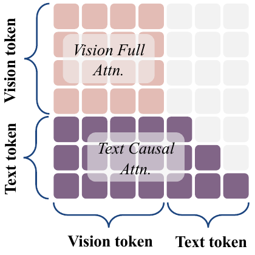

# LaVer · 视觉全注意力与文本因果注意力

<!-- CATEGORY NAV -->
[Teaser](../../teaser/README.md) · [Architecture](../README.md) · [Element](../../element/README.md) · [总目录](../../CATALOG.md)
<!-- END CATEGORY NAV -->

**Architecture · 原论文 Figure 3(b) · arXiv:2512.06281v1**

用块矩阵区分视觉 token 的全注意力与文本 token 的因果注意力，颜色编码两种模态。

[原论文（完整 Fig. 3）](https://arxiv.org/html/2512.06281v1) · [作者独立 PDF](original.pdf) · [元数据](metadata.json) · [署名与许可](RIGHTS.source.txt)

作者：Hengzhuang Li, Xinsong Zhang, Qiming Peng, Bin Luo, Han Hu, Dengyang Jiang, Han-Jia Ye, Teng Zhang, Hai Jin。从[固定版本 TeX 归档](https://arxiv.org/src/2512.06281v1) 原样保存 `fig/3_fig_full_attn.pdf`；预览仅渲染缩小。文件含矢量路径及可提取文字，无位图；未测试 Illustrator 导入。没有转载含例图照片的 Fig. 3(a)。

<!-- BEGIN FIGURE LINKS -->
## 关联范例与元素

同论文的其他图：[LaVer · 二维旋转位置编码](../laver-2d-rope/README.md)

[范例与元素对照表](../../element/with-examples.md) · [元素分类目录](../../element/README.md)
<!-- END FIGURE LINKS -->
