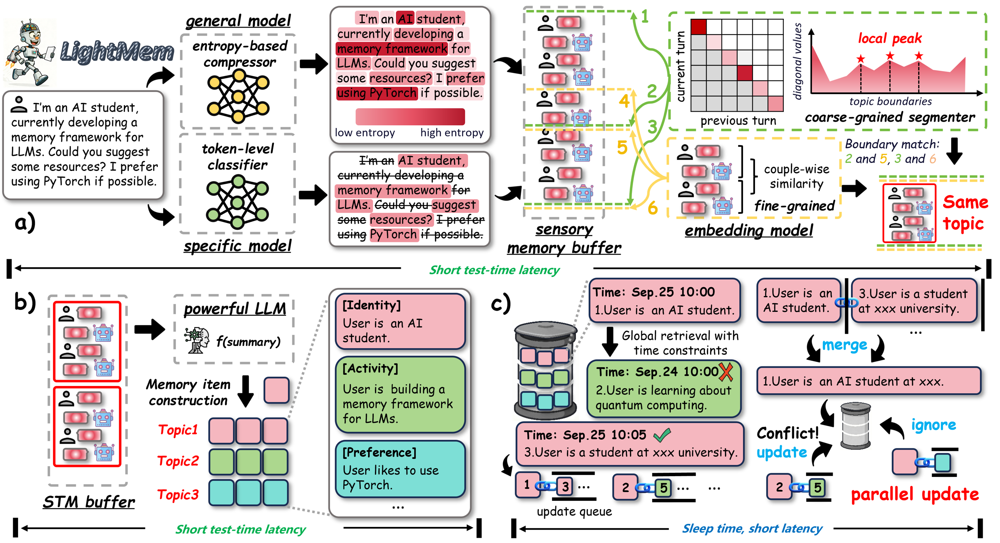

# LightMem · 感觉过滤、主题记忆与睡眠更新三面板

<!-- CATEGORY NAV -->
[Teaser](../../teaser/README.md) · [Architecture](../README.md) · [Element](../../element/README.md) · [总目录](../../CATALOG.md)
<!-- END CATEGORY NAV -->

**Architecture · 原论文 Figure 2 · 2510.18866v4**

## 内容与构图

三面板以实际对话和记忆项解释 token 过滤、主题切分、结构化摘要与离线合并；包含注意力矩阵、局部峰值及更新队列。

(a) 上方长条感觉记忆过滤与切分；(b) 左下主题记忆构建；(c) 右下睡眠时间合并与更新。

解释模型内部结构、处理步骤或数据流，按主要表达用途归入 Architecture。

## 与这次四张参考图的关系

沿 [参考图 3 · MemoryVLA](../../teaser/memoryvla-cognition-memory-action/README.md) · [参考图 4 · Cortex](../../teaser/cortex-memory-consolidation/README.md) · [参考图 2 · Speculative RAG](../../architecture/speculative-rag-draft-verify/README.md) 的表达方式继续检索。

可借鉴的组织关系：

- 用不等宽面板为复杂过滤过程留足空间。
- 实际例子、矩阵和存储操作同时说明抽象模块。

## 文件与编辑范围

[作者原始 PNG](original.png) · [原始插图定义](figure-inclusion.tex) · [来源与校验记录](metadata.json)

作者 TeX 归档与已检查的作者 GitHub 仓库均提供整张 PNG。本条为位图构图参考，未取得这张图可逐对象编辑的 PDF、SVG 或 AI；未生成 SVG 外壳。预览将透明背景合成到白底，原 PNG 字节和透明度保留。

## 原始出处

- 论文：[LightMem: Lightweight and Efficient Memory-Augmented Generation](https://arxiv.org/abs/2510.18866v4)
- 作者：Fang, Jizhan；Deng, Xinle；Xu, Haoming；Jiang, Ziyan；Tang, Yuqi；Xu, Ziwen；Deng, Shumin；Yao, Yunzhi；Wang, Mengru；Qiao, Shuofei；Chen, Huajun；Zhang, Ningyu
- [作者项目或仓库](https://github.com/zjunlp/LightMem)
- 所收录版本：`2510.18866v4`，原文 PDF 第 4 页，Figure 2。
- [固定版本 TeX 源码归档](https://arxiv.org/src/2510.18866v4)；原件路径 `figure/Lightmem.png`。
- [会议身份依据](https://github.com/zjunlp/LightMem)：ICLR 2026；本条源文件版本仍以上述 arXiv 为准。

## 权利与转换记录

所收录 arXiv 版本采用非独占分发许可，该许可不等同第三方重用授权。本条用于私有参考，保留署名与来源；图中第三方插图和照片按原始权利核对。

[原版本许可](https://arxiv.org/licenses/nonexclusive-distrib/1.0/) · [权利记录](RIGHTS.source.txt)

原始文件按原字节保存，转换件另存。

<!-- BEGIN FIGURE LINKS -->
## 关联范例与元素

同论文的其他图：[LightMem · 原始记忆流水线与主题过滤、睡眠更新对照](../../teaser/lightmem-memory-construction-comparison/README.md)

**可搭配的现有元素：** [数据库](../../element/svg/tabler-database.svg) · [文本文件](../../element/svg/tabler-file-text.svg) · [点阵](../../element/svg/tabler-grid-dots.svg) · [回环箭头](../../element/svg/tabler-arrow-loop-right.svg)

这些元素按表达功能关联，并非从本论文原图拆出；来源和许可仍以各元素记录为准。

[范例与元素对照表](../../element/with-examples.md) · [元素分类目录](../../element/README.md)
<!-- END FIGURE LINKS -->
