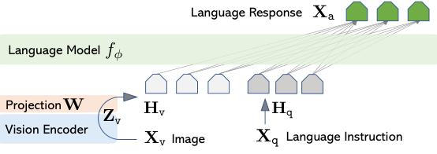

# LLaVA · 视觉投影与语言 token 的统一输入

<!-- CATEGORY NAV -->
[Teaser](../../teaser/README.md) · [Architecture](../README.md) · [Element](../../element/README.md) · [总目录](../../CATALOG.md)
<!-- END CATEGORY NAV -->

[所属分类](../README.md) · [总目录](../../CATALOG.md)

**NeurIPS 2023 · Oral · 原论文 Figure 1**

## 为什么收这张图

用颜色和形状区分视觉 token、指令 token 与生成 token，投影层把图像特征接入语言模型的关系简洁清楚。

视觉语言模型的精简整体架构。

## 可以借鉴

- 少量模块即可交代多模态连接
- 输入与输出 token 保持可辨认的身份
- 斜向细连线表达自回归依赖

## 文件与编辑范围

[主文件](source.svg) · [单图 PDF](figure.pdf) · [来源与校验记录](metadata.json)

结构与文字轮廓均为矢量路径；另附 PDF 摘图保留原字体和结构。

SVG 是原论文图形的提取转换件，未取得作者原生 AI 工程。不同 PDF 阅读器或 Illustrator 对字体、透明度的导入可能有差异。

## 原始出处

- 论文：[Visual Instruction Tuning](https://arxiv.org/abs/2304.08485)
- 作者：Liu, Haotian, Li, Chunyuan, Wu, Qingyang, Lee, Yong Jae
- [作者项目或代码](https://llava-vl.github.io/)
- [会议与展示身份依据](https://github.com/haotian-liu/LLaVA)
- PDF 第 4 页，Figure 1；截取坐标见 metadata.json。

## 权利与修改记录

arXiv 原文声明 CC BY 4.0；保留作者署名、论文链接和裁剪转换说明。第三方照片与模型若有独立声明，仍按原声明。

原文许可声明：https://creativecommons.org/licenses/by/4.0/

只提取、裁剪与转换原图；没有重新绘制。

<!-- BEGIN FIGURE LINKS -->
## 关联范例与元素

**可搭配的现有元素：** [ViT 编码器块](../../element/svg/vit-encoder-block.svg) · [线性映射与形状重排](../../element/svg/dit-linear-reshape.svg) · [条件嵌入模块](../../element/svg/dit-embed.svg) · [文本文件](../../element/svg/tabler-file-text.svg)

这些元素按表达功能关联，并非从本论文原图拆出；来源和许可仍以各元素记录为准。

[范例与元素对照表](../../element/with-examples.md) · [元素分类目录](../../element/README.md)
<!-- END FIGURE LINKS -->
