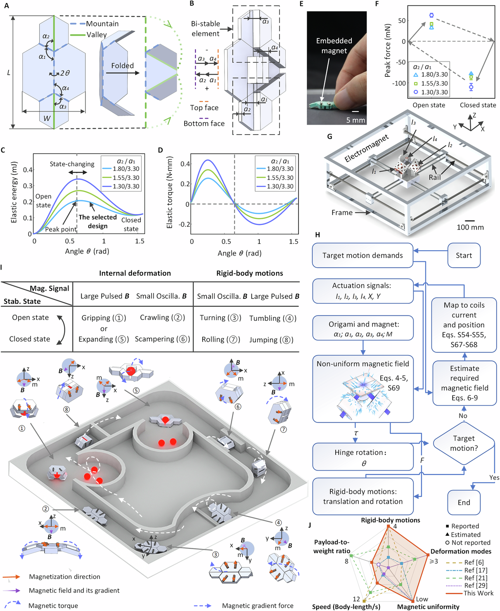

# 双稳态折纸机器人 · 结构、磁驱动与运动模式

<!-- CATEGORY NAV -->
[Teaser](../../teaser/README.md) · [Architecture](../README.md) · [Element](../../element/README.md) · [总目录](../../CATALOG.md)
<!-- END CATEGORY NAV -->

**Architecture · Figure 1 · Nature Communications 2026**

## 内容与构图

A–J 十个面板将折痕与铰链几何、原型和力学曲线、四线圈驱动装置与控制流程排在同一版。下方用一条示例路线和编号把八种形变与运动模式对应起来。

A–F 展开结构、样机与力学表征，G–H 展示驱动装置和驱动信号求解，I 用表格与场景串起八种模式，J 作雷达图对比。

- 用 A–H 解释各层设计，再给 I 面板留出大面积，以同一条路线串起八种模式。表格、路线和局部姿态复用编号。
- 把线圈装置 G 放在流程图 H 上方。磁场、磁矩方向、磁力矩和梯度力分别用图例标识，读者可以将控制量对照到具体姿态。

论文用四个电磁线圈产生非均匀磁场。折纸结构的开合状态与不同磁激励组合，形成抓取、爬行、转向、翻滚等模式。
J 面板的雷达图用非零基线标示未报告的指标，具体标记见原图图例。

同类机器人方法图可对照 [VoxPoser Fig. 2](../voxposer-drawer-value-map-planning/README.md)。

## 文件与编辑范围

[出版社 PNG 原图](original.png) · [预览](preview.png) · [来源与校验记录](metadata.json)

出版社独立图版为 2000 × 2444 的 PNG。Article in Press PDF 第 3 页把 Figure 1 作为一张同尺寸位图嵌入。公开补充包提供数值数据和 MATLAB 脚本，已查来源中未发现可逐对象编辑的整图。

源数据工作簿提供 C 的弹性能量曲线、D 的弹性力矩曲线和 F 的峰值力数据，分别在 `Fig. 1C`、`Fig. 1D` 和 `Fig. 1F` 工作表。[代码与源数据包](https://static-content.springer.com/esm/art%3A10.1038%2Fs41467-026-79010-w/MediaObjects/41467_2026_79010_MOESM12_ESM.rar)

## 原始出处

*Bistable origami robot for adaptive multimodal motion actuated by nonuniform magnetic fields*。Chong Huang、Zhuangzhi Miao、Sida Ma、Zheguo Tang、Heming Wang、Zhanpeng Cui、Yihao Fu、Yang Li。论文于 2026 年 11 月 6 日上线。[论文与许可](https://www.nature.com/articles/s41467-026-79010-w) · [Article in Press PDF 第 3 页](https://www.nature.com/articles/s41467-026-79010-w_reference.pdf#page=3) · [出版社图版](https://media.springernature.com/full/springer-static/image/art%3A10.1038%2Fs41467-026-79010-w/MediaObjects/41467_2026_79010_Fig1_HTML.png) · [补充材料](https://static-content.springer.com/esm/art%3A10.1038%2Fs41467-026-79010-w/MediaObjects/41467_2026_79010_MOESM1_ESM.pdf)

## 权利与转换记录

出版社页面标注 CC BY 4.0。保留作者署名、出处与许可链接。原图按下载字节保存，预览仅作等比缩放。[CC BY 4.0](https://creativecommons.org/licenses/by/4.0/) · [权利记录](RIGHTS.source.txt)

<!-- BEGIN FIGURE LINKS -->
## 关联范例与元素

**可搭配的现有元素：** [磁体](../../element/svg/tabler-magnet.svg) · [机器人](../../element/svg/tabler-robot.svg) · [路径](../../element/svg/tabler-route.svg) · [折线图符号](../../element/svg/tabler-chart-line.svg)

这些元素按表达功能关联，并非从本论文原图拆出；来源和许可仍以各元素记录为准。

[范例与元素对照表](../../element/with-examples.md) · [元素分类目录](../../element/README.md)
<!-- END FIGURE LINKS -->
