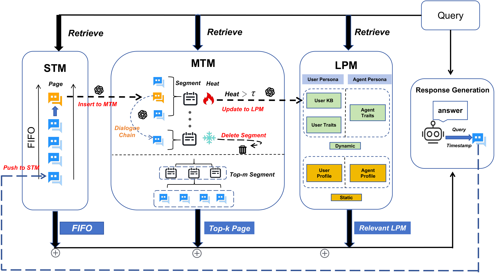

# MemoryOS · 三层记忆、动态更新与回答生成

<!-- CATEGORY NAV -->
[Teaser](../../teaser/README.md) · [Architecture](../README.md) · [Element](../../element/README.md) · [总目录](../../CATALOG.md)
<!-- END CATEGORY NAV -->

**Architecture · 原论文 Figure 1 · 2506.06326v1**

## 内容与构图

短期、中期和长期个人记忆并排展开，包含队列、页面、热度、用户画像与检索回路；上下主线把存储、更新和生成串起来。

STM、MTM、LPM 三个记忆区及右侧回答区；上下检索和写回回路贯穿。

解释模型内部结构、处理步骤或数据流，按主要表达用途归入 Architecture。

## 与这次四张参考图的关系

沿 [参考图 3 · MemoryVLA](../../teaser/memoryvla-cognition-memory-action/README.md) · [参考图 4 · Cortex](../../teaser/cortex-memory-consolidation/README.md) 的表达方式继续检索。

可借鉴的组织关系：

- 用不同数据组织方式说明各层记忆差异。
- 粗主线负责跨层流动，局部细线负责内部更新。

## 文件与编辑范围

[作者独立 PDF](original.pdf) · [SVG 转换件](source.svg) · [原始插图定义](figure-inclusion.tex) · [来源与校验记录](metadata.json)

作者独立 PDF 含 68 个绘图对象、39 个文本片段和 31 个嵌入位图对象；保留原有矢量、文字或轮廓。SVG 是 PDF 转换件，文字转轮廓，嵌入图片保持。位图对象数不代表子图数。

PDF 的框线、箭头和原有文字对象或轮廓可按实际对象修改；照片和部分图标仍为位图。桌面 Illustrator 尚未逐项实测。

## 原始出处

- 论文：[Memory OS of AI Agent](https://arxiv.org/abs/2506.06326v1)
- 作者：Kang, Jiazheng；Ji, Mingming；Zhao, Zhe；Bai, Ting
- [作者项目或仓库](https://github.com/BAI-LAB/MemoryOS)
- 所收录版本：`2506.06326v1`，原文 PDF 第 3 页，Figure 1。
- [固定版本 TeX 源码归档](https://arxiv.org/src/2506.06326v1)；原件路径 `latex/figure/mem_pipline.pdf`。
- [会议身份依据](https://github.com/BAI-LAB/MemoryOS)：EMNLP 2025 Oral（作者明确声明）

## 权利与转换记录

所收录 arXiv 版本采用非独占分发许可，该许可不等同第三方重用授权。本条用于私有参考，保留署名与来源；图中第三方插图和照片按原始权利核对。

[原版本许可](https://arxiv.org/licenses/nonexclusive-distrib/1.0/) · [权利记录](RIGHTS.source.txt)

原始文件按原字节保存，转换件另存。

<!-- BEGIN FIGURE LINKS -->
## 关联范例与元素

**可搭配的现有元素：** [数据库](../../element/svg/tabler-database.svg) · [文本文件](../../element/svg/tabler-file-text.svg) · [回环箭头](../../element/svg/tabler-arrow-loop-right.svg) · [用户](../../element/svg/tabler-user.svg)

这些元素按表达功能关联，并非从本论文原图拆出；来源和许可仍以各元素记录为准。

[范例与元素对照表](../../element/with-examples.md) · [元素分类目录](../../element/README.md)
<!-- END FIGURE LINKS -->
