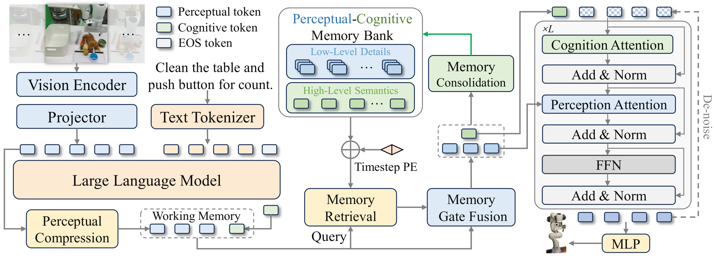

# MemoryVLA · 感知认知记忆库与扩散动作网络

<!-- CATEGORY NAV -->
[Teaser](../../teaser/README.md) · [Architecture](../README.md) · [Element](../../element/README.md) · [总目录](../../CATALOG.md)
<!-- END CATEGORY NAV -->

**Architecture · 原论文 Figure 2 · 2508.19236v1**

## 内容与构图

左侧视觉与语言编码，中间感知认知记忆库、检索、门控融合和巩固回路，右侧展开动作专家的双路注意力与去噪结构。

输入编码、记忆管理、动作专家三个区域；最后一个区域展示内部网络层。

解释模型内部结构、处理步骤或数据流，按主要表达用途归入 Architecture。

与已收录 MemoryVLA teaser 使用同一 2025 年 arXiv v1；不混入后续版本新增结构或评测。

## 与这次四张参考图的关系

沿 [参考图 3 · MemoryVLA](../../teaser/memoryvla-cognition-memory-action/README.md) · [参考图 4 · Cortex](../../teaser/cortex-memory-consolidation/README.md) 的表达方式继续检索。

可借鉴的组织关系：

- 总体流程与单个网络的内部展开共处同一张图。
- 用稳定颜色区分感知 token、认知 token 与动作分支。

## 文件与编辑范围

[作者独立 PDF](original.pdf) · [SVG 转换件](source.svg) · [原始插图定义](figure-inclusion.tex) · [来源与校验记录](metadata.json)

作者独立 PDF 含 140 个绘图对象、41 个文本片段和 115 个嵌入位图对象；保留原有矢量、文字或轮廓。SVG 是 PDF 转换件，文字转轮廓，嵌入图片保持。位图对象数不代表子图数。

PDF 的框线、箭头和原有文字对象或轮廓可按实际对象修改；照片和部分图标仍为位图。桌面 Illustrator 尚未逐项实测。

## 原始出处

- 论文：[MemoryVLA: Perceptual-Cognitive Memory in Vision-Language-Action Models for Robotic Manipulation](https://arxiv.org/abs/2508.19236v1)
- 作者：Shi, Hao；Xie, Bin；Liu, Yingfei；Sun, Lin；Liu, Fengrong；Wang, Tiancai；Zhou, Erjin；Fan, Haoqiang；Zhang, Xiangyu；Huang, Gao
- [作者项目或仓库](https://shihao1895.github.io/MemoryVLA/)
- 所收录版本：`2508.19236v1`，原文 PDF 第 4 页，Figure 2。
- [固定版本 TeX 源码归档](https://arxiv.org/src/2508.19236v1)；原件路径 `figures/fig_2_method.pdf`。
- [会议身份依据](https://openreview.net/forum?id=54U3XHf7qq)：ICLR 2026；本条源文件版本仍以上述 arXiv 为准。

## 权利与转换记录

所收录 arXiv 版本采用非独占分发许可，该许可不等同第三方重用授权。本条用于私有参考，保留署名与来源；图中第三方插图和照片按原始权利核对。

[原版本许可](https://arxiv.org/licenses/nonexclusive-distrib/1.0/) · [权利记录](RIGHTS.source.txt)

原始文件按原字节保存，转换件另存。

<!-- BEGIN FIGURE LINKS -->
## 关联范例与元素

同论文的其他图：[MemoryVLA · 人类记忆类比、方法与性能首图](../../teaser/memoryvla-cognition-memory-action/README.md)

**可搭配的现有元素：** [ViT 编码器块](../../element/svg/vit-encoder-block.svg) · [DiT 多头自注意力模块](../../element/svg/dit-self-attention.svg) · [数据库](../../element/svg/tabler-database.svg) · [回环箭头](../../element/svg/tabler-arrow-loop-right.svg)

这些元素按表达功能关联，并非从本论文原图拆出；来源和许可仍以各元素记录为准。

[范例与元素对照表](../../element/with-examples.md) · [元素分类目录](../../element/README.md)
<!-- END FIGURE LINKS -->
