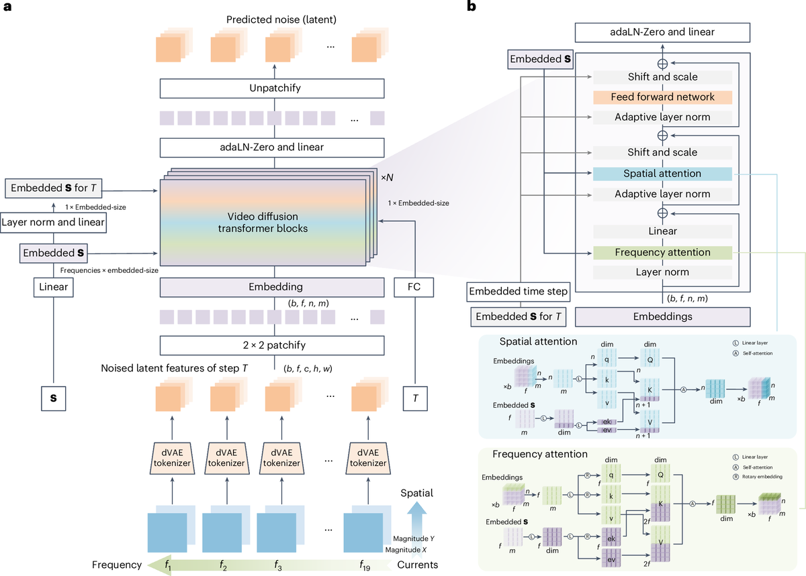

# MetaAI · 从电流扩散 Transformer 展开两种注意力

<!-- CATEGORY NAV -->
[Teaser](../../teaser/README.md) · [Architecture](../README.md) · [Element](../../element/README.md) · [总目录](../../CATALOG.md)
<!-- END CATEGORY NAV -->

[原始 PNG](original.png) · [分类目录](../README.md#network)

*Nature Machine Intelligence* **8**, 59–69 (2026) · Fig. 2a、b

## 读图

从 a 底部的一叠电流图向上看：各频点的电流先编码，再分块送入重复的 Transformer 块。沿浅灰色放大带移到 b，堆叠块内的频率注意力和空间注意力各有一条同色引线。右下角的绿色细节图沿频点处理信息，青色细节图沿空间位置处理信息。S 和时间步 T 的条件输入都可沿各自的线追踪。

**同篇图版**　[Fig. 1 设计总览](../../teaser/metaai-current-diffusion-design-overview/README.md) · [Fig. 3 单层设计](../../multipanel/metaai-single-layer-current-and-spectrum/README.md) · [Fig. 4 可调器件](../../multipanel/metaai-tunable-metasurface-prototype/README.md) · [Fig. 5 多层器件](../../multipanel/metaai-multilayer-transmission-absorption/README.md)

## 出处

Current-diffusion model for metasurface structure discoveries with spatial-frequency dynamics。Erji Li、Yusong Wang 等。2025 年 12 月 31 日在线发表，收入 2026 年卷。

期刊原图为 2165 × 1550 像素的 PNG。期刊标明作者版权并独家授权 Springer Nature Limited。图版作为论文参考留存，发表时复用或改编请查阅期刊的权限说明。

[论文](https://www.nature.com/articles/s42256-025-01162-z) · [期刊原图](https://media.springernature.com/full/springer-static/image/art%3A10.1038%2Fs42256-025-01162-z/MediaObjects/42256_2025_1162_Fig2_HTML.png) · [版权说明](https://www.nature.com/articles/s42256-025-01162-z#rightslink)

<!-- BEGIN FIGURE LINKS -->
## 关联范例与元素

同论文的其他图：[MetaAI · 从目标电磁响应到可实现的超表面](../../teaser/metaai-current-diffusion-design-overview/README.md)

**可搭配的现有元素：** [Patchify 图像分块模块](../../element/svg/dit-patchify.svg) · [DiT 多头自注意力模块](../../element/svg/dit-self-attention.svg) · [条件缩放与平移模块](../../element/svg/dit-scale-shift.svg)

这些元素按表达功能关联，并非从本论文原图拆出；来源和许可仍以各元素记录为准。

[范例与元素对照表](../../element/with-examples.md) · [元素分类目录](../../element/README.md)
<!-- END FIGURE LINKS -->
