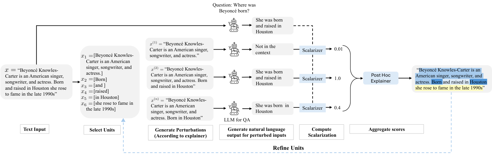

# MExGen · 问答扰动与逐级文本归因

<!-- CATEGORY NAV -->
[Teaser](../../teaser/README.md) · [Architecture](../README.md) · [Element](../../element/README.md) · [总目录](../../CATALOG.md)
<!-- END CATEGORY NAV -->

**Architecture · 原论文 Figure 2 · ACL 2025 Oral**

## 内容与构图

围绕一条出生地问答展开文本切分和三条并行扰动。每个回答旁保留具体的标量分数，最后回到着色的原文本并用虚线表示进一步细分。

横向六步为输入、单元切分、生成扰动、问答、标量化和分数汇总，底部虚线回到单元切分。

- 将同一问题的多条扰动输入、回答与分数横向对齐，便于看出差别来自哪个文本单元。
- 把阶段名称集中在底部，虚线从汇总结果回到切分步骤，呈现多粒度归因的迭代。

同类构图可对照 [FlashTrace Figure 2](../flashtrace-span-recursive-attribution/README.md)。

## 文件与编辑范围

[作者独立 PDF](original.pdf) · [SVG 转换件](source.svg) · [LaTeX 插图定义](figure-inclusion.tex) · [来源与校验记录](metadata.json)

作者 PDF 含 48 个矢量绘图对象、101 个文本片段和 4 个嵌入位图对象。SVG 将文字转为轮廓，并保留原有位图；部分路径的变换矩阵已等价展开以保留虚线等细节。桌面 Illustrator 尚未实测。

## 原始出处

*Multi-Level Explanations for Generative Language Models*。Lucas Monteiro Paes、Dennis Wei、Hyo Jin Do、Hendrik Strobelt、Ronny Luss、Amit Dhurandhar、Manish Nagireddy、Karthikeyan Natesan Ramamurthy、Prasanna Sattigeri、Werner Geyer、Soumya Ghosh。原图为 `2403.14459v2` 源包的 `Figures/DiagramMexGEN.pdf`。插图定义位于 `main.tex`。[固定版论文](https://arxiv.org/abs/2403.14459v2) · [论文 PDF 第 3 页](https://arxiv.org/pdf/2403.14459v2#page=3) · [LaTeX 源码包](https://arxiv.org/src/2403.14459v2) · [论文集](https://aclanthology.org/2025.acl-long.1553/) · [会议信息](https://research.ibm.com/events/acl-2025) · [作者项目或发布页](https://github.com/IBM/ICX360)

## 权利与转换记录

所收录 arXiv 版本标注 CC BY 4.0。保留作者署名和出处，图中第三方图像的权利以原出处为准。作者 PDF 按原字节保存，PNG 和 SVG 由该 PDF 转换。[所收录版本许可](https://creativecommons.org/licenses/by/4.0/) · [权利记录](RIGHTS.source.txt)

<!-- BEGIN FIGURE LINKS -->
## 关联范例与元素

**可搭配的现有元素：** [文本文件](../../element/svg/tabler-file-text.svg) · [机器人](../../element/svg/tabler-robot.svg) · [回环箭头](../../element/svg/tabler-arrow-loop-right.svg)

这些元素按表达功能关联，并非从本论文原图拆出；来源和许可仍以各元素记录为准。

[范例与元素对照表](../../element/with-examples.md) · [元素分类目录](../../element/README.md)
<!-- END FIGURE LINKS -->
