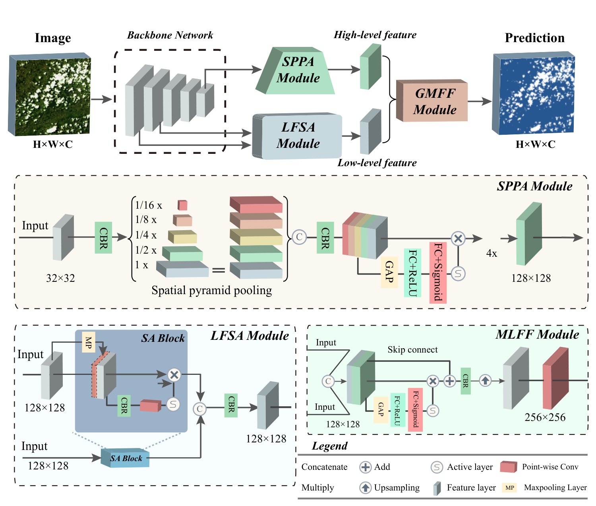

# 多尺度网络总览与模块展开

<!-- CATEGORY NAV -->
[Teaser](../../teaser/README.md) · [Architecture](../README.md) · [Element](../../element/README.md) · [总目录](../../CATALOG.md)
<!-- END CATEGORY NAV -->

作者 Illustrator 科研绘图教程中的多尺度网络案例：Backbone、高低层特征、SPPA／LFSA／GMFF 模块、预测结果，以及模块细节。原文件含 7 个画板。

## 可编辑文件

- **主文件：[source.ai](source.ai)**
- [结构化元数据](metadata.json)

## 借鉴什么

适合借鉴“上方总览 + 下方局部展开”的架构主图布局、不同分辨率特征图堆叠、跳连与图例。建议先从第 6 个画板的完整主图入手，再复制其余画板中的模块。

## 打开与编辑

在 Illustrator 中使用“文件 → 打开”选择 `source.ai`，按需要取消编组并另存自己的工作副本。SVG 可另外用 Inkscape 打开；AI 预览来自其 PDF 兼容层。

- 包含 Adobe Illustrator 原生 AIPrivateData，原始 AI 字节未修改。
- 检查过 PDF 兼容层，未在桌面 Illustrator 中实际打开。
- 在原文件 XMP 中未发现外链 Manifest；这不构成完整的桌面字体与链接验证。

## 来源

- https://github.com/JunchuanYu/Adobe_Illustrator_for_Scientific_Graphic_Design
- https://github.com/JunchuanYu/Adobe_Illustrator_for_Scientific_Graphic_Design/blob/main/demo/task5/task5.ai
- https://raw.githubusercontent.com/JunchuanYu/Adobe_Illustrator_for_Scientific_Graphic_Design/main/demo/task5/task5.ai

原始文件名：`demo/task5/task5.ai`。

## 许可与使用范围

**未发现明确 LICENSE**。作者提供公开免费教程；公开下载不等于自由再分发许可。保留出处；不能标为 MIT、CC0 或已获商用授权。

## 整理时做了什么

- AI 源文件保持原始字节，仅重命名为 source.ai。
- preview.png 从第 6 个 PDF 兼容画板重新渲染到 1500 px 宽。

收录日期：2026-10-25。主文件与所有随附二进制文件的 SHA256 记录在 `metadata.json`。

<!-- BEGIN FIGURE LINKS -->
## 关联范例与元素

**从本图拆出的部件：** [输入特征层](../../element/svg/task5-input-feature.svg) · [多尺度特征堆叠](../../element/svg/task5-feature-pyramid.svg) · [多通道彩色张量](../../element/svg/task5-rgb-tensor.svg) · [输出特征层](../../element/svg/task5-output-feature.svg) · [拼接节点](../../element/svg/task5-concat.svg) · [加法节点](../../element/svg/task5-add.svg) · [乘法节点](../../element/svg/task5-multiply.svg) · [上采样节点](../../element/svg/task5-upsample.svg) · [CBR 模块](../../element/svg/task5-cbr.svg) · [GAP 模块](../../element/svg/task5-gap.svg) · [FC + ReLU 模块](../../element/svg/task5-fc-relu.svg)

[范例与元素对照表](../../element/with-examples.md) · [元素分类目录](../../element/README.md)
<!-- END FIGURE LINKS -->
