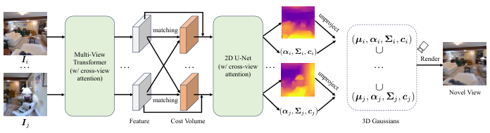

# MVSplat · 多视图匹配、代价体与三维高斯预测

<!-- CATEGORY NAV -->
[Teaser](../../teaser/README.md) · [Architecture](../README.md) · [Element](../../element/README.md) · [总目录](../../CATALOG.md)
<!-- END CATEGORY NAV -->

[所属分类](../README.md) · [总目录](../../CATALOG.md)

**ECCV 2024 · Oral · 原论文 Figure 2**

## 为什么收这张图

输入视图、匹配特征、代价体、深度及三维表示沿一条阅读方向展开，两个视图始终保持上下对应关系。

整体网络与几何重建框架。

## 可以借鉴

- 对应视图沿全流程保持位置一致
- 用堆叠平面表达代价体
- 把深度反投影与高斯融合明确画出

## 文件与编辑范围

[主文件](source.svg) · [单图 PDF](figure.pdf) · [来源与校验记录](metadata.json)

原 PDF 的几何路径与线条保留，SVG 文字转为轮廓；照片、三维渲染与原有位图部件仍为嵌入图片。

SVG 是原论文图形的提取转换件，未取得作者原生 AI 工程。不同 PDF 阅读器或 Illustrator 对字体、透明度的导入可能有差异。

## 原始出处

- 论文：[MVSplat: Efficient 3D Gaussian Splatting from Sparse Multi-View Images](https://arxiv.org/abs/2403.14627)
- 作者：Chen, Yuedong, Xu, Haofei, Zheng, Chuanxia, Zhuang, Bohan, Pollefeys, Marc, Geiger, Andreas, Cham, Tat-Jen, Cai, Jianfei
- [作者项目或代码](https://donydchen.github.io/mvsplat/)
- [会议与展示身份依据](https://donydchen.github.io/mvsplat/)
- PDF 第 4 页，Figure 2；截取坐标见 metadata.json。

## 权利与修改记录

arXiv 原文声明 CC BY 4.0；保留作者署名、论文链接和裁剪转换说明。第三方照片与模型若有独立声明，仍按原声明。

原文许可声明：https://creativecommons.org/licenses/by/4.0/

只提取、裁剪与转换原图；没有重新绘制。

<!-- BEGIN FIGURE LINKS -->
## 关联范例与元素

同论文的其他图：[MVSplat · 重建质量、速度与参数量的并列对照](../../teaser/mvsplat-comparison/README.md)

**可搭配的现有元素：** [Self attention 块](../../element/svg/lightglue-self-attention.svg) · [多尺度特征堆叠](../../element/svg/task5-feature-pyramid.svg) · [拼接节点](../../element/svg/task5-concat.svg) · [特征表示堆叠](../../element/svg/rust-feature-stack.svg)

这些元素按表达功能关联，并非从本论文原图拆出；来源和许可仍以各元素记录为准。

[范例与元素对照表](../../element/with-examples.md) · [元素分类目录](../../element/README.md)
<!-- END FIGURE LINKS -->
