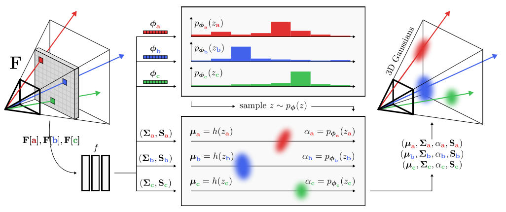

# pixelSplat · 概率深度采样与像素对齐高斯

<!-- CATEGORY NAV -->
[Teaser](../../teaser/README.md) · [Architecture](../README.md) · [Element](../../element/README.md) · [总目录](../../CATALOG.md)
<!-- END CATEGORY NAV -->

[所属分类](../README.md) · [总目录](../../CATALOG.md)

**CVPR 2024 · 会议论文；未核实 Oral · 原论文 Figure 3**

## 为什么收这张图

用相机、射线、离散概率柱状图和连续高斯对应表达同一预测过程，抽象参数与几何对象能在图中逐一对上。

概率表示与几何预测的算法架构；不是生成样例拼图。

## 可以借鉴

- 统一颜色追踪不同像素与射线
- 将概率表示画在对应几何对象旁
- 用局部展开连接计算流程与空间意义

## 文件与编辑范围

[主文件](source.svg) · [单图 PDF](figure.pdf) · [来源与校验记录](metadata.json)

原 PDF 的几何路径与线条保留，SVG 文字转为轮廓；照片、三维渲染与原有位图部件仍为嵌入图片。

SVG 是原论文图形的提取转换件，未取得作者原生 AI 工程。不同 PDF 阅读器或 Illustrator 对字体、透明度的导入可能有差异。

## 原始出处

- 论文：[pixelSplat: 3D Gaussian Splats from Image Pairs for Scalable Generalizable 3D Reconstruction](https://arxiv.org/abs/2312.12337)
- 作者：Charatan, David, Li, Sizhe, Tagliasacchi, Andrea, Sitzmann, Vincent
- [作者项目或代码](https://davidcharatan.com/pixelsplat/)
- [会议与展示身份依据](https://cvpr.thecvf.com/media/cvpr-2024/Slides/32147.pdf)
- PDF 第 4 页，Figure 3；截取坐标见 metadata.json。

## 权利与修改记录

arXiv 标注的是授予 arXiv 的非独占分发许可，不是第三方图形重用许可。本条用于个人私有参考，改编或公开再用需核对原权利。

原文许可声明：https://arxiv.org/licenses/nonexclusive-distrib/1.0/

只提取、裁剪与转换原图；没有重新绘制。

<!-- BEGIN FIGURE LINKS -->
## 关联范例与元素

**可搭配的现有元素：** [匹配相似度矩阵](../../element/svg/lightglue-assignment-matrix.svg) · [多通道彩色张量](../../element/svg/task5-rgb-tensor.svg) · [相机](../../element/svg/tabler-camera.svg) · [浅层神经网络](../../element/svg/towaki-neuralnetwork.svg)

这些元素按表达功能关联，并非从本论文原图拆出；来源和许可仍以各元素记录为准。

[范例与元素对照表](../../element/with-examples.md) · [元素分类目录](../../element/README.md)
<!-- END FIGURE LINKS -->
