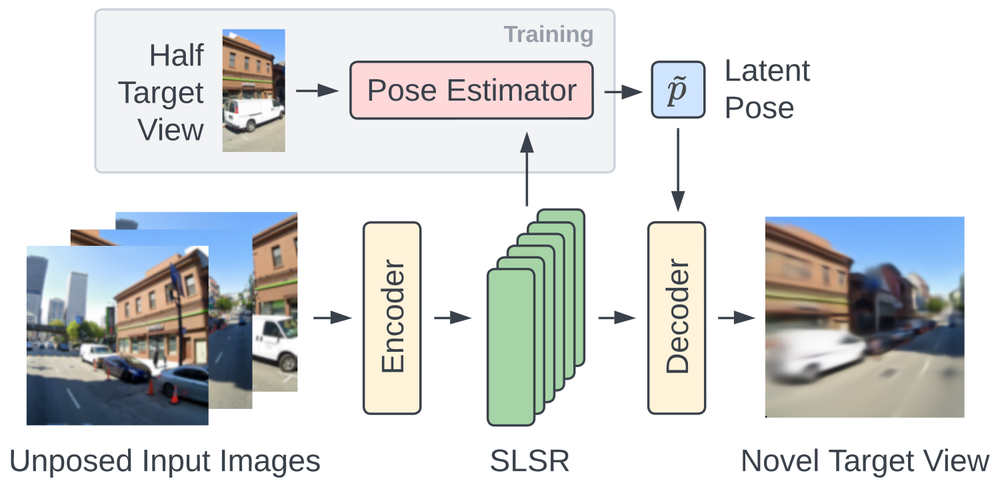

# RUST：编码器、场景表示与位姿分支

<!-- CATEGORY NAV -->
[Teaser](../../teaser/README.md) · [Architecture](../README.md) · [Element](../../element/README.md) · [总目录](../../CATALOG.md)
<!-- END CATEGORY NAV -->

无位姿输入图像经 Encoder、场景表示、Decoder 输出新视角，训练时有 Pose Estimator 分支。按内容归入 architecture。

[作者原始 SVG](source.svg) · [来源与检查记录](metadata.json) · [原项目](https://rust-paper.github.io/)

## 来源与可编辑范围

来源：`rust-paper/rust-paper.github.io` / `data/teaser.svg`，固定版本 `8c3a856479a9`。原 SVG 未重绘、未修改字节。

SVG 对象：199 个 path，9 个 text，7 个 image。有 SVG 容器不代表每个区域都是可编辑矢量；内嵌照片和渲染图保持位图，公式可能为轮廓。

项目仓库未发现 LICENSE；仅作出处明确的参考，元素提取不新增授权。

已检查预览；桌面 Illustrator 的字体与链接兼容性尚未逐项实测。

<!-- BEGIN FIGURE LINKS -->
## 关联范例与元素

**从本图拆出的部件：** [编码器块](../../element/svg/rust-encoder.svg) · [解码器块](../../element/svg/rust-decoder.svg) · [特征表示堆叠](../../element/svg/rust-feature-stack.svg) · [单层特征块](../../element/svg/rust-feature-tile.svg) · [位姿估计模块](../../element/svg/rust-pose-estimator.svg) · [右向流程箭头](../../element/svg/rust-arrow-right.svg) · [下向流程箭头](../../element/svg/rust-arrow-down.svg)

**可搭配的现有元素：** [回环箭头](../../element/svg/tabler-arrow-loop-right.svg) · [相机](../../element/svg/tabler-camera.svg)

这些元素按表达功能关联，并非从本论文原图拆出；来源和许可仍以各元素记录为准。

[范例与元素对照表](../../element/with-examples.md) · [元素分类目录](../../element/README.md)
<!-- END FIGURE LINKS -->
