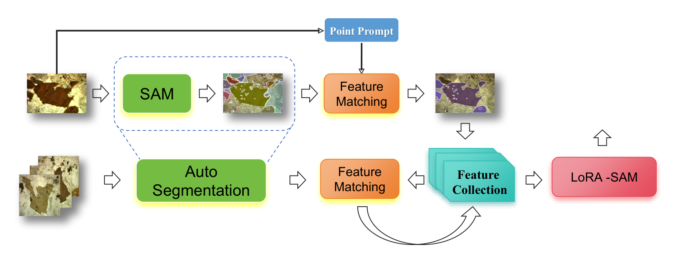
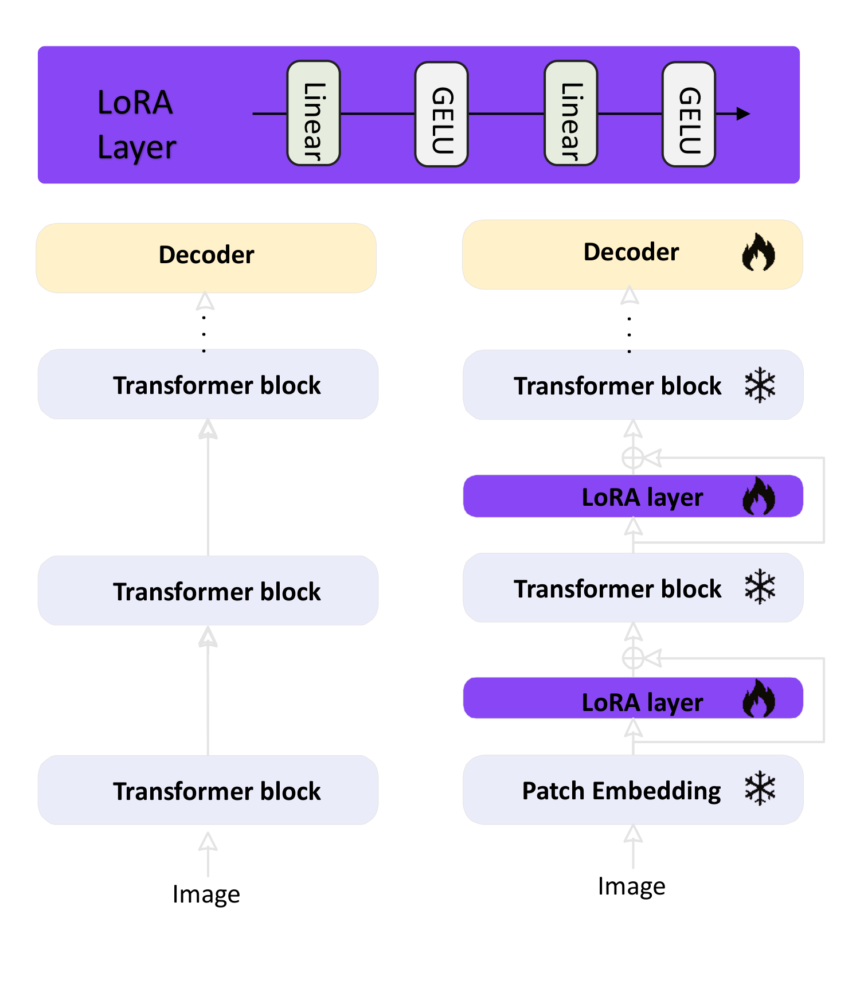

# SAM / LoRA 总体流程与 Transformer 模块

<!-- CATEGORY NAV -->
[Teaser](../../teaser/README.md) · [Architecture](../README.md) · [Element](../../element/README.md) · [总目录](../../CATALOG.md)
<!-- END CATEGORY NAV -->

作者 Illustrator 科研绘图教程中的 SAM / LoRA 案例，含总体方法流程与 Transformer／LoRA 模块结构，共 2 个画板；公开的 PNG、PDF 与 PPTX 配套素材一并保留。

## 可编辑文件

- **主文件：[source.ai](source.ai)**
- [结构化元数据](metadata.json)

配套原始文件与许可：

- [`assets/data2.pdf`](assets/data2.pdf)
- [`assets/data-01.png`](assets/data-01.png)
- [`assets/data.pptx`](assets/data.pptx)
- [`assets/data-02-02.png`](assets/data-02-02.png)
- [`assets/data.pdf`](assets/data.pdf)

## 借鉴什么

适合借鉴“整体流程 + 局部可训练模块”的画法、冻结与训练部件的区分、多模态输入和模块放大框。原作者未提供明确开源许可，先作为布局与绘制参考使用。

## 打开与编辑

在 Illustrator 中使用“文件 → 打开”选择 `source.ai`，按需要取消编组并另存自己的工作副本。SVG 可另外用 Inkscape 打开；AI 预览来自其 PDF 兼容层。

- 包含 Adobe Illustrator 原生 AIPrivateData，原始 AI 字节未修改。
- 原文件元数据含作者本地 AI_图像.psd 引用，该 PSD 未公开，Illustrator 可能提示旧链接。
- 原作者公开的 PNG／PDF／PPTX 位于 assets/；这些文件不能保证完整恢复缺失 PSD 的图层或链接。
- 检查过 PDF 兼容层，未在桌面 Illustrator 中实际打开。

## 来源

- https://github.com/JunchuanYu/Adobe_Illustrator_for_Scientific_Graphic_Design
- https://github.com/JunchuanYu/Adobe_Illustrator_for_Scientific_Graphic_Design/tree/main/demo/task4
- https://raw.githubusercontent.com/JunchuanYu/Adobe_Illustrator_for_Scientific_Graphic_Design/main/demo/task4/task4.ai

原始文件名：`demo/task4/task4.ai`, `demo/task4/data-01.png`, `demo/task4/data-02-02.png`, `demo/task4/data.pdf`, `demo/task4/data2.pdf`, `demo/task4/data.pptx`。

## 许可与使用范围

**未发现明确 LICENSE**。作者提供公开免费教程；公开下载不等于自由再分发许可。保留出处；不能标为 MIT、CC0 或已获商用授权。

## 整理时做了什么

- AI 源文件保持原始字节，仅重命名为 source.ai。
- 公开配套素材保持原始字节，收录在 assets/。
- preview.png 与 module-preview.png 分别从两个 PDF 兼容画板重新渲染到 1500 px 宽。

收录日期：2026-10-25。主文件与所有随附二进制文件的 SHA256 记录在 `metadata.json`。

第二画板的模块预览：

<!-- BEGIN FIGURE LINKS -->
## 关联范例与元素

**可搭配的现有元素：** [图像](../../element/svg/tabler-photo.svg) · [Self attention 块](../../element/svg/lightglue-self-attention.svg) · [锁定](../../element/svg/tabler-lock.svg) · [解锁](../../element/svg/tabler-lock-open.svg)

这些元素按表达功能关联，并非从本论文原图拆出；来源和许可仍以各元素记录为准。

[范例与元素对照表](../../element/with-examples.md) · [元素分类目录](../../element/README.md)
<!-- END FIGURE LINKS -->
