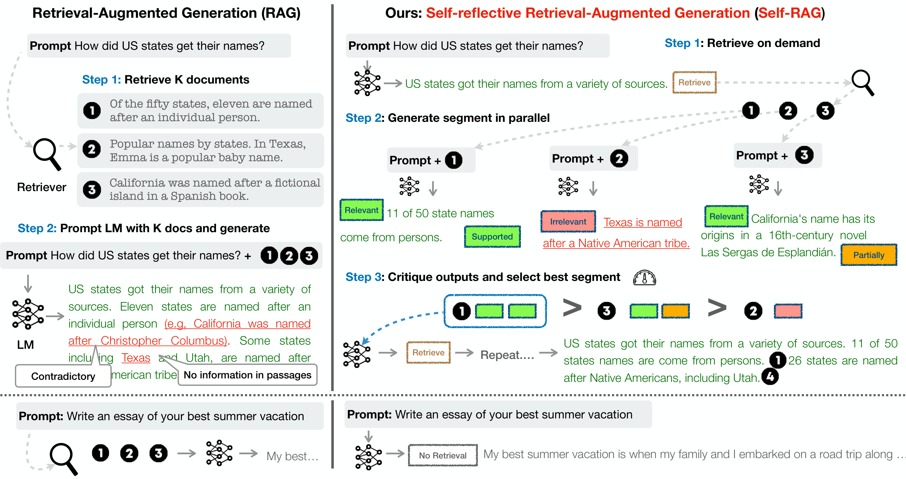

# Self-RAG · 检索、并行生成与自评选择

<!-- CATEGORY NAV -->
[Teaser](../../teaser/README.md) · [Architecture](../README.md) · [Element](../../element/README.md) · [总目录](../../CATALOG.md)
<!-- END CATEGORY NAV -->

**Architecture · 原论文 Figure 1 · 2310.11511v1**

## 内容与构图

左侧是固定检索 RAG，右侧完整展开按需检索、并行生成和自评选择，下方再用不需要检索的请求形成补充对照。

左右方法对照；右侧包含三阶段和三条文档分支；底部额外对照非检索任务。

解释模型内部结构、处理步骤或数据流，按主要表达用途归入 Architecture。

原文件名包含 teaser，但本库按主要作用归入 Architecture：图中详细解释检索、生成、自评与选择的数据流。所收录为 2023 年 arXiv v1，会议身份为 ICLR 2024。

## 与这次四张参考图的关系

沿 [参考图 2 · Speculative RAG](../../architecture/speculative-rag-draft-verify/README.md) 的表达方式继续检索。

可借鉴的组织关系：

- 用具体问题与文档片段承载流程，而不是只写模块名。
- 答案片段、文档编号和评估色块互相呼应。

## 文件与编辑范围

[作者独立 PDF](original.pdf) · [SVG 转换件](source.svg) · [原始插图定义](figure-inclusion.tex) · [来源与校验记录](metadata.json)

作者独立 PDF 含 98 个绘图对象、79 个文本片段和 29 个嵌入位图对象；保留原有矢量、文字或轮廓。SVG 是 PDF 转换件，文字转轮廓，嵌入图片保持。位图对象数不代表子图数。

PDF 的框线、箭头和原有文字对象或轮廓可按实际对象修改；照片和部分图标仍为位图。桌面 Illustrator 尚未逐项实测。

## 原始出处

- 论文：[Self-RAG: Learning to Retrieve, Generate, and Critique through Self-Reflection](https://arxiv.org/abs/2310.11511v1)
- 作者：Asai, Akari；Wu, Zeqiu；Wang, Yizhong；Sil, Avirup；Hajishirzi, Hannaneh
- [作者项目或仓库](https://selfrag.github.io/)
- 所收录版本：`2310.11511v1`，原文 PDF 第 2 页，Figure 1。
- [固定版本 TeX 源码归档](https://arxiv.org/src/2310.11511v1)；原件路径 `figs/teaser_self_rag_v8.pdf`。
- [会议身份依据](https://github.com/AkariAsai/self-rag)：ICLR 2024 Oral（作者明确声明）

## 权利与转换记录

所收录 arXiv 论文版本声明 CC BY 4.0，保留作者署名、版本与转换记录；图中的第三方照片、商标或引用素材仍按原始权利核对。

[原版本许可](https://creativecommons.org/licenses/by/4.0/) · [权利记录](RIGHTS.source.txt)

原始文件按原字节保存，转换件另存。

<!-- BEGIN FIGURE LINKS -->
## 关联范例与元素

**可搭配的现有元素：** [文本文件](../../element/svg/tabler-file-text.svg) · [网络](../../element/svg/tabler-network.svg) · [勾选](../../element/svg/tabler-check.svg) · [分流箭头](../../element/svg/tabler-arrows-split.svg)

这些元素按表达功能关联，并非从本论文原图拆出；来源和许可仍以各元素记录为准。

[范例与元素对照表](../../element/with-examples.md) · [元素分类目录](../../element/README.md)
<!-- END FIGURE LINKS -->
