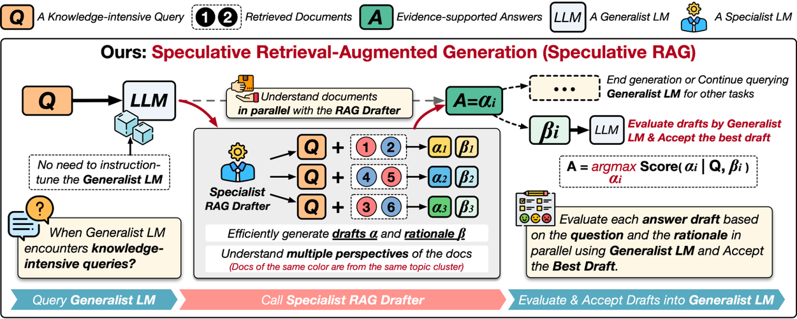
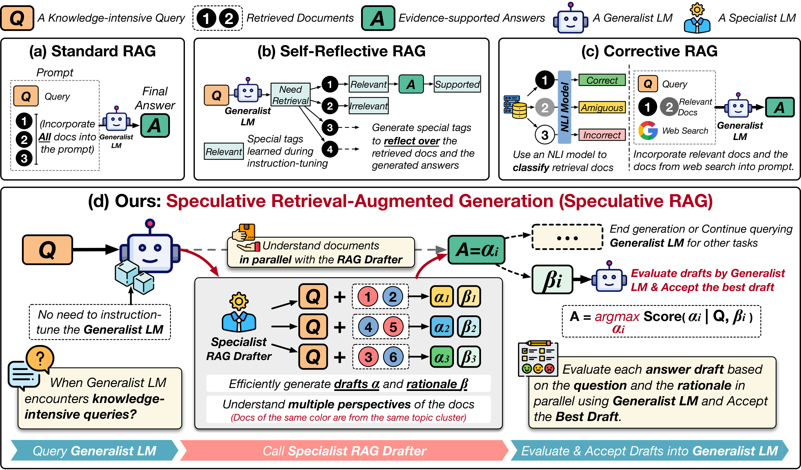

# Speculative RAG · 并行起草与通用模型验证

<!-- CATEGORY NAV -->
[Teaser](../../teaser/README.md) · [Architecture](../README.md) · [Element](../../element/README.md) · [总目录](../../CATALOG.md)
<!-- END CATEGORY NAV -->

[Teaser](../../teaser/README.md) · [Architecture](../../architecture/README.md) · [Element](../../element/README.md) · [总目录](../../CATALOG.md)

**用户参考图 2 · Figure 1 · Architecture**

## 与用户参考图的对应

用户图 2 与 Google Research 官方博客 Speculative_RAG_img1 原图一致，包括 LLM 方框图标。论文 Figure 1(d) 是同一方法的另一图形版本，使用机器人图标，并与 (a)–(c) 对照面板组合；两版均收录。

[四张图片的出处与版本对照](../../docs/image-provenance-2026-11-04.md)

## 内容与分类

小型专用 RAG 模型对不同文档子集并行生成答案草稿和依据，再由大型通用模型验证并选择。图内明确展示查询、文档、答案、依据与两类模型之间的数据流。

用户参考的主体解释方法分工、并行分支和验证数据流，归入 Architecture／Framework。保留论文完整 Figure 1 作为上下文。

官方博客图分为查询通用模型、专用模型起草、通用模型验证三个阶段。论文完整 Figure 1 另保留 (a)–(c) 三类既有方法及 (d) 本方法。

三阶段是用户截图对应的官方博客方法流程，不将它们计作三个独立模型。完整论文图的四个面板是方法对照，两版对应关系分别记录。

## 可以借鉴

- 先以图例建立查询、文档、草稿与依据的视觉语汇。
- 将并行分支聚拢在一个任务区，用汇合表达验证与选择。
- 底部阶段条负责阅读顺序，内部箭头负责实际数据关系。

## 文件与编辑范围

[作者独立 PDF](original.pdf) · [SVG 转换件](source.svg) · [原始插图定义](figure-inclusion.tex) · [来源与校验记录](metadata.json)

作者独立 PDF 保留矢量结构及原有文字对象或轮廓；SVG 为 PDF 转换件，文字转轮廓。原 PDF 含 18 个嵌入位图对象，可移动或替换，不能按矢量节点编辑。位图对象数不等于子图数。 与用户截图一致的官方博客 PNG 是整张位图；论文 PDF／SVG 是图标和排版略有差异的矢量配套版。

原 PDF 和 SVG 的框线、箭头、公式或文字结构可按实际对象修改；桌面 Illustrator 尚未逐项实测。

[与截图同款的官方博客 PNG](original-blog.png) · [官方博客页面](https://research.google/blog/speculative-rag-enhancing-retrieval-augmented-generation-through-drafting/)

论文完整版 Figure 1（与博客版的 LM 图标不同；上方另有三种方法对照）：

## 原始出处

- 论文：[Speculative RAG: Enhancing Retrieval Augmented Generation through Drafting](https://arxiv.org/abs/2407.08223v2)
- 作者：Wang, Zilong；Wang, Zifeng；Le, Long；Zheng, Huaixiu Steven；Mishra, Swaroop；Perot, Vincent；Zhang, Yuwei；Mattapalli, Anush；Taly, Ankur；Shang, Jingbo；Lee, Chen-Yu；Pfister, Tomas
- [作者项目或论文页面](https://research.google/pubs/speculative-rag-enhancing-retrieval-augmented-generation-through-drafting-2/)
- 所收录版本：`2407.08223v2`；原文 PDF 第 2 页，Figure 1。
- [固定版本作者源码归档](https://arxiv.org/src/2407.08223v2)；成员路径 `figures/main_figure-5-21.pdf`。

## 权利与修改记录

所收录 arXiv 版本采用非独占分发许可，此许可不是第三方图形重用授权；本条用于私有参考。保留作者署名、固定版本与转换记录。图中第三方插画、Logo、照片或引用素材按原始权利声明核对。 Google Research 博客原图未发现单独的图像重用许可，另按官方原图保留来源。

[原版本许可](https://arxiv.org/licenses/nonexclusive-distrib/1.0/) · [权利记录](RIGHTS.source.txt)

作者原件按原字节保存；只作格式转换、预览和来源整理。

<!-- BEGIN FIGURE LINKS -->
## 关联范例与元素

**可搭配的现有元素：** [文本文件](../../element/svg/tabler-file-text.svg) · [网络](../../element/svg/tabler-network.svg) · [右箭头](../../element/svg/tabler-arrow-right.svg) · [勾选](../../element/svg/tabler-check.svg)

这些元素按表达功能关联，并非从本论文原图拆出；来源和许可仍以各元素记录为准。

[范例与元素对照表](../../element/with-examples.md) · [元素分类目录](../../element/README.md)
<!-- END FIGURE LINKS -->
