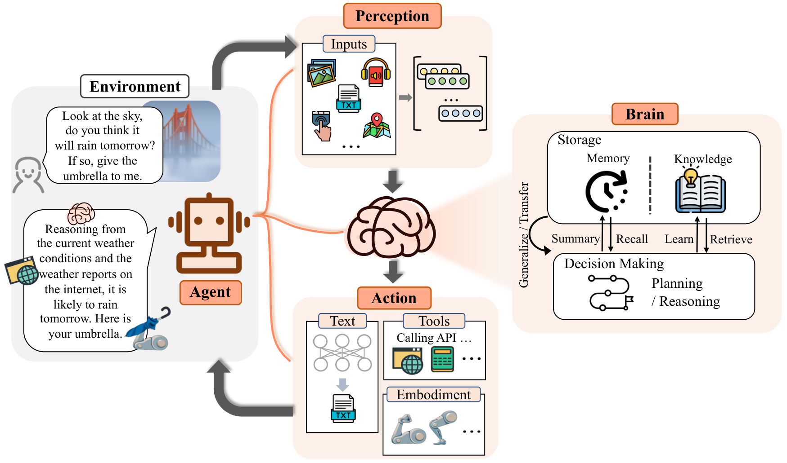

# Agent 概念框架 · 感知、大脑与行动

<!-- CATEGORY NAV -->
[Teaser](../../teaser/README.md) · [Architecture](../README.md) · [Element](../../element/README.md) · [总目录](../../CATALOG.md)
<!-- END CATEGORY NAV -->

[所属分类](../README.md) · [总目录](../../CATALOG.md)

**arXiv 2023 · 预印本综述 · 原论文 Figure 2**

## 为什么收这张图

用环境交互闭环串起感知、大脑与行动，同时在右侧展开存储和决策能力；适合作为综述统一框架图的构图参考。

综述提炼的概念框架，按内部组成与交互关系放入 Architecture；不是某个具体可执行模型的完整网络定义。

## 可以借鉴

- 整体交互闭环与局部功能展开分区表达。
- 用一个用户指令例子把抽象模块与实际信息流联系起来。
- 保持输入、记忆知识、规划推理、工具和具身行动之间的层级。

## 文件与编辑范围

[作者原始 PDF](original.pdf) · [SVG 转换件](source.svg) · [原始 LaTeX 插图定义](figure-inclusion.tex) · [来源与校验记录](metadata.json)

作者独立 PDF 中的文字与图形对象保留；SVG 文字转为轮廓。原有照片、标识、人物或渲染仍为嵌入位图，可移动替换，不能按矢量节点编辑。

对照原论文页核实了图号和实际用途；独立 PDF 按作者提交的原文件保存。

原始 PDF 来自作者提交的 TeX 归档，未改字节；SVG 是格式转换件，未取得原生 AI 工程。桌面 Illustrator 尚未逐项实测。

## 原始出处

- 论文：[The Rise and Potential of Large Language Model Based Agents: A Survey](https://arxiv.org/abs/2309.07864v3)
- 作者：Xi, Zhiheng, Chen, Wenxiang, Guo, Xin, He, Wei, Ding, Yiwen, Hong, Boyang, Zhang, Ming, Wang, Junzhe, Jin, Senjie, Zhou, Enyu, Zheng, Rui, Fan, Xiaoran, Wang, Xiao, Xiong, Limao, Zhou, Yuhao, Wang, Weiran, Jiang, Changhao, Zou, Yicheng, Liu, Xiangyang, Yin, Zhangyue, Dou, Shihan, Weng, Rongxiang, Cheng, Wensen, Zhang, Qi, Qin, Wenjuan, Zheng, Yongyan, Qiu, Xipeng, Huang, Xuanjing, Gui, Tao
- [作者项目或仓库](https://github.com/WooooDyy/LLM-Agent-Paper-List)
- [论文 TeX 原始归档](https://arxiv.org/src/2309.07864v3)，固定版本 `2309.07864v3`。
- 归档内路径：`figures/sec3_construction_v2.pdf`；原文 PDF 第 10 页，Figure 2。
- [出版与来源依据](https://arxiv.org/abs/2309.07864v3)；出版年份与所收录 arXiv 修订版时间分别记录。

## 权利与修改记录

该 arXiv 版本的非独占分发许可不是第三方图形重用许可；此条用于个人私有参考，公开改编或再用应核对原权利。 场景、人物和部分图标含第三方视觉素材；不视为本仓库可自由再分发的元素。

[原文许可声明](https://arxiv.org/licenses/nonexclusive-distrib/1.0/) · [本条权利记录](RIGHTS.source.txt)

只复制作者原件、转换格式和制作预览；没有重绘或新增图形。

<!-- BEGIN FIGURE LINKS -->
## 关联范例与元素

同论文的其他图：[Agent 社会场景 · 综述概念 teaser](../../teaser/survey-agent-society-teaser/README.md)

**可搭配的现有元素：** [大脑](../../element/svg/tabler-brain.svg) · [数据库](../../element/svg/tabler-database.svg) · [聊天机器人](../../element/svg/tabler-message-chatbot.svg) · [回环箭头](../../element/svg/tabler-arrow-loop-right.svg)

这些元素按表达功能关联，并非从本论文原图拆出；来源和许可仍以各元素记录为准。

[范例与元素对照表](../../element/with-examples.md) · [元素分类目录](../../element/README.md)
<!-- END FIGURE LINKS -->
