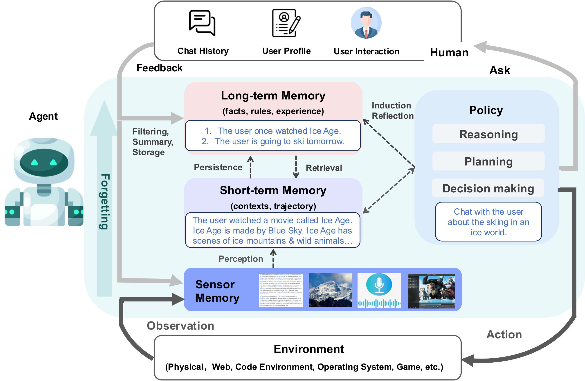

# AI 记忆综述 · 感觉、短期、长期记忆与行动闭环

<!-- CATEGORY NAV -->
[Teaser](../../teaser/README.md) · [Architecture](../README.md) · [Element](../../element/README.md) · [总目录](../../CATALOG.md)
<!-- END CATEGORY NAV -->

**Architecture · 原论文 Figure 9 · 2601.09113v1**

## 内容与构图

层叠的感觉、短期和长期记忆与右侧策略推理相连，外圈串联环境、观测、行动与人类反馈；图内保留具体记忆内容和多模态输入。

三层记忆、右侧三类策略、顶部人类交互、底部环境构成闭环。

解释模型内部结构、处理步骤或数据流，按主要表达用途归入 Architecture。

## 与这次四张参考图的关系

沿 [参考图 3 · MemoryVLA](../../teaser/memoryvla-cognition-memory-action/README.md) · [参考图 4 · Cortex](../../teaser/cortex-memory-consolidation/README.md) 的表达方式继续检索。

可借鉴的组织关系：

- 记忆层级占据主视觉，反馈闭环沿外边界流动。
- 用实际短期与长期记忆内容解释抽象存储层。

## 文件与编辑范围

[作者独立 PDF](original.pdf) · [SVG 转换件](source.svg) · [原始插图定义](figure-inclusion.tex) · [来源与校验记录](metadata.json)

作者独立 PDF 含 31 个绘图对象、44 个文本片段和 8 个嵌入位图对象；保留原有矢量、文字或轮廓。SVG 是 PDF 转换件，文字转轮廓，嵌入图片保持。位图对象数不代表子图数。

PDF 的框线、箭头和原有文字对象或轮廓可按实际对象修改；照片和部分图标仍为位图。桌面 Illustrator 尚未逐项实测。

## 原始出处

- 论文：[The AI Hippocampus: How Far are We From Human Memory?](https://arxiv.org/abs/2601.09113v1)
- 作者：Jia, Zixia；Li, Jiaqi；Kang, Yipeng；Wang, Yuxuan；Wu, Tong；Wang, Quansen；Wang, Xiaobo；Zhang, Shuyi；Shen, Junzhe；Li, Qing；Qi, Siyuan；Liang, Yitao；He, Di；Zheng, Zilong；Zhu, Song-Chun
- [作者项目或仓库](https://github.com/bigai-nlco/LLM-Memory-Survey)
- 所收录版本：`2601.09113v1`，原文 PDF 第 24 页，Figure 9。
- [固定版本 TeX 源码归档](https://arxiv.org/src/2601.09113v1)；原件路径 `sections/llm_agent/agent_mem_newcolor.pdf`。

## 权利与转换记录

所收录 arXiv 版本采用非独占分发许可，该许可不等同第三方重用授权。本条用于私有参考，保留署名与来源；图中第三方插图和照片按原始权利核对。

[原版本许可](https://arxiv.org/licenses/nonexclusive-distrib/1.0/) · [权利记录](RIGHTS.source.txt)

原始文件按原字节保存，转换件另存。

<!-- BEGIN FIGURE LINKS -->
## 关联范例与元素

同论文的其他图：[AI 记忆综述 · 视频对象、动作、问答与生成四面板](../../teaser/survey-ai-memory-video-task-panels/README.md)

**可搭配的现有元素：** [大脑](../../element/svg/tabler-brain.svg) · [数据库](../../element/svg/tabler-database.svg) · [机器人](../../element/svg/tabler-robot.svg) · [回环箭头](../../element/svg/tabler-arrow-loop-right.svg)

这些元素按表达功能关联，并非从本论文原图拆出；来源和许可仍以各元素记录为准。

[范例与元素对照表](../../element/with-examples.md) · [元素分类目录](../../element/README.md)
<!-- END FIGURE LINKS -->
