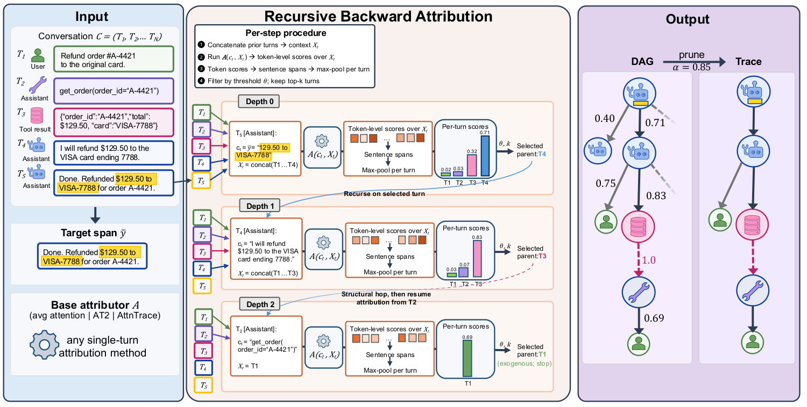

# Tokengeist · 五轮退款对话的递归溯源

<!-- CATEGORY NAV -->
[Teaser](../../teaser/README.md) · [Architecture](../README.md) · [Element](../../element/README.md) · [总目录](../../CATALOG.md)
<!-- END CATEGORY NAV -->

**Architecture · 原论文 Figure 13 · arXiv 2026**

## 内容与构图

一段五轮退款对话贯穿全图。逐层展示词元分数如何汇总到对话轮次、如何选取父节点，以及如何将有向无环图裁剪成最终溯源链。

左栏对话与归因目标，中栏三层递归并配有四步操作说明，右栏并列裁剪前后的溯源图。

- 把每一轮都会执行的四步操作集中写在中栏上方，下面三行用同样的布局展示分数和所选节点。
- 用同一套角色颜色贯穿原始对话、候选轮次和输出图，虚线区分工具结果到调用轮次的结构边。

同类构图可对照 [FlashTrace Figure 2](../flashtrace-span-recursive-attribution/README.md)。

## 贯穿示例的架构图

[Chain-of-Table](../chain-of-table-cyclist-table-reasoning/README.md) · [Graph of Thoughts](../graph-of-thoughts-sorting-walkthrough/README.md) · [IRCoT](../ircot-songwriting-multihop-retrieval/README.md) · [Tree of Thoughts](../tree-of-thoughts-game24-search/README.md)

## 文件与编辑范围

[作者独立 PDF](original.pdf) · [SVG 转换件](source.svg) · [LaTeX 插图定义](figure-inclusion.tex) · [来源与校验记录](metadata.json)

作者 PDF 含 334 个矢量绘图对象、241 个文本片段和 6 个嵌入位图对象。SVG 将文字转为轮廓，并保留原有位图。桌面 Illustrator 尚未实测。

## 原始出处

*Tokengeist: Multi-Turn Attribution Tracing in Agentic Conversations*。Jessica Tang、Shraddha Barke、Sharad Agarwal。原图为 `2607.22610v1` 源包的 `figures/tokengeist-procedure.pdf`。插图定义位于 `sections/appendix_procedure.tex`。[固定版论文](https://arxiv.org/abs/2607.22610v1) · [论文 PDF 第 26 页](https://arxiv.org/pdf/2607.22610v1#page=26) · [LaTeX 源码包](https://arxiv.org/src/2607.22610v1) · [作者项目或发布页](https://www.microsoft.com/en-us/research/publication/tokengeist-multi-turn-attribution-tracing-in-agentic-conversations/)

## 权利与转换记录

所收录 arXiv 版本标注 CC BY 4.0。保留作者署名和出处，图中第三方图像的权利以原出处为准。作者 PDF 按原字节保存，PNG 和 SVG 由该 PDF 转换。[所收录版本许可](https://creativecommons.org/licenses/by/4.0/) · [权利记录](RIGHTS.source.txt)

<!-- BEGIN FIGURE LINKS -->
## 关联范例与元素

**可搭配的现有元素：** [机器人](../../element/svg/tabler-robot.svg) · [数据库](../../element/svg/tabler-database.svg) · [柱状图符号](../../element/svg/tabler-chart-bar.svg) · [过滤](../../element/svg/tabler-filter.svg)

这些元素按表达功能关联，并非从本论文原图拆出；来源和许可仍以各元素记录为准。

[范例与元素对照表](../../element/with-examples.md) · [元素分类目录](../../element/README.md)
<!-- END FIGURE LINKS -->
