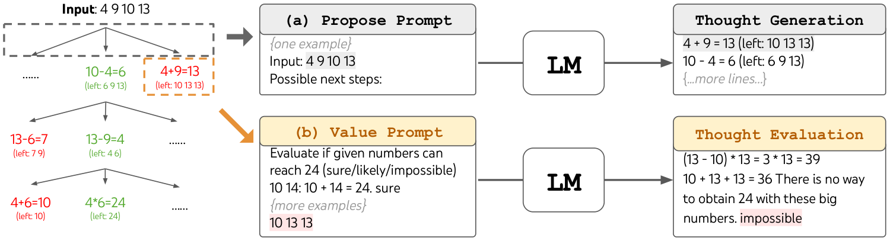

# Tree of Thoughts · 24 点的分支生成与评估

<!-- CATEGORY NAV -->
[Teaser](../../teaser/README.md) · [Architecture](../README.md) · [Element](../../element/README.md) · [总目录](../../CATALOG.md)
<!-- END CATEGORY NAV -->

**Architecture · 原论文 Figure 2 · NeurIPS 2023**

## 内容与构图

用 4、9、10、13 玩 24 点。左侧保留每次运算后剩余的数，右侧拿树上的输入和候选状态展开生成与评估模块。

左侧为搜索树。右上展开候选生成提示与输出，右下展开候选评估提示与输出。

- 用虚线框定位搜索树里要展开的状态，再连到右侧对应的模型提示词。
- 用颜色标出能继续的分支和失败路径。候选评估模块给出剩余数字以及模型的具体判断。

同类构图可对照 [Tokengeist Fig. 13](../tokengeist-refund-provenance-trace/README.md)。

## 文件与编辑范围

[作者独立 PDF](original.pdf) · [SVG 转换件](source.svg) · [LaTeX 插图定义](figure-inclusion.tex) · [来源与校验记录](metadata.json)

作者 PDF 含 160 个矢量绘图对象、74 个文本片段和 0 个嵌入位图对象。SVG 将文字转为轮廓。部分路径的变换矩阵已等价展开以保留虚线等细节。桌面 Illustrator 尚未实测。

## 原始出处

*Tree of Thoughts: Deliberate Problem Solving with Large Language Models*。Shunyu Yao、Dian Yu、Jeffrey Zhao、Izhak Shafran、Thomas L. Griffiths、Yuan Cao、Karthik Narasimhan。原图为 `2305.10601v2` 源包的 `figures/game24_diagram.pdf`。插图定义位于 `main.tex`。[固定版论文](https://arxiv.org/abs/2305.10601v2) · [论文 PDF 第 5 页](https://arxiv.org/pdf/2305.10601v2#page=5) · [LaTeX 源码包](https://arxiv.org/src/2305.10601v2) · [会议信息](https://proceedings.neurips.cc/paper_files/paper/2023/hash/271db9922b8d1f4dd7aaef84ed5ac703-Abstract-Conference.html) · [作者项目或发布页](https://github.com/princeton-nlp/tree-of-thought-llm)

## 权利与转换记录

所收录 arXiv 版本标注 CC BY 4.0。保留作者署名和出处，图中第三方图像的权利以原出处为准。作者 PDF 按原字节保存，PNG 和 SVG 由该 PDF 转换。[所收录版本许可](https://creativecommons.org/licenses/by/4.0/) · [权利记录](RIGHTS.source.txt)

<!-- BEGIN FIGURE LINKS -->
## 关联范例与元素

**可搭配的现有元素：** [分流箭头](../../element/svg/tabler-arrows-split.svg) · [函数图形](../../element/svg/tabler-graph.svg) · [过滤](../../element/svg/tabler-filter.svg)

这些元素按表达功能关联，并非从本论文原图拆出；来源和许可仍以各元素记录为准。

[范例与元素对照表](../../element/with-examples.md) · [元素分类目录](../../element/README.md)
<!-- END FIGURE LINKS -->
