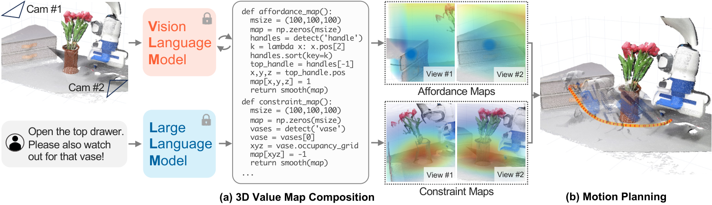

# VoxPoser · 开抽屉并绕开花瓶的轨迹规划

<!-- CATEGORY NAV -->
[Teaser](../../teaser/README.md) · [Architecture](../README.md) · [Element](../../element/README.md) · [总目录](../../CATALOG.md)
<!-- END CATEGORY NAV -->

**Architecture · 原论文 Figure 2 · CoRL 2023**

## 内容与构图

用“打开上层抽屉并避开花瓶”串起双相机观测、视觉语言模型、代码、可供性图与约束图，最后叠加机器人末端轨迹。

左部组合三维值图，从双相机观测和指令到代码及两类地图。右部在同一场景里画出轨迹。

- 代码里的两个函数与两排地图一一对应，地图保留同样的两个观察角度。
- 在输入和轨迹输出中重复呈现抽屉、花瓶与机器人，让目标和障碍物在各阶段都能对上。

同类构图可对照 [VTrace Fig. 4](../vtrace-multihop-visual-attribution/README.md)。

## 文件与编辑范围

[作者独立 PDF](original.pdf) · [SVG 转换件](source.svg) · [LaTeX 插图定义](figure-inclusion.tex) · [来源与校验记录](metadata.json)

作者 PDF 含 28 个矢量绘图对象、56 个文本片段和 10 个嵌入位图对象。SVG 将文字转为轮廓，并保留原有位图。部分路径的变换矩阵已等价展开以保留虚线等细节。桌面 Illustrator 尚未实测。

## 原始出处

*VoxPoser: Composable 3D Value Maps for Robotic Manipulation with Language Models*。Wenlong Huang、Chen Wang、Ruohan Zhang、Yunzhu Li、Jiajun Wu、Li Fei-Fei。原图为 `2307.05973v2` 源包的 `media/method.pdf`。插图定义位于 `main.tex`。[固定版论文](https://arxiv.org/abs/2307.05973v2) · [论文 PDF 第 4 页](https://arxiv.org/pdf/2307.05973v2#page=4) · [LaTeX 源码包](https://arxiv.org/src/2307.05973v2) · [会议信息](https://proceedings.mlr.press/v229/huang23b.html) · [作者项目或发布页](https://voxposer.github.io/)

## 权利与转换记录

所收录 arXiv 版本声明向 arXiv 授予非独占分发许可。此条保留作者署名与原件，用于私有参考，第三方重用授权以作者声明为准。作者 PDF 按原字节保存，PNG 和 SVG 由该 PDF 转换。[所收录版本许可](https://arxiv.org/licenses/nonexclusive-distrib/1.0/) · [权利记录](RIGHTS.source.txt)

<!-- BEGIN FIGURE LINKS -->
## 关联范例与元素

**可搭配的现有元素：** [机器人](../../element/svg/tabler-robot.svg) · [地图](../../element/svg/tabler-map.svg) · [路径](../../element/svg/tabler-route.svg)

这些元素按表达功能关联，并非从本论文原图拆出；来源和许可仍以各元素记录为准。

[范例与元素对照表](../../element/with-examples.md) · [元素分类目录](../../element/README.md)
<!-- END FIGURE LINKS -->
