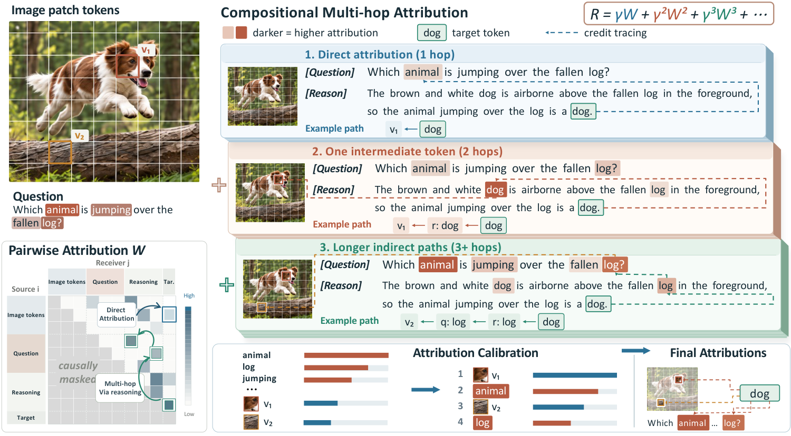

# VTrace · 从回答到视觉证据的多跳归因

<!-- CATEGORY NAV -->
[Teaser](../../teaser/README.md) · [Architecture](../README.md) · [Element](../../element/README.md) · [总目录](../../CATALOG.md)
<!-- END CATEGORY NAV -->

**Architecture · 原论文 Figure 4 · arXiv 2026**

## 内容与构图

用小狗跳过倒木的视觉问答展示直接归因、两跳和更长路径。左侧展开图像块与成对归因矩阵，底部对照校准前后的词元和图像块排序。

左侧输入图像块与成对归因矩阵，右侧三层路径，底部校准与最终归因。

- 逐层重复相同图片、问题和推理文字，虚线与短路径标签交代每一跳增加了哪个中间词元。
- 保留局部矩阵、文本路径和最终排序三种视图，让公式与具体图像块有可查的对应。

同类构图可对照 [FlashTrace Figure 2](../flashtrace-span-recursive-attribution/README.md)。

## 贯穿示例的架构图

[VoxPoser](../voxposer-drawer-value-map-planning/README.md) · [G-Retriever](../g-retriever-graph-question-walkthrough/README.md)

## 文件与编辑范围

[作者独立 PDF](original.pdf) · [SVG 转换件](source.svg) · [LaTeX 插图定义](figure-inclusion.tex) · [来源与校验记录](metadata.json)

作者 PDF 含 400 个矢量绘图对象、273 个文本片段和 14 个嵌入位图对象。SVG 将文字转为轮廓，并保留原有位图。桌面 Illustrator 尚未实测。

## 原始出处

*Tracing the Evidence: Faithful Token Attribution Through Vision-Language Reasoning*。Bowen Yuan、Danny Wang、Ruihong Qiu、Zijian Wang、Zi Huang。原图为 `2609.37656v1` 源包的 `figures/method_fig.pdf`。插图定义位于 `content/3_Methodology.tex`。[固定版论文](https://arxiv.org/abs/2609.37656v1) · [论文 PDF 第 5 页](https://arxiv.org/pdf/2609.37656v1#page=5) · [LaTeX 源码包](https://arxiv.org/src/2609.37656v1) · [作者项目或发布页](https://vtrace-attribution.github.io/)

## 权利与转换记录

所收录 arXiv 版本标注 CC BY 4.0。保留作者署名和出处，图中第三方图像的权利以原出处为准。作者 PDF 按原字节保存，PNG 和 SVG 由该 PDF 转换。[所收录版本许可](https://creativecommons.org/licenses/by/4.0/) · [权利记录](RIGHTS.source.txt)

<!-- BEGIN FIGURE LINKS -->
## 关联范例与元素

**可搭配的现有元素：** [图像块线性投影模块](../../element/svg/vit-patch-projection.svg) · [匹配相似度矩阵](../../element/svg/lightglue-assignment-matrix.svg) · [柱状图符号](../../element/svg/tabler-chart-bar.svg)

这些元素按表达功能关联，并非从本论文原图拆出；来源和许可仍以各元素记录为准。

[范例与元素对照表](../../element/with-examples.md) · [元素分类目录](../../element/README.md)
<!-- END FIGURE LINKS -->
