# 顶会论文配图精选

[回到仓库首页](../README.md) · [全部 teaser](../examples/teasers/README.md) · [全部 architecture](../examples/architectures/README.md) · [逐项来源记录](top-conference-figures.json)

这轮人工逐页筛选 **18 张作者原图：6 张 teaser、12 张 architecture / framework**。其中 **16 张来自 10 篇已核实 Oral 的论文**，另有 2 张 SIGGRAPH 架构图，展示身份分开记录。

优先看图的表达：读者能否一眼看出核心想法、对照是否一致、信息流是否清楚、整体与局部是否有层级。没有把普通样例拼图全部当作 teaser，也没有按 Figure 1 编号判断图的作用。

## 先看这几张

| 你要表达什么 | 建议先看 | 借鉴重点 |
|---|---|---|
| 新旧范式的根本区别 | [VAR](#var-paradigm) · [DPO](#dpo-comparison) | 相同输入与视觉语法下突出变化；DPO 是位图参考 |
| 新任务、新交互能力 | [Genie](#genie-interaction) | 输入种类、操作和输出轨迹在一张图里对应 |
| 整体网络加局部模块 | [DiT](#dit-architecture) · [SD3](#sd3-mmdit-architecture) · [ViT](#vit-original-architecture) | 主干与 block 展开，保持符号和颜色一致 |
| 多视图、状态与三维重建 | [VGGT](#vggt-architecture) · [CUT3R](#cut3r-architecture) · [LGM](#lgm-architecture) | token、时间或视角对应关系 |
| 优化和可微渲染的闭环 | [3DGS](#gaussian-splatting-architecture) · [DreamGaussian](#dreamgaussian-architecture) | 正向操作、损失、梯度回传各自归位 |

## 文件的真实编辑范围

- **2 张结构全矢量**：DiT、SD3 的架构图。
- **14 张含原始矢量与位图**：可编辑矢量部分；照片、渲染结果，以及作者本来就栅格化的局部仍是图片。不同图的可拆程度不同。
- **2 张整图位图**：DPO 对照图、Genie 训练总览。保留原 PNG 与 PDF 摘图，不提供套壳 SVG，不称作可编辑模板。

16 张 SVG 均从作者原论文 PDF 提取转换，文字转为轮廓；另附单图 PDF。没有作者原生 AI 工程的条目不会标成原生 AI。具体对象数量、图片数量和转换过程见各条目 metadata.json。

## 会议与 Oral 身份核验

| 论文 | 会议 | 身份与依据 |
|---|---|---|
| VGGT: Visual Geometry Grounded Transformer | CVPR 2025 | [Oral · Best Paper](https://cvpr.thecvf.com/Conferences/2025/News/Awards_Press) |
| Continuous 3D Perception Model with Persistent State | CVPR 2025 | [Oral](https://github.com/CUT3R/CUT3R/blob/main/README.md) |
| Scalable Diffusion Models with Transformers | ICCV 2023 | [Oral](https://www.wpeebles.com/DiT) |
| LGM: Large Multi-View Gaussian Model for High-Resolution 3D Content Creation | ECCV 2024 | [Oral](https://me.kiui.moe/lgm/) |
| Visual Autoregressive Modeling: Scalable Image Generation via Next-Scale Prediction | NeurIPS 2024 | [Oral · Best Paper](https://neurips.cc/virtual/2024/oral/97960) |
| Direct Preference Optimization: Your Language Model is Secretly a Reward Model | NeurIPS 2023 | [Oral · Outstanding Paper](https://media.neurips.cc/Conferences/NeurIPS2023/NeurIPS2023-Press_Release.pdf) |
| An Image is Worth 16x16 Words: Transformers for Image Recognition at Scale | ICLR 2021 | [Oral](https://iclr.cc/virtual/2021/oral/3458) |
| DreamGaussian: Generative Gaussian Splatting for Efficient 3D Content Creation | ICLR 2024 | [Oral](https://dreamgaussian.github.io/) |
| Scaling Rectified Flow Transformers for High-Resolution Image Synthesis | ICML 2024 | [Oral](https://icml.cc/virtual/2024/oral/35548) |
| Genie: Generative Interactive Environments | ICML 2024 | [Oral](https://icml.cc/virtual/2024/oral/35508) |
| Instant Neural Graphics Primitives with a Multiresolution Hash Encoding | SIGGRAPH 2022 | [SIGGRAPH / TOG；未作 Oral 声明](https://nvlabs.github.io/instant-ngp/) |
| 3D Gaussian Splatting for Real-Time Radiance Field Rendering | SIGGRAPH 2023 | [SIGGRAPH / TOG；未作 Oral 声明](https://repo-sam.inria.fr/fungraph/3d-gaussian-splatting/) |

会议官网优先；部分论文使用作者项目页或官方代码仓库的明确 Oral 声明。核验日期：2026-10-27。不同文章的奖项与展示身份不互相推定。

## Teaser：概念、范式与能力

### VAR · 从逐 token 到逐尺度生成的范式对照

**NeurIPS 2024 · Oral · Figure 2** · 矢量 + 原有位图

**值得借鉴：** 同一张图比较语言自回归、图像逐 token 生成和逐尺度生成，核心差异直接表现为生成顺序与尺度变化。

[原文件](../examples/teasers/var-paradigm/source.svg) · [单图 PDF](../examples/teasers/var-paradigm/figure.pdf) · [说明与来源](../examples/teasers/var-paradigm/README.md)

### DPO · RLHF 与直接偏好优化的流程简化

**NeurIPS 2023 · Oral · Figure 1** · 整图位图，仅构图参考

[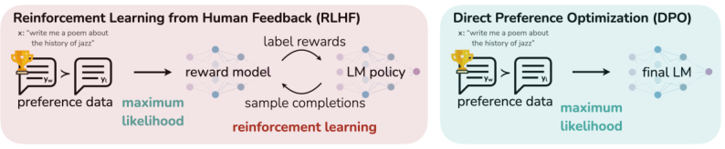](../examples/teasers/dpo-comparison/README.md)

**值得借鉴：** 左右两块使用同一输入与终点，只改变中间步骤；简化过程本身就是论文的主要观点。

[原文件](../examples/teasers/dpo-comparison/source.png) · [单图 PDF](../examples/teasers/dpo-comparison/figure.pdf) · [说明与来源](../examples/teasers/dpo-comparison/README.md)

### Genie · 不同提示生成可交互世界

**ICML 2024 · Oral · Figure 1** · 矢量 + 原有位图

[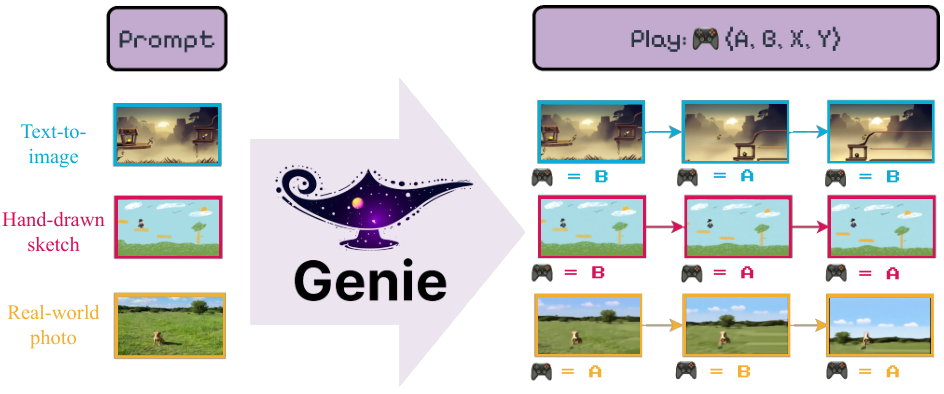](../examples/teasers/genie-interaction/README.md)

**值得借鉴：** 左侧三种输入沿统一箭头进入模型，右侧按动作展示连续变化；一张图同时回答输入是什么、输出是什么、为什么可交互。

[原文件](../examples/teasers/genie-interaction/source.svg) · [单图 PDF](../examples/teasers/genie-interaction/figure.pdf) · [说明与来源](../examples/teasers/genie-interaction/README.md)

### DreamGaussian · 生成能力与优化进程同图展示

**ICLR 2024 · Oral · Figure 1** · 矢量 + 原有位图

[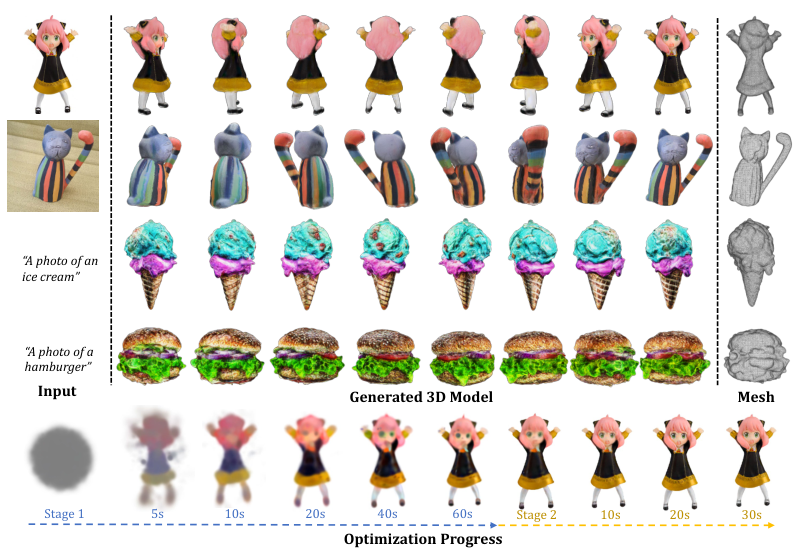](../examples/teasers/dreamgaussian-progress/README.md)

**值得借鉴：** 上方多视角结果说明输出能力，下方时间序列展示从模糊到成形的优化过程，让效率与质量成为同一视觉叙事。

[原文件](../examples/teasers/dreamgaussian-progress/source.svg) · [单图 PDF](../examples/teasers/dreamgaussian-progress/figure.pdf) · [说明与来源](../examples/teasers/dreamgaussian-progress/README.md)

### VGGT · 多视图输入与统一三维感知能力

**CVPR 2025 · Oral · Figure 1** · 矢量 + 原有位图

[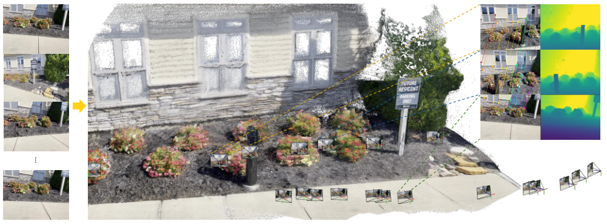](../examples/teasers/vggt-capabilities/README.md)

**值得借鉴：** 用一个大型三维场景作为视觉中心，两侧安排输入与多种输出，让读者先理解方法能做什么。

[原文件](../examples/teasers/vggt-capabilities/source.svg) · [单图 PDF](../examples/teasers/vggt-capabilities/figure.pdf) · [说明与来源](../examples/teasers/vggt-capabilities/README.md)

### CUT3R · 静态、动态与稀疏照片三类场景

**CVPR 2025 · Oral · Figure 1** · 矢量 + 原有位图

[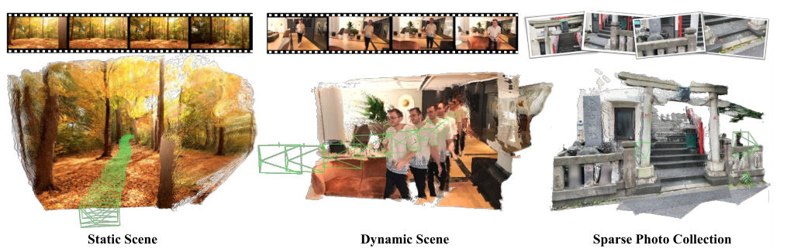](../examples/teasers/cut3r-capabilities/README.md)

**值得借鉴：** 三列分别说明输入场景和重建能力，借助同一版式把连续三维感知的应用范围讲清楚。

[原文件](../examples/teasers/cut3r-capabilities/source.svg) · [单图 PDF](../examples/teasers/cut3r-capabilities/figure.pdf) · [说明与来源](../examples/teasers/cut3r-capabilities/README.md)

## Architecture：已核实 Oral 论文

### DiT · 整体主干与三种条件注入模块

**ICCV 2023 · Oral · Figure 3** · 矢量结构

[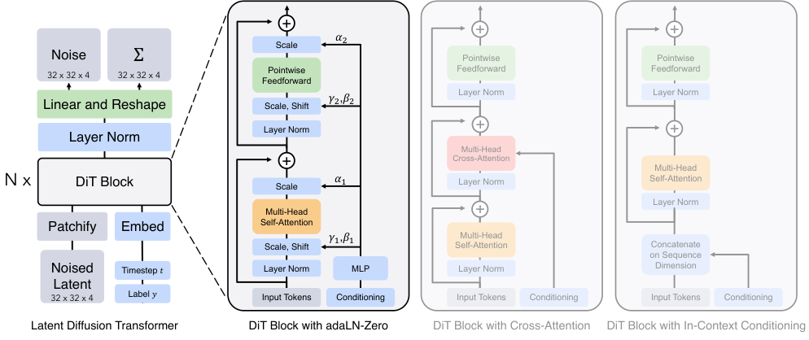](../examples/architectures/dit-architecture/README.md)

**值得借鉴：** 左侧给完整主干，右侧展开 block 变体；推荐模块使用更高视觉对比，完整展示论文的结构选择。

[原文件](../examples/architectures/dit-architecture/source.svg) · [单图 PDF](../examples/architectures/dit-architecture/figure.pdf) · [说明与来源](../examples/architectures/dit-architecture/README.md)

### SD3 · 双模态主干与 MM-DiT block 展开

**ICML 2024 · Oral · Figure 2** · 矢量结构

[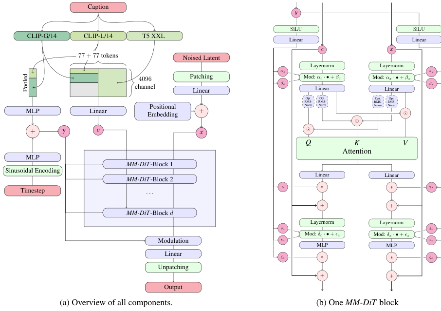](../examples/architectures/sd3-mmdit-architecture/README.md)

**值得借鉴：** 左侧说明文本与图像条件如何进入主干，右侧以对称双路结构展开联合注意力，颜色和符号在两部分保持一致。

[原文件](../examples/architectures/sd3-mmdit-architecture/source.svg) · [单图 PDF](../examples/architectures/sd3-mmdit-architecture/figure.pdf) · [说明与来源](../examples/architectures/sd3-mmdit-architecture/README.md)

### ViT 原论文 · 图像分块、token 序列与编码器展开

**ICLR 2021 · Oral · Figure 1** · 矢量 + 原有位图

[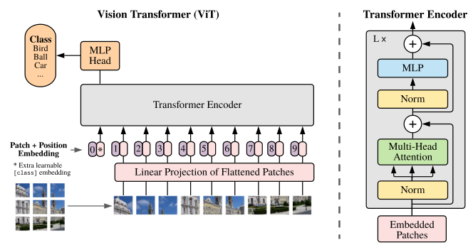](../examples/architectures/vit-original-architecture/README.md)

**值得借鉴：** 输入图像、patch 序列、位置编码和分类 token 都有直观的对应关系；右侧独立展开重复的 Transformer 编码器。

[原文件](../examples/architectures/vit-original-architecture/source.svg) · [单图 PDF](../examples/architectures/vit-original-architecture/figure.pdf) · [说明与来源](../examples/architectures/vit-original-architecture/README.md)

### VGGT · 交替注意力主干与多任务输出头

**CVPR 2025 · Oral · Figure 2** · 矢量 + 原有位图

[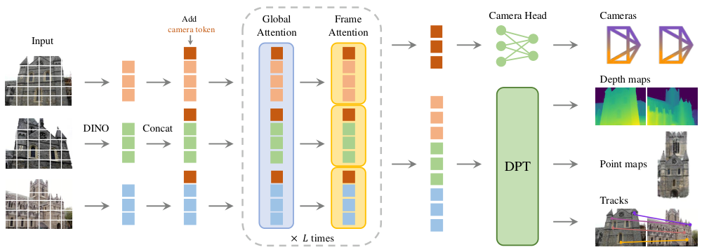](../examples/architectures/vggt-architecture/README.md)

**值得借鉴：** 整图始终沿左到右阅读；颜色区分 token，虚线框标出重复主干，右侧分组展开输出任务。

[原文件](../examples/architectures/vggt-architecture/source.svg) · [单图 PDF](../examples/architectures/vggt-architecture/figure.pdf) · [说明与来源](../examples/architectures/vggt-architecture/README.md)

### CUT3R · 持久状态的更新、读取与未见视角推断

**CVPR 2025 · Oral · Figure 3** · 矢量 + 原有位图

[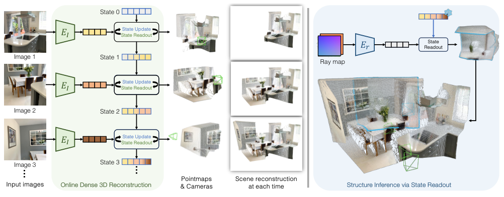](../examples/architectures/cut3r-architecture/README.md)

**值得借鉴：** 左侧按时间展开状态更新，右侧用独立色块解释状态读取；重建结果紧邻对应计算步骤。

[原文件](../examples/architectures/cut3r-architecture/source.svg) · [单图 PDF](../examples/architectures/cut3r-architecture/figure.pdf) · [说明与来源](../examples/architectures/cut3r-architecture/README.md)

### LGM · 从文本或图像到三维高斯和网格的流程

**ECCV 2024 · Oral · Figure 2** · 矢量 + 原有位图

[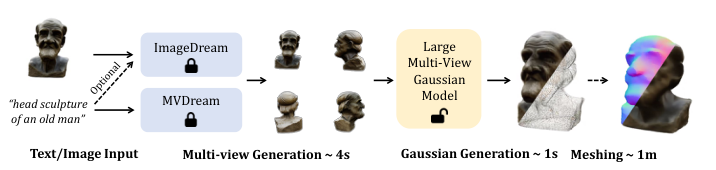](../examples/architectures/lgm-pipeline/README.md)

**值得借鉴：** 用少量大模块完成端到端说明，同时把各阶段耗时直接放在阶段下方，适合紧凑的方法总览。

[原文件](../examples/architectures/lgm-pipeline/source.svg) · [单图 PDF](../examples/architectures/lgm-pipeline/figure.pdf) · [说明与来源](../examples/architectures/lgm-pipeline/README.md)

### LGM · 非对称 U-Net 与跨视角注意力

**ECCV 2024 · Oral · Figure 3** · 矢量 + 原有位图

[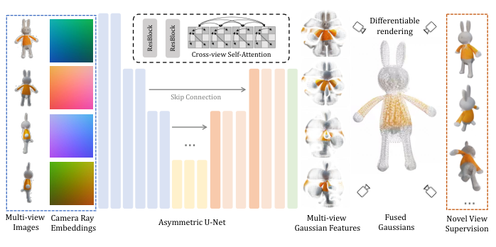](../examples/architectures/lgm-architecture/README.md)

**值得借鉴：** 把多视图输入、相机射线编码、U-Net、三维融合和监督闭环放在一张图里；顶部局部放大说明跨视角交互。

[原文件](../examples/architectures/lgm-architecture/source.svg) · [单图 PDF](../examples/architectures/lgm-architecture/figure.pdf) · [说明与来源](../examples/architectures/lgm-architecture/README.md)

### VAR · 多尺度 VQVAE 与 VAR 两阶段训练

**NeurIPS 2024 · Oral · Figure 4** · 矢量 + 原有位图

[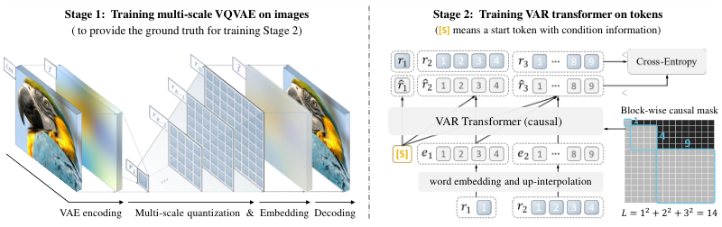](../examples/architectures/var-architecture/README.md)

**值得借鉴：** 两块并列区域分别解释表示学习和自回归训练，尺度、token 序列和因果 mask 的对应关系可在图中追踪。

[原文件](../examples/architectures/var-architecture/source.svg) · [单图 PDF](../examples/architectures/var-architecture/figure.pdf) · [说明与来源](../examples/architectures/var-architecture/README.md)

### DreamGaussian · 高斯生成、网格提取与纹理细化

**ICLR 2024 · Oral · Figure 2** · 矢量 + 原有位图

[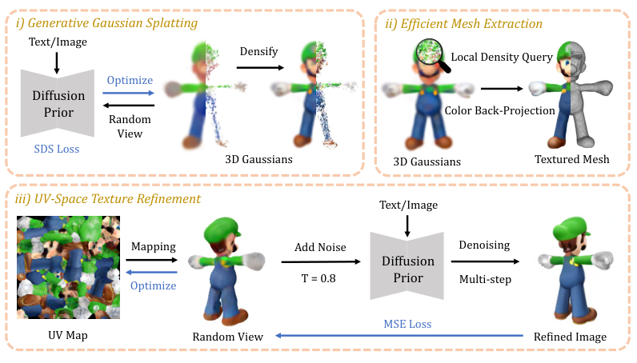](../examples/architectures/dreamgaussian-architecture/README.md)

**值得借鉴：** 三个带编号的区域分别解释表示初始化、表示转换和后续细化，同时把不同损失放在对应优化回路内。

[原文件](../examples/architectures/dreamgaussian-architecture/source.svg) · [单图 PDF](../examples/architectures/dreamgaussian-architecture/figure.pdf) · [说明与来源](../examples/architectures/dreamgaussian-architecture/README.md)

### Genie · 视频 tokenizer、潜在动作与动力学模型

**ICML 2024 · Oral · Figure 3** · 整图位图，仅构图参考

[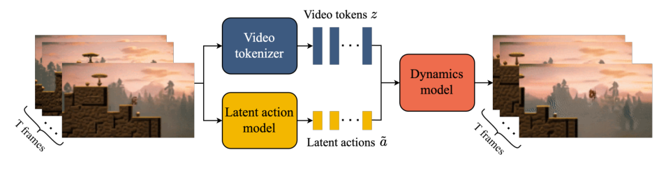](../examples/architectures/genie-architecture/README.md)

**值得借鉴：** 只保留三个核心模块，视频 tokens 与潜在动作分别编码后汇入动力学模型；简单分支就讲清训练信息来源。

[原文件](../examples/architectures/genie-architecture/source.png) · [单图 PDF](../examples/architectures/genie-architecture/figure.pdf) · [说明与来源](../examples/architectures/genie-architecture/README.md)

## SIGGRAPH 架构精选

### Instant NGP · 多分辨率哈希编码到 MLP

**SIGGRAPH 2022 · 会议论文 · Figure 3** · 矢量 + 原有位图

[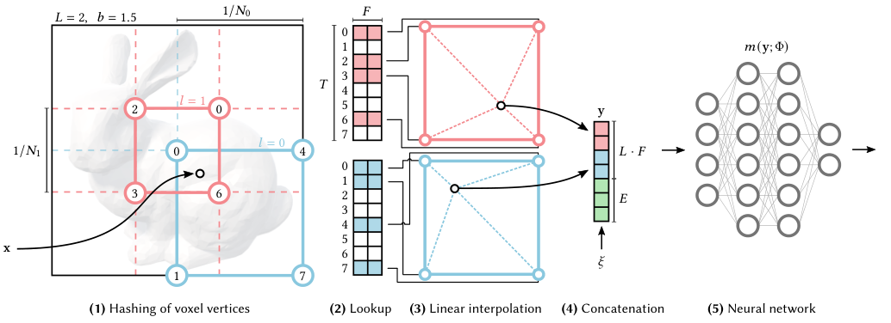](../examples/architectures/instant-ngp-hash-architecture/README.md)

**值得借鉴：** 通过五个编号步骤，将空间采样、哈希查表、插值、拼接与网络连接起来；不同尺度的颜色可贯穿整张图。

[原文件](../examples/architectures/instant-ngp-hash-architecture/source.svg) · [单图 PDF](../examples/architectures/instant-ngp-hash-architecture/figure.pdf) · [说明与来源](../examples/architectures/instant-ngp-hash-architecture/README.md)

### 3D Gaussian Splatting · 优化与光栅化双向流程

**SIGGRAPH 2023 · 会议论文 · Figure 2** · 矢量 + 原有位图

[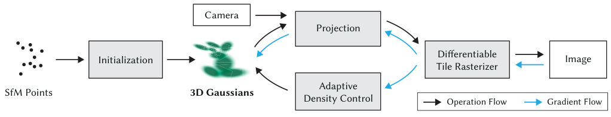](../examples/architectures/gaussian-splatting-architecture/README.md)

**值得借鉴：** 黑色实线和蓝色箭头分别表达正向操作与梯度回传，让自适应密度控制与可微渲染的关系无需依赖长图注。

[原文件](../examples/architectures/gaussian-splatting-architecture/source.svg) · [单图 PDF](../examples/architectures/gaussian-splatting-architecture/figure.pdf) · [说明与来源](../examples/architectures/gaussian-splatting-architecture/README.md)

## 收录与重用

保持作者署名和原来源。原文 CC BY、CC0 或未单独授予第三方重用权的状态已逐项记录；不对第三方素材统一重新授权。
这是一份私人参考库；改成自己的论文图时，应使用自己的内容与研究结论，按原许可处理需要保留的图元。
