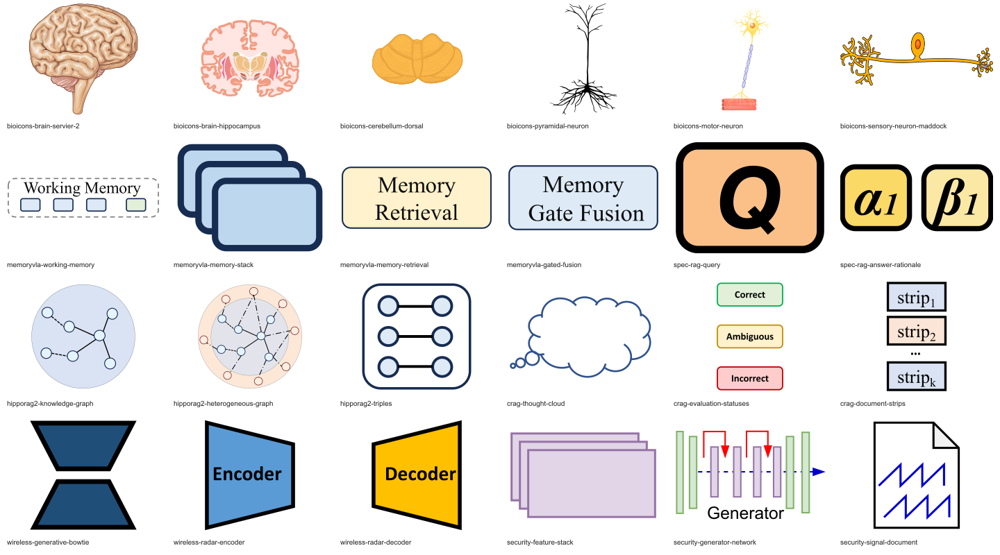

# 新增元素 · 2026-11-05

[Element 总目录](../element/README.md) · [内容分类](../element/README.md#按内容浏览) · [论文范例与元素对应](../element/with-examples.md)

新增 **51 个独立 SVG**：38 个论文矢量拆件、13 个 Bioicons 原件。元素库合计 **392 个**。

## 论文原图拆件

只复制作者独立 PDF 转换 SVG 中已有的节点，不重画，不包含嵌入位图。部分拆件排除了原图的位图阴影；节点路径、原图 SHA256 和画布范围记录在 [提取清单](../element/vector-parts.json)。

| 来源 | 数量 | 部件 |
|---|---:|---|
| [MemoryVLA 原图部件](../architecture/memoryvla-perceptual-cognitive-architecture/README.md) | 13 | [MemoryVLA 视觉编码器](../element/svg/memoryvla-vision-encoder.svg) · [MemoryVLA 投影模块](../element/svg/memoryvla-projector.svg) · [文本 Tokenizer 模块](../element/svg/memoryvla-text-tokenizer.svg) · [MemoryVLA 语言模型块](../element/svg/memoryvla-language-model.svg) · [感知压缩模块](../element/svg/memoryvla-perceptual-compression.svg) · [工作记忆与 Token 组](../element/svg/memoryvla-working-memory.svg) · [记忆检索模块](../element/svg/memoryvla-memory-retrieval.svg) · [记忆门控融合模块](../element/svg/memoryvla-gated-fusion.svg) · [记忆巩固模块](../element/svg/memoryvla-consolidation.svg) · [认知注意力模块](../element/svg/memoryvla-cognition-attention.svg) · [感知注意力模块](../element/svg/memoryvla-perception-attention.svg) · [层叠记忆条目](../element/svg/memoryvla-memory-stack.svg) · [时间步嵌入菱形](../element/svg/memoryvla-timestep-diamond.svg) |
| [无线感知综述原图部件](../teaser/survey-genai-wireless-four-scenarios/README.md) | 6 | [生成模型双梯形符号](../element/svg/wireless-generative-bowtie.svg) · [雷达编码器梯形](../element/svg/wireless-radar-encoder.svg) · [雷达解码器梯形](../element/svg/wireless-radar-decoder.svg) · [特征提取梯形](../element/svg/wireless-feature-extractor.svg) · [判别器梯形](../element/svg/wireless-discriminator.svg) · [CSI 菱形输入序列](../element/svg/wireless-csi-input.svg) |
| [Speculative RAG 原图部件](../architecture/speculative-rag-draft-verify/README.md) | 5 | [知识查询 Q 标记](../element/svg/spec-rag-query.svg) · [证据支持答案 A 标记](../element/svg/spec-rag-answer.svg) · [同主题检索文档组](../element/svg/spec-rag-topic-documents.svg) · [答案与依据配对标记](../element/svg/spec-rag-answer-rationale.svg) · [方法阶段箭头带](../element/svg/spec-rag-stage-chevron.svg) |
| [HippoRAG 2 原图部件](../architecture/hipporag2-indexing-retrieval-framework/README.md) | 4 | [图谱检索文档图标](../element/svg/hipporag2-passage.svg) · [三元组关系表](../element/svg/hipporag2-triples.svg) · [单层知识图谱节点组](../element/svg/hipporag2-knowledge-graph.svg) · [短语与文档双层图谱](../element/svg/hipporag2-heterogeneous-graph.svg) |
| [CRAG 原图部件](../architecture/crag-evaluate-correct-generate/README.md) | 5 | [检索评估思考气泡轮廓](../element/svg/crag-thought-cloud.svg) · [检索评估状态标记（三种变体）](../element/svg/crag-evaluation-statuses.svg) · [分解后的文档条带](../element/svg/crag-document-strips.svg) · [内部知识块 k-in](../element/svg/crag-internal-knowledge.svg) · [空心流程箭头](../element/svg/crag-hollow-arrow.svg) |
| [A-MEM 原图部件](../architecture/amem-notes-links-evolution-framework/README.md) | 1 | [查询嵌入向量条](../element/svg/amem-embedding-vector.svg) |
| [无线安全综述原图部件](../teaser/survey-genai-wireless-security-four-panels/README.md) | 4 | [带信号的文档符号](../element/svg/security-signal-document.svg) · [多层特征图堆叠](../element/svg/security-feature-stack.svg) · [生成器层结构](../element/svg/security-generator-network.svg) · [损失计算模块](../element/svg/security-loss-calculation.svg) |

## 原生脑区与神经元

这些图来自 Bioicons 的固定提交，与论文原图中的脑部插画是不同来源。原文件字节不变，保留 CC0、CC BY 3.0 或 CC BY 4.0 的具体许可与作者。8 个文件带有旧版 Illustrator XML 扩展，原件以 `.svg.source` 保留；兼容副本仅展开命名空间实体并移除非显示用的 1×1 PGF 引用，矢量几何与样式不变。其他 5 个 SVG 原字节提供。

| 元素 | 作者 | 许可 | 原件 |
|---|---|---|---|
| [锥体神经元](../element/svg/bioicons-pyramidal-neuron.svg) | Fabian-Mikulasch | CC0-1.0 | [原始下载件](../element/svg/bioicons-pyramidal-neuron.svg) |
| [大脑侧视图（Servier）](../element/svg/bioicons-brain-servier-1.svg) | Servier | CC-BY-3.0 | [原始下载件](../element/svg/bioicons-brain-servier-1.svg) |
| [大脑与脑干（Servier）](../element/svg/bioicons-brain-servier-2.svg) | Servier | CC-BY-3.0 | [原始下载件](../element/svg/bioicons-brain-servier-2.svg) |
| [神经元（DBCLS）](../element/svg/bioicons-neuron-dbcls.svg) | DBCLS | CC-BY-4.0 | [原始下载件](../element/svg/bioicons-neuron-dbcls.svg) |
| [感觉神经元（Maddock）](../element/svg/bioicons-sensory-neuron-maddock.svg) | Marnie-Maddock | CC-BY-4.0 | [原始下载件](../element/svg/bioicons-sensory-neuron-maddock.svg) |
| [小脑背侧视图](../element/svg/bioicons-cerebellum-dorsal.svg) | DBCLS | CC-BY-4.0 | [原始下载件](../element/sources/bioicons-neuroscience/bioicons-cerebellum-dorsal.svg.source) |
| [小脑分区](../element/svg/bioicons-cerebellum-divisions.svg) | DBCLS | CC-BY-4.0 | [原始下载件](../element/sources/bioicons-neuroscience/bioicons-cerebellum-divisions.svg.source) |
| [脑冠状面与杏仁核定位](../element/svg/bioicons-brain-amygdala.svg) | DBCLS | CC-BY-4.0 | [原始下载件](../element/sources/bioicons-neuroscience/bioicons-brain-amygdala.svg.source) |
| [脑冠状面与海马定位](../element/svg/bioicons-brain-hippocampus.svg) | DBCLS | CC-BY-4.0 | [原始下载件](../element/sources/bioicons-neuroscience/bioicons-brain-hippocampus.svg.source) |
| [大脑水平切面](../element/svg/bioicons-brain-horizontal.svg) | DBCLS | CC-BY-4.0 | [原始下载件](../element/sources/bioicons-neuroscience/bioicons-brain-horizontal.svg.source) |
| [中间神经元](../element/svg/bioicons-interneuron.svg) | DBCLS | CC-BY-4.0 | [原始下载件](../element/sources/bioicons-neuroscience/bioicons-interneuron.svg.source) |
| [运动神经元](../element/svg/bioicons-motor-neuron.svg) | DBCLS | CC-BY-4.0 | [原始下载件](../element/sources/bioicons-neuroscience/bioicons-motor-neuron.svg.source) |
| [感觉神经元（DBCLS）](../element/svg/bioicons-sensory-neuron-dbcls.svg) | DBCLS | CC-BY-4.0 | [原始下载件](../element/sources/bioicons-neuroscience/bioicons-sensory-neuron-dbcls.svg.source) |

[新增元素完整总览 SVG](../element/overviews/latest-additions.svg) · [逐项来源记录](../sources/element-update-2026-11-05.json)

论文图中标作“从本图拆出的部件”的才是原图拆件；脑区等其他素材列为功能关联。
