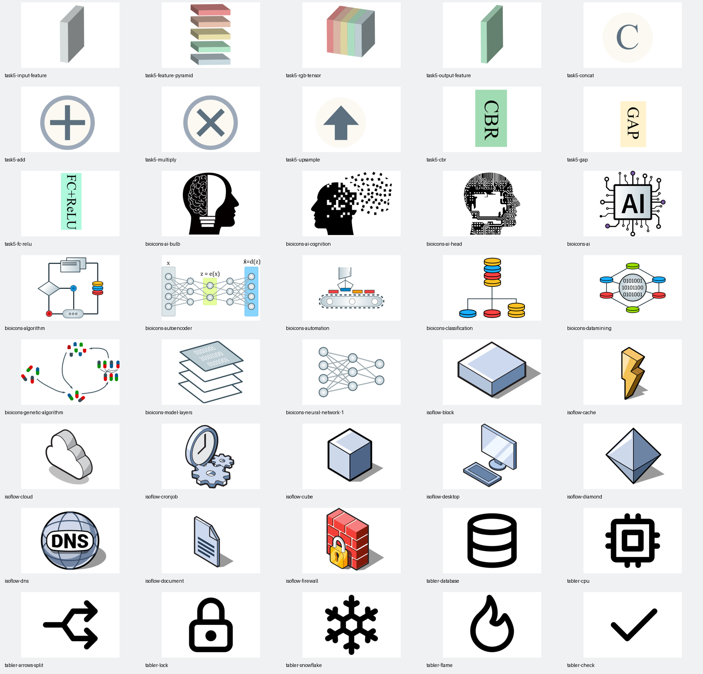
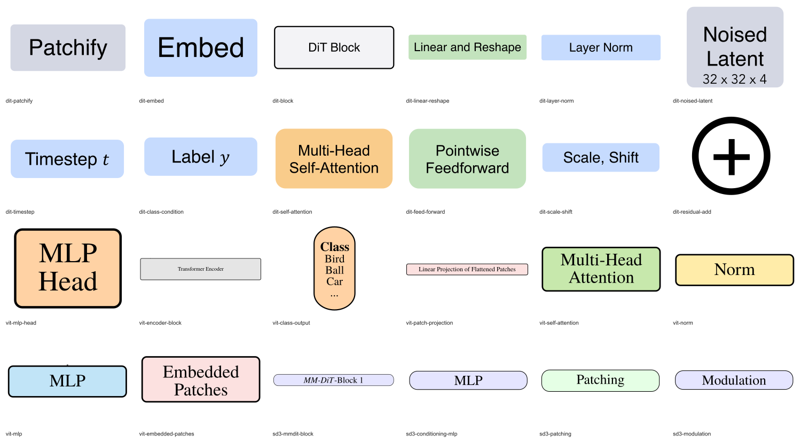

# Element · 元素库

[Teaser](../teaser/README.md) · [Architecture](../architecture/README.md) · [总目录](../CATALOG.md)

**341 个独立 SVG**，全部为外部下载或现有原图节点的提取。

[范例与元素对照表](with-examples.md)：从完整范例找部件，也可从各元素分类页反查关联范例。原图拆件与功能关联分别标明。

[离线搜索与筛选](gallery.html)（下载仓库后直接打开） · [完整总览 SVG](all-elements.svg) · [逐项来源、许可与署名](catalog.json)

## 论文原图网络部件

注意力、嵌入、归一化、前馈、残差与条件调制等独立节点，保留各自原图及精确提取记录。

## 按内容浏览

| 分类 | 数量 | 入口 |
|---|---:|---|
| 网络与模块 | 66 | [图文目录](by-category/modules.md) |
| 数据与文档 | 58 | [图文目录](by-category/data.md) |
| 运算与变换 | 39 | [图文目录](by-category/operations.md) |
| 箭头与连接 | 63 | [图文目录](by-category/connections.md) |
| 训练与标记 | 42 | [图文目录](by-category/training.md) |
| 设备与对象 | 54 | [图文目录](by-category/devices.md) |
| 科学与图表 | 19 | [图文目录](by-category/science.md) |

## 按来源浏览

| 来源 | 数量 | 说明 |
|---|---:|---|
| [Towaki CC0](by-source/source-1.md) | 5 | 保留作者原图或精确提取位置 |
| [RUST 原图部件](by-source/source-2.md) | 7 | 保留作者原图或精确提取位置 |
| [LightGlue 原图部件](by-source/source-3.md) | 4 | 保留作者原图或精确提取位置 |
| [Tabler outline](by-source/source-4.md) | 160 | 保留作者原图或精确提取位置 |
| [Bioicons](by-source/source-5.md) | 100 | 保留作者原图或精确提取位置 |
| [Isoflow](by-source/source-6.md) | 30 | 保留作者原图或精确提取位置 |
| [Illustrator task5 source](by-source/source-7.md) | 11 | 保留作者原图或精确提取位置 |
| [DiT 原图部件](by-source/source-8.md) | 12 | 保留作者原图或精确提取位置 |
| [ViT 原图部件](by-source/source-9.md) | 8 | 保留作者原图或精确提取位置 |
| [SD3 原图部件](by-source/source-10.md) | 4 | 保留作者原图或精确提取位置 |

原始下载件不改色、不重画。AI 教程、RUST 等未明确单独图形授权的部件保留为参考，其他素材逐项保留 CC0、CC BY、MIT 等原许可。
完整的卷积、池化与注意力机制图见 [机制参考目录](../references/mechanisms/README.md)，不混入本页的最小元素计数。
