# 箭头与连接

[返回 Element](../README.md) · [Teaser](../../teaser/README.md) · [Architecture](../../architecture/README.md) · [范例与元素对照表](../with-examples.md)

关联范例按表达功能互链；是否为原图拆件见对照表与元素来源记录。

| 预览 | 名称与 SVG | 来源与许可 | 关联范例（最多列三项） |
|---|---|---|---|
| 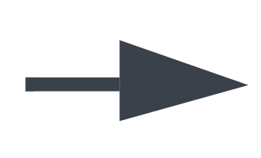 | [右向流程箭头](../../element/svg/rust-arrow-right.svg) | RUST 原图部件 · 原项目未发现独立图形授权；仅作出处明确的参考 | [D2L · 编码器—解码器](../../architecture/d2l-encoder-decoder/README.md) · [RUST：编码器、场景表示与位姿分支](../../architecture/rust/README.md) |
| 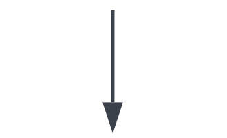 | [下向流程箭头](../../element/svg/rust-arrow-down.svg) | RUST 原图部件 · 原项目未发现独立图形授权；仅作出处明确的参考 | [RUST：编码器、场景表示与位姿分支](../../architecture/rust/README.md) |
| 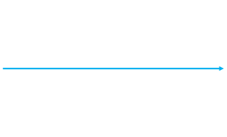 | [蓝色流程箭头](../../element/svg/lightglue-flow-arrow.svg) | LightGlue 原图部件 · Apache-2.0（LightGlue 来源仓库） | [LightGlue：注意力、动态剪枝与匹配](../../architecture/lightglue/README.md) |
| 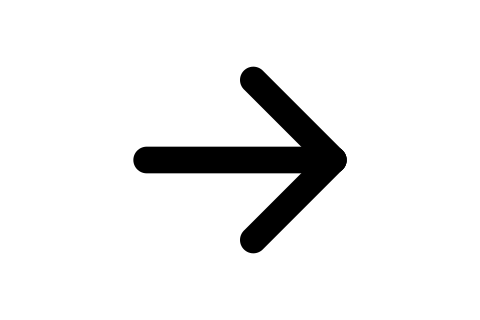 | [右箭头](../../element/svg/tabler-arrow-right.svg) | Tabler outline · MIT | [Genie · 不同提示生成可交互世界](../../teaser/genie-interaction/README.md) · [AI4Research · 科学发现的五区流程总览](../../teaser/survey-ai4research-discovery-cycle/README.md) · [可微仿真综述 · 十二个场景的双排时间线](../../teaser/survey-diffsim-twelve-scenes/README.md) |
| 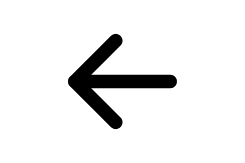 | [左箭头](../../element/svg/tabler-arrow-left.svg) | Tabler outline · MIT | — |
| 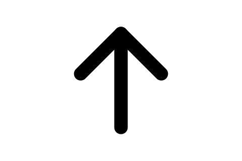 | [上箭头](../../element/svg/tabler-arrow-up.svg) | Tabler outline · MIT | — |
| 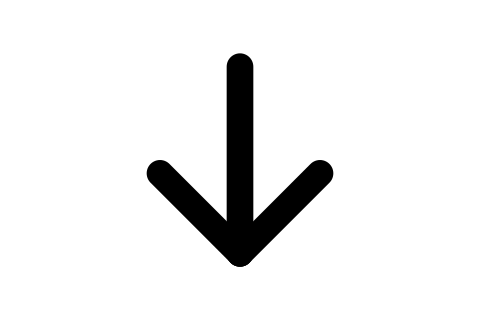 | [下箭头](../../element/svg/tabler-arrow-down.svg) | Tabler outline · MIT | — |
| 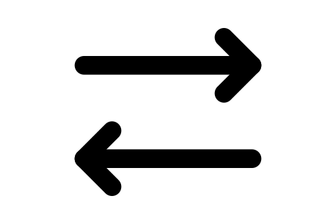 | [水平双向箭头](../../element/svg/tabler-arrows-right-left.svg) | Tabler outline · MIT | [DPO · RLHF 与直接偏好优化的流程简化](../../teaser/dpo-comparison/README.md) · [DreamGaussian · 生成能力与优化进程同图展示](../../teaser/dreamgaussian-progress/README.md) · [K-LoRA：主体风格组合与训练范式比较](../../teaser/k-lora/README.md) |
| 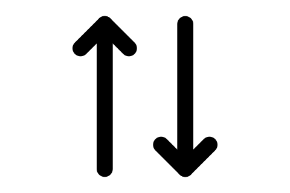 | [垂直双向箭头](../../element/svg/tabler-arrows-up-down.svg) | Tabler outline · MIT | — |
| 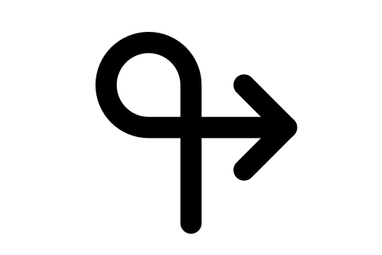 | [回环箭头](../../element/svg/tabler-arrow-loop-right.svg) | Tabler outline · MIT | [SAM 2 · 任务、模型与数据引擎三联概念图](../../teaser/sam2-task-model-data/README.md) · [AI for PDEs · 物理与数据条件下的三类方法对照](../../teaser/survey-ai-pde-physics-data-paradigms/README.md) · [世界模型能力递进 · 可信预测、可控干预与决策收益](../../teaser/survey-world-model-capability-ladder/README.md) |
| 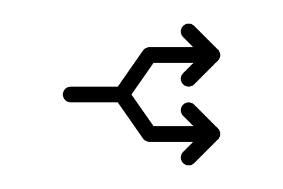 | [分流箭头](../../element/svg/tabler-arrows-split.svg) | Tabler outline · MIT | [3D／4D 世界模型方法地图 · 三棵功能树](../../teaser/survey-3d4d-method-tree/README.md) · [AI for PDEs · 领域定位、方法与应用全景](../../teaser/survey-ai-pde-scope-map/README.md) · [基础模型概念总览 · 多源数据与多任务适配](../../teaser/survey-foundation-model-adaptation/README.md) |
| 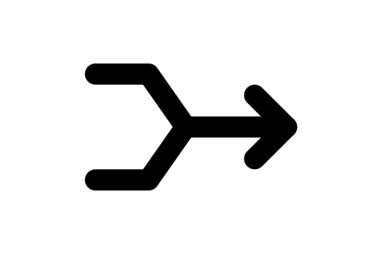 | [汇合箭头](../../element/svg/tabler-arrows-join.svg) | Tabler outline · MIT | — |
| 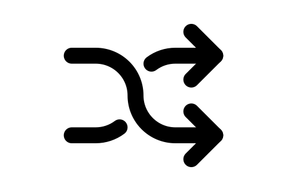 | [交叉连接](../../element/svg/tabler-arrows-shuffle.svg) | Tabler outline · MIT | — |
|  | [折线箭头](../../element/svg/tabler-arrow-elbow-right.svg) | Tabler outline · MIT | — |
| 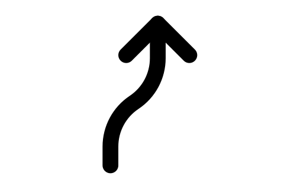 | [曲线箭头](../../element/svg/tabler-arrow-curve-right.svg) | Tabler outline · MIT | — |
| 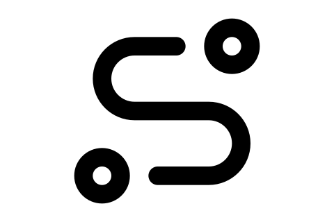 | [路径](../../element/svg/tabler-route.svg) | Tabler outline · MIT | [世界模型数据集图谱 · 蛇形时间路与模态卡片](../../teaser/survey-3d4d-dataset-roadmap/README.md) · [LLM 发布脉络 · 主轴与时间分支](../../teaser/survey-llm-release-timeline/README.md) · [语言模型四代能力演进 · 阶梯式概念图](../../teaser/survey-lm-capability-evolution/README.md) |
| 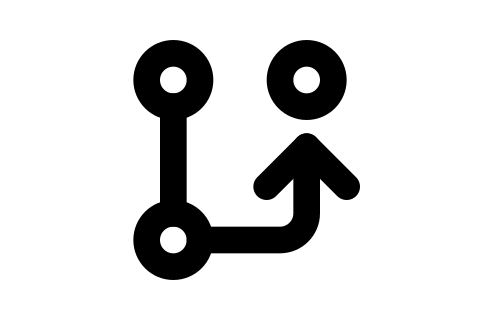 | [分支](../../element/svg/tabler-git-branch.svg) | Tabler outline · MIT | — |
| 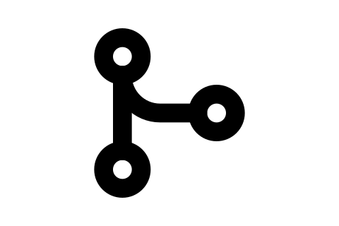 | [合并](../../element/svg/tabler-git-merge.svg) | Tabler outline · MIT | — |
| 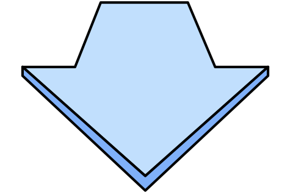 | [arrow-3d-forward](../../element/svg/bioicons-arrow-3d-forward.svg) | Bioicons · CC-BY-3.0 | — |
| 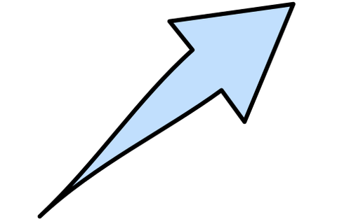 | [arrow-45deg-left](../../element/svg/bioicons-arrow-45deg-left.svg) | Bioicons · CC-BY-3.0 | — |
| 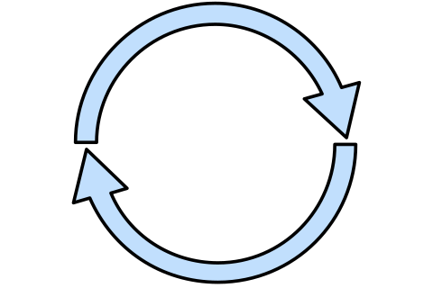 | [arrow-circular](../../element/svg/bioicons-arrow-circular.svg) | Bioicons · CC-BY-3.0 | — |
| 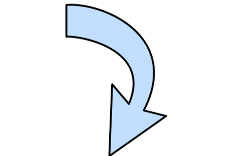 | [arrow-clockwise-4](../../element/svg/bioicons-arrow-clockwise-4.svg) | Bioicons · CC-BY-3.0 | — |
| 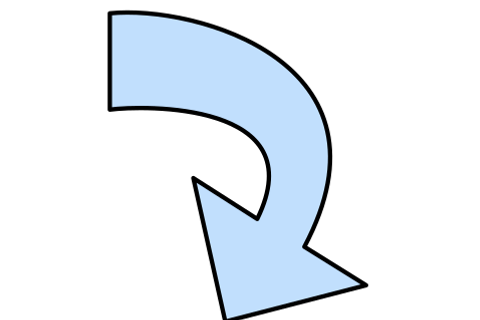 | [arrow-clockwise-5](../../element/svg/bioicons-arrow-clockwise-5.svg) | Bioicons · CC-BY-3.0 | — |
| 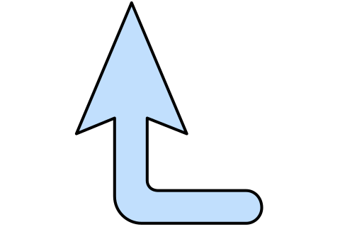 | [arrow-corner-left-up-2](../../element/svg/bioicons-arrow-corner-left-up-2.svg) | Bioicons · CC-BY-3.0 | — |
| 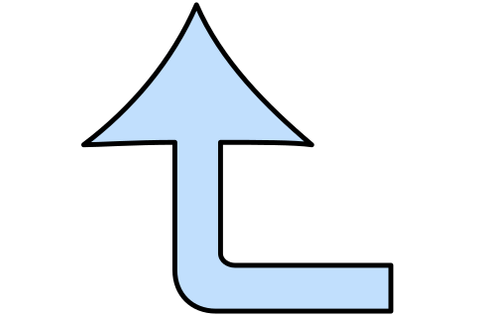 | [arrow-corner-left-up](../../element/svg/bioicons-arrow-corner-left-up.svg) | Bioicons · CC-BY-3.0 | — |
| 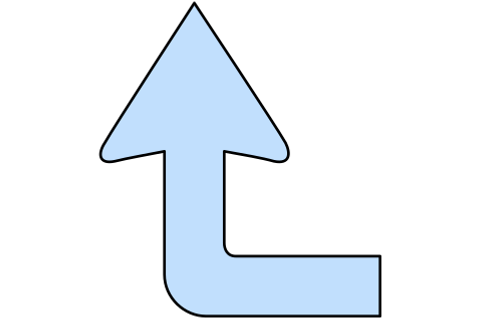 | [arrow-corner-up](../../element/svg/bioicons-arrow-corner-up.svg) | Bioicons · CC-BY-3.0 | — |
| 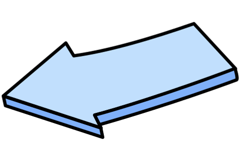 | [arrow-curved-clockwise-1](../../element/svg/bioicons-arrow-curved-clockwise-1.svg) | Bioicons · CC-BY-3.0 | — |
| 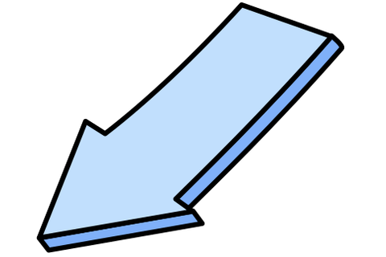 | [arrow-curved-clockwise-3](../../element/svg/bioicons-arrow-curved-clockwise-3.svg) | Bioicons · CC-BY-3.0 | — |
| 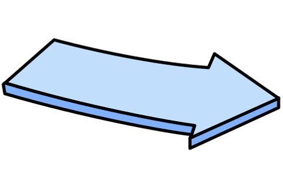 | [arrow-curved-counterclockwise-2](../../element/svg/bioicons-arrow-curved-counterclockwise-2.svg) | Bioicons · CC-BY-3.0 | — |
| 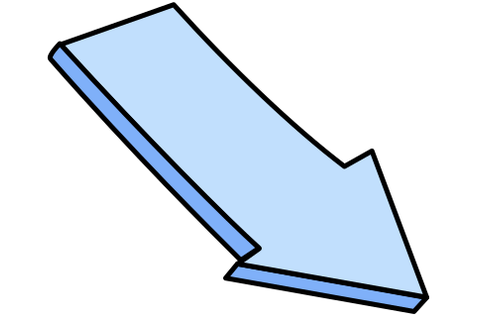 | [arrow-curved-counterclockwise-3](../../element/svg/bioicons-arrow-curved-counterclockwise-3.svg) | Bioicons · CC-BY-3.0 | — |
| 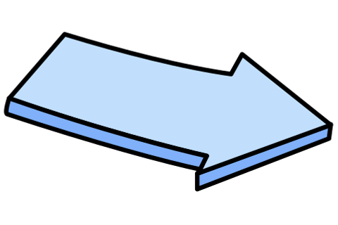 | [arrow-curved-counterclockwise-short](../../element/svg/bioicons-arrow-curved-counterclockwise-short.svg) | Bioicons · CC-BY-3.0 | — |
| 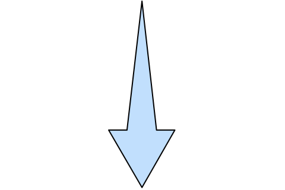 | [arrow-down-2](../../element/svg/bioicons-arrow-down-2.svg) | Bioicons · CC-BY-3.0 | — |
| 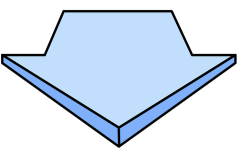 | [arrow-down-3d](../../element/svg/bioicons-arrow-down-3d.svg) | Bioicons · CC-BY-3.0 | — |
| 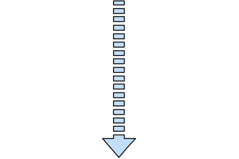 | [arrow-down-dotted](../../element/svg/bioicons-arrow-down-dotted.svg) | Bioicons · CC-BY-3.0 | — |
| 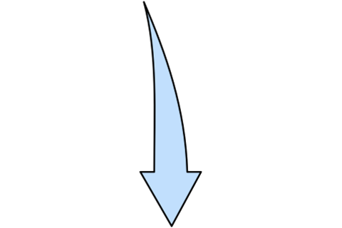 | [下箭头](../../element/svg/bioicons-arrow-down.svg) | Bioicons · CC-BY-3.0 | — |
| 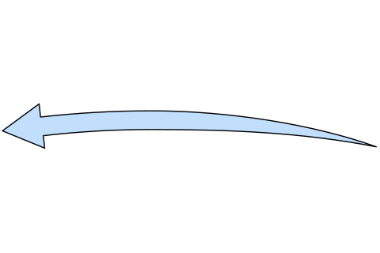 | [arrow-left-curved-1](../../element/svg/bioicons-arrow-left-curved-1.svg) | Bioicons · CC-BY-3.0 | — |
| 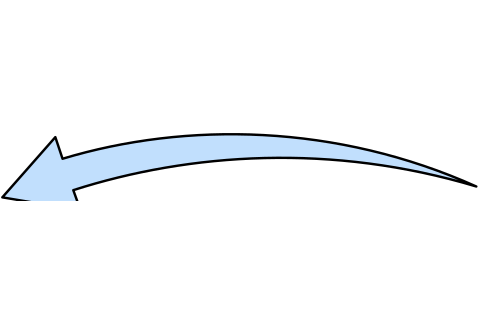 | [arrow-left-curved-2](../../element/svg/bioicons-arrow-left-curved-2.svg) | Bioicons · CC-BY-3.0 | — |
| 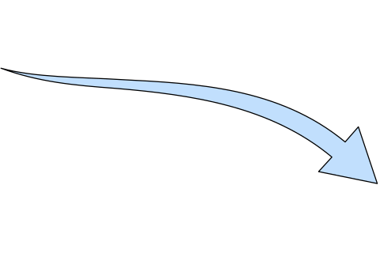 | [arrow-right-curved-3](../../element/svg/bioicons-arrow-right-curved-3.svg) | Bioicons · CC-BY-3.0 | — |
| 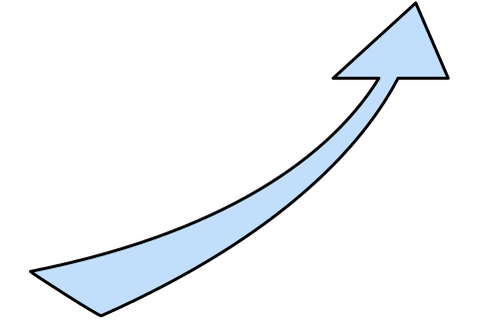 | [arrow-right-curved-4](../../element/svg/bioicons-arrow-right-curved-4.svg) | Bioicons · CC-BY-3.0 | — |
| 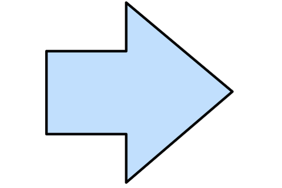 | [arrow-right-short](../../element/svg/bioicons-arrow-right-short.svg) | Bioicons · CC-BY-3.0 | — |
| 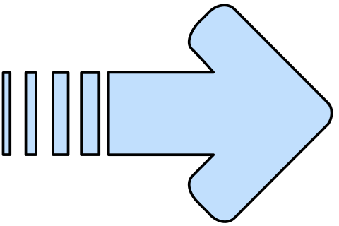 | [arrow-right-striped](../../element/svg/bioicons-arrow-right-striped.svg) | Bioicons · CC-BY-3.0 | — |
| 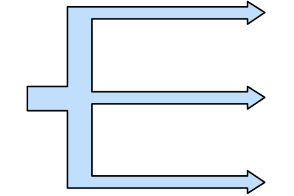 | [arrow-right-three-ends](../../element/svg/bioicons-arrow-right-three-ends.svg) | Bioicons · CC-BY-3.0 | — |
| 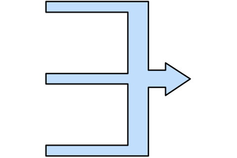 | [arrow-right-three-start](../../element/svg/bioicons-arrow-right-three-start.svg) | Bioicons · CC-BY-3.0 | — |
| 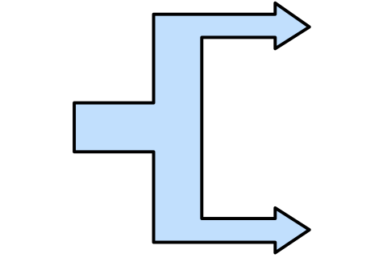 | [arrow-right-two-ends](../../element/svg/bioicons-arrow-right-two-ends.svg) | Bioicons · CC-BY-3.0 | — |
| 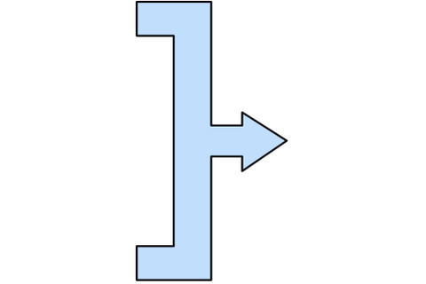 | [arrow-right-two-start](../../element/svg/bioicons-arrow-right-two-start.svg) | Bioicons · CC-BY-3.0 | — |
| 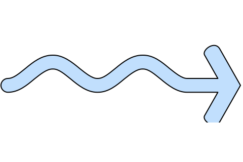 | [arrow-right-wavy-large](../../element/svg/bioicons-arrow-right-wavy-large.svg) | Bioicons · CC-BY-3.0 | — |
| 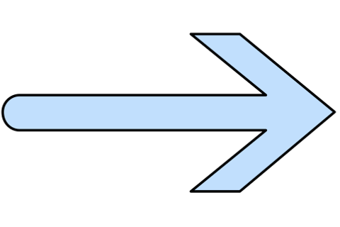 | [右箭头](../../element/svg/bioicons-arrow-right.svg) | Bioicons · CC-BY-3.0 | — |
| 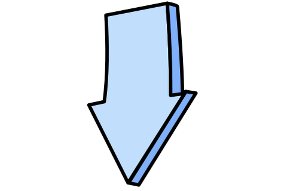 | [arrow-short-down](../../element/svg/bioicons-arrow-short-down.svg) | Bioicons · CC-BY-3.0 | — |
| 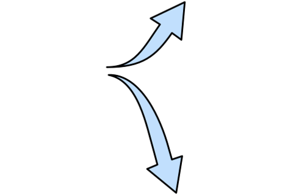 | [arrow-split-right](../../element/svg/bioicons-arrow-split-right.svg) | Bioicons · CC-BY-3.0 | — |
| 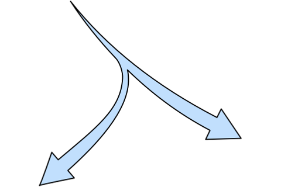 | [arrow-split](../../element/svg/bioicons-arrow-split.svg) | Bioicons · CC-BY-3.0 | — |
| 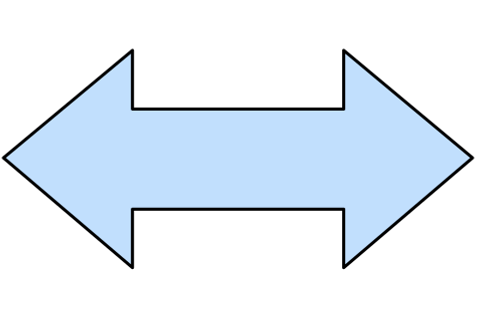 | [arrow-twosides-horizontal](../../element/svg/bioicons-arrow-twosides-horizontal.svg) | Bioicons · CC-BY-3.0 | — |
|  | [arrow-up-3d-2](../../element/svg/bioicons-arrow-up-3d-2.svg) | Bioicons · CC-BY-3.0 | — |
|  | [arrow-up-3d-3](../../element/svg/bioicons-arrow-up-3d-3.svg) | Bioicons · CC-BY-3.0 | — |
|  | [arrow-up-3d](../../element/svg/bioicons-arrow-up-3d.svg) | Bioicons · CC-BY-3.0 | — |
|  | [arrow-up-long](../../element/svg/bioicons-arrow-up-long.svg) | Bioicons · CC-BY-3.0 | — |
|  | [arrow-wavy-right-long](../../element/svg/bioicons-arrow-wavy-right-long.svg) | Bioicons · CC-BY-3.0 | — |
|  | [arrow-wavy-right-medium](../../element/svg/bioicons-arrow-wavy-right-medium.svg) | Bioicons · CC-BY-3.0 | — |
|  | [arrow-wavy-right-short](../../element/svg/bioicons-arrow-wavy-right-short.svg) | Bioicons · CC-BY-3.0 | — |
|  | [arrow-zigzag-up](../../element/svg/bioicons-arrow-zigzag-up.svg) | Bioicons · CC-BY-3.0 | — |
|  | [arrow3d-clockwise-1](../../element/svg/bioicons-arrow3d-clockwise-1.svg) | Bioicons · CC-BY-3.0 | — |
|  | [arrow3d-clockwise-2](../../element/svg/bioicons-arrow3d-clockwise-2.svg) | Bioicons · CC-BY-3.0 | — |
|  | [arrow3d-clockwise-3](../../element/svg/bioicons-arrow3d-clockwise-3.svg) | Bioicons · CC-BY-3.0 | — |
|  | [arrow3d-counterclockwise-1](../../element/svg/bioicons-arrow3d-counterclockwise-1.svg) | Bioicons · CC-BY-3.0 | — |
