# 数据与文档

[返回 Element](../README.md) · [Teaser](../../teaser/README.md) · [Architecture](../../architecture/README.md) · [范例与元素对照表](../with-examples.md)

关联范例按表达功能互链；是否为原图拆件见对照表与元素来源记录。

| 预览 | 名称与 SVG | 来源与许可 | 关联范例（最多列三项） |
|---|---|---|---|
| 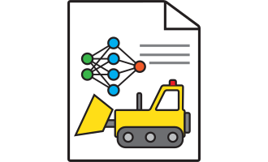 | [神经场论文图标](../../element/svg/towaki-neuralfieldpaper.svg) | Towaki CC0 · CC0-1.0 | — |
| 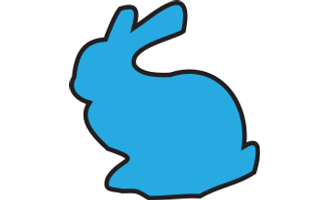 | [兔形图标](../../element/svg/towaki-bunny.svg) | Towaki CC0 · CC0-1.0 | — |
|  | [存储图标](../../element/svg/towaki-floppydisk.svg) | Towaki CC0 · CC0-1.0 | — |
| 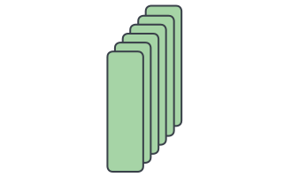 | [特征表示堆叠](../../element/svg/rust-feature-stack.svg) | RUST 原图部件 · 原项目未发现独立图形授权；仅作出处明确的参考 | [CUT3R · 持久状态的更新、读取与未见视角推断](../../architecture/cut3r-architecture/README.md) · [D2L · 编码器—解码器](../../architecture/d2l-encoder-decoder/README.md) · [Genie · 视频 tokenizer、潜在动作与动力学模型](../../architecture/genie-architecture/README.md) |
| 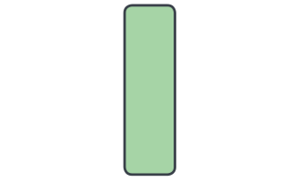 | [单层特征块](../../element/svg/rust-feature-tile.svg) | RUST 原图部件 · 原项目未发现独立图形授权；仅作出处明确的参考 | [D2L · Transformer 编码器与解码器](../../architecture/d2l-transformer/README.md) · [D2L · Vision Transformer](../../architecture/d2l-vit/README.md) · [DiT · 整体主干与三种条件注入模块](../../architecture/dit-architecture/README.md) |
|  | [匹配相似度矩阵](../../element/svg/lightglue-assignment-matrix.svg) | LightGlue 原图部件 · Apache-2.0（LightGlue 来源仓库） | [BLIP-2 · Q-Former 与三种注意力掩码](../../architecture/blip2-qformer-architecture/README.md) · [CLIP Figure 1：训练到零样本预测](../../architecture/clip/README.md) · [D2L · 带注意力的 Seq2Seq](../../architecture/d2l-seq2seq-attention/README.md) |
| 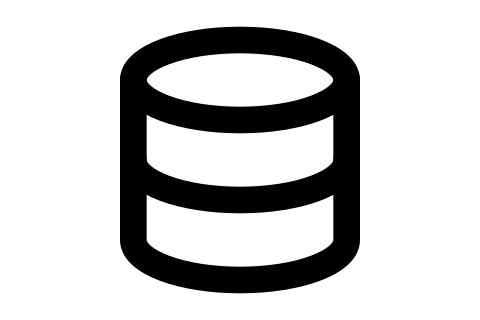 | [数据库](../../element/svg/tabler-database.svg) | Tabler outline · MIT | [世界模型数据集图谱 · 蛇形时间路与模态卡片](../../teaser/survey-3d4d-dataset-roadmap/README.md) · [AI for PDEs · 物理与数据条件下的三类方法对照](../../teaser/survey-ai-pde-physics-data-paradigms/README.md) · [基础模型生态 · 数据、模型与人的完整链条](../../teaser/survey-foundation-model-ecosystem/README.md) |
| 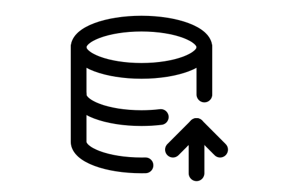 | [数据库导入](../../element/svg/tabler-database-import.svg) | Tabler outline · MIT | — |
| 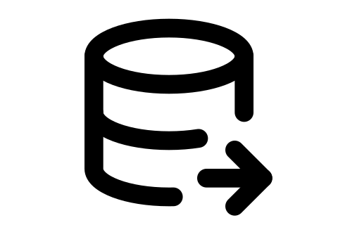 | [数据库导出](../../element/svg/tabler-database-export.svg) | Tabler outline · MIT | — |
|  | [数据库检索](../../element/svg/tabler-database-search.svg) | Tabler outline · MIT | — |
|  | [表格](../../element/svg/tabler-table.svg) | Tabler outline · MIT | — |
|  | [文件](../../element/svg/tabler-file.svg) | Tabler outline · MIT | — |
|  | [文本文件](../../element/svg/tabler-file-text.svg) | Tabler outline · MIT | [生物医学 PIML · 六面板方法范式总览](../../teaser/survey-biomedical-six-methods/README.md) · [基础模型概念总览 · 多源数据与多任务适配](../../teaser/survey-foundation-model-adaptation/README.md) · [指令式图像编辑 · 21 种任务的多子图总览](../../teaser/survey-instruction-editing-task-gallery/README.md) |
| 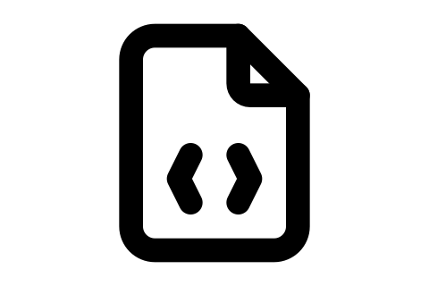 | [代码文件](../../element/svg/tabler-file-code.svg) | Tabler outline · MIT | — |
|  | [PDF 文件](../../element/svg/tabler-file-type-pdf.svg) | Tabler outline · MIT | — |
| 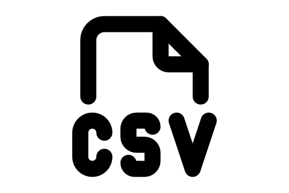 | [CSV 文件](../../element/svg/tabler-file-type-csv.svg) | Tabler outline · MIT | — |
|  | [多文件](../../element/svg/tabler-files.svg) | Tabler outline · MIT | — |
|  | [文件夹](../../element/svg/tabler-folder.svg) | Tabler outline · MIT | — |
|  | [多文件夹](../../element/svg/tabler-folders.svg) | Tabler outline · MIT | — |
|  | [图像](../../element/svg/tabler-photo.svg) | Tabler outline · MIT | [Uneven Double Refraction：原型与成像能力展示](../../teaser/birefractive-rgbd/README.md) · [CUT3R · 静态、动态与稀疏照片三类场景](../../teaser/cut3r-capabilities/README.md) · [DECOLLAGE：局部风格控制与三维细化](../../teaser/decollage/README.md) |
| 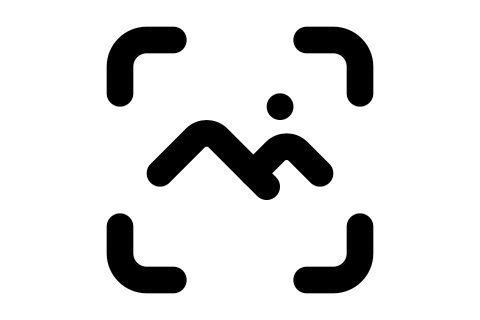 | [图像扫描](../../element/svg/tabler-photo-scan.svg) | Tabler outline · MIT | — |
| 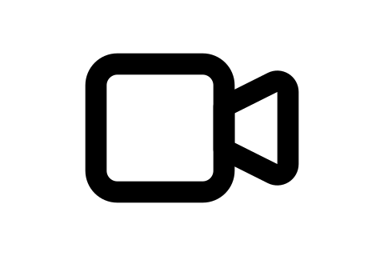 | [视频](../../element/svg/tabler-video.svg) | Tabler outline · MIT | [CUT3R · 静态、动态与稀疏照片三类场景](../../teaser/cut3r-capabilities/README.md) · [Genie · 不同提示生成可交互世界](../../teaser/genie-interaction/README.md) · [SAM 2 · 任务、模型与数据引擎三联概念图](../../teaser/sam2-task-model-data/README.md) |
|  | [音频](../../element/svg/tabler-music.svg) | Tabler outline · MIT | — |
| 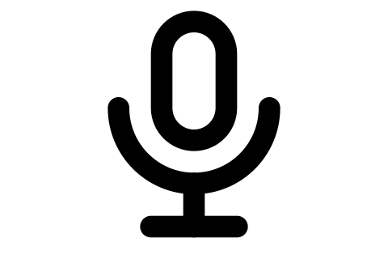 | [麦克风](../../element/svg/tabler-microphone.svg) | Tabler outline · MIT | — |
| 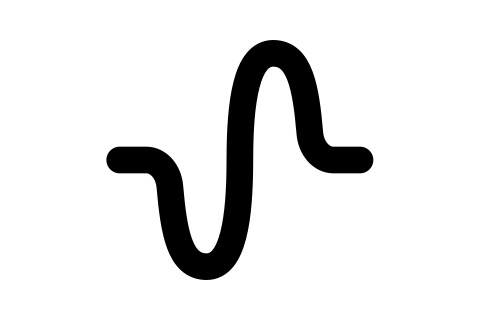 | [正弦信号](../../element/svg/tabler-wave-sine.svg) | Tabler outline · MIT | [AI for PDEs · 物理与数据条件下的三类方法对照](../../teaser/survey-ai-pde-physics-data-paradigms/README.md) · [AI for PDEs · 领域定位、方法与应用全景](../../teaser/survey-ai-pde-scope-map/README.md) · [AI4Science 领域圆环 · 从量子到连续系统](../../teaser/survey-ai4science-domain-wheel/README.md) |
|  | [四格网格](../../element/svg/tabler-layout-grid.svg) | Tabler outline · MIT | — |
| 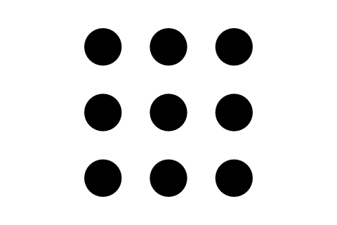 | [点阵](../../element/svg/tabler-grid-dots.svg) | Tabler outline · MIT | [PINN 综述 · 问题、损失与优化的多子图全景](../../teaser/survey-piml-optimization-landscape/README.md) |
| 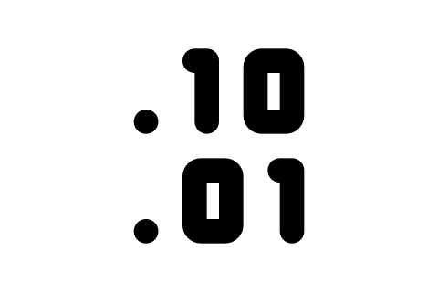 | [二进制](../../element/svg/tabler-binary.svg) | Tabler outline · MIT | — |
| 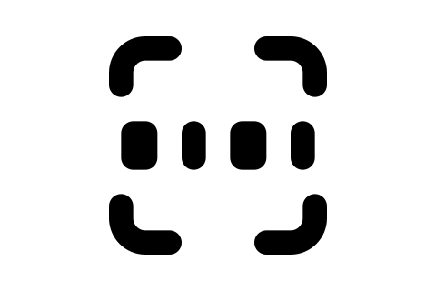 | [条形码](../../element/svg/tabler-barcode.svg) | Tabler outline · MIT | — |
| 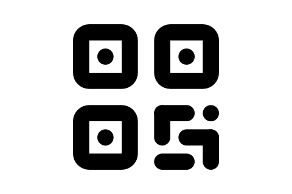 | [二维码](../../element/svg/tabler-qrcode.svg) | Tabler outline · MIT | — |
| 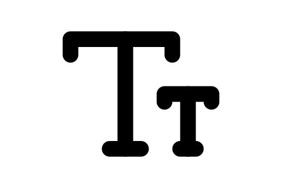 | [文本](../../element/svg/tabler-text-size.svg) | Tabler outline · MIT | — |
| 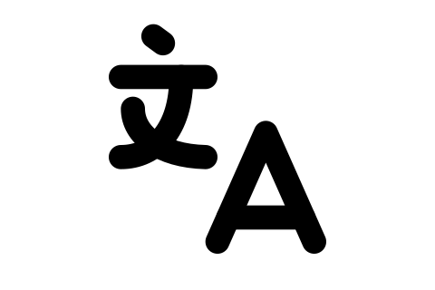 | [语言](../../element/svg/tabler-language.svg) | Tabler outline · MIT | — |
|  | [书籍](../../element/svg/tabler-book.svg) | Tabler outline · MIT | [3DGS 综述路线图 · 双侧分类地图](../../teaser/survey-3dgs-review-map/README.md) · [语言模型四代能力演进 · 阶梯式概念图](../../teaser/survey-lm-capability-evolution/README.md) |
|  | [多本书](../../element/svg/tabler-books.svg) | Tabler outline · MIT | — |
|  | [剪贴板](../../element/svg/tabler-clipboard.svg) | Tabler outline · MIT | — |
|  | [Document](../../element/svg/bioicons-document.svg) | Bioicons · CC0-1.0 | — |
| 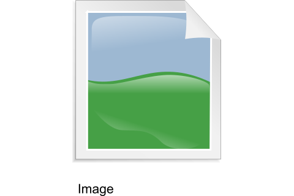 | [Image](../../element/svg/bioicons-image.svg) | Bioicons · CC0-1.0 | — |
| 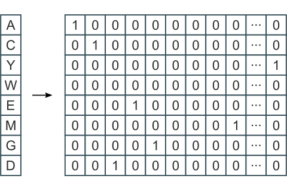 | [独热编码](../../element/svg/bioicons-onehotencoding.svg) | Bioicons · CC0-1.0 | — |
| 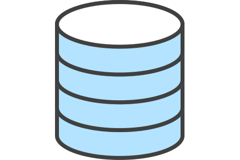 | [database-colored](../../element/svg/bioicons-database-colored.svg) | Bioicons · CC0-1.0 | — |
| 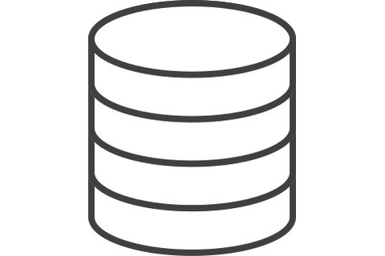 | [数据库](../../element/svg/bioicons-database.svg) | Bioicons · CC0-1.0 | — |
|  | [书籍](../../element/svg/bioicons-book.svg) | Bioicons · CC-BY-3.0 | — |
| 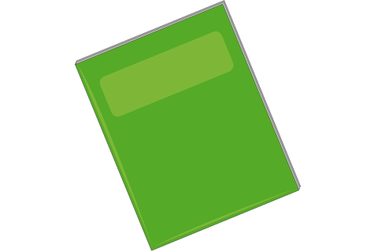 | [labbook](../../element/svg/bioicons-labbook.svg) | Bioicons · CC-BY-3.0 | — |
|  | [notepad](../../element/svg/bioicons-notepad.svg) | Bioicons · CC-BY-3.0 | — |
| 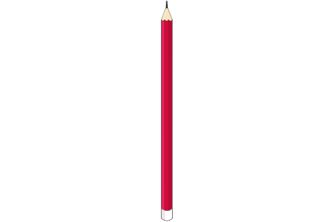 | [pencil](../../element/svg/bioicons-pencil.svg) | Bioicons · CC-BY-3.0 | — |
|  | [缓存](../../element/svg/isoflow-cache.svg) | Isoflow · MIT | — |
|  | [文档](../../element/svg/isoflow-document.svg) | Isoflow · MIT | — |
| 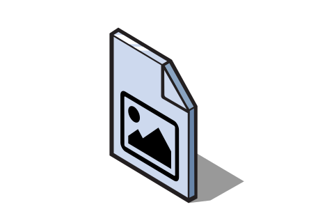 | [图像文件](../../element/svg/isoflow-image.svg) | Isoflow · MIT | — |
|  | [邮件](../../element/svg/isoflow-mail.svg) | Isoflow · MIT | — |
|  | [队列](../../element/svg/isoflow-queue.svg) | Isoflow · MIT | — |
| 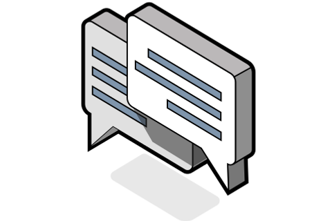 | [对话气泡](../../element/svg/isoflow-speech.svg) | Isoflow · MIT | — |
|  | [存储](../../element/svg/isoflow-storage.svg) | Isoflow · MIT | — |
| 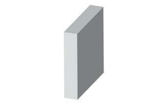 | [输入特征层](../../element/svg/task5-input-feature.svg) | Illustrator task5 source · 原作者未声明独立复用授权 | [多尺度网络总览与模块展开](../../architecture/multiscale-network/README.md) |
| 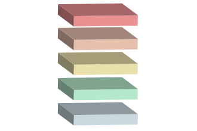 | [多尺度特征堆叠](../../element/svg/task5-feature-pyramid.svg) | Illustrator task5 source · 原作者未声明独立复用授权 | [MVSplat · 重建质量、速度与参数量的并列对照](../../teaser/mvsplat-comparison/README.md) · [VAR · 从逐 token 到逐尺度生成的范式对照](../../teaser/var-paradigm/README.md) · [Instant NGP · 多分辨率哈希编码到 MLP](../../architecture/instant-ngp-hash-architecture/README.md) |
| 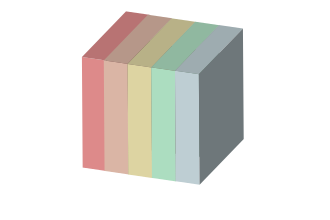 | [多通道彩色张量](../../element/svg/task5-rgb-tensor.svg) | Illustrator task5 source · 原作者未声明独立复用授权 | [VAR · 从逐 token 到逐尺度生成的范式对照](../../teaser/var-paradigm/README.md) · [D2L · AlexNet](../../architecture/d2l-alexnet/README.md) · [D2L · DenseNet 密集连接块](../../architecture/d2l-densenet-block/README.md) |
| 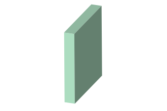 | [输出特征层](../../element/svg/task5-output-feature.svg) | Illustrator task5 source · 原作者未声明独立复用授权 | [D2L · AlexNet](../../architecture/d2l-alexnet/README.md) · [D2L · DenseNet 密集连接块](../../architecture/d2l-densenet-block/README.md) · [D2L · 全卷积网络](../../architecture/d2l-fcn/README.md) |
|  | [带噪潜变量块](../../element/svg/dit-noised-latent.svg) | DiT 原图部件 · CC-BY-4.0 | [DiT · 整体主干与三种条件注入模块](../../architecture/dit-architecture/README.md) |
|  | [类别输出列表](../../element/svg/vit-class-output.svg) | ViT 原图部件 · 作者保留权利 / 参考收录 | [ViT 原论文 · 图像分块、token 序列与编码器展开](../../architecture/vit-original-architecture/README.md) |
|  | [图像块嵌入模块](../../element/svg/vit-embedded-patches.svg) | ViT 原图部件 · 作者保留权利 / 参考收录 | [ViT 原论文 · 图像分块、token 序列与编码器展开](../../architecture/vit-original-architecture/README.md) |
