# 数据与文档

[返回 Element](../README.md) · [Teaser](../../teaser/README.md) · [Architecture](../../architecture/README.md) · [范例与元素对照表](../with-examples.md)

关联范例按表达功能互链；是否为原图拆件见对照表与元素来源记录。

| 预览 | 名称与 SVG | 来源与许可 | 关联范例（最多列三项） |
|---|---|---|---|
|  | [神经场论文图标](../../element/svg/towaki-neuralfieldpaper.svg) | Towaki CC0 · CC0-1.0 | — |
|  | [兔形图标](../../element/svg/towaki-bunny.svg) | Towaki CC0 · CC0-1.0 | — |
|  | [存储图标](../../element/svg/towaki-floppydisk.svg) | Towaki CC0 · CC0-1.0 | — |
|  | [特征表示堆叠](../../element/svg/rust-feature-stack.svg) | RUST 原图部件 · 原项目未发现独立图形授权；仅作出处明确的参考 | [CUT3R · 持久状态的更新、读取与未见视角推断](../../architecture/cut3r-architecture/README.md) · [D2L · 编码器—解码器](../../architecture/d2l-encoder-decoder/README.md) · [Genie · 视频 tokenizer、潜在动作与动力学模型](../../architecture/genie-architecture/README.md) |
|  | [单层特征块](../../element/svg/rust-feature-tile.svg) | RUST 原图部件 · 原项目未发现独立图形授权；仅作出处明确的参考 | [D2L · Transformer 编码器与解码器](../../architecture/d2l-transformer/README.md) · [D2L · Vision Transformer](../../architecture/d2l-vit/README.md) · [DiT · 整体主干与三种条件注入模块](../../architecture/dit-architecture/README.md) |
| 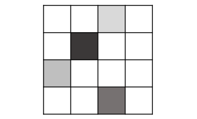 | [匹配相似度矩阵](../../element/svg/lightglue-assignment-matrix.svg) | LightGlue 原图部件 · Apache-2.0（LightGlue 来源仓库） | [BLIP-2 · Q-Former 与三种注意力掩码](../../architecture/blip2-qformer-architecture/README.md) · [CLIP Figure 1：训练到零样本预测](../../architecture/clip/README.md) · [D2L · 带注意力的 Seq2Seq](../../architecture/d2l-seq2seq-attention/README.md) |
|  | [数据库](../../element/svg/tabler-database.svg) | Tabler outline · MIT | [Cortex · 生物系统巩固与模型记忆巩固类比](../../teaser/cortex-memory-consolidation/README.md) · [HippoRAG · 普通 RAG、人类记忆与海马索引对照](../../teaser/hipporag-human-memory-comparison/README.md) · [LightMem · 原始记忆流水线与主题过滤、睡眠更新对照](../../teaser/lightmem-memory-construction-comparison/README.md) |
|  | [数据库导入](../../element/svg/tabler-database-import.svg) | Tabler outline · MIT | — |
|  | [数据库导出](../../element/svg/tabler-database-export.svg) | Tabler outline · MIT | — |
|  | [数据库检索](../../element/svg/tabler-database-search.svg) | Tabler outline · MIT | — |
|  | [表格](../../element/svg/tabler-table.svg) | Tabler outline · MIT | — |
|  | [文件](../../element/svg/tabler-file.svg) | Tabler outline · MIT | — |
|  | [文本文件](../../element/svg/tabler-file-text.svg) | Tabler outline · MIT | [LightMem · 原始记忆流水线与主题过滤、睡眠更新对照](../../teaser/lightmem-memory-construction-comparison/README.md) · [MemOS · 文本、激活与参数记忆的双向转化](../../teaser/memos-three-memory-consolidation-paths/README.md) · [AI4Research · 科学发现的五区流程总览](../../teaser/survey-ai4research-discovery-cycle/README.md) |
|  | [代码文件](../../element/svg/tabler-file-code.svg) | Tabler outline · MIT | — |
|  | [PDF 文件](../../element/svg/tabler-file-type-pdf.svg) | Tabler outline · MIT | — |
|  | [CSV 文件](../../element/svg/tabler-file-type-csv.svg) | Tabler outline · MIT | — |
|  | [多文件](../../element/svg/tabler-files.svg) | Tabler outline · MIT | — |
|  | [文件夹](../../element/svg/tabler-folder.svg) | Tabler outline · MIT | — |
|  | [多文件夹](../../element/svg/tabler-folders.svg) | Tabler outline · MIT | — |
|  | [图像](../../element/svg/tabler-photo.svg) | Tabler outline · MIT | [Uneven Double Refraction：原型与成像能力展示](../../teaser/birefractive-rgbd/README.md) · [CUT3R · 静态、动态与稀疏照片三类场景](../../teaser/cut3r-capabilities/README.md) · [DECOLLAGE：局部风格控制与三维细化](../../teaser/decollage/README.md) |
|  | [图像扫描](../../element/svg/tabler-photo-scan.svg) | Tabler outline · MIT | — |
|  | [视频](../../element/svg/tabler-video.svg) | Tabler outline · MIT | [CUT3R · 静态、动态与稀疏照片三类场景](../../teaser/cut3r-capabilities/README.md) · [Genie · 不同提示生成可交互世界](../../teaser/genie-interaction/README.md) · [SAM 2 · 任务、模型与数据引擎三联概念图](../../teaser/sam2-task-model-data/README.md) |
|  | [音频](../../element/svg/tabler-music.svg) | Tabler outline · MIT | — |
|  | [麦克风](../../element/svg/tabler-microphone.svg) | Tabler outline · MIT | — |
|  | [正弦信号](../../element/svg/tabler-wave-sine.svg) | Tabler outline · MIT | [AI for PDEs · 物理与数据条件下的三类方法对照](../../teaser/survey-ai-pde-physics-data-paradigms/README.md) · [AI for PDEs · 领域定位、方法与应用全景](../../teaser/survey-ai-pde-scope-map/README.md) · [AI4Science 领域圆环 · 从量子到连续系统](../../teaser/survey-ai4science-domain-wheel/README.md) |
| 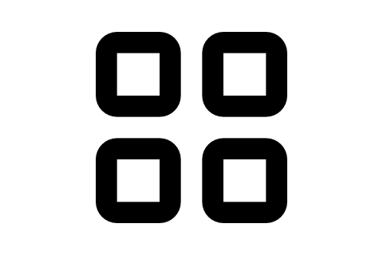 | [四格网格](../../element/svg/tabler-layout-grid.svg) | Tabler outline · MIT | — |
|  | [点阵](../../element/svg/tabler-grid-dots.svg) | Tabler outline · MIT | [PINN 综述 · 问题、损失与优化的多子图全景](../../teaser/survey-piml-optimization-landscape/README.md) · [LightMem · 感觉过滤、主题记忆与睡眠更新三面板](../../architecture/lightmem-sensory-topic-sleep-framework/README.md) |
|  | [二进制](../../element/svg/tabler-binary.svg) | Tabler outline · MIT | — |
|  | [条形码](../../element/svg/tabler-barcode.svg) | Tabler outline · MIT | — |
|  | [二维码](../../element/svg/tabler-qrcode.svg) | Tabler outline · MIT | — |
|  | [文本](../../element/svg/tabler-text-size.svg) | Tabler outline · MIT | — |
|  | [语言](../../element/svg/tabler-language.svg) | Tabler outline · MIT | — |
|  | [书籍](../../element/svg/tabler-book.svg) | Tabler outline · MIT | [3DGS 综述路线图 · 双侧分类地图](../../teaser/survey-3dgs-review-map/README.md) · [语言模型四代能力演进 · 阶梯式概念图](../../teaser/survey-lm-capability-evolution/README.md) |
| 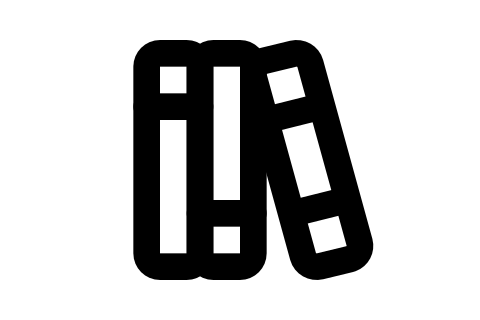 | [多本书](../../element/svg/tabler-books.svg) | Tabler outline · MIT | — |
|  | [剪贴板](../../element/svg/tabler-clipboard.svg) | Tabler outline · MIT | — |
|  | [Document](../../element/svg/bioicons-document.svg) | Bioicons · CC0-1.0 | — |
|  | [Image](../../element/svg/bioicons-image.svg) | Bioicons · CC0-1.0 | — |
|  | [独热编码](../../element/svg/bioicons-onehotencoding.svg) | Bioicons · CC0-1.0 | — |
|  | [database-colored](../../element/svg/bioicons-database-colored.svg) | Bioicons · CC0-1.0 | — |
|  | [数据库](../../element/svg/bioicons-database.svg) | Bioicons · CC0-1.0 | — |
|  | [书籍](../../element/svg/bioicons-book.svg) | Bioicons · CC-BY-3.0 | — |
|  | [labbook](../../element/svg/bioicons-labbook.svg) | Bioicons · CC-BY-3.0 | — |
|  | [notepad](../../element/svg/bioicons-notepad.svg) | Bioicons · CC-BY-3.0 | — |
|  | [pencil](../../element/svg/bioicons-pencil.svg) | Bioicons · CC-BY-3.0 | [MemOS · LLM 记忆、人类类比与可管理记忆三阶段](../../teaser/memos-memory-evolution-three-stages/README.md) |
| 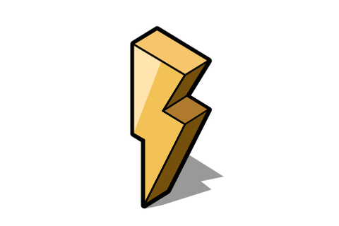 | [缓存](../../element/svg/isoflow-cache.svg) | Isoflow · MIT | — |
|  | [文档](../../element/svg/isoflow-document.svg) | Isoflow · MIT | — |
|  | [图像文件](../../element/svg/isoflow-image.svg) | Isoflow · MIT | — |
|  | [邮件](../../element/svg/isoflow-mail.svg) | Isoflow · MIT | — |
|  | [队列](../../element/svg/isoflow-queue.svg) | Isoflow · MIT | — |
|  | [对话气泡](../../element/svg/isoflow-speech.svg) | Isoflow · MIT | — |
|  | [存储](../../element/svg/isoflow-storage.svg) | Isoflow · MIT | — |
|  | [输入特征层](../../element/svg/task5-input-feature.svg) | Illustrator task5 source · 原作者未声明独立复用授权 | [多尺度网络总览与模块展开](../../architecture/multiscale-network/README.md) |
|  | [多尺度特征堆叠](../../element/svg/task5-feature-pyramid.svg) | Illustrator task5 source · 原作者未声明独立复用授权 | [MVSplat · 重建质量、速度与参数量的并列对照](../../teaser/mvsplat-comparison/README.md) · [VAR · 从逐 token 到逐尺度生成的范式对照](../../teaser/var-paradigm/README.md) · [Instant NGP · 多分辨率哈希编码到 MLP](../../architecture/instant-ngp-hash-architecture/README.md) |
|  | [多通道彩色张量](../../element/svg/task5-rgb-tensor.svg) | Illustrator task5 source · 原作者未声明独立复用授权 | [VAR · 从逐 token 到逐尺度生成的范式对照](../../teaser/var-paradigm/README.md) · [D2L · AlexNet](../../architecture/d2l-alexnet/README.md) · [D2L · DenseNet 密集连接块](../../architecture/d2l-densenet-block/README.md) |
|  | [输出特征层](../../element/svg/task5-output-feature.svg) | Illustrator task5 source · 原作者未声明独立复用授权 | [D2L · AlexNet](../../architecture/d2l-alexnet/README.md) · [D2L · DenseNet 密集连接块](../../architecture/d2l-densenet-block/README.md) · [D2L · 全卷积网络](../../architecture/d2l-fcn/README.md) |
|  | [带噪潜变量块](../../element/svg/dit-noised-latent.svg) | DiT 原图部件 · CC-BY-4.0 | [DiT · 整体主干与三种条件注入模块](../../architecture/dit-architecture/README.md) |
|  | [类别输出列表](../../element/svg/vit-class-output.svg) | ViT 原图部件 · 作者保留权利 / 参考收录 | [ViT 原论文 · 图像分块、token 序列与编码器展开](../../architecture/vit-original-architecture/README.md) |
| 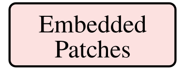 | [图像块嵌入模块](../../element/svg/vit-embedded-patches.svg) | ViT 原图部件 · 作者保留权利 / 参考收录 | [ViT 原论文 · 图像分块、token 序列与编码器展开](../../architecture/vit-original-architecture/README.md) |
|  | [工作记忆与 Token 组](../../element/svg/memoryvla-working-memory.svg) | MemoryVLA 原图部件 · 作者保留权利 / 私有参考 | [MemoryVLA · 人类记忆类比、方法与性能首图](../../teaser/memoryvla-cognition-memory-action/README.md) · [MemoryVLA · 感知认知记忆库与扩散动作网络](../../architecture/memoryvla-perceptual-cognitive-architecture/README.md) |
|  | [层叠记忆条目](../../element/svg/memoryvla-memory-stack.svg) | MemoryVLA 原图部件 · 作者保留权利 / 私有参考 | [MemoryVLA · 人类记忆类比、方法与性能首图](../../teaser/memoryvla-cognition-memory-action/README.md) · [MemoryVLA · 感知认知记忆库与扩散动作网络](../../architecture/memoryvla-perceptual-cognitive-architecture/README.md) |
|  | [时间步嵌入菱形](../../element/svg/memoryvla-timestep-diamond.svg) | MemoryVLA 原图部件 · 作者保留权利 / 私有参考 | [MemoryVLA · 感知认知记忆库与扩散动作网络](../../architecture/memoryvla-perceptual-cognitive-architecture/README.md) |
| 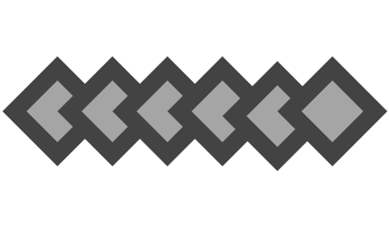 | [CSI 菱形输入序列](../../element/svg/wireless-csi-input.svg) | 无线感知综述原图部件 · 作者保留权利 / 私有参考 | [无线生成式 AI · 城市场景串联四类应用](../../teaser/survey-genai-wireless-four-scenarios/README.md) |
|  | [知识查询 Q 标记](../../element/svg/spec-rag-query.svg) | Speculative RAG 原图部件 · 作者保留权利 / 私有参考 | [Speculative RAG · 并行起草与通用模型验证](../../architecture/speculative-rag-draft-verify/README.md) |
|  | [证据支持答案 A 标记](../../element/svg/spec-rag-answer.svg) | Speculative RAG 原图部件 · 作者保留权利 / 私有参考 | [Speculative RAG · 并行起草与通用模型验证](../../architecture/speculative-rag-draft-verify/README.md) |
|  | [同主题检索文档组](../../element/svg/spec-rag-topic-documents.svg) | Speculative RAG 原图部件 · 作者保留权利 / 私有参考 | [Speculative RAG · 并行起草与通用模型验证](../../architecture/speculative-rag-draft-verify/README.md) |
|  | [答案与依据配对标记](../../element/svg/spec-rag-answer-rationale.svg) | Speculative RAG 原图部件 · 作者保留权利 / 私有参考 | [Speculative RAG · 并行起草与通用模型验证](../../architecture/speculative-rag-draft-verify/README.md) |
|  | [图谱检索文档图标](../../element/svg/hipporag2-passage.svg) | HippoRAG 2 原图部件 · 作者保留权利 / 私有参考 | [HippoRAG 2 · 图谱索引、筛选与检索双阶段](../../architecture/hipporag2-indexing-retrieval-framework/README.md) · [Speculative RAG · 并行起草与通用模型验证](../../architecture/speculative-rag-draft-verify/README.md) |
| 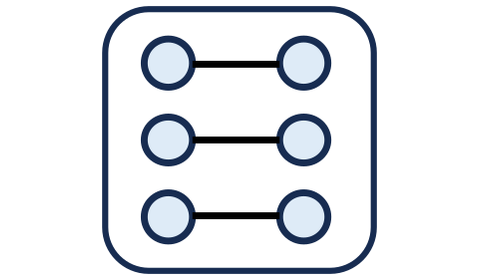 | [三元组关系表](../../element/svg/hipporag2-triples.svg) | HippoRAG 2 原图部件 · 作者保留权利 / 私有参考 | [HippoRAG 2 · 图谱索引、筛选与检索双阶段](../../architecture/hipporag2-indexing-retrieval-framework/README.md) |
|  | [单层知识图谱节点组](../../element/svg/hipporag2-knowledge-graph.svg) | HippoRAG 2 原图部件 · 作者保留权利 / 私有参考 | [HippoRAG 2 · 图谱索引、筛选与检索双阶段](../../architecture/hipporag2-indexing-retrieval-framework/README.md) |
| 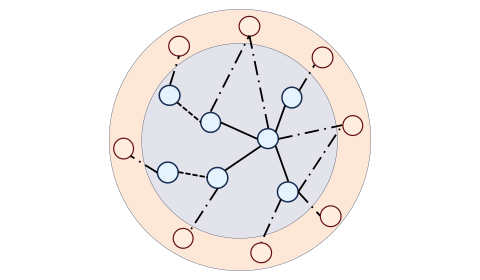 | [短语与文档双层图谱](../../element/svg/hipporag2-heterogeneous-graph.svg) | HippoRAG 2 原图部件 · 作者保留权利 / 私有参考 | [HippoRAG 2 · 图谱索引、筛选与检索双阶段](../../architecture/hipporag2-indexing-retrieval-framework/README.md) |
| 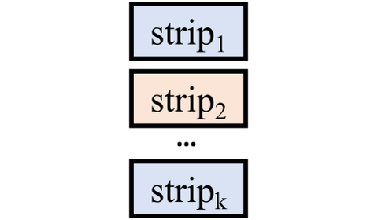 | [分解后的文档条带](../../element/svg/crag-document-strips.svg) | CRAG 原图部件 · 作者保留权利 / 私有参考 | [CRAG · 评估分流、知识纠正与三路生成](../../architecture/crag-evaluate-correct-generate/README.md) |
| 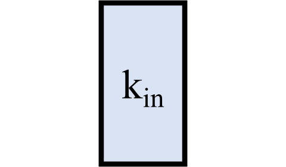 | [内部知识块 k-in](../../element/svg/crag-internal-knowledge.svg) | CRAG 原图部件 · 作者保留权利 / 私有参考 | [CRAG · 评估分流、知识纠正与三路生成](../../architecture/crag-evaluate-correct-generate/README.md) |
| 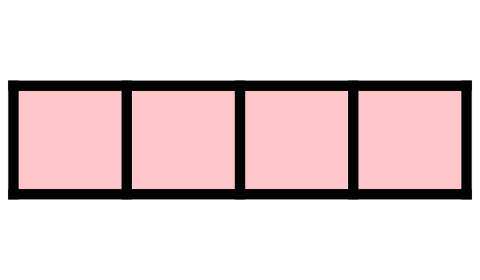 | [查询嵌入向量条](../../element/svg/amem-embedding-vector.svg) | A-MEM 原图部件 · 作者保留权利 / 私有参考 | [A-MEM · 笔记构建、关联、演化与检索四分区](../../architecture/amem-notes-links-evolution-framework/README.md) · [FlashTrace · 片段归因与多跳递归追踪](../../architecture/flashtrace-span-recursive-attribution/README.md) · [GrAInS · 归因、PCA 与推理时引导](../../architecture/grains-attribution-steering-pipeline/README.md) |
|  | [带信号的文档符号](../../element/svg/security-signal-document.svg) | 无线安全综述原图部件 · 作者保留权利 / 私有参考 | [无线生成式 AI · 城市场景串联四类应用](../../teaser/survey-genai-wireless-four-scenarios/README.md) · [GenAI 无线安全 · 四场景与局部机制并列](../../teaser/survey-genai-wireless-security-four-panels/README.md) |
| 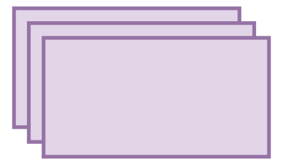 | [多层特征图堆叠](../../element/svg/security-feature-stack.svg) | 无线安全综述原图部件 · 作者保留权利 / 私有参考 | [无线生成式 AI · 城市场景串联四类应用](../../teaser/survey-genai-wireless-four-scenarios/README.md) · [GenAI 无线安全 · 四场景与局部机制并列](../../teaser/survey-genai-wireless-security-four-panels/README.md) |
