# 设备与对象

[返回 Element](../README.md) · [Teaser](../../teaser/README.md) · [Architecture](../../architecture/README.md) · [范例与元素对照表](../with-examples.md)

关联范例按表达功能互链；是否为原图拆件见对照表与元素来源记录。

| 预览 | 名称与 SVG | 来源与许可 | 关联范例（最多列三项） |
|---|---|---|---|
| 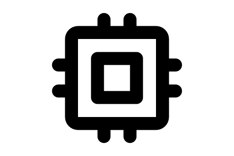 | [CPU](../../element/svg/tabler-cpu.svg) | Tabler outline · MIT | — |
| 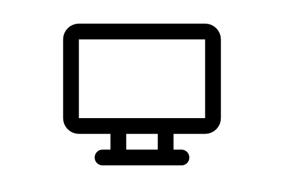 | [台式电脑](../../element/svg/tabler-device-desktop.svg) | Tabler outline · MIT | [AI4Research · 三大领域、七类应用面板](../../teaser/survey-ai4research-seven-domains/README.md) · [可微仿真综述 · 十二个场景的双排时间线](../../teaser/survey-diffsim-twelve-scenes/README.md) · [GenAI 网络管理 · 控制面、数据面与切片场景](../../teaser/survey-genai-network-management-scenes/README.md) |
| 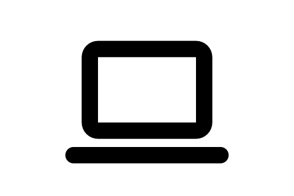 | [笔记本电脑](../../element/svg/tabler-device-laptop.svg) | Tabler outline · MIT | — |
| 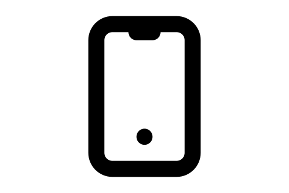 | [手机](../../element/svg/tabler-device-mobile.svg) | Tabler outline · MIT | [GenAI × IoT · 分层技术栈与多场景应用](../../teaser/survey-genai-iot-layers-scenes/README.md) · [无线生成式 AI · 城市场景串联四类应用](../../teaser/survey-genai-wireless-four-scenarios/README.md) |
| 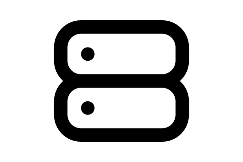 | [服务器](../../element/svg/tabler-server.svg) | Tabler outline · MIT | — |
| 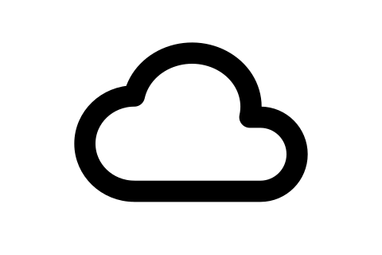 | [云](../../element/svg/tabler-cloud.svg) | Tabler outline · MIT | — |
| 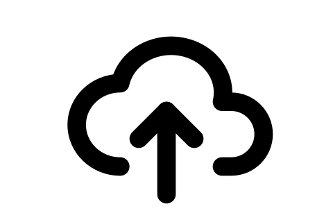 | [上传云端](../../element/svg/tabler-cloud-upload.svg) | Tabler outline · MIT | — |
| 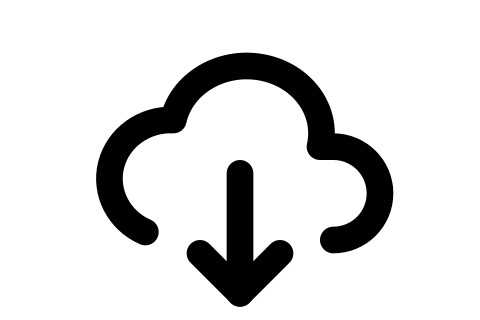 | [云端下载](../../element/svg/tabler-cloud-download.svg) | Tabler outline · MIT | — |
| 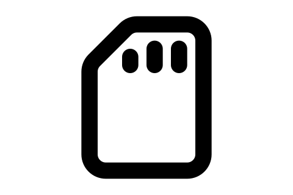 | [存储卡](../../element/svg/tabler-device-sd-card.svg) | Tabler outline · MIT | — |
| 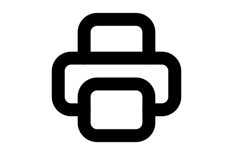 | [打印机](../../element/svg/tabler-printer.svg) | Tabler outline · MIT | — |
| 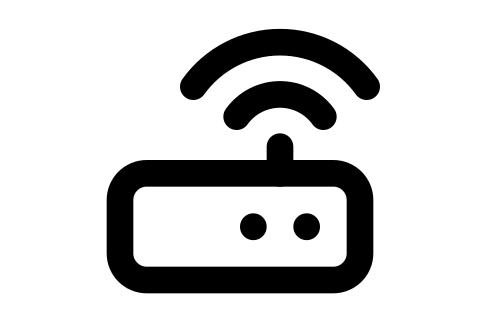 | [路由器](../../element/svg/tabler-router.svg) | Tabler outline · MIT | — |
| 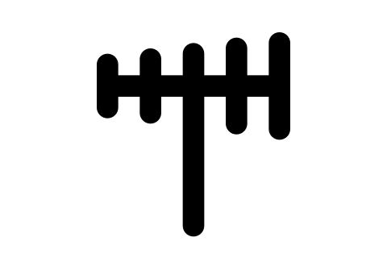 | [天线](../../element/svg/tabler-antenna.svg) | Tabler outline · MIT | — |
| 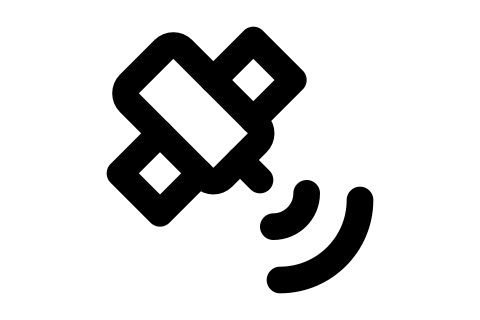 | [卫星](../../element/svg/tabler-satellite.svg) | Tabler outline · MIT | — |
| 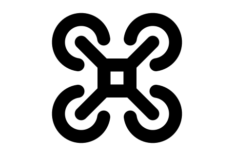 | [无人机](../../element/svg/tabler-drone.svg) | Tabler outline · MIT | — |
|  | [相机](../../element/svg/tabler-camera.svg) | Tabler outline · MIT | [3DETR · 输入点云、注意力与检测结果的对应](../../teaser/3detr-attention-teaser/README.md) · [Uneven Double Refraction：原型与成像能力展示](../../teaser/birefractive-rgbd/README.md) · [CUT3R · 静态、动态与稀疏照片三类场景](../../teaser/cut3r-capabilities/README.md) |
| 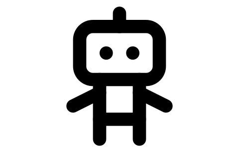 | [机器人](../../element/svg/tabler-robot.svg) | Tabler outline · MIT | [MemoryVLA · 人类记忆类比、方法与性能首图](../../teaser/memoryvla-cognition-memory-action/README.md) · [AI4Research · 科学发现的五区流程总览](../../teaser/survey-ai4research-discovery-cycle/README.md) · [AI4Research · 五类科研活动的多区总览](../../teaser/survey-ai4research-five-activities/README.md) |
| 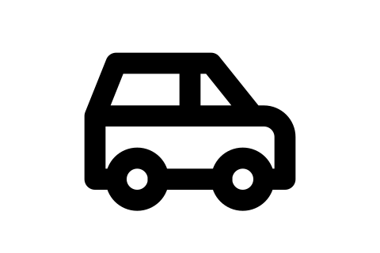 | [汽车](../../element/svg/tabler-car.svg) | Tabler outline · MIT | [3D／4D 世界模型 · 场景与研究维度全景](../../teaser/survey-3d4d-world-overview/README.md) · [LAV：感知、预测与驾驶控制流程](../../architecture/lav/README.md) |
| 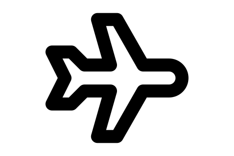 | [飞机](../../element/svg/tabler-plane.svg) | Tabler outline · MIT | — |
| 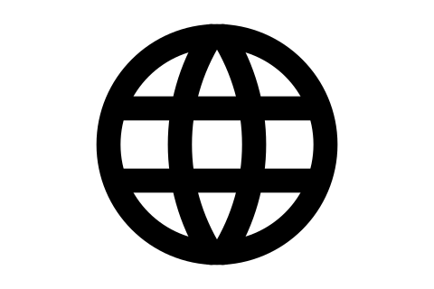 | [地球](../../element/svg/tabler-world.svg) | Tabler outline · MIT | [3DGS 应用全景 · 中心主题与场景分支](../../teaser/survey-3dgs-application-landscape/README.md) · [Agent 社会场景 · 综述概念 teaser](../../teaser/survey-agent-society-teaser/README.md) · [科学大模型综述 · 六学科环形问答总览](../../teaser/survey-scillm-six-domain-examples/README.md) |
| 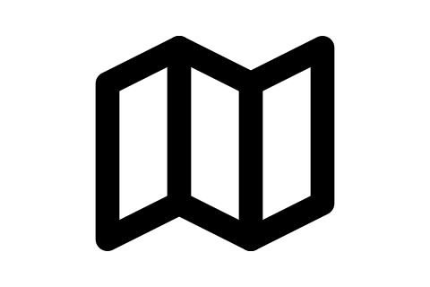 | [地图](../../element/svg/tabler-map.svg) | Tabler outline · MIT | [OrienterNet：用二维地图定位的任务与动机](../../teaser/orienternet/README.md) · [VoxPoser · 开抽屉并绕开花瓶的轨迹规划](../../architecture/voxposer-drawer-value-map-planning/README.md) |
| 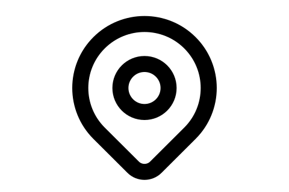 | [定位](../../element/svg/tabler-map-pin.svg) | Tabler outline · MIT | [OrienterNet：用二维地图定位的任务与动机](../../teaser/orienternet/README.md) |
| 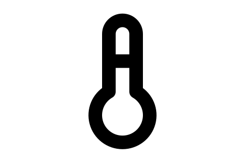 | [温度](../../element/svg/tabler-temperature.svg) | Tabler outline · MIT | — |
| 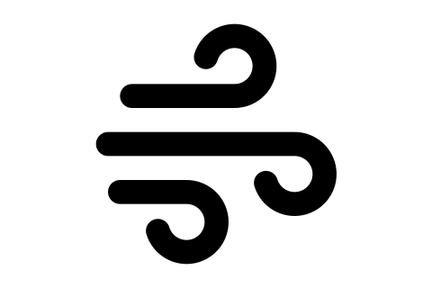 | [风场符号](../../element/svg/tabler-wind.svg) | Tabler outline · MIT | — |
| 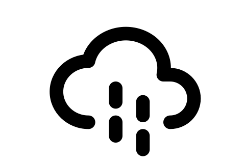 | [降雨](../../element/svg/tabler-cloud-rain.svg) | Tabler outline · MIT | — |
|  | [闪电](../../element/svg/tabler-bolt.svg) | Tabler outline · MIT | — |
| 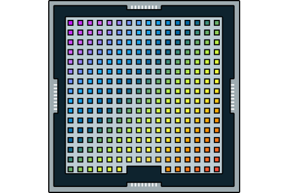 | [CPU](../../element/svg/bioicons-cpu.svg) | Bioicons · CC0-1.0 | — |
| 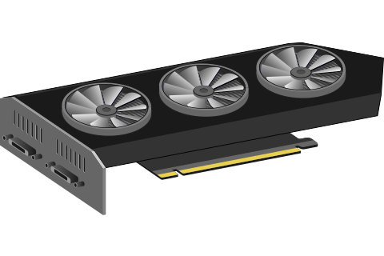 | [三维 GPU](../../element/svg/bioicons-gpu-3d.svg) | Bioicons · CC0-1.0 | — |
| 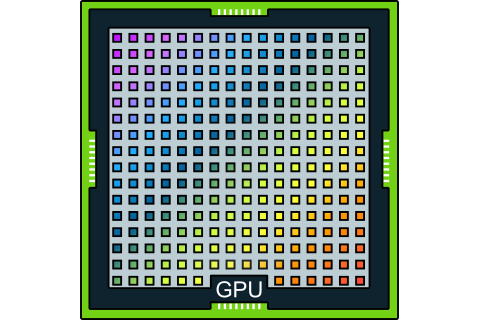 | [GPU](../../element/svg/bioicons-gpu.svg) | Bioicons · CC0-1.0 | — |
| 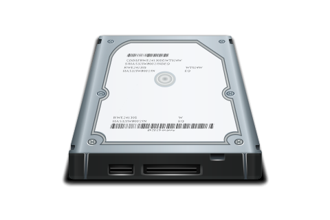 | [硬盘](../../element/svg/bioicons-hdd.svg) | Bioicons · CC0-1.0 | — |
| 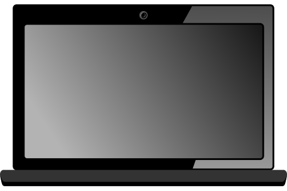 | [笔记本电脑](../../element/svg/bioicons-laptop.svg) | Bioicons · CC0-1.0 | — |
| 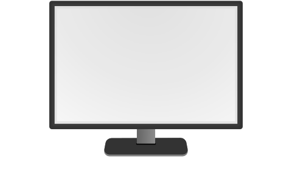 | [显示器](../../element/svg/bioicons-screen.svg) | Bioicons · CC0-1.0 | — |
| 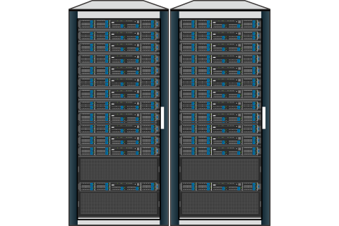 | [超级计算机](../../element/svg/bioicons-supercomputer.svg) | Bioicons · CC0-1.0 | — |
| 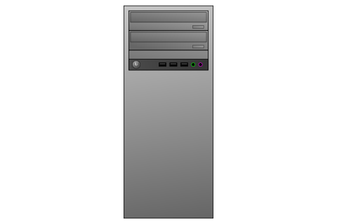 | [工作站](../../element/svg/bioicons-workstation.svg) | Bioicons · CC0-1.0 | — |
| 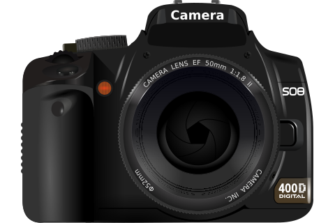 | [相机](../../element/svg/bioicons-camera.svg) | Bioicons · CC0-1.0 | — |
| 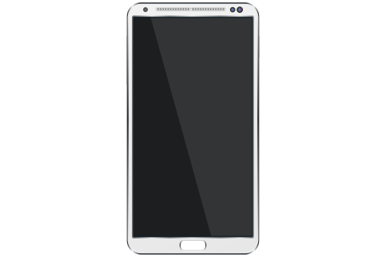 | [smartphone](../../element/svg/bioicons-smartphone.svg) | Bioicons · CC0-1.0 | — |
| 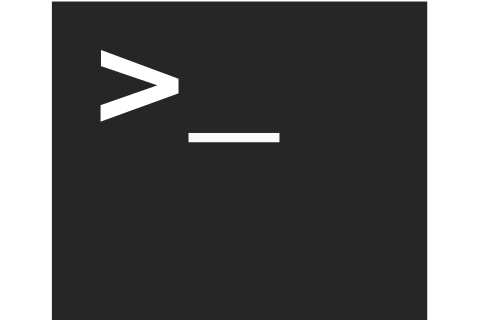 | [terminal](../../element/svg/bioicons-terminal.svg) | Bioicons · CC0-1.0 | — |
| 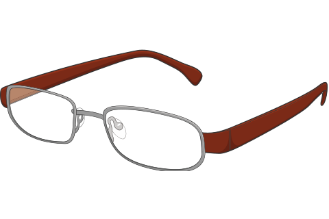 | [glasses](../../element/svg/bioicons-glasses.svg) | Bioicons · CC-BY-3.0 | — |
| 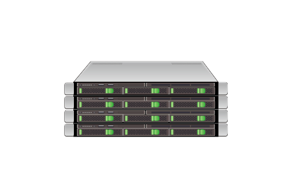 | [Server rack](../../element/svg/bioicons-server-rack.svg) | Bioicons · CC-BY-4.0 | — |
| 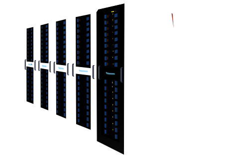 | [serverroom](../../element/svg/bioicons-serverroom.svg) | Bioicons · CC-BY-4.0 | — |
| 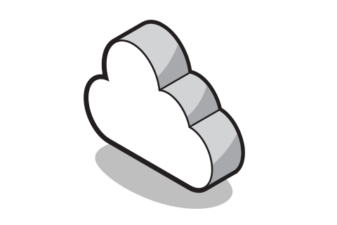 | [云](../../element/svg/isoflow-cloud.svg) | Isoflow · MIT | — |
| 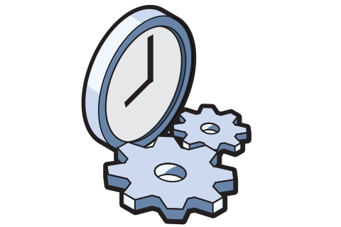 | [定时任务](../../element/svg/isoflow-cronjob.svg) | Isoflow · MIT | — |
| 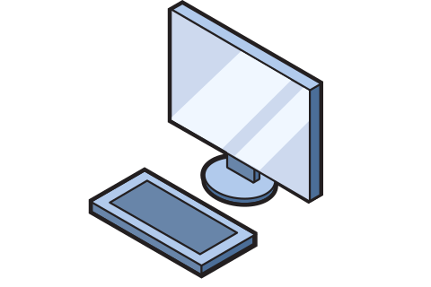 | [台式电脑](../../element/svg/isoflow-desktop.svg) | Isoflow · MIT | — |
| 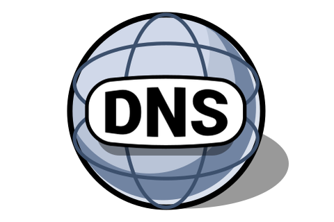 | [DNS](../../element/svg/isoflow-dns.svg) | Isoflow · MIT | — |
|  | [防火墙](../../element/svg/isoflow-firewall.svg) | Isoflow · MIT | — |
| 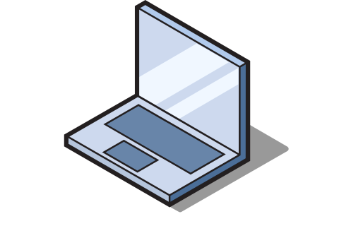 | [笔记本电脑](../../element/svg/isoflow-laptop.svg) | Isoflow · MIT | — |
| 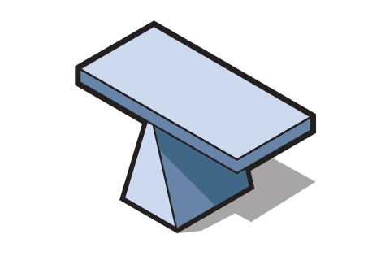 | [负载均衡](../../element/svg/isoflow-loadbalancer.svg) | Isoflow · MIT | — |
|  | [锁定](../../element/svg/isoflow-lock.svg) | Isoflow · MIT | — |
| 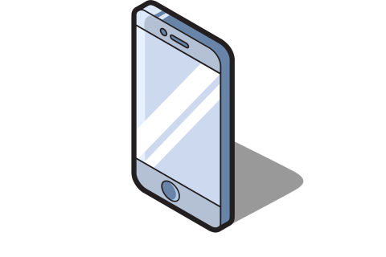 | [移动设备](../../element/svg/isoflow-mobiledevice.svg) | Isoflow · MIT | — |
| 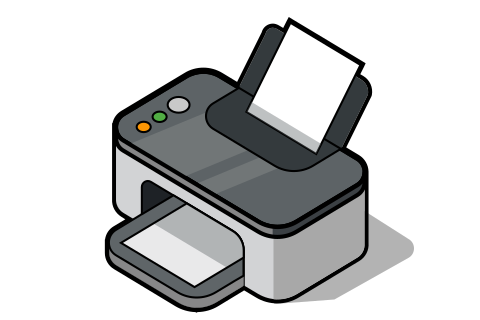 | [打印机](../../element/svg/isoflow-printer.svg) | Isoflow · MIT | — |
| 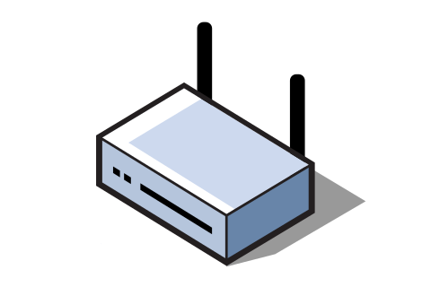 | [路由器](../../element/svg/isoflow-router.svg) | Isoflow · MIT | — |
| 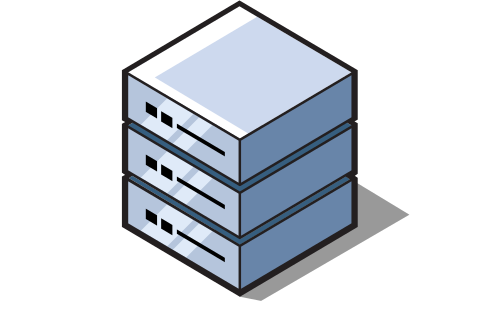 | [服务器](../../element/svg/isoflow-server.svg) | Isoflow · MIT | — |
| 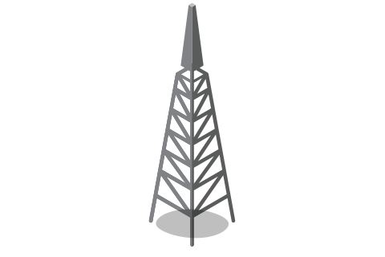 | [信号塔](../../element/svg/isoflow-tower.svg) | Isoflow · MIT | — |
| 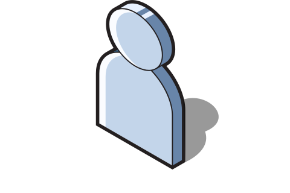 | [用户](../../element/svg/isoflow-user.svg) | Isoflow · MIT | — |
| 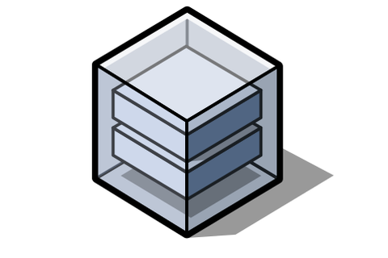 | [虚拟机](../../element/svg/isoflow-vm.svg) | Isoflow · MIT | — |
